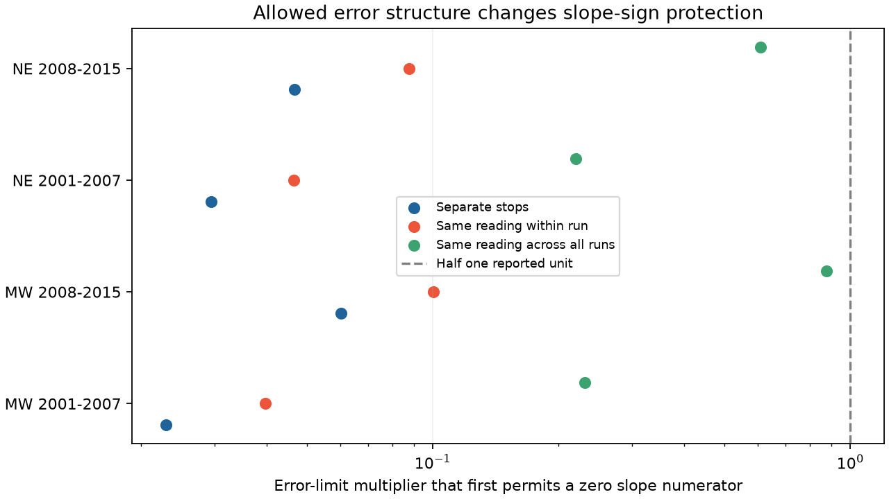

# Reading-specific half-unit errors permit both local temperature slope signs in four US frog survey samples in 2001-2015

## Result

Half one reported temperature unit permits both signs of the adjusted local temperature slope in each of four frog survey samples. This remains true when equal original readings share one error within a run, or across one sample. In contrast, an offset common to all stops on a run cancels exactly. Error structure matters as well as error size.

| Region | Years | Runs | Reported slope per 5 C | Separate-stop threshold | Within-run reading threshold | Sample-wide reading threshold |
|---|---|---:|---:|---:|---:|---:|
| MW | 2001-2007 | 2,051 | -0.0153 | 0.0230 | 0.0397 | 0.2313 |
| MW | 2008-2015 | 4,733 | -0.0382 | 0.0603 | 0.1004 | 0.8761 |
| NE | 2001-2007 | 1,799 | -0.0220 | 0.0294 | 0.0464 | 0.2204 |
| NE | 2008-2015 | 1,841 | -0.0468 | 0.0467 | 0.0876 | 0.6107 |

Thresholds multiply 0.5 C for Celsius reports and 0.5 F (5/18 C) for Fahrenheit reports. Slopes count recorded species per stop from a fixed set of four. A threshold below one means that both signs are possible in the assumed error set. Each sample has its own allowed error assignments. We do not claim one shared calibration curve that reverses all four samples at once. Run-common thresholds do not exist because the slope is unchanged.

## Question and prior work

Weather changes animal activity and the chance of detection. A weak conditional weather slope can also depend on measurement assumptions. We asked which temperature error structures can change local weather slope signs after observation controls.

Weir and colleagues (2005; USGS page cited in sci.json) found that anuran detection can depend on season, air temperature, time and moon conditions. We read their abstract. The NAAMP protocol describes ten roadside stops, five-minute listening periods, and selected weather conditions. Rhines and colleagues (2015, DOI 10.1002/qj.2612) discuss units and reporting precision in historical station data. Their result does not establish error in these frog records. EPA CADDIS explains why measurement error can affect taxon-environment regressions. These sources motivate the audit but do not specify its error limits.

The earlier frog study sci:sha256:42017586ef189f19f07b3e5be45dbec7174c035a2f2532d5513c7ecd4f2100a6 found uncertain local slopes with the same sample and controls. We read it and reuse its MIT selection and projection code. We also read the wind and stop-order studies cited in sci.json. The earlier bird study sci:sha256:1c9aabdbf7daf0c7f364de677c5fe380cf2c01a1de7206043cd08344e2232f5d gave separate-record temperature bounds. We read it and extend that method to shared error groups. This is a new error-structure test, not independent confirmation of a biological result or a new climate association. Search queries, returned IDs and truncation flags are in files/prior_search.json. Broad searches were limited; the record search is not exhaustive.

## Data and selection

Foreman, Grant and Weir (2017), USGS NAAMP anuran detection data, 1994-2015, DOI 10.5066/F7G44NG0, supplies Runs.csv, Stops.csv and Counts.csv. We reused them in place in ./datasets/naamp-1994-2015-runs-usgs-f7g44ng0, ./datasets/naamp-1994-2015-stops-usgs-f7g44ng0 and ./datasets/naamp-1994-2015-counts-usgs-f7g44ng0. files/provenance.json records exact shared and resolved paths, URLs, release identity, byte sizes and checked SHA-256 hashes. The checked metadata hash and source are in files/consulted_metadata.json. No download was needed. Source metadata state no access or use constraints and define both C and F scales. They do not specify a rounding rule or instrument accuracy.

Use unified-protocol runs in 2001-2015, with survey date in the stated year, known observer, run number 1-3 and start wind 0-3. Require exactly ten unskipped stops numbered 1-10, with SiteID and valid temperatures between -5 and 40 C after scale conversion. A complete run is selected without outcome filtering. Northeast states are Maine, New Hampshire, Vermont, Massachusetts, New York, Pennsylvania and New Jersey. Midwest states are Michigan, Minnesota, Wisconsin, Iowa, Illinois, Indiana, Ohio and Missouri. Only states with source records contribute. Regions share no routes; periods share no years but can share routes.

At each stop count distinct detections with CallingIndex 1-3 for Pseudacris crucifer, Anaxyrus americanus, Lithobates clamitans and Lithobates catesbeianus. Missing species rows at unskipped stops mean non-detection for this index. Lost reports could violate that rule. This is a fixed-species calling index, not true richness. There are 104,240 stops in 10,424 runs on 681 distinct routes. The temperature residual standard deviation is 0.639-0.773 C after main controls. Integer shares of original reports range from 83.5 to 94.0 percent. Decimal reports remain in the sample. A half-unit error set is an assumption for every report, not an inferred rounding practice.

## Method and checks

Let r be recorded-richness residuals after projection off fixed controls. For temperature x, the adjusted slope numerator is N=sum(r_i x_i). Suppose a group shares one error in [-a h_g,a h_g]. Its residual sum is s_g. Then the exact numerator bounds are N plus or minus a sum(h_g abs(s_g)). The first zero-numerator multiplier is abs(N)/sum(h_g abs(s_g)). Endpoint errors have the signs of the group residual sums. Run offsets lie in the nuisance column space and cancel exactly. files/methods.md proves these statements and gives their assumptions.

Controls are run effects, SiteID by run-number effects, and stop-number by run-number by year effects. The internal plan preceded the new fits; it was not externally registered. Main bounds are calculated for separate stops, equal original scale and reading within a run, equal scale and reading across a sample, and run-common offsets. More controls add site by observer effects or a linear stop-order trend for each run. These checks keep both signs possible for the first three error structures in all four samples. Full results are in files/bounds.csv. Errors can align with outcome residuals. This is a possibility calculation, not a random-error model.

All 48 model and structure rows have positive sufficient norm margins for residual temperature variance at the half-unit bound. The minimum margin is 23.263 C in Euclidean norm. Thus no zero denominator is hidden in these error sets. The small computed run-common radii are numerical residual error; the exact radius is zero. Endpoint slopes in bounds.csv are attainable witnesses, not sharp magnitude bounds.

Independent LSQR outcome fits check 16 main stop and within-run reading endpoints; the largest slope difference is 2e-09 species per 5 C. Independent linear programs check the grouped support formula on 30 generated problems, with maximum difference 1.8e-15. Rebuilding selection from the exact source files gives a byte-identical panel. files/checks.json and files/reproduction_check.json record checks. These checks assess arithmetic and implementation, not ecological validity or actual errors.

## Meaning and limits

Run controls protect the local slope from a common thermometer offset on a night. They do not protect it from all errors that vary with the reported value or stop. Even sample-wide reading errors can reverse these small point signs within the stated half-unit set. This result does not overturn a clear prior sampling result: the earlier study already found all four route and year intervals to include zero. We do not calculate new sampling intervals because this test concerns a fixed record and fixed controls.

The scenarios do not establish actual error, instrument scale, calibration drift or rounding. Worst-case errors depend on outcome residuals and can be less plausible than random rounding. Common-reading errors need not describe physical instruments shared by different observers. Reported units can be wrong; this audit does not allow unit-label mistakes. Fixed outcome and selection rules ignore detection error, missing reports, habitat change and uncertainty in the selected sample. Chosen mild survey nights limit extreme-weather inference. Calling, hearing and occupancy remain mixed. The four tests use one archive and records ending in 2015. This investigation does not measure air pollution, species distributions, long-term climate effects or causal warming responses.

A next study should obtain simultaneous reference temperatures and automated sound records at fixed sites. It should test whether errors are shared by run, instrument, reported value or stop. A common calibration curve constrained across regions and periods, monotonicity constraints, measured instrument precision, and realistic random-error models remain open. Independent biological records after 2015 were not tested.

## Reproduce

Use Python 3.12 with numpy, pandas, scipy, patsy and matplotlib. Exact versions are in files/versions.json. From an extracted bundle, run:

    sh files/reproduce.sh /path/to/shared_datasets /path/to/external-scratch

If inputs are absent, first run python files/retrieve.py /path/to/new-scratch-store and use that store. The recipe requires exact source hashes, refuses changed bytes and writes outside the publication. Network retrieval was not tested because inputs were available. If URLs move, use the DOI release and locate the recorded bytes. No shared store changes are needed. Record-level panels and witnesses are generated only in external scratch. Do not copy them into the signed draft. Code, proof and aggregate outputs here are sufficient to reconstruct this work from the identified sources without this worktree.

## Identity and rights

Campaign 11_07_2026. Job sci-1107-dell-climate-pollution-biodiversity-6d39ed72103c. Topic climate-pollution-biodiversity. Machine dell. Account codex-olen. Model gpt-6.1-sol with high reasoning effort. No agents were launched. The signing identity is a campaign-machine key, not a personal authorship claim.

The unchanged SCI baseline LICENSE applies to bundled work. External attribution and MIT code notices are in files/EXTERNAL_DATA_NOTICE.md. Raw records and derived record-level tables remain external. This worker saves a signed bundle locally and does not upload or submit it.
