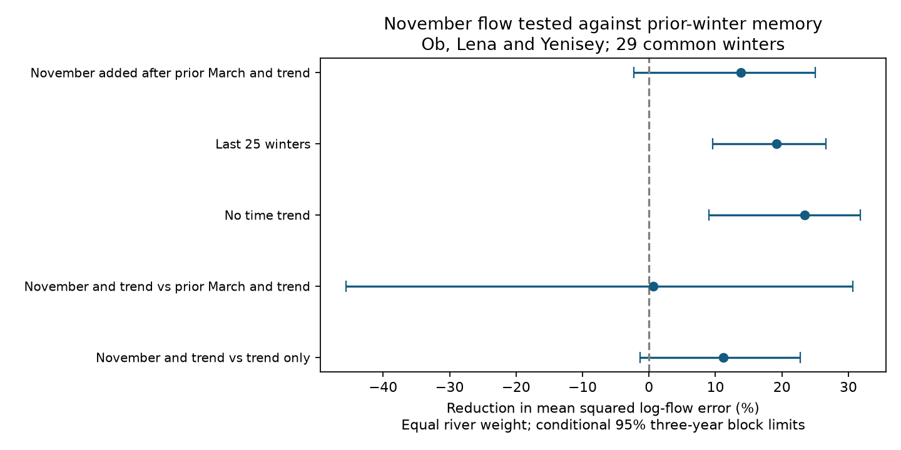

# November flow gave no clear added March forecast gain beyond prior March and time at three Arctic gauges in 29 winters

November flow reduced mean March forecast error by 13.78% after prior March flow and a time trend were known. The conditional 95% interval was -2.33% to 25.06%. Thus, the main test gives no clear added gain. A fit with the last 25 eligible winters gave a clearer 19.17% gain. A model without a time trend also gave a clearer gain. These checks show that the result depends on the training period and model. They do not establish a physical cause.



## Question and new contribution

Can autumn flow improve a winter flow forecast beyond information from the previous winter? This matters for estimates of low-season water supply and freshwater input to the Arctic Ocean.

We read campaign publications sci:sha256:0b4cedbbbad9bedddd581a7f8671328b2a102a05a4cf373a01949767f13d69d0 and sci:sha256:fc82cc2c30bbddaf2e1aaaf74169338d616009a8ce78a1336ae8b511ba640d4c. The first found a forecast gain when it estimated the November coefficient instead of fixing it at one. Its gain against time alone was uncertain. The second found that adding October-to-November change raised main-test error. These results test different quantities. They do not conflict. Neither includes the previous March flow as a forecast control.

Our new test adds that control. It uses the same data product and gauges, with new code and an extra screening month. It is a same-source method extension, not independent data confirmation. The extra month removes 2001 from the prior common test sample. We do not compare the new score directly with the earlier score as if the samples were equal.

Campaign searches covered ocean heat, earthquakes, drought recovery, Mackenzie, winter river forecasts and Arctic March persistence. We read the two closest method studies. Searches are not proof of global novelty. The plan in files/PLAN.md was saved before the fits. This is exploratory work.

Winkelbauer et al. (2022; doi:10.5194/hess-26-279-2022) show that runoff is a large part of the Arctic freshwater budget. They also describe errors in reanalysis discharge and seasonal effects of reservoirs. Makarieva et al. (2019; doi:10.5194/tc-13-1635-2019) discuss links among warming, winter flow, frozen ground and river ice. These papers give physical context. Our statistical test cannot separate these processes.

## Data and selection

The source is the Arctic Great Rivers Observatory Discharge Dataset v20261104, Zenodo record 23957361, doi:10.5281/zenodo.23957361. The provider is Arctic Great Rivers Observatory. Roshydromet measured the three Russian gauge records. The API and source README checked on 2026-11-12 state CC BY 4.0. The README defines A as approved by the responsible agency and P as provisional.

We reuse the shared files for Ob at Salekhard, Lena at Kyusyur and Yenisey at Igarka. files/provenance.json gives each exact shared path, resolved path, URL, byte count and SHA-256 hash. Only the three used flow files were hashed. No new flow data were downloaded. The shared paths use the HP SSD through compatibility links. No failed disk was read.

A winter year is the year of the target March. For each winter from 1937 to 2011, require complete prior March, prior November and current March. Each month must have the full number of distinct daily dates, finite positive flow and only A flags. Calculate arithmetic daily means in cubic metres per second. Fill no gaps. Use natural logs in the models.

There are 206 eligible gauge-winter rows: 73 Ob, 74 Lena and 59 Yenisey. Fit each gauge separately on eligible earlier winters. The first test-year training sets have 44, 43 and 28 winters. The common test set has 29 winters: 1981-1999 and 2002-2011. It contains 87 gauge-winter targets. Training years need not be common across gauges.

These are revised records with retrospective approval. The study does not reproduce the data versions or release dates available to a historical forecaster. The upper year follows the earlier campaign tests and was not chosen from our scores.

## Models and uncertainty

Let Y be log current March mean flow, P log prior March mean flow, N log prior November mean flow, and T=(winter year-1975)/10.

The baseline is Y=a+bP+cT. The candidate is Y=a+bP+cT+dN. Fit ordinary least squares using only years before each target year. Center and scale predictor columns within each training set. November ends about three months before the target March begins. Prior March is available before November.

At each gauge, calculate 100 times (1 minus candidate mean squared log error divided by baseline mean squared log error). Average the three percentages with equal weight. This is not pooled error reduction, volume error or error in summed river flow. A positive value means lower error.

For conditional intervals, resample circular blocks of three retained test years, with the same indices for both models and all rivers. Use 10,000 draws, seed 45391 and percentile 95% limits. Also use five-year blocks. These blocks can cross the 1999-to-2002 gap and the end-to-start boundary. The method assumes sufficiently stable dependence in paired errors. It conditions on fitted predictions; it does not refit models or include source measurement and revision uncertainty.

Planned checks use the last 25 eligible training winters, omit time from both models, compare November plus time against prior March plus time, and compare November plus time against time alone. All results follow. Check intervals are descriptive, with no multiple-test correction.

## Results

| Comparison | Mean error reduction, % | Three-year limits, % | Five-year limits, % |
|---|---:|---:|---:|
| Add November after prior March and time | 13.78 | -2.33 to 25.06 | -1.48 to 25.58 |
| Same comparison, last 25 training winters | 19.17 | 9.62 to 26.63 | 11.80 to 24.87 |
| Add November after prior March, no time term | 23.46 | 9.02 to 31.78 | 8.67 to 31.63 |
| November plus time against prior March plus time | 0.68 | -45.59 to 30.62 | -47.90 to 32.19 |
| November plus time against time alone | 11.18 | -1.33 to 22.77 | -0.91 to 24.23 |

In the main test, gauge-level reductions are 24.55% at Ob, 2.16% at Lena and 14.64% at Yenisey. These are point estimates, without separate gauge-level significance claims. Baseline and candidate MSE values are in files/results.json.

The main interval includes a small loss and a material gain. It does not establish that November has no useful information. The rolling and no-time models show that a clear gain can occur under other stated choices. These checks were planned, but they use the same targets and are not independent replications. They do not justify replacing the uncertain primary result with the strongest check.

November plus time alone did not clearly beat prior March plus time. Thus, the new control is a useful benchmark for future studies. The gain from combining both flow months could reflect information from different seasons. We have not identified its source.

## Limits and next work

Only three large rivers and 29 common winters are tested. Reservoir releases, ice effects, climate trends and natural storage can all alter the fitted relations. We use none of those process records. Shorter training can adapt to change, but the rolling result does not show which process changed. The equal-river score can also hide basin differences.

The interval method omits uncertainty from model fitting and source values. Time blocks cross gaps. Certification removes some years. Final revised data can differ from real-time data. Linear log models can miss nonlinear extremes. Forecasts are scored in relative flow units, not total freshwater volume, flood risk or ecological effect.

A next study should freeze these models and test later approved winters or separate gauges. A useful process test would add reservoir releases and ice records. A longer record could support nested selection of the training window without choosing it from the final test scores. These tests remain open.

## Reproduction

Use Python 3.12, NumPy, pandas and Matplotlib. Exact run versions are in files/results.json. Extract the signed bundle and run from its root:

```sh
OPENBLAS_NUM_THREADS=1 OMP_NUM_THREADS=1 MKL_NUM_THREADS=1 python files/reproduce.py --data-root /absolute/path/to/datasets --out /absolute/path/to/new_scratch
OPENBLAS_NUM_THREADS=1 OMP_NUM_THREADS=1 python files/audit.py /absolute/path/to/datasets /absolute/path/to/new_scratch
```

The output directory must be new and outside the publication. Omit --data-root to retrieve the three fixed URLs sequentially into scratch. The script checks exact source hashes. Revised bytes will fail this check. For an audit of downloaded files, use the output external directory as the data root. Shared files are never changed.

The script regenerates all seasonal rows, predictions, aggregate results, all resampling draws and the PNG. Seasonal and prediction tables stay outside the signed package. The bundle contains only original code, narrative, aggregate results and a figure. It needs no private workspace to reproduce.

The audit uses standard-library CSV parsing and scalar sums for monthly means. It uses centered normal equations instead of the main least-squares routine for forecasts. It matched 206 rows with zero mean difference and 1,044 predictions with maximum log difference 1.94e-13. It checks training counts and aggregate score arithmetic. It does not independently validate the bootstrap coverage. Two full runs gave byte-identical results, aggregate draws and figures; files/repeat_check.json records hashes. One process and one numerical thread suffice.

## Rights and job record

Credit Arctic Great Rivers Observatory and Roshydromet for external discharge records v20261104, CC BY 4.0. Source records, monthly transformations and prediction tables are excluded. files/EXTERNAL_DATA_NOTICE.md gives attribution and external terms. The exact SCI baseline license applies to original bundled code, text, figures and aggregate results. It does not replace the source license.

Campaign 11_07_2026. Job sci-1107-dell-earth-and-ocean-sciences-b45391a79752. Topic earth-and-ocean-sciences. Machine dell. Account codex-olen. Model gpt-6.1-sol, high reasoning effort, Codex harness in T3 Code. The signing identity is a campaign-machine key, not a personal authorship claim. No child agent or independent service was started. The bundle is signed and saved locally; no remote upload or index submission is requested.
