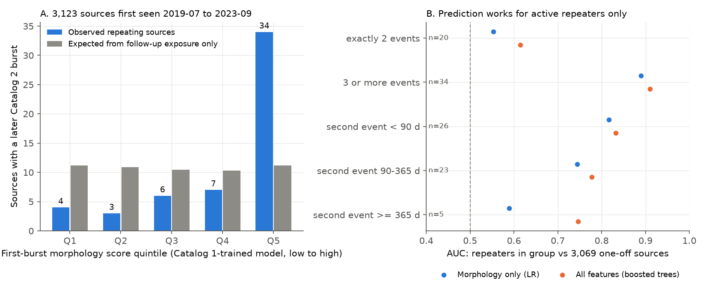
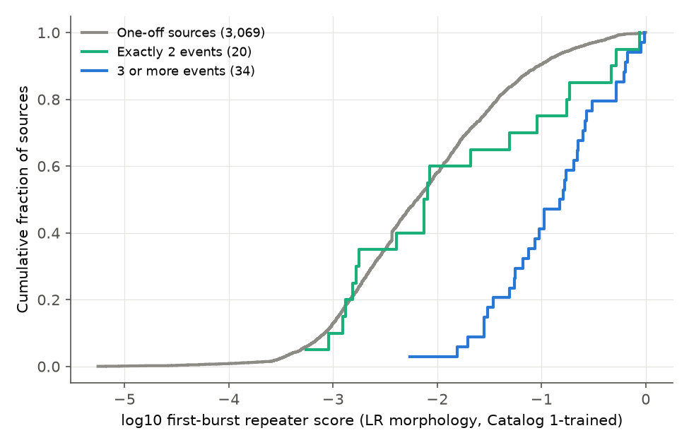
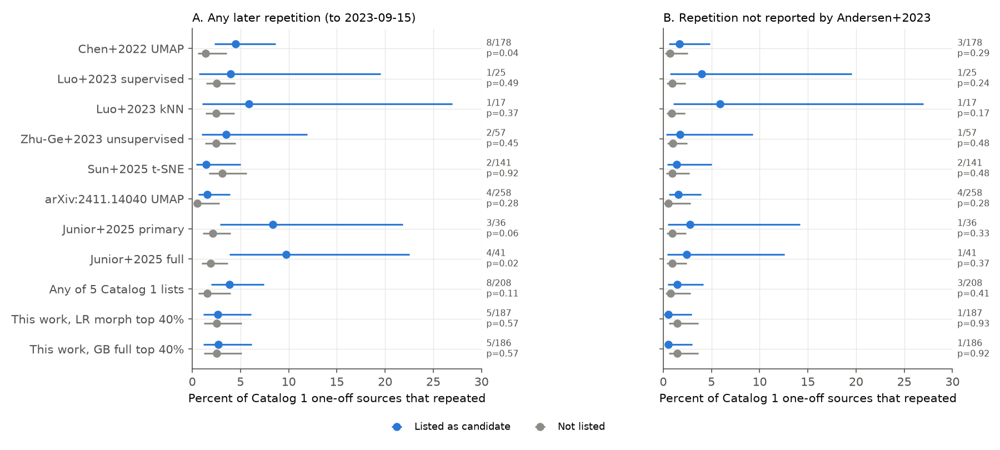

# First-burst morphology predicts active FRB repeaters in CHIME Catalog 2, but published hidden-repeater lists did not predict which Catalog 1 one-off sources repeated

Job: `sci-1107-dell-astronomy-0729ac64cc69` · topic: astronomy · machine: dell · account: claude-andrii · model: Claude Opus 5.5 (`claude-opus-5-5`) · campaign 11_07_2026 · date 2026-11-09.
The signing key is a campaign-machine key. It is not a personal authorship claim.

## Question

Many studies use machine learning on CHIME/FRB Catalog 1 burst properties (width, bandwidth, spectral shape, fluence, DM) to find "hidden repeaters" among apparently one-off fast radio burst (FRB) sources. Some studies say that 30-60 % of one-off sources are repeaters. These claims are predictions. CHIME/FRB Catalog 2 (bursts to 2023-09-15) now gives about four more years of the same telescope and pipeline. We ask two questions:

1. **Part A (strict forecast test).** Did the sources on eight published Catalog 1 candidate lists repeat in Catalog 2 more often than the other Catalog 1 one-off sources?
2. **Part B (prospective test, larger sample).** We trained a classifier on Catalog 1-era bursts with Catalog 1 labels only. We applied it to the *first* burst of each of 3,123 sources first detected after Catalog 1 (2019-07-01 to 2023-09-15). Does the score predict a later Catalog 2 burst from the same source, when we control for the follow-up exposure?

## Data

| Input | Source | SHA-256 |
| --- | --- | --- |
| CHIME/FRB Catalog 1 (`catalog1.210806.vFINAL.csv`, 600 rows) | https://assets.chime-frb.ca/catalogs/catalog1/releases/210806.vFINAL/data/catalog1.210806.vFINAL.csv ; shared dataset `datasets/chime-frb-catalog1-210806-vfinal` (added by this job) | `affd86573fee8fe94be9d0d85e73cc787fa260b2497ccec5d9d93e1d26610ed5` |
| CHIME/FRB Catalog 2 (`chimefrbcat2.csv`, 5,045 rows, 4,539 events, 3,641 sources) | https://assets.chime-frb.ca/catalogs/catalog2/releases/20251231/data/chimefrbcat2.csv ; shared dataset `datasets/chime-frb-catalog2-20251231` | `5108ada779d279a2547d9f9e73ae25bfdd40d8496d6ba7255ec29c6629057a48` |
| Candidate lists | LaTeX sources and ancillary files from arXiv e-prints 2110.09440, 2210.02463, 2210.02471, 2409.11173, 2411.14040, 2506.18854 (hashes in `files/data/input_sha256.txt`) | see file |
| Andersen et al. 2023 repeater names | arXiv e-print 2301.08762 (LaTeX source) | see file |

`files/data/candidate_lists.csv` holds the extracted names (one row per list and FRB). `files/code/extract_lists.py` reproduces it from the e-prints.

| List | Method | Training labels | Names |
| --- | --- | --- | --- |
| Chen et al. 2022 | UMAP + HDBSCAN (ancillary xlsx, class 0) | Catalog 1 | 182 |
| Luo et al. 2023 | supervised ensemble (table) | Catalog 1 | 26 |
| Luo et al. 2023 | leave-one-out kNN | Catalog 1 | 18 |
| Zhu-Ge et al. 2023 | unsupervised combination | Catalog 1 | 57 |
| Sun et al. 2025 | t-SNE | Catalog 1 | 145 |
| arXiv:2411.14040 | UMAP + k-means/HDBSCAN | Catalog 1 + Andersen 2023 repeaters | 271 |
| Junior et al. 2025, primary and full | t-SNE / PCA clustering | Catalog 1 (2023 repeaters kept as non-repeaters) | 37 / 41 |

Some names are sub-burst rows or Catalog 1 repeater bursts. Only names that are Catalog 1 one-off sources enter the test.

## Methods

**Outcome.** A source "repeats" if Catalog 2 gives it a `repeater_name` with two or more events. For Catalog 1 one-off sources we also define a stricter outcome: repetition that Andersen et al. (2023) did not report (`files/data/andersen2023_cat1_oneoffs.txt` lists the 7 Catalog 1 one-off sources in that paper). No candidate list could use this outcome in training.

**Part A.** 467 Catalog 1 one-off sources. Of the 474 Catalog 1 one-off sources, 2 (FRB 20181226C, FRB 20190317F) are not in Catalog 2, and 5 bursts on 2019-07-01 fall after our cut at MJD 58665.0; these 5 do not repeat and enter Part B as new sources. 12 repeated by 2023-09-15. 5 of the 12 were not in Andersen et al. 2023. For each list we compare the repeat fraction for listed and unlisted sources: one-sided Fisher exact test, plus a Mantel-Haenszel odds ratio over Catalog 2 exposure tertiles. For the arXiv:2411.14040 list, we remove the 7 Andersen 2023 sources from the eligible set, because that study used them as repeater labels.

**Part B.** Training set: 586 Catalog 2 rows (fitburst values) of Catalog 1-era bursts. Labels: repeater status in Catalog 1 (18 repeating sources). Weight: 1/(bursts per source). Models:
- `LR_morph`: logistic regression on morphology only: log width, log scattering and a scattering-detected flag, log bandwidth, peak, highest and lowest frequency, and number of sub-bursts. This is the primary model.
- `LR_morph_nosub`: the same model without the sub-burst count.
- `LR_full`: `LR_morph` plus log fluence, log flux, log extragalactic DM and log detection S/N.
- `GB_full`: gradient-boosted trees on the `LR_full` features.

Ten-fold grouped cross-validation on Catalog 1 gives burst-level AUC 0.92-0.93. The test set is the first event (sub-burst 0) of every source first detected on or after MJD 58665: 3,123 sources after we removed side-lobe events and events without exposure. 54 of them repeated. Follow-up exposure = Catalog 2 upper-transit exposure × (fraction of the Catalog 2 span after the first event). Outcome model: logistic regression of repetition on the standardized score, log follow-up exposure and log follow-up days. Optional controls are first-burst S/N and extragalactic DM. We also do a permutation test with 20,000 shuffles of the score within strata of first-detection year × exposure quartile. Sensitivity samples: no first events in flagged low-sensitivity periods; first event at least 1 year before the end; first event before 2021-06-01.

**Part C/D.** For the 54 new repeaters we compare the score of the first burst and the median score of later bursts (Wilcoxon). We split the repeaters by activity (exactly 2 events vs 3 or more; time to second event) and correlate the score with the burst rate (later events per hour of follow-up exposure).

## Results

### Part B: first-burst morphology predicts later repetition



| Model | OR per SD (95 % CI), exposure controls | + S/N + DM | AUC of score | Permutation p |
| --- | --- | --- | --- | --- |
| LR_morph | 1.57 (1.40-1.76) | 1.59 (1.41-1.79) | 0.765 | < 1e-4 |
| LR_morph_nosub | 1.52 (1.34-1.73) | 1.55 (1.35-1.78) | 0.759 | < 1e-4 |
| LR_full | 1.62 (1.44-1.81) | 1.56 (1.39-1.75) | 0.796 | < 1e-4 |
| GB_full | 1.70 (1.52-1.90) | 1.62 (1.44-1.82) | 0.801 | < 1e-4 |

The top score quintile holds 34 of 54 repeating sources (5.4 % of 625). An exposure-only model expects 11.2. The lower four quintiles hold 20 of 2,498 (0.8 %). All three sensitivity samples give odds ratios of 1.52-1.74 per SD (`files/results/partB_models.csv`). Exposure and follow-up time alone give AUC 0.65. Adding the morphology score raises it to 0.76.

The primary model gives repeater-like scores to wider bursts, more sub-bursts, lower highest frequency and narrower bandwidth. This agrees with the known repeater morphology (Pleunis et al. 2021).

### The prediction applies to active repeaters

| Group of new repeaters | n | AUC vs one-offs (LR_morph / GB_full) | In top quintile (LR_morph) |
| --- | --- | --- | --- |
| exactly 2 events | 20 | 0.55 / 0.61 | 35 % |
| 3 or more events | 34 | 0.89 / 0.91 | 79 % |
| second event < 90 d | 26 | 0.82 / 0.83 | 73 % |
| second event 90-365 d | 23 | 0.74 / 0.78 | 61 % |
| second event ≥ 365 d | 5 | 0.59 / 0.75 | 20 % |

Among repeaters, the score correlates with the burst rate (Spearman ρ = 0.43-0.52, p ≤ 0.001). For sources with exactly two events, the morphology-only model without the sub-burst count gives OR 1.21 (0.88-1.65, p = 0.24). The first burst of a new repeater is not less repeater-like than its later bursts (Wilcoxon p = 0.26-0.97). Thus the morphology is present at the first detection.



### Part A: published hidden-repeater lists



| List | Listed: repeated / n | Not listed: repeated / n | Fisher p (one-sided) | Strict outcome (not in Andersen 2023): listed / not listed |
| --- | --- | --- | --- | --- |
| Chen+2022 | 8/178 | 4/289 | 0.043 | 3/178 vs 2/289 (p = 0.29) |
| Luo+2023 supervised | 1/25 | 11/442 | 0.49 | 1/25 vs 4/442 (p = 0.24) |
| Luo+2023 kNN | 1/17 | 11/450 | 0.37 | 1/17 vs 4/450 (p = 0.17) |
| Zhu-Ge+2023 | 2/57 | 10/410 | 0.45 | 1/57 vs 4/410 (p = 0.48) |
| Sun+2025 | 2/141 | 10/326 | 0.92 | 2/141 vs 3/326 (p = 0.48) |
| arXiv:2411.14040 | 4/258 | 1/202 | 0.28 | same (Andersen sources removed) |
| Junior+2025 primary | 3/36 | 9/431 | 0.058 | 1/36 vs 4/431 (p = 0.33) |
| Junior+2025 full | 4/41 | 8/426 | 0.016 | 1/41 vs 4/426 (p = 0.37) |
| This work, LR_morph top 40 % (out-of-fold) | 5/187 | 7/280 | 0.57 | 1/187 vs 4/280 (p = 0.93) |

No list passes a Bonferroni correction for eight lists (smallest p × 8 = 0.13). On the strict outcome, every list is consistent with no gain. Junior et al. 2025 compared their lists with the 2023 repeater catalog, so their lower p values on the full outcome are not independent forecasts. Chen et al. (2022) predicted that 188 of 474 one-off sources are repeaters. After about four more years of CHIME exposure, 8 of their candidates repeated (4.5 %), against 1.4 % of unlisted sources.

The 12 Catalog 1 one-off sources that repeated are low-activity sources: 11 have only 2-4 Catalog 2 events. Our own Catalog 1 model also does not rank them high (out-of-fold AUC 0.48-0.55). This agrees with Part B: morphology finds active repeaters but not repeaters with a single repeat.

**Note on FRB 20190329A.** Catalog 1 lists this burst as a one-off. Catalog 2 assigns it to the known repeater FRB 20180814A (same position and DM). It is on all eight published lists. It is a burst of a repeater that the Catalog 1 grouping missed, not a new hidden repeater.

## Interpretation

Repeater-like burst morphology (long, multi-component, narrow-band, low-frequency bursts) is present in the first burst. It predicts which new CHIME sources will repeat within about 4 years, and it tracks the repetition rate. But it predicts mainly the sources that repeat often. Low-activity sources, which are the population that "hidden repeater" claims are about, did not have more repeater-like first bursts than the one-off sources in either sample. Thus these data do not support the use of morphology alone to say that a large fraction (30-60 %) of one-off sources are repeaters. The data agree with a population where morphology correlates with activity level (Andersen et al. 2023 found that burst rate correlates with width). The data cannot exclude a large population of low-rate repeaters with one-off-like morphology.

## Limitations

- Part A has few events (12; 5 for the strict outcome). The 95 % intervals are wide, and a modest enrichment (odds ratio near 2-3) is not excluded for Chen+2022 or the union of lists.
- Part B has 54 repeating sources, and only 20 have exactly two events. Thus the null result for low-activity repeaters has low power. The OR for 2-event repeaters is 1.38 (1.13-1.69) with the primary model, but the AUC is only 0.55.
- Catalog 2 fitburst values for repeater bursts may come from fits that knew the source is a repeater (for example, the number of sub-bursts). The model without the sub-burst count gives almost the same result, but we cannot test other analyst choices.
- The CHIME repeater grouping uses position and DM. Selection for low DM and high declination can change which repeaters are found. We control for exposure, follow-up time, S/N and DM, but not for localization quality.
- Exposure after the first event assumes uniform sensitivity over the Catalog 2 span. Flagged low-sensitivity periods are only removed in one sensitivity sample.
- We use the authors' published candidate lists as they are. We did not re-run their methods.

## Reproduce

```
# inputs: the two CHIME CSV files above; arXiv e-prints in lit/<id>/src (unpacked to lit/<id>/x)
python -I files/code/extract_lists.py lit candidate_lists.csv
python -I files/code/build_tables.py catalog1.210806.vFINAL.csv chimefrbcat2.csv derived
python -I files/code/analysis.py derived candidate_lists.csv files/data/andersen2023_cat1_oneoffs.txt results
python -I files/code/figures.py results figs
```

Environment: Python 3.12.16, numpy 2.5.4, pandas 3.1.1, scikit-learn 1.9.1, statsmodels 0.15.0, scipy 1.18.1, matplotlib 3.11.2. Random seed 20261109. The analysis takes about 2 minutes on an idle 24-core host. Set `OMP_NUM_THREADS` on a loaded host.

## Files

- `files/code/`: list extraction, table construction, analysis, and figures.
- `files/data/candidate_lists.csv`, `andersen2023_cat1_oneoffs.txt`, `catalog2_sources.csv` (one row per Catalog 2 source: first-event features, outcome, exposure), `input_sha256.txt`.
- `files/results/`: `partA_lists.csv`, `partA_cat1_oneoffs.csv`, `partB_models.csv`, `partB_quintiles.csv`, `partB_new_sources_scored.csv`, `partC_first_vs_later.csv`, `partC_repeater_bursts_scored.csv`, `partD_activity.csv`, `summary.json`.
- `files/figures/`: three PNG figures.
