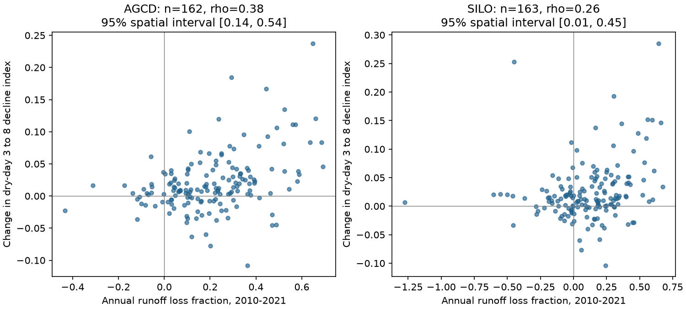

# Annual runoff loss and short dry-spell decline changes covaried across 162 south-east Australian catchments in 2010-2021

## Result
In 162 south-east Australian catchments, larger annual runoff losses accompanied larger changes in flow decline from dry day 3 to dry day 8 in 2010-2021. The Spearman rank correlation was 0.377. Its 95% spatial bootstrap interval was 0.135 to 0.541. Annual loss is relative to a climate model fitted before 1997. The dry-spell statistic is unchanged by a constant positive flow multiplier in either period.

The result links two published signatures in the same catchments and period. It does not show that faster drainage caused the runoff loss. The association was weaker with SILO rain. Controls for reference rainfall and runoff retained an AGCD association but gave no clear SILO association. Changes between 1997-2009 and 2010-2021 did not clearly covary. The day-14-supported subset had no clear association at either horizon. These limits prevent a general regional attribution.

## Question and prior evidence
The selected work reports annual runoff below the pre-1997 rainfall-runoff relation in south-east Australia. It also reports faster flow decline in selected dry spells. Two regional mean changes need not have a common spatial pattern. We ask whether their magnitudes covary in the same basins.

Trotter, Saft, Peel and Fowler (2024), doi:10.1016/j.jhydrol.2024.130707, already found steeper recessions in catchments with drought-related rainfall-runoff shifts. We do not claim the first link between these signatures. Our contribution is a continuous, same-basin and same-period test with a flow-scale-invariant event statistic, spatial intervals, reference-climate controls and cross-period checks. This is a new synthesis of existing records, not independent field confirmation.

The event input is SCI publication 2bffa2ff9f3678c329abf22c8ec32451f66cac1b17cf5bf390c924c67d92edcc. The annual input is SCI publication fde6f0d61f6ba9c3f5b413a8128858ba1a2542232262f2e8568ed176fefbc394. Both use CAMELS-AUS v2.03. Fowler et al. (2022), doi:10.5194/hess-26-6073-2022, reviews several possible causes, including recharge and groundwater connection. Zhou et al. (2022), doi:10.5194/hess-26-4497-2022, shows why small near-river stores must be distinguished from regional groundwater. Our inputs contain no direct measurement of either store.

## Data and methods
Only verified published statistical outputs were used. No new raw data download or reading of a sibling private workspace was needed. Exact source SCI ZIP and member hashes are in files/source_publications.json. The package includes compact published endpoint estimates and new period-level annual loss estimates. They can be regenerated with files/collect.py. Source records remain in the source SCI publications or the shared CAMELS-AUS dataset store.

The annual source fits, per catchment, the following model in 1951-1996:

    Pe = P + l (P_previous_year - Pbar)
    C = (Pe^w + R^w)^(1/w) - R + d (T - Tbar)

The source code bounds effective rainfall and applies its numeric safeguards. We use its saved no-change prediction C, not a refit or a fitted post-change mechanism. It includes current and previous annual rain and temperature. For each test period, define:

    L = 1 - sum(observed annual runoff) / sum(C)

Thus L=0 means no total loss against the model; L=0.2 means 20% less runoff. Negative values are retained. Prediction sums must be positive. Catchments need at least eight available annual observations in 1997-2009 or six in 2010-2021. Missing years are not filled. We select annual-source group SE-AU and outlet latitude below -30 degrees. The primary joined sample has 162 basins in 21 outlet cells.

The event source defines dry spells as maximal runs with daily basin rain below 1 mm. The preceding day must be wet. For horizon h, it uses finite Q3>0 and Qh>=0, with both days in the same year. Flat and rising endpoints remain valid. Define:

    D_event = (Q3 - Qh) / (Q3 + Qh)
    delta_D = matched_test_mean(D_event) - matched_reference_mean(D_event)

The reference is 1951-1996. D_event=1 includes zero endpoints. A constant positive multiplier on all flows in either era leaves this index unchanged. The source also uses within-era starting-flow ranks, so rank matching is unchanged by that multiplier. It matches four seasons, two starting-flow rank classes and two prior-30-day rain classes. Each cell needs at least three events per era. Each catchment needs three supported cells and 20 supported events per era. Cells have weights set by test event counts. We retain its estimates and support rules. Initial rank does not mean equal storage or equal absolute flow.

The primary test is the Spearman correlation between L and delta_D at h=8, with AGCD rain, in 2010-2021. Each basin has equal weight. We resample 2-degree latitude-longitude outlet cells with replacement 4,999 times, seed 11071109, and retain all basins in each sampled cell. Ranks are recomputed in each draw. Intervals are percentile limits. They are conditional on the published estimates and support. They do not include annual-model fit error, finite-event error, source measurement error or uncertainty over the historical weather sequence. Twenty-one cells are a limited basis for spatial inference.

The planned diagnostics use SILO rain, 1997-2009, day 14, and the estimator without starting-rank matching. Partial ranks regress the ranks of L and delta_D separately on an intercept and ranks of reference mean rain Pbar and runoff Qbar, then correlate their residuals. Within-cell ranks are centered by each cell's mean after ranking over the full sample. The period-change test correlates L_late-L_drought with delta_D_late-delta_D_drought in common catchments. Cross-period tests pair one period's loss with the other period's decline change. They reduce overlap of test years but retain a shared reference and catchment properties. Leave-one-cell-out ranges check single-cell influence.

After initial result inspection, we added controls for reference mean D and tested day 8 in the catchments that also support day 14. These are exploratory checks. See files/PLAN.md and files/SEARCH.md. No diagnostic has a multiple-test correction.

## Evidence
The primary mean annual loss was 20.8%, and mean delta_D was 0.0200 in the joined cohort. These means and the correlation concern this cohort only. They are not a conversion of delta_D into missing water.

| Test | Basins | Rank association | Spatial 95% interval |
| --- | ---: | ---: | --- |
| AGCD, 2010-2021, day 8 | 162 | 0.377 | 0.135 to 0.541 |
| AGCD, reference rain and runoff controlled | 162 | 0.268 | 0.088 to 0.419 |
| AGCD, ranks centered within cells | 162 | 0.228 | -0.0005 to 0.417 |
| SILO, 2010-2021, day 8 | 163 | 0.258 | 0.007 to 0.447 |
| SILO, reference rain and runoff controlled | 163 | 0.152 | -0.031 to 0.324 |
| AGCD, 1997-2009, day 8 | 166 | 0.277 | 0.019 to 0.459 |
| AGCD, late-minus-drought changes | 162 | -0.111 | -0.313 to 0.132 |
| AGCD, late loss versus drought decline change | 162 | 0.325 | 0.087 to 0.485 |
| AGCD, drought loss versus late decline change | 162 | 0.371 | 0.072 to 0.572 |
| AGCD, 2010-2021, day 14 | 63 | -0.035 | -0.201 to 0.171 |

The primary correlation remains positive when any one outlet cell is removed: 0.320 to 0.424. Omitting starting-rank matching gives 0.338 (0.082 to 0.493; 166 basins). Controlling reference D as well as reference rain and runoff gives 0.267 (0.079 to 0.422). With SILO, that last control gives 0.156 (-0.024 to 0.330).

The longer-horizon null cannot be read as a horizon effect. In the same 63 catchments that support day 14, the day-8 correlation is also near zero: -0.022 (-0.206 to 0.188). SILO gives -0.135 (-0.351 to 0.157) in 64 day-14-supported basins at day 8. Catchment selection can therefore account for the contrast between these horizon summaries; this does not prove that it is the only cause. Complete diagnostics are in files/results/summary.csv and postinspection.csv.

The plotted intervals are spatial, conditional intervals. The points are basin-level estimates with unequal errors. Neither axis is a physical drainage parameter.

## Interpretation and limits
The AGCD spatial result strengthens the evidence that annual runoff loss and altered within-spell behavior occur together at basin scale. Cross-period associations show that shared test-year errors alone are not required for this pattern. However, they can also reflect persistent basin properties or shared reference errors. The within-cell result and SILO controls weaken the case for a common local mechanism. The period-change null gives no clear evidence that temporal changes in this signature track temporal changes in the annual loss.

A constant positive flow multiplier cannot itself change delta_D for a fixed catchment and event sample. This is a useful safeguard, but it does not exclude nonlinear gauge changes, event-composition changes, altered delayed recharge, flow-path mixtures, evaporation, transmission loss or groundwater disconnection. The dry-spell and annual quantities use the same flow record, so their errors can be related. Source rain products are related and do not provide independent replications.

The annual model can be wrong outside its calibration climate and omits detailed within-year rainfall timing. Dividing by predicted flow can make loss estimates less stable in low-runoff basins. Rank methods limit the effect of extreme magnitudes but do not correct measurement error. Selection on endpoint support excludes basins with too few long dry spells or positive starts. It can select different flow regimes and reduce geographic range. Geographic blocks do not fully account for nested basins, dependence across block boundaries or catchment-size differences. Source estimates have no paired joint uncertainty draws suitable for propagation here.

This is evidence for a scoped spatial association. It gives no causal loss fraction, independent water balance, forecast validation or regional attribution. A useful next test is a joint model fitted to annual flow and complete dry-event paths, with independent near-river storage or groundwater observations. The model must reproduce the spatial association, its rain-product sensitivity and the selected-subset null, rather than only two regional mean changes.

## Reproduction and provenance
Run the commands in files/REPRODUCE.md. files/analyze.py rebuilds the main table, all main bootstrap draws and figure from the included statistical inputs. files/diagnostics.py rebuilds the explicitly post-inspection table. files/audit.py checks input hashes, sample uniqueness, main means and correlations, and every main interval. Raw-data regeneration is delegated to the cited, preserved source publications, which include their fitting and retrieval code. Exact source paths, versions and hashes are retained in the provenance files. Credit and compatible data terms are in files/DATA_NOTICE.md. No incompatible external raw records are bundled.

Job: sci-1107-dell-earth-and-ocean-sciences-9b148c5b6b65. Topic: earth-and-ocean-sciences. Campaign: 11_07_2026. Machine: dell. Account: codex-myxtap. Model: gpt-6.1-sol, high reasoning effort, through Codex in T3 Code. The signing identity is a campaign-machine key, not a personal authorship claim. No agents were launched. All computations ran in the assigned workspace. This package is saved to the local campaign only.
