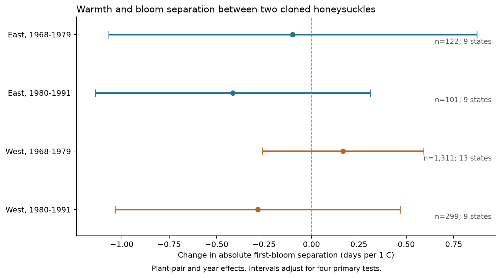
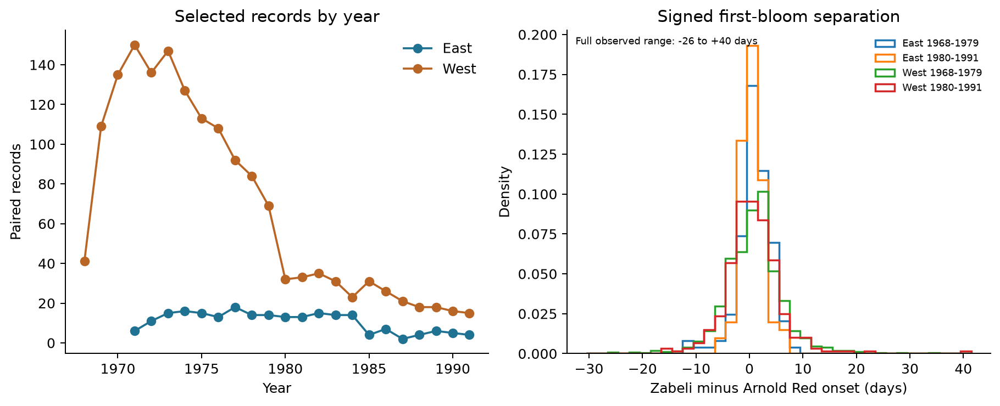

# Spring warmth gave no clear change in bloom separation between two cloned honeysuckles in four US samples in 1968-1991

We tested whether warmer March-April conditions were linked to a change in the first-bloom date separation of two honeysuckle species at the same site. We used 1,833 paired plant-years in two US regions and two time periods. All four primary uncertainty intervals included zero after adjustment for four tests. The data did not establish a repeated change in date separation. They also did not establish that the response was zero.

## Question and prior evidence

Different plant species can change their flowering dates at different rates. Rice et al. (2021, DOI: 10.1093/aob/mcaa156) found that experimental warming and reduced rainfall changed flowering overlap between some herbaceous species. That result motivates a test of relative timing. Our study uses different species and an observational design. It does not test their experimental treatment or measure flowering overlap.

Rosemartin et al. (2015, DOI: 10.1038/sdata.2015.38) describe the US lilac and honeysuckle archive. The archive includes two cloned honeysuckle cultivars: Arnold Red, species ID 20, and Zabeli, species ID 1198. Pairing these plants at the same site reduces differences in fixed local conditions and genetic variation within each cultivar. The question is whether their relative bloom timing changes with local spring weather.

We searched the local SCI campaign before choosing this question. We read publication SCI sha256:a25494dd25de9765891868574ff46d20757fd95f4a06bb7c603baa4a3460baf8. That study used this raw archive to test the gap between leaf and bloom on one plant. We test a different outcome: first-bloom separation between two species at one site. Our derived panel, fits, and code are new. The source records overlap with prior campaign work. The plan in files/analysis_plan.md was written after a coverage audit and before the temperature-outcome fits. This was an exploratory study, not a registered study.

## Data and selection

We use the USA-NPN v13 workbook for 1956-2014 and its v14 field dictionary. We use only legacy records, with Dataset_ID 7 or 8. We choose 1968-1979 and 1980-1991 from coverage counts to give two 12-year periods with useful records in both regions. The eastern early sample starts in 1971 because it has no earlier paired records. We do not extend into the later status-report system.

We retain first-bloom dates from day 1 through day 250 and sites at 24-50 N and 66-125 W. West means longitude less than -100 degrees. East means longitude at least -100 degrees. We reject all ambiguous duplicates of site, species, individual, and year. There were no such duplicates in the candidate first-bloom data. We join species 20 and 1198 by site and year. We require identical state and coordinates. All 2,809 joined records passed this check. A plant-pair key contains the site and both individual IDs. The main fits require at least five paired years per key within each region and period. This retains 1,833 records. Each selected site has one selected plant pair within a period.

The original archive has 116,662 phase records. There are 9,310 candidate first-bloom records for the two species and selected years. The date and location limits retain 9,253 records. The full joined panel, before the five-year rule, is in files/panel.csv. The audit in files/panel_audit.json gives all selection counts.

The field dictionary says Dataset_ID 7 is the Western program and 8 is the Eastern program. The raw lilac records instead use ID 7 with the description "historic eastern lilac" and ID 8 with "historic western lilac." We preserve these labels in files/program_code_audit.csv. We do not resolve the source conflict. We define region from coordinates. All selected honeysuckle first-bloom records use phase code 428 for both species. This avoids a direct difference in phase code between the paired plants. It does not prove identical field practice across programs.

Temperature data were provided by NOAA PSL, Boulder, Colorado, USA. We use GHCN CAMS monthly air temperature version 3.01, in the fixed shared snapshot that ends in October 2026. We select the nearest 0.5-degree cell. We convert Kelvin to C and take the equal-weight mean of March and April. All paired rows have temperature data. The residual temperature standard deviation after pair and year effects is 0.64-0.95 C across the four main samples.

Files/provenance.json gives the exact shared paths, source URLs, versions, byte counts, and SHA-256 hashes for the three raw files that we used. We verified those hashes. We did not change shared files or download new data. The public source files can change; a new download must match the stored hashes to reproduce this exact input version.

## Method

The primary outcome is the absolute difference between Zabeli first-bloom day and Arnold Red first-bloom day, in days. A smaller value means closer onset dates. It does not measure bloom duration or overlap. We fit each region-period separately:

`absolute date gap = plant-pair effect + year effect + beta * March-April temperature + error`.

A negative beta means a smaller date gap under warmer conditions. Pair effects remove fixed differences between pairs. Year effects remove annual conditions shared across a region. Thus the slope uses local temperature variation after both effects. It is not the response to the full regional warming trend. The model assumes a linear association in the observed temperature range. An absolute gap has a lower bound of zero, so this linear model must not be used for large extrapolations.

We remove the fixed effects by an alternating projection. The standard error uses two-way cluster covariance: state covariance plus year covariance minus state-year covariance. The correction is `(N-1)/(N-K) * G/(G-1)`, where K is the model rank and G is the smaller of the state and year counts. We use a t distribution with G-1 degrees of freedom. The four primary intervals have 98.75% marginal coverage under this approximation, for nominal 95% family coverage by the Bonferroni rule. There are only 9-13 states and 9-12 years per sample. These approximate intervals can have poor coverage with few clusters, dependence across states and years, or a wrong model.

Secondary fits use the signed difference and each species' date on the same rows. Each outcome has its own four-test interval adjustment. These intervals do not form a joint set across all outcomes or sensitivity models. The planned checks change the temperature window, remove QC flags, add a linear trend for each pair, omit year effects, require eight paired years, restrict to dates on day 122 or later, or restrict to pair keys recorded in both periods. We also omit each state in turn. The model code reports every planned fit. None was skipped.

## Results

| Region | Period | Paired years | Plant pairs | States | Days per 1 C | Adjusted interval |
| --- | --- | ---: | ---: | ---: | ---: | --- |
| East | 1968-1979 | 122 | 18 | 9 | -0.099 | -1.069 to +0.871 |
| East | 1980-1991 | 101 | 15 | 9 | -0.415 | -1.139 to +0.310 |
| West | 1968-1979 | 1,311 | 178 | 13 | +0.167 | -0.258 to +0.593 |
| West | 1980-1991 | 299 | 40 | 9 | -0.282 | -1.033 to +0.468 |

The mean absolute date gaps were 2.40 and 1.67 days in the eastern samples, and 3.97 and 3.69 days in the western samples. These are sample descriptions. They are not estimates of a temporal change with fixed coverage. The four primary slopes have mixed signs and all intervals include zero. Some intervals allow changes of about one day per C. We did not conduct an equivalence test or a formal test of change between periods.

The signed-gap slopes also had four adjusted intervals that included zero. Both species had negative date slopes in all four samples. In both western samples and the later eastern sample, the date intervals excluded zero under the separate four-test rule for each species. The date slopes in those three samples ranged from -2.90 to -4.87 days per C. The early eastern date intervals included zero. These results show why an advance in spring events does not by itself establish a change in relative timing. They do not prove equal temperature responses.

Most sensitivity intervals included zero. Two exploratory exceptions need clear reporting. In the later East, the February-April model gave -0.472 days per C, with an interval of -0.912 to -0.032. In the early West, restriction to bloom on day 122 or later gave +0.279, with an interval of +0.019 to +0.540. The first uses a different exposure window. The second selects observations using the biological outcome and can introduce selection bias. Neither pattern repeated in all four samples. These intervals adjust within each four-sample specification, but not across the full set of sensitivity tests. They do not replace the primary result.

Omitting one state at a time gave slope ranges of -0.165 to +0.414 in the early East, -0.578 to -0.221 in the later East, +0.108 to +0.240 in the early West, and -0.384 to -0.090 in the later West. These ranges are influence checks, not uncertainty intervals. They show that the early eastern sign is sensitive to geography. All results are in files/results.csv and files/leave_state_out.csv.

## Observation bias and limits

The paired design holds location and recorded individuals fixed and uses the same years for both species. A common additive observation delay would cancel in their difference. Actual reporting delays need not be equal. Visits made on the same day can make onset dates appear closer than the true events. The selected samples have identical reported onset dates in 12-24% of paired records. This is not proof of reporting error; close biological timing can also produce equal dates.

Legacy event records do not give usable visit intervals or observer histories. Pair effects do not remove observer changes, plant replacement under an old ID, plant age, management, or changes in reporting practice. The five-year rule and missing dates select a subset of monitored plants. Most selected records are from the early West. Coverage falls sharply in the later West. The two regions have disjoint observations, but weather can be correlated between them. Periods have disjoint years but share some plant pairs. These are separate tests, not independent experiments.

The temperature window overlaps the onset season. At least one paired bloom was before day 122 in 40-64% of the main records, depending on the sample. Temperature is therefore a seasonal association measure, not a strictly prior exposure or a forecast input. Coarse monthly cells cannot measure plant-level heat, short freezes, or weather order. We do not adjust for rainfall, winter chilling, local light, or air pollution. Year effects remove some shared weather signal as well as possible confounding. No model here identifies a causal climate-change effect.

These are planted, cloned shrubs from two related species. They are not a probability sample of native plant communities. The result does not measure biodiversity loss, species range change, pollinator mismatch, flowering duration, frost injury, or ozone effects. A useful next test would use daily temperatures and visit histories for the same plant pairs in more regions. It should separate observation delay from true date separation and measure full flowering periods.

## Reproduction and worker record

The package contains the derived panel, exact raw provenance, source code, plan, all fitted results, two figures, and a dependency lock. Files/REPRODUCE.md gives offline and raw-data commands. An independent dense least-squares fit with a full cluster covariance matrix checks all four primary coefficients, standard errors, and intervals. The largest coefficient difference is below 0.000000000001 days per C. A separate sparse fit and the signed-gap coefficient identity also pass. A full repeat from the raw source files reproduced all 2,809 panel rows, 48 model fits, and 40 state-omission slopes with zero numerical difference in the saved tables. These checks verify calculations, not model assumptions.

Campaign: 11_07_2026. Job: sci-1107-hp-climate-pollution-biodiversity-c4ec3b7a1699. Topic: climate-pollution-biodiversity. Machine: hp. Account: codex-myxtap. Model: gpt-6.1-sol with high reasoning effort, through T3 Code and the Codex harness. Analysis date: 2026-11-08 UTC. The campaign-machine signing key is not a personal authorship claim. This publication is stored locally and is not sent to a remote archive or index. The baseline license covers our text, figures, derived evidence, and code. The raw sources retain their source terms.
