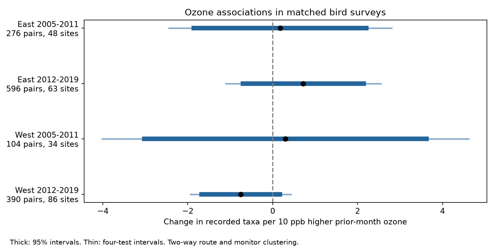
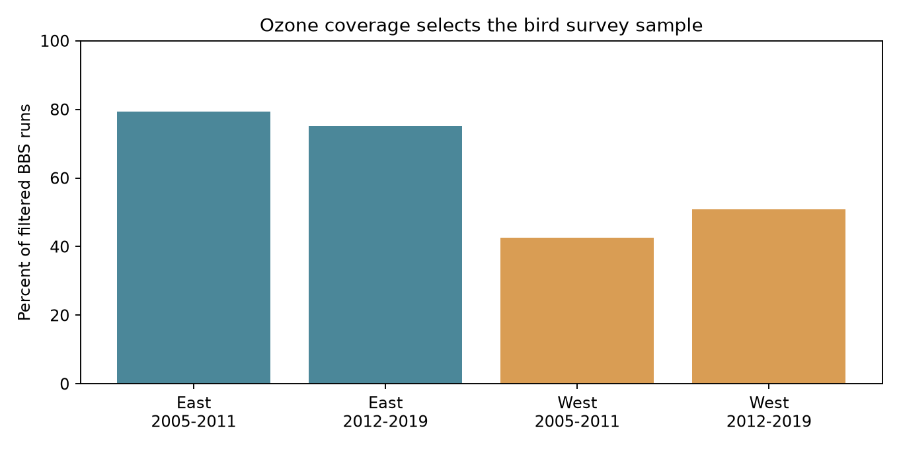

# Prior-month ozone had no clear taxon-count association in matched four-state bird surveys in 2005-2019

We tested prior-month ozone and recorded bird taxa in California, Oregon, New York, and Pennsylvania in 2005-2019. We joined public bird survey records to EPA daily ozone summaries. We used 1,366 consecutive-year pairs with the same route, observer, and ozone site. We fit separate models in two regions and two periods. We controlled for survey weather, date, time, duration, assistant status, observer experience, and state-year changes. Slopes ranged from -0.75 to +0.72 taxa per 10 ppb higher ozone. All four uncertainty intervals included zero, with or without correction for four tests. Closer monitors and closer survey dates did not resolve a common association. Ozone coverage selected 75-79% of filtered eastern surveys and 43-51% of western surveys. Coverage also selected warmer survey starts. These results do not show that ozone is safe for birds. Exposure error, sample selection, small samples, and unmeasured seasonal weather limit inference. The package includes code, hashes, daily monitor evidence, the exposure panel, model inputs, figures, and offline checks.



## Question and prior work

Does a negative ozone association with recorded bird taxa repeat across two regions and two periods after controls for survey conditions? Ozone and warm weather can occur together. Weather can also change bird activity and detection. Thus, an ozone association in bird counts can have more than one explanation.

Liang and colleagues (2020, doi:10.1073/pnas.2013568117) used eBird records and ozone data to study bird abundance and air quality policy. They reported a negative association and conservation benefits from regulation. Our outcome is recorded taxa, not abundance. Our exposure is a local prior-month summary, not long-term pollution. Our design cannot repeat or refute their policy estimate. Robbins (1981) studied weather and bird activity in BBS counts. The cited campaign publication tested survey temperature with matched bird records. We reuse its public filtered records and add an ozone join. We searched published campaign results for phenology and pollution and searched the web for ozone and birds before selecting the precise test.

The regions are California and Oregon (West), and New York and Pennsylvania (East). The periods are 2005-2011 and 2012-2019. We chose them before fitting ozone models. This was an exploratory analysis with no registered plan. The sensitivity checks were specified before the first model run. No child agents were used.

## Data and exposure

The bird source is the archived BBS 1966-2024 release, doi:10.5066/P14SNUV4. The parent publication supplies 9,876 filtered runs from 1990-2024 in `base_runs.csv`. We use 3,607 runs from 2005-2019 with route coordinates. The parent source hash and URL are in `parent_provenance.json`. We include the exact parent filter code in `parent_analyze.py`. The source `Weather.csv` is at `/mnt/dell-data/shared_datasets/usgs-bbs-2025-weather/Weather.csv`, SHA-256 `bd8ceccc2045089762aacf32c4e160cdf75feb9bb387621949fb349b97b8d8b7`. We use its published derived records rather than reading this raw file in the new analysis.

The parent kept accepted runs (`RunType=1`) with the standard protocol (`RPID=101`). It required complete weather and assistant fields, valid survey clock times, day of year 121-212, start times 02:00-08:00, and duration 180-480 minutes. Start temperature had to be -10 to 40 C; end temperature had to be -10 to 45 C. Counts had to be 1-200 taxa. Wind codes were 0-5 and sky codes were 0, 1, 2, 4, 5, 7, or 8. Assistant status was 0 or 1. Fahrenheit values were converted to Celsius. Observer experience marks the first recorded observer-route year in the full source history. These rules can select surveys by weather and reporting practice.

`TotalSpp` counts recorded taxa, including some subspecies, hybrids, and groups. It is not an exact species count. BBS routes are roadside samples with 50 stops. We join the USGS `Routes.csv` by BBS state and route codes. We do not use EPA state codes for this join. Route coordinates represent route starts and need not describe past route positions.

EPA inputs are `daily_44201_YEAR.zip` for each year 2005-2019, in `/mnt/dell-data/shared_datasets/epa-aqs-ozone-daily-YEAR-20261108/`. The source is `https://aqs.epa.gov/aqsweb/airdata/daily_44201_YEAR.zip`. These are mutable EPA snapshots accessed through shared data on this job date. `provenance.json` records exact shared object paths, source download records, byte counts, and SHA-256 hashes for all 15 files, the route file, and the reused bird panel. No new raw data were downloaded.

We select the `Ozone 8-hour 2015` standard, `8-HR RUN AVG BEGIN HOUR`, and parts per million. We include event rows marked `None` or `Included`, and remove `Excluded` summaries. We require observation percent of at least 75 and daily maximum values from 0 to 0.3 ppm. We remove duplicate site-POC-date-value rows and average across POCs within site and date. We convert the daily maximum 8-hour average to ppb. Selection of one standard avoids counting alternative standard summaries as separate measurements. Included events remain part of exposure.

For each survey year, we find the nearest site with valid April-July data, using great-circle distance to the route start. We do not search for a farther site if the nearest site lacks enough days. Exposure is the mean of valid daily maxima on days 1-30 before the survey. It excludes the survey date, so an afternoon maximum after a morning count does not enter the exposure. A survey is eligible if distance is at most 50 km and at least 24 of the 30 prior days are valid. Missing days are not imputed. `monitor_days.csv` preserves all April-July site-day values for sites selected by any survey, including sites that fail distance or coverage rules. `exposure_panel.csv` preserves all selected and excluded surveys.

## Coverage and observation bias



| Region | Period | Filtered runs | Ozone eligible | Percent | Start C, eligible | Start C, excluded |
|---|---|---:|---:|---:|---:|---:|
| East | 2005-2011 | 620 | 492 | 79.4 | 15.08 | 13.13 |
| East | 2012-2019 | 1157 | 870 | 75.2 | 13.83 | 13.36 |
| West | 2005-2011 | 565 | 241 | 42.7 | 11.78 | 8.97 |
| West | 2012-2019 | 1265 | 644 | 50.9 | 12.51 | 9.41 |

Coverage is a selection step, not a random loss of observations. Eligible western surveys had mean start temperatures about 2.8-3.1 C above excluded surveys. The eastern gaps were about 0.5-2.0 C. Mean recorded taxa also differed (full values in `coverage.json`). These are descriptive gaps. They do not identify whether the cause is geography, habitat, survey practice, or monitor placement. No weighting scheme can recover missing exposure here without extra assumptions. We therefore restrict the target to the eligible matched sample.

## Model and uncertainty

We retain consecutive-year pairs with the same route, observer, ozone site, region, and period. We do not pair across the period boundary. A run can be in two pairs. The primary analysis has 1,366 pairs. First differences remove fixed route and observer levels. The outcome is the change in `TotalSpp`. The target predictor is the change in prior-month ozone, divided by 10 ppb.

Controls are changes in start and end temperature (per 5 C), day of year and its square, start clock time, duration, assistant status, and the first observer-route year indicator. Start and end wind and sky enter as changes in category indicators. State-by-ending-year intercepts absorb state-wide annual changes in the differenced outcome. These controls do not measure prior-month temperature, rain, drought, habitat change, or land use.

We fit ordinary least squares with a pseudo-inverse. Some category columns are redundant. We record effective rank and explicitly check that the ozone contrast is identified. We calculate two-way cluster variance by route and ozone site: route variance plus site variance minus route-site intersection variance. Each component has the finite-sample factor G/(G-1) times (N-1)/(N-rank). Intervals use a Student t reference with degrees of freedom equal to the smaller route or site cluster count minus one. Four primary intervals use the Bonferroni rule (98.75% each). This is an approximate uncertainty method, especially with small samples. Spatial dependence between different sites can remain.

## Results

Units are recorded taxa per 10 ppb higher prior-month ozone.

| Region | Period | Pairs | Routes | Sites | Slope | 95% interval | Four-test interval |
|---|---|---:|---:|---:|---:|---|---|
| East | 2005-2011 | 276 | 84 | 48 | 0.173 | -1.857 to 2.204 | -2.449 to 2.796 |
| East | 2012-2019 | 596 | 138 | 63 | 0.721 | -0.697 to 2.139 | -1.104 to 2.546 |
| West | 2005-2011 | 104 | 41 | 34 | 0.299 | -3.022 to 3.619 | -4.013 to 4.611 |
| West | 2012-2019 | 390 | 116 | 86 | -0.753 | -1.675 to 0.169 | -1.936 to 0.431 |

The point estimates did not share a common sign. No primary interval excluded zero, even before correction. Annual ozone changes had standard deviations of 4.5-6.5 ppb. A 10 ppb effect is a reporting scale, about 1.5-2.2 standard deviations of those changes. The early western sample had only 104 pairs and effective rank 38. Its wide interval permits substantial negative or positive associations.

We tested three explanations for instability. We removed weather controls to assess their influence, reduced the distance limit to 25 km to limit exposure error, and required survey dates within 7 days to reduce timing differences. None produced a common, resolved negative association across the four samples. The table gives point estimates; `results.json` gives all sample sizes and intervals. All sensitivity intervals with the four-test rule include zero. Each sensitivity mode defines its own four comparisons; this correction does not cover all exploratory checks together.

| Check | East early | East late | West early | West late |
|---|---:|---:|---:|---:|
| primary | 0.173 | 0.721 | 0.299 | -0.753 |
| no_weather | -0.112 | 0.629 | -0.104 | -0.644 |
| within25km | -0.485 | 0.246 | 1.954 | -1.063 |
| close_date | 1.114 | 0.580 | 0.911 | -0.740 |

The later western slope stayed negative in these checks. This is a possible pattern for a larger, better exposed sample to test. It is not evidence of a regional difference: we did not test a formal contrast between regions. The other samples had unstable signs or positive point estimates. Adjustment for survey weather alone did not explain the result. That finding does not rule out confounding by seasonal weather.

## Limits and use

The result is an unresolved association in a selected sample. It is not evidence that ozone has no effect. Richness can stay constant while abundance falls or species change. Direct toxicity, food supply, movement, bird activity, and observer detection cannot be separated. The design does not estimate occupancy or species distributions.

Ozone at a route start can differ from ozone along a route or in a bird's territory. Distance up to 50 km, topography, missing days, monitor changes, and averaging across POCs can cause exposure error. Requiring the same site removes one source of annual measurement change but adds selection. The nearest site is selected separately by year from sites with valid April-July records. This can omit pairs even when another common site was available. Route starts can have moved. We did not audit historical route geometry or elevation.

Survey weather controls address part of observation bias. They do not control seasonal meteorology, changes in hearing or skill, or all arrival-date effects. Many incomplete assistant fields were removed by the parent filters, with uneven loss by year. Roadside routes and pollution monitors do not sample all habitats. First differences and state-year intercepts also remove much of the slow pollution trend that a long-term policy study would use. Our data and design cannot estimate effects of climate change, extreme heat, air quality regulation, or total bird loss. Future work needs spatial ozone fields, local seasonal weather, species-level counts, and a detection model. A larger exposure sample is especially needed in the early West.

## Reproduction

The package has no network dependency for the main analysis. Use Python 3 with the versions in `files/requirements.txt` and `files/environment.json`. Keep library threads at one. On this campaign host use the compute limiter:

```sh
python3 -m venv /tmp/ozone-env
/tmp/ozone-env/bin/pip install -r files/requirements.txt
OPENBLAS_NUM_THREADS=1 OMP_NUM_THREADS=1 MKL_NUM_THREADS=1 campaign-compute -- /tmp/ozone-env/bin/python files/analyze.py files/exposure_panel.csv /tmp/ozone-reproduced
OPENBLAS_NUM_THREADS=1 OMP_NUM_THREADS=1 MKL_NUM_THREADS=1 campaign-compute -- /tmp/ozone-env/bin/python files/validate.py
```

The first command writes regenerated estimates, coverage, designs, pairs, and figures outside the bundle. `validate.py` independently checks all four coefficients and two-way cluster errors with Statsmodels, and recalculates every exposure window from the retained daily monitor values. It reads the preserved evidence and writes `files/validation.json`; run it on an extracted copy of the bundle if you want to retain a verified original. The saved `validation.json` records the completed checks. A separate offline analysis run produced an exact match for `results.json`. Statsmodels warns that nuisance columns are rank deficient; the explicit contrast check establishes that the ozone coefficient is identified.

To rebuild the exposure panel from shared raw inputs:

```sh
OPENBLAS_NUM_THREADS=1 OMP_NUM_THREADS=1 MKL_NUM_THREADS=1 campaign-compute -- /tmp/ozone-env/bin/python files/build.py /mnt/dell-data/shared_datasets /tmp/ozone-rebuilt
```

Compare `exposure_panel.csv` and the numeric exposure fields with the preserved panel before fitting. `build.py` reads `base_runs.csv` beside the script. For raw retrieval on another campaign host, `python3 files/retrieve.py` prints exact helper commands with source URLs and expected hashes. EPA snapshots can change; a hash mismatch requires the archived snapshot and must not be silently accepted. The shared raw files are not copied into this package. The original raw bird filter can be inspected or rerun with `parent_analyze.py` and the parent publication instructions. That script is an upstream reproduction tool, not the new ozone model.

## Job record and rights

Campaign: `11_07_2026`. Job: `sci-1107-dell-climate-pollution-biodiversity-7ea167000060`. Topic: `climate-pollution-biodiversity`. Machine: `dell`. Account: `codex-andrii`. Model: `gpt-6.1-sol`, high reasoning effort, in T3 Code through the Codex harness. This worker used no child agents. The campaign-machine signing key is not a personal authorship claim. No private key is in this package. The SCI baseline license covers this text, figures, code, and derived evidence, subject to upstream source rights. EPA and USGS sources retain their source attribution. The reused campaign records and code are cited above. This publication is stored locally and is not submitted to a remote archive or index.
