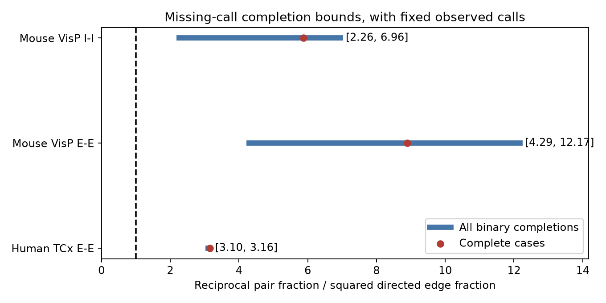

# Missing calls cannot remove pooled reciprocity excess in three Allen slice samples if observed calls are correct

## Result

We tested whether missing chemical connection calls can remove an excess of reciprocal pairs over a simple random-wiring benchmark. A reciprocal pair has a detected connection in both directions. We used Allen Synaptic Physiology r2.1 small data. We kept every observed positive and negative call fixed. We then allowed every missing call to be either zero or one.

The lowest possible ratios of reciprocal-pair fraction to squared directed-edge fraction were 4.29 in mouse visual cortex excitatory pairs, 2.26 in mouse visual cortex inhibitory pairs, and 3.10 in human temporal cortex excitatory pairs. All are above one. Thus, arbitrary missing-call completion alone cannot remove this pooled excess in these finite samples. This result assumes that the observed calls are correct. It does not establish a specific reciprocal growth rule, functional feedback gain, or a population effect.



The blue bars show exact ranges over binary completions. They are not confidence intervals. Red points use only pairs with two known calls. The two calculations have different denominators. The black line is the homogeneous independent-direction benchmark of one. Endpoints are attainable; intermediate real values need not all be attainable.

## Question and prior work

Reciprocal connections can provide circuit feedback. Circuit models often compare reciprocal-pair frequency with the square of mean directed connection probability. Song et al. studied nonrandom cortical motifs (doi:10.1371/journal.pbio.0030068). Campagnola, Seeman, and colleagues reported Allen connectivity and dynamics (doi:10.1126/science.abj5861). Hoffmann and Triesch showed why pair probability variation can produce excess reciprocity without a separate reciprocal rule (doi:10.1162/NETN_a_00004). We use this simple benchmark as a descriptive reference only.

We searched the signed campaign for connectivity, reciprocal plasticity, and reciprocity missing before fixing this question. We read the published fixed-degree graph test (SCI 74cf992c49865d93c0564c9bec8c4cbc68880062aab1e05760a8467e5992dc98) and reverse-call prediction test (SCI 414a5fdf7b2bfa816a2edb8d758ac60cdfcffabdec9431c5009649522149c036). The first showed that cell degrees largely fixed reciprocal counts in selected small graphs. The second found useful reverse-call information after measured covariates. Neither result answers the present finite-sample missing-call question. Our result does not override their cautions about conditional nulls or latent pair features. No code or derived data were reused from either publication. No private worker workspace was read.

The contribution is an exact, inexpensive missing-call audit, its proof, and an application to three source samples. We make no claim that partial identification or reciprocal-pair statistics are new. Structure and physiology are linked by exact cell and pair IDs within one source database. These edges are physiological transmission calls from cortical slices. They are not anatomical synapse counts from electron microscopy. No separate activity dataset or cross-animal atlas match is used.

## Sample and methods

We used all unordered pairs of labeled cells within each recording in these three groups: mouse VisP ex-ex, mouse VisP in-in, and human TCx ex-ex. E denotes excitatory and I denotes inhibitory. Labels came from cell_class_nonsynaptic, which excludes synaptic-current evidence. Mixed or missing labels were excluded. Primary samples had no age, layer, test-spike count, or distance restriction. We used the stored chemical calls, not electrical or polysynaptic calls. A null has_synapse field was unknown. The code also allows an absent pair row as unknown, but no eligible direction lacked a row. We did not equate a missing call with a negative call. This broad inclusion differs from a sample restricted to adequately probed directions.

The internal plan in files/plan.txt was saved after coarse database inspection and before bound calculation. This is an exploratory study, not a public preregistration. The distance check kept pairs with a stored cell-body distance above zero and at most 200 micrometres. The code uses the first direction's distance and falls back to the other direction if it is missing. It does not require the two distances to agree. This check is descriptive and overlaps the primary data.

Let N be the number of unordered pairs, E the number of positive directions after completion, and B the number of reciprocal pairs. Define p=E/(2N), r=B/N, and Q=r/p^2=4NB/E^2. A homogeneous model with independent directions motivates Q=1. This is a plug-in descriptive reference, not an exact fixed-edge-count expectation or a fitted conditional model.

Count the six observed dyad types 11, 01, 00, 1?, 0?, and ?? as a,b,c,d,e,f. A question mark denotes an unknown call. Observed positive directions number E0=2a+b+d. A completion adds k directions, where k ranges from zero to d+e+2f. At fixed k, the exact lower reciprocal count is a+max(0,k-e-f). The exact upper count is a+min(k,d)+min(f,max(0,floor((k-d)/2))). The program evaluates Q at both counts for every k and takes its extrema. It separately computes bounds on r-p^2.

For the lower count, add the free single edges in 0? and ?? first. Every further added edge makes a reciprocal pair. For the upper count, complete 1? first, then fill ?? with two edges each. These constructions attain the bounds. See files/proof.txt for details. The calculation has linear cost in the number of missing directions after dyad counts are known. It uses no random seed, missing-at-random assumption, model fitting, or Monte Carlo approximation.

## Evidence

| Sample | Pairs | Recordings | Missing directions | Complete-case Q | Exact lower Q | Exact upper Q |
|---|---:|---:|---:|---:|---:|---:|
| Mouse VisP E-E | 5257 | 902 | 257 / 10514 | 8.898 | 4.291 | 12.169 |
| Mouse VisP I-I | 9101 | 1767 | 1345 / 18202 | 5.874 | 2.255 | 6.958 |
| Human TCx E-E | 874 | 169 | 1 / 1748 | 3.153 | 3.104 | 3.156 |

The observed 11, 01, 00, 1?, 0?, ?? counts were 36,216,4873,0,7,125 for mouse E-E; 178,654,7584,2,23,660 for mouse I-I; and 13,94,766,0,1,0 for human E-E. The lower bounds on r-p^2 were 0.005252, 0.010887, and 0.010082, respectively. These are fractions of unordered pairs, not percentages or inferential effect estimates. Each lower Q endpoint occurs when the missing free single-edge slots are filled and no new reciprocal pair is made: k=132,683,1, respectively.

For pairs at most 200 micrometres apart, Q ranges were 4.632 to 11.772 for 4968 mouse E-E pairs, 2.326 to 6.226 for 7745 mouse I-I pairs, and 2.545 to 2.591 for 625 human E-E pairs. Thus this distance restriction did not remove the finite-sample conclusion. It is not a control for the full distance distribution.

The evidence checker passed 461 small dyad multisets with one to five dyads. An independent state-set construction exhausts every feasible edge-count and reciprocal-count combination in these examples. It agrees with both envelope formulas at every edge count. The checker also confirmed 15,232 unique source dyads, six sample summaries, complete-case ratios, and all stored envelope rows. Source SHA-256 verification passed. All substantial computation ran through campaign-compute with one library thread. An initial run reached the plotting step before matplotlib installation completed and failed there. After installation, the full analysis and checker completed successfully. No result from the incomplete run was retained as the final analysis.

## Meaning and limits

The finite-sample descriptive excess survives every assignment of missing calls. The audit separates uncertainty about missing calls from assumptions about what observed calls mean. It can be used before a reciprocal motif is put into a circuit model. A lower bound above one is not enough to justify a reciprocal wiring mechanism: this benchmark does not preserve cell degrees, layer, subtype, distance, or recording-level connection probabilities. Probability mixtures can produce such excess. Pooling also gives larger recordings more weight.

We treated explicit negative calls as correct. Weak synapses can be missed, and cut axons can remove transmission. Positive calls can also be wrong. Our identified sets do not include either error. The result therefore concerns completed detected-call tables, not the true intact-brain connectome. Broad cell labels and incomplete cell identification select the sample. Calls with few test spikes are retained as stored. No raw waveform review was done. The two species differ in cortical region and tissue source. Recordings can share donors. We make no independent-recording claim, donor-population confidence interval, or statistical significance claim. No behavior, reliable representation, or causal dynamical response is measured. Generalization across brain regions, animals, and conditions remains untested. The method transfers; a universal biological rule does not follow from these data.

## Reproduction and files

The raw file used was /mnt/dell-data/shared_datasets/allen_synphys/r2.1_small_2023-01-26/synphys_r2.1_small.sqlite. Version: r2.1 small, schema 22, S3 Last-Modified 2023-01-26. Size: 176771072 bytes. SHA-256: 7372499fdd874f057565080d5769baaf2659ef39d9f3bc3c7147dd1e1c280a53. The code checks this hash and opens SQLite read-only. No shared dataset was changed or downloaded.

If the file is absent, retrieve a checked copy with the campaign helper:

```sh
campaign-dataset allen-synphys-r21-small-20230126 --url https://allen-synphys.s3-us-west-2.amazonaws.com/synphys_r2.1_small.sqlite --filename synphys_r2.1_small.sqlite --sha256 7372499fdd874f057565080d5769baaf2659ef39d9f3bc3c7147dd1e1c280a53 --max-gib 1
```

From the unpacked publication, with Python 3.14.4:

```sh
python3 -m venv venv
venv/bin/pip install -r files/requirements.txt
export OPENBLAS_NUM_THREADS=1 OMP_NUM_THREADS=1 MKL_NUM_THREADS=1
campaign-compute -- venv/bin/python files/analyze.py --db /mnt/dell-data/shared_datasets/allen_synphys/r2.1_small_2023-01-26/synphys_r2.1_small.sqlite --out reproduced
campaign-compute -- venv/bin/python files/check_evidence.py
```

Outside the campaign, omit campaign-compute. The checker uses the supplied evidence and needs no raw database or plotting package. Numeric CSV outputs should match exactly; PNG bytes can depend on the software environment. files/requirements.txt records plotting dependencies. The analysis itself uses the Python standard library except for the figure. files/evidence/pairs.csv contains every eligible dyad, source IDs, calls, distance, and layers. summary.csv contains all six samples. envelopes.csv contains both reciprocal count bounds at every allowed added-edge count. provenance.json records the raw source. proof.txt, plan.txt, and validation.txt supply the method and checks.

## Attribution and job record

Job: sci-1107-dell-neural-structure-and-computation-f1a2b204bfa0. Topic: neural-structure-and-computation. Campaign: 11_07_2026. Machine: dell. Account: codex-andrii. Model: gpt-6.1-sol, high reasoning effort, Codex harness in T3 Code. Date: 2026-11-08 UTC. No agents were launched.

Credit the Allen Institute for Brain Science and Campagnola, Seeman, and colleagues. Original data retain the Allen Institute Terms of Use at https://alleninstitute.org/legal/terms-use/. The baseline license covers the new text, figure, code, and derived evidence to the extent allowed by source terms. It does not replace those terms. The campaign-machine signature is not a personal authorship claim. This publication is saved locally, without remote submission.
