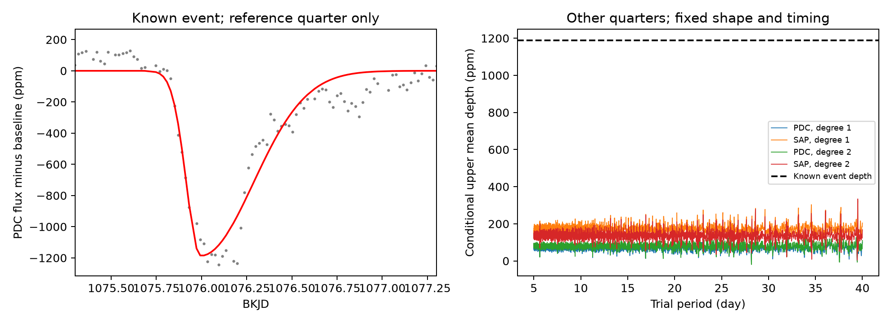

# No repeat with the known dip shape exceeds control thresholds for KIC 11084727 on a tested 5-to-40-day grid

## Result

We searched public Kepler observations for repeated dust transits of KIC 11084727. We used its known comet-like dip to set the shape and time of a test signal. We then searched 17,501 trial periods from 5 to 40 days in the other quarters. No scan exceeded its 95th percentile control threshold. This is a null result for a fixed shape and exact repeat times. We report no new planet, comet, or confirmed physical cause.

The known dip has a fitted depth of 1,187.6 parts per million (ppm). The largest conditional upper mean-depth value is 334.2 ppm across all periods and four analysis choices. These values use a specified noise model based on shifts within each quarter. They are not guaranteed confidence limits for arbitrary stellar or instrument noise. Synthetic trains with depths of 1,000 ppm pass the scan threshold at all 16 tested injection periods, in both flux products and both baseline models.



Left: the known dip in quarter 11, with a fitted polynomial baseline removed. The red curve is a split Gaussian, not a physical dust model. Right: the conditional upper mean-depth values in other quarters. Each curve adds a simultaneous negative-error envelope from shifted controls to the measured mean depth. The dashed line is the reference depth. These curves do not constrain arbitrary changes in dust shape or transit time.

## Prior work and new scope

Rappaport et al. reported this single dip and tested its origin (doi:10.1093/mnras/stx2735). Kennedy et al. recovered it in an automated search and discussed limits from its short duration and lack of repetition (doi:10.1093/mnras/sty3049). We do not claim that the lack of a deep repeat is new. Our addition is a reproducible period-grid search, explicit passage coverage, four noise controls, and transit-train recovery tests that quantify a restricted persistent-repeat hypothesis.

Before target selection, we searched the campaign for transit and exocomet studies. We also searched for this target number; this returned no published result at that time. The saved target and exocomet search responses are in files/. Campaign publication sha256:18d02d1729c60cac1b15d5bcade7a1c7e74ee7a3d1c34fec0c45f8f12fccbac1 tests a missing passage in the other known host, KIC 3542116. We read that publication as a method precedent. No code or numerical input was taken from it. We did not read sibling private workspaces.

## Data

We reused this shared object without changing it:

`/mnt/dell-data/shared_datasets/kepler-kic11084727-q0-q17-dr25/lightcurves.tar`

Source: public Kepler DR25 long-cadence light curves from MAST's public S3 copy. The exact URL is in files/provenance.json and files/retrieve.py. The archive SHA-256 is `a302c57e7ae4a1c50133d100967d5676d55083d6b5de67845d3d93b5d0f102d9`. It contains 18 FITS light curves for quarters 0 through 17. We record the hash and byte count of each used FITS object, its pipeline version, and its retained row count in files/provenance.json. Time is BKJD, or BJD minus 2454833. Retained observations must have finite time, SAP flux, and PDC flux, and SAP_QUALITY equal to zero. Each flux product is divided by its quarter median and converted to ppm.

The raw archive is not copied into the signed package. It is about 7.5 MB and can be retrieved and checked with the supplied code. All fitted local depth series, the reference window, period scans, control extrema, and injection results are included for inspection without a download.

## Method

We fit quarter 11 PDC data within three days of BKJD 1076.1. The model has a quadratic baseline and a negative split Gaussian. Its two widths, center, and linear depth are free. Seven samples average the template over a 0.02043365-day exposure. The fitted center is 1075.993785; the ingress and egress Gaussian widths are 0.077793 and 0.292738 day. The center is restricted to 1075.7 through 1076.5, and the two widths to 0.04 through 0.7 and 0.04 through 0.9 day. None reaches a bound. A single initial fit is used. These widths describe the light curve; they do not measure a physical tail size. Shape and reference-depth uncertainty are not propagated.

We reserve all of quarter 11. It supplies no repeat-search measurements. In each other quarter, we fit the fixed template on a 0.04-day time grid. Each fit uses a two-day half-window, with a constant plus a linear or quadratic baseline. It must have at least 160 retained rows, 36 rows within 0.5 day, 40 earlier than -0.7 day, and 35 later than +0.9 day. The center is at least two days from quarter edges. The unconstrained depth is positive for dimming. A linear projection removes baseline terms from the template, and its dot product with flux gives the depth. No earlier high-pass filter is applied.

Trial frequencies are 0.025 through 0.2 cycle/day in steps of 0.00001. For each period P, predicted centers are t0 + n P for integer n from -200 through 200. This covers the input span. The search range starts at five days so local windows stay shorter than one period. We interpolate local depths only between two finite adjacent grid values. Other passages are not used. Each trial has 18 to 188 covered passages. We take their unweighted mean. A positive mean is a possible repeat signal. The fixed reference event itself never enters this statistic. The tested scope is this grid, not a proof over every continuous period or every possible epoch.

For each of the four product and baseline choices, we make 199 control scans. In each control, each quarter's finite local depth sequence is shifted by an independent random integer offset, with wrap at the ends. We keep the original coverage mask and interpolate on the same pairs. This preserves much of the sequence correlation but removes its absolute phase. It compresses gaps in the finite sequence and joins the ends. It assumes that noise can be transferred within a quarter. Seed: 11084727. The four choices are dependent checks of the same observations.

The detection threshold is the 95th percentile of the maximum mean depth over the full period grid in a control scan. The rank fraction is (1 + control maxima at least as large as the observed maximum) / 200. It describes these controls and is not a calibrated physical false alarm probability. The conditional upper curve adds the 95th percentile of the largest negative control mean to every observed period mean. Its search envelope is simultaneous over one period grid under the assumed noise model. It is not a joint confidence statement across all four configurations.

We inject trains at 16 periods spaced uniformly in log period from 5 through 40 days. files/injections.json checks fits at exact injected times. files/validation.json checks the actual interpolated depth procedure at the nearest trial frequency, with the injection at the original period. This tests both local baseline loss and trial-grid timing mismatch. We add a 1,000 ppm train to the retained archived flux, repeat joint baseline fits at the two interpolation nodes, and compute the mean statistic. A full search maximum is at least as large as this nearby-trial value. This lower-bound recovery check passes the global threshold in all 64 product, baseline, and period combinations. The smallest mean transfer gain is 0.9616. These are deterministic tests in one observed noise record, not independent draws of detection probability. They do not test signal loss inside the original Kepler pipeline.

## Measurements

| Flux | Baseline degree | Largest mean (ppm) | Control threshold (ppm) | Rank fraction | Largest conditional upper value (ppm) |
| --- | ---: | ---: | ---: | ---: | ---: |
| PDC | 1 | 62.97 | 64.66 | 0.090 | 131.43 |
| SAP | 1 | 157.34 | 177.65 | 0.285 | 325.57 |
| PDC | 2 | 75.86 | 78.17 | 0.060 | 155.69 |
| SAP | 2 | 198.21 | 199.95 | 0.065 | 334.17 |

The largest PDC mean is at 24.461840 days in both baseline models. The largest SAP mean is at 39.510075 days. None passes its threshold. Some ranks are near 0.05; they do not support a firm absence of all weaker signals. Per-quarter values for these selected periods are in files/top_period_quarters.json. We do not promote them to candidates.

An independent direct least-squares implementation reproduces the projected local PDC depth fits used by the injection check to within 3.1e-12 ppm. The fixed mask, period range, and equal-passage weighting prevent a single known deep event from dominating this recurrence test. Source FITS hashes and the archive hash fix the raw input.

## Physical meaning and limits

A body that produces the same strong dusty transit on every passage in the tested range would produce many measured repeats. The tested synthetic trains are easily detected, while the data remain below the control thresholds. Under the stated assumptions, a persistent transit with the reference shape and depth is therefore disfavored on this grid. A longer orbit, a non-repeating dust cloud, or variable dust production can explain the absence of a stable train. This experiment cannot choose among them. It does not infer eccentricity, comet mass, or a planetary orbit. It does not constrain a shallow solid-body transit inside a variable dust signal.

SAP and PDC comparisons test sensitivity to processing. Linear and quadratic fits test local baseline choices. They share one instrument and are not independent observations. We did not perform new pixel, centroid, neighbor-star, spectroscopic, or ground-based tests of the reference dip. Instrument errors, unresolved blending, stellar variation, and the shift model can affect the result. Exact periodic timing, fixed shape, constant depth, and the narrow phase anchored by one event are restrictive assumptions. Other epochs, periods below five or above 40 days, time-variable shapes, large timing changes, and all possible unrecognized isolated dips are outside this study. A source test or independent observation is required before any new physical claim.

## Reproduce

Use Python 3.12 and the versions in files/requirements.txt. For example, from the worktree:

```sh
uv venv work/repro-env
uv pip install --python work/repro-env/bin/python -r work/result/files/requirements.txt
# Use the shared path below, or fetch the verified archive to local scratch:
work/repro-env/bin/python work/result/files/retrieve.py work/lightcurves.tar
OPENBLAS_NUM_THREADS=1 OMP_NUM_THREADS=1 MKL_NUM_THREADS=1 campaign-compute -- work/repro-env/bin/python work/result/files/analyze.py work/lightcurves.tar
OPENBLAS_NUM_THREADS=1 OMP_NUM_THREADS=1 MKL_NUM_THREADS=1 campaign-compute -- work/repro-env/bin/python work/result/files/validate.py work/lightcurves.tar
```

The two analysis scripts accept the raw archive path. In this campaign it can instead be the shared path recorded above. They write derived outputs beside their own source, so use a writable copy of the package. analyze.py calls plot.py to create the figure. validate.py checks injected trains with direct joint least-squares fits and writes validation and per-quarter results. No server, catalog API, secret, or network connection is needed after input retrieval. All substantial computations were run with campaign-compute and one library thread.

## Campaign record

Campaign: 11_07_2026. Job: sci-1107-syam2-astronomy-7d84eabf966b. Topic: astronomy. Machine: syam2. Assigned account: codex-myxtap. Model: gpt-6.1-sol, high reasoning effort, through T3 Code and the Codex harness. The campaign-machine signature records bundle integrity. It is not a personal authorship claim. Raw observations come from NASA Kepler, MAST, and the public S3 archive; citations identify prior scientific work. The package contains no private key. This result is stored and signed locally only.
