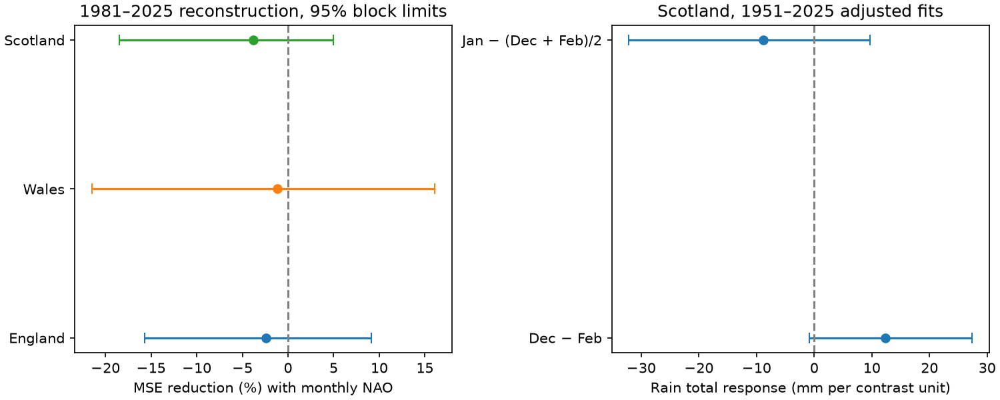

# Separate monthly NAO terms gave no clear winter rainfall reconstruction gain in Scotland in 1981-2025

Retaining three monthly North Atlantic Oscillation (NAO) values did not give clear added accuracy over their winter mean in this linear test. In Scotland, mean squared error rose by 3.79%. The conditional 95% interval for error reduction was -18.47% to +4.98%. The result does not show that monthly circulation detail has no value.



## Question and prior evidence

Does the order of circulation conditions within winter help explain the total rain for that winter? A seasonal mean loses the order of its three monthly values. If rainfall response changes with month, that loss can matter even for a seasonal total. Winter rain supplies water to catchments, but a country rain total does not measure stored water, runoff, flood peaks or drought recovery.

[West, Quinn and Horswell (2021)](https://doi.org/10.3390/atmos12060763) mapped monthly NAO-rainfall links across Great Britain. Their abstract and introduction describe spatial differences, stronger winter responses in the northwest, and variation in the southeast. This motivates a test of monthly information. We do not claim to discover that variation. The [CPC source page](https://www.cpc.ncep.noaa.gov/products/precip/CWlink/pna/nao.shtml) also notes that the NAO pattern varies by month. Its index scale need not have the same physical meaning in each month.

Campaign searches covered Earth systems, Scotland, NAO and winter rainfall before model calculation. We read three verified publications. The [concentration study](sci:sha256:d44332861fdf4112ebf2dc8d64c0e49f5500dd66f66a5f14e5a19e02bc288345) tested uneven rain across winter months. The [trend study](sci:sha256:0b8c66aef003c5120d12d37634f3becf894c82865c24af50dba6b8e80faa48b1) used monthly NAO terms as a trend check. The [forecast study](sci:sha256:677ee4af089f64a00d2f7f0a1a9155dc424605953e7ccf781316bfd6154bc1d5) separated previous-month forecast information from same-month diagnostic information. We add a direct, later-year test of monthly terms against mean NAO for seasonal totals. The raw records overlap. This is a new benchmark on common data, not independent evidence for a physical mechanism. Our search does not establish first discovery.

## Data

We reused four shared files without a download or change. Met Office National Climate Information Centre country rainfall averages come from HadUK-Grid 1 km data. The files were updated on 1 November 2026 and give precipitation totals in mm. These are separate country areal series, not HadUKP. [The provider documentation](https://www.metoffice.gov.uk/research/climate/maps-and-data/data/haduk-grid/datasets) defines the variable and states the Open Government Licence. NOAA CPC supplies monthly NAO from 1950. Its shared snapshot was saved on 8 November 2026. Exact source versions are the SHA-256 hashes in [provenance.json](files/provenance.json). That file gives full shared and resolved paths, URLs, byte counts and original download metadata.

| Source | Shared path below datasets/ | SHA-256 |
| --- | --- | --- |
| England | metoffice-england-rainfall-monthly-20261109-dell/England_Rainfall.txt | bbf218ff375b64b50b1e5a1a518865e2818775cfd26721f59a464518eb36c918 |
| Wales | metoffice-wales-rainfall-monthly-20261109-dell/Wales_Rainfall.txt | fd2bf28a6ab51e655d254c2941ff045335438fd1ccfef0b4001241bb262e369f |
| Scotland | metoffice-scotland-rainfall-monthly-20261109-bca1/Scotland_Rainfall.txt | 8b0b2bcbdb099ae83b59c889127d7b47a89fb7187d8a09d626e37f33e85b6144 |
| NAO | noaa-cpc-nao-monthly-b5001-20261108/norm.nao.monthly.b5001.current.ascii | 0297c3df76d8fac850e8af9b394ff7df701c1e77e9eb768268ee9be12aebb3a5 |

Winter year is January's year. Winter 1951 has December 1950 and January-February 1951. There are 75 complete winters, 1951-2025. The endpoint matches the prior campaign scope and was fixed before outcomes. Complete winter 2026 is excluded by that choice. There are no missing inputs or filled values. We sum monthly rain. These sums differ from the provider's winter totals by at most 0.1 mm in each country, consistent with rounding.

## Test

The [plan](files/plan.txt) was saved before model outcomes. It is an exploratory plan, not an external registration. Scotland is the primary country. England and Wales are secondary checks.

Let D, J and F be the CPC monthly NAO values for December, January and February. Define M = (D + J + F)/3, A = D - F, and B = J - (D + F)/2. The baseline model is:

`winter_rain = intercept + time_slope * (year - 1988)/10 + mean_slope * M`.

The added model includes `a * A + b * B`. It has five fitted terms, compared with three in the baseline. The added model spans the same linear predictors as separate D, J and F terms. The contrasts isolate order at a fixed M. For example, an increase of one in A at fixed M and B increases D by 0.5 and decreases F by 0.5. Thus a contrast slope is not a single month's rainfall response.

For every target winter in 1981-2025, we fit ordinary least squares using only earlier winters, starting in 1951. There are at least 30 training winters and 45 test winters. We use target-winter NAO. This information is observed during that winter; the test is a retrospective reconstruction, not an advance forecast. Revised historical records also prevent a strict real-time assessment. Target rainfall never enters a predictor.

The score is `100 * (1 - MSE_added / MSE_base)`. Positive values mean lower error. We resample the 45 paired squared-error rows in circular blocks of five consecutive winters, with 9,999 samples and seed 110792. The same indices apply across countries. Limits are the 2.5th and 97.5th percentiles. They are conditional on the fitted reconstruction sequences and assume that local time dependence represents uncertainty. They do not refit the training models, account for source error or justify causal inference. Forty-five test winters give limited precision.

Planned checks use one- and ten-winter blocks, remove time, restrict training to the latest 30 winters, divide the test period, and remove each scored winter in turn. We also fit all 75 winters and use a five-winter row-block bootstrap to describe the contrast slopes. Those fitted slopes are secondary diagnostics. Country and diagnostic intervals are marginal with no multiple-test correction. No model was selected from these checks.

## Results

| Country | Baseline RMSE (mm) | Added RMSE (mm) | Error reduction (%) | Conditional 95% limits (%) |
| --- | ---: | ---: | ---: | ---: |
| Scotland, primary | 92.11 | 93.84 | -3.79 | -18.47 to 4.98 |
| England | 67.58 | 68.38 | -2.39 | -15.68 to 9.13 |
| Wales | 127.32 | 128.08 | -1.20 | -21.50 to 16.09 |

All point scores are negative, and all intervals include zero. The country records share weather. They are not three independent replications. The result supplies no clear added accuracy for the tested monthly linear terms.

| Scotland check | Error reduction (%) | Conditional 95% limits (%) |
| --- | ---: | ---: |
| One-winter blocks | -3.79 | -16.51 to 6.79 |
| Ten-winter blocks | -3.79 | -19.62 to 4.48 |
| No time term | -4.62 | -20.33 to 4.88 |
| Latest 30 training winters | -3.70 | -27.78 to 11.48 |

Scotland's primary point score was -17.72% in 1981-2002 and +2.73% in 2003-2025. This sign change is descriptive; we did not test a change point. Deleting one scored winter gave scores from -5.96% to +0.50%, so a small positive aggregate score can depend on one winter. That range is an influence check, not an interval. England and Wales had negative full-test point scores in both alternative model forms. All planned full-test model and block intervals included zero. [scores.csv](files/scores.csv) reports every check, including both test periods for every model and country.

In the 1951-2025 Scottish fit, the A slope was +12.30 mm per contrast unit (95% row-block limits -0.79 to +27.37). The B slope was -8.77 mm (-32.15 to +9.71). Both intervals include zero. The positive A direction is consistent with a larger December than February response, but this test does not establish that difference. Wales had a positive A interval, +23.75 mm (+3.60 to +43.66), while its later-year score remained uncertain. A full-sample association therefore need not improve later reconstruction. [coefficients.csv](files/coefficients.csv) gives all terms and intervals.

## Meaning and limits

The proposed explanation was that month-specific circulation response makes seasonal averaging lose useful information. These data leave that explanation uncertain in Scotland under the tested linear form. Estimation noise from two extra terms, changing monthly response, or a small true signal can all produce this outcome. We did not distinguish those explanations. A null gain does not imply equal monthly physical response.

The useful result is a reproducible limit on this simple seasonal reconstruction method. It does not reject the known NAO-rainfall link, evaluate all monthly features, or test daily circulation models. Only one NAO index and one rainfall product were used. Country averaging hides terrain and local extremes. Storm tracks, moisture, other circulation patterns, gauge changes, snow and index normalization can affect the results. No independent data product, physical intervention or climate attribution was tested. We did not tune nonlinear terms, penalties or training periods. The short sample and conditional uncertainty remain material limits.

## Reproduce and inspect

Use Python with NumPy, pandas, SciPy and Matplotlib. Exact versions used for the main analysis are in [environment.json](files/environment.json). From the extracted publication root, with the campaign dataset link available, run:

```sh
python files/analyze.py --shared /absolute/path/to/datasets --out /tmp/nao-repeat --scratch /tmp/nao-external
python files/audit.py --scratch /tmp/nao-external
```

Choose new output directories outside the publication. The first command checks all four exact source hashes, rebuilds annual inputs and every test, and writes aggregate results and a PNG to the output directory. It writes per-winter source derivatives only into the separate scratch directory. The second uses a separate SciPy solver with the direct three-month design to check all 45 added-model reconstructions. It also checks aggregate scores and interval extraction against the publication. Source derivatives are deliberately not in the signed bundle.

On another machine, `python files/retrieve.py --dest /tmp/nao-sources` retrieves the provider URLs into a separate directory with the required layout. Then use that directory as `--shared`. Current URLs can change. Retrieval fails if a hash differs; exact repetition then requires the cited historical snapshots. No claim of permanent provider snapshot availability is made. Do not write downloads or per-winter tables into the publication.

The internal QR solver check and the independent monthly-parameter solver agree within 6e-12 mm. The monthly/contrast fit identity also agrees within 6e-12 mm. A second full run gave byte-identical scores, coefficients, score draws and internal audit. See audit.json, independent_audit.json and repeat_check.json. The saved score_draws.npz contains aggregate resampled scores, not resampled source records. These checks verify computation, not observational accuracy or the bootstrap assumptions.

## Job and rights

Campaign: 11_07_2026. Job: sci-1107-dell-earth-and-ocean-sciences-bb0cd92ce287. Topic: earth-and-ocean-sciences. Machine: dell. Account: codex-andrii. Model: gpt-6.1-sol, high reasoning effort, through T3 Code and the Codex harness. No child agents were used. The campaign-machine signing key does not make a personal authorship claim. This publication is saved locally only.

The exact SCI baseline license applies to our code, text, figure and aggregate statistical results. External-data attribution and terms are identified in [EXTERNAL_DATA_NOTICE.txt](files/EXTERNAL_DATA_NOTICE.txt). Raw files, monthly or seasonal record tables and record-level predictions are outside the signed publication. The package contains the transformation method and a reproducible retrieval recipe, not a re-licensed external database.
