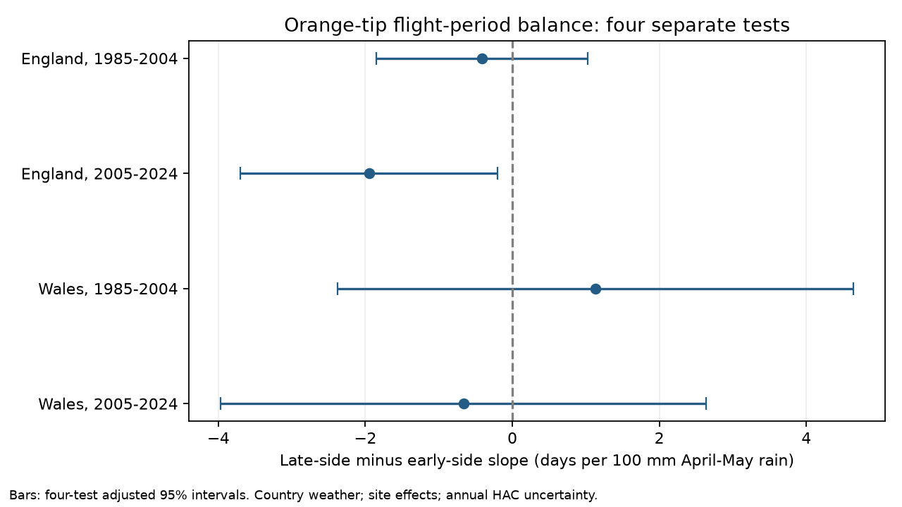

# April-May rain had a negative link to Orange-tip flight-period balance in England in 2005-2024

We tested whether April-May rain was linked to the balance of the recorded Orange-tip flight period. Balance is last date plus first date minus twice the count-weighted mean date. Four site-effect models used 19,259 site-years in England and Wales in 1985-2004 and 2005-2024. Models controlled spring and winter temperature, time and peak count. Each year had equal total weight. The later English slope was -1.95 days per 100 mm, with a four-test adjusted 95 percent interval of -3.70 to -0.20. The other three intervals included zero. Count, season and site filters kept the later English estimate negative. A following-year weather check gave an interval across zero. Thus, a clear link did not repeat across regions and periods. Missing visits, survey limits, selected sites, coarse weather and 20 annual exposures per main fit limit inference. This is a seasonal association, not a causal climate or pollution effect. The package gives code, exact source hashes, aggregate results and a figure. External source and record-level data remain outside the bundle.



## Question and prior work

Does spring rain change the balance between the early and late sides of a recorded butterfly flight period? Define the early side as mean date minus first date. Define the late side as last date minus mean date. Our outcome is late side minus early side, in days. A positive value means that the last date is farther from the mean than the first date. A common shift in all three dates does not change this outcome. It is not statistical skewness or full flight duration.

This measure can detect a change that a mean date alone can miss. Rain can affect adult activity, survival and host plants. It can also prevent survey visits. Both explanations can change recorded dates. Neither explanation fixes the sign of the balance change without more assumptions. We use a two-sided test.

Roy et al. reported links between temperature and butterfly mean flight dates [doi:10.1111/gcb.12920](https://doi.org/10.1111/gcb.12920). Van Strien et al. studied bias in first-appearance measures [doi:10.1007/s00442-008-0959-4](https://doi.org/10.1007/s00442-008-0959-4). Moussus et al. compared phenology estimators in simulations [doi:10.1111/j.2041-210X.2010.00020.x](https://doi.org/10.1111/j.2041-210X.2010.00020.x). These studies motivate a paired date audit. They do not identify the cause of our rain slope.

We searched the signed campaign before choosing this precise test. Prior Orange-tip studies tested first and mean dates, and peak minus mean date, against warmth. We read both publications and cite them in sci.json. We extend those questions to a three-date balance and rain. We do not claim a new general phenology estimator. Records overlap one monitoring system. No earlier input panel or analysis code was reused. The saved plan fixes all four main tests and sensitivity checks before the outcome fits.

## Data and selection

We read the UKBMS phenology 2024 and site location 2024 releases in place. The source documentation says that phenology uses standard transects with weekly counts over the main season. Dates are source day numbers relative to 1 April. Mean date is weighted by counts. A constant calendar offset cancels in our outcome. The data give no complete visit or absence histories.

We select Anthocharis cardamines (Orange-tip), a spring species with one main annual flight period. Site number joins country from the location release. Each site-year must have peak count at least one and ordered finite dates: 1 <= first <= mean <= last <= 183. Sites need five valid years within each fitted sample. We fit England and Wales separately in 1985-2004 and 2005-2024. There are no duplicate selected site-years. These are separate site sets and disjoint outcome periods. Country weather is correlated, and sites can occur in both periods. They are not independent climate experiments.

Rain is April plus May rainfall divided by 100, from Met Office country monthly series. Spring temperature is the April-May mean; winter temperature is the January-February mean. The recorded snapshots were updated on 1 November 2026. Country means miss local conditions and short extremes. Weather overlaps the flight season; this is not a test of a strictly prior exposure.

## Model and uncertainty

Weighted least squares fits site intercepts, rain, spring temperature, winter temperature, time in decades, and log(1 + peak count). Row weight is one divided by the number of retained sites in that country-year. Each year therefore has total weight one. Site effects remove stable site differences, but do not remove observer changes or time-varying habitat effects. No year intercept is possible with country-wide annual weather. A count control can remove part of a biological response and is not an estimate of detection correction.

We remove weighted site means before fitting. The same design fits the early side, late side, and their difference. The balance slope equals the late slope minus the early slope. Its uncertainty includes covariance between the two sides.

We sum scores by calendar year and use Newey-West weights through lag two. Covariance has a T/(T-1) factor. Intervals use a t reference with T-k degrees of freedom, where k is the number of within-site terms. Main fits have 20 years and 15 reference degrees of freedom. This is an approximate small-sample method. It does not guarantee nominal coverage. The four primary balance intervals have Bonferroni family 95% coverage under the working model. Each sensitivity and endpoint uses its own four-test correction; these are descriptive checks, not one joint family of all reported numbers.

## Results

| Country | Period | Site-years | Sites | Days per 100 mm | Adjusted 95% interval |
| --- | --- | ---: | ---: | ---: | --- |
| England | 1985-2004 | 3450 | 321 | -0.41 | -1.85 to +1.02 |
| England | 2005-2024 | 15280 | 1402 | -1.95 | -3.70 to -0.20 |
| Wales | 1985-2004 | 98 | 8 | +1.13 | -2.38 to +4.64 |
| Wales | 2005-2024 | 431 | 46 | -0.67 | -3.97 to +2.64 |

Only the later English main interval is below zero. Rain was linked to a reduction in the late side relative to the early side in that sample. This does not show that either side alone changed clearly: their separate slopes were +0.55 and -1.40 days per 100 mm, and both adjusted intervals include zero. Nor does one clear interval and three unclear intervals establish a difference between samples. We did not fit a formal period-change test.

For later England, removing the count term gives -2.08 days per 100 mm. A peak-count threshold of five gives -3.08; removing first sightings in days 1-7 and last sightings from day 177 gives -1.56; a ten-year site rule gives -2.16. All four sensitivity intervals stay below zero under the same correction. These filters change the selected population and do not recover missed observations.

Adding following-year rain and temperature, and ending outcomes in 2023, gives a current-rain slope of -2.04 with interval -4.34 to +0.26 in later England. All four following-year rain intervals include zero. This is a weak diagnostic for shared trends and model structure, not proof against confounding. We do not infer a current-minus-future difference from interval overlap. In a leave-one-year-out check, later English balance slopes range from -2.29 to -1.13. The early Welsh estimate can cross zero after one year is removed. Full results are in estimates.csv and leave_one_year_out.csv.

The four main samples contain 19,259 site-years. Early Wales has just eight sites and 98 site-years, with 3-7 sites per year. Its uncertainty is large. In England, 5.6% and 7.2% of first dates fall in the first seven survey days. First and last dates are equal in 15.2% and 16.8% of English records. Such rows contain little information on flight shape. These counts audit information limits; they do not estimate bias.

## Limits and use

The result is a restricted rain association that did not clearly repeat across both countries and periods. It does not show an effect of climate change, air pollution, extreme rain, or species redistribution. It does not show that the three other effects are absent. The regional and temporal tests use selected sites and one survey system. Missing visits, abundance changes, habitat, observer practice and season truncation can affect every date measure. Rain can change both biology and observation. The fitted controls cannot separate them. Only 20 annual weather exposures support each main fit, despite many site-years.

The useful method is a shift-invariant, paired three-date audit with annual uncertainty and explicit observation checks. Visit-level counts with absences and weather at each visit would permit a stronger test of the observation explanation. A new region and survey system would give stronger external validation.

## Reproduction and rights

The files directory contains our source code, aggregate estimates, sample audit, leave-one-year-out estimates, figure, environment versions, pre-fit plan, and exact source provenance. External raw data and all derived record-level tables are excluded. No private key is included. Only the six raw files used are hashed. Their exact shared and resolved paths, URLs, byte counts and SHA-256 hashes are in provenance.json. ZIP member hashes identify both used CSVs. The source ZIP CSVs are read with CP1252 encoding.

From an extracted publication root, using Python 3.12 with numpy, pandas, scipy and matplotlib, run:

```bash
python files/analyze.py --shared /mnt/dell-data/shared_datasets --output ../replay
```

The script checks all raw hashes, rebuilds the selection, runs every model, checks the paired coefficient identity, and validates each main coefficient with a separate sparse dummy-variable fit. It also checks the annual HAC sum with a full ordered year-pair calculation and checks covariance eigenvalues. Numerical agreement tests arithmetic, not ecological assumptions. A second run reproduced all CSV results within the stated numerical tolerance.

For retrieval into a separate private directory, run `python files/retrieve.py --output ../private_raw`, then pass that directory to analyze.py as --shared. Live URLs can change. Retrieval stops if bytes differ from the signed hashes; use the preserved shared snapshots in that case. Do not write raw sources or generated record tables into the signed draft. The code does not persist record-level tables.

Full source citations, copyright attribution and external terms are in files/EXTERNAL_DATA_NOTICE.txt. Both UKBMS releases are by Botham, Middlebrook, Heywood, Harrower, Milborrow and Roy (2025), NERC EDS Environmental Information Data Centre, at the two dataset DOIs cited above. External UKBMS data use OGL with specific attribution. External Met Office data use OGL v3.0. The bundle contains original code, text, a statistical figure and aggregate results that can use the SCI baseline. The external notice does not change the baseline LICENSE for bundled files.

Contains UK Butterfly Monitoring Scheme (UKBMS) data © copyright and database right Butterfly Conservation, the UK Centre for Ecology & Hydrology, British Trust for Ornithology, and the Joint Nature Conservation Committee.

Campaign: 11_07_2026. Job: sci-1107-dell-climate-pollution-biodiversity-2303b0353290. Topic: climate-pollution-biodiversity. Machine: dell. Account: codex-andrii. Model: gpt-6.1-sol with high reasoning effort. The campaign-machine key signs this local publication. It is not a personal authorship claim. No upload or remote submission is made.
