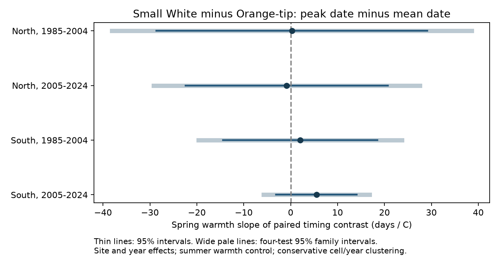

# Spring warmth gave no clear Small White versus Orange-tip peak-minus-mean date contrast in England in 1985-2024

We tested whether spring warmth had a different link to peak date minus mean flight date in Small White and Orange-tip butterflies. We matched the two species at the same English sites and years. Four models used 18,156 matched site-years in two regions and two periods from 1985 to 2024. Models removed site and year effects and controlled summer temperature. The four spring slopes ranged from -0.85 to 5.50 days per C. All four adjusted 95 percent intervals included zero. Only 0.054 to 0.067 C of residual spring variation remained. Count and season coverage checks also gave intervals across zero. Models with a time trend instead of year effects gave negative estimates in both later samples. These fits use different weather variation and do not show that year control removed a true effect. The data do not establish a common species difference or equal responses. Missing visits, selected sites, coarse weather, peak ties and few year clusters limit inference. No pollution effect or causal change in generation number is tested. The package gives code, aggregate results, source hashes and checks. External records stay outside the package.



## Question and prior work

Does spring warmth change the difference between peak and mean flight dates more in Small White than in Orange-tip? Small White has several broods; Orange-tip has one spring brood. A change in brood weights could change peak and mean dates by different amounts. A uniform shift of all dates leaves peak minus mean unchanged. However, the gap is not a unique measure of curve shape, brood count or skew. Visits, count error and the rule for peak ties can also change it. Thus even a clear slope would not establish a generation mechanism.

Roy et al. (2015), doi:10.1111/gcb.12920, compared spatial and temporal temperature links in butterfly emergence dates. Macgregor et al. (2019), doi:10.1038/s41467-019-12479-w, studied phenology and multiple reproductive cycles. Moussus et al. (2010), doi:10.1111/j.2041-210X.2010.00020.x, tested phenology estimators with simulations. These studies motivate the question but do not predict our contrast's sign. Small White life history source: https://www.yorkshirebutterflies.org.uk/yorkshire-species/small-white . Orange-tip source: doi:10.1007/s13280-014-0602-z.

We searched the signed campaign before choosing the precise question. Prior SCI study 0d921dbb958f2ded91c8a43f38c71a051ae7e7b1d0ab56dee2bedf567ee0df19 tested Orange-tip peak minus mean with country weather. Study 6a2ba4ee97dd1c4ac9652eccaed866f37bef77284c0c73b6245cc9550bbccb1e tested late flights and later abundance. Our question uses paired species, local weather and site and year effects. The raw observations overlap those studies. It is not an independent validation of their results. The design was saved before model outputs. Source handling changes are recorded in files/design.txt.

## Data and selection

We use UKBMS phenology 2024 and site location 2024, released in 2025, plus NOAA GHCN-CAMS monthly temperature version 3.01. Their external terms and full citations are in files/NOTICE_external_data.md. The UKBMS summaries concern standard transects with regular counts. They do not give actual visit dates. We make no claim that summary records measure all flights.

We first remove 98 rows that are exact duplicates in all source columns. We then match Small White and Orange-tip by site and year. The location join is unique. We retain England, 1985-2024, positive peak counts, peak and mean dates from 1 to 183, and peak dates within first and last dates. There are 21,638 matched rows before these quality rules and 21,578 after them. Models require at least five usable years per site within each fitted sample. Each retained site-year has equal weight. Large recent panels therefore give more weight to years with more sites. Site entry and species presence remain selective.

North and South are divided at British National Grid northing 300,000 m. Periods are 1985-2004 and 2005-2024. Sites do not overlap between regions. Outcome years do not overlap between periods. Some sites repeat across periods. Regions share broad weather and year shocks. These are separate checks, not four independent experiments.

Temperature is matched to the nearest complete land grid cell in a fixed British bounding box. We use squared latitude difference plus squared longitude difference scaled by cosine latitude. A complete cell has all months present for 1985-2024. The maximum site-to-cell distance is 31.86 km. Spring is the equal-month mean for March-May; summer is June-August. Temperature is from a 0.5 degree grid, not on-site microclimate or daily extremes. Seasonal means can include weather after some flight dates. This is not a strict exposure-before-outcome test.

## Model and uncertainty

Define G as peak date minus count-weighted mean flight date. The outcome is G for Small White minus G for Orange-tip at the same site and year. Positive values mean a later peak relative to the mean in Small White. We fit outcome = site intercept + year intercept + b times spring temperature + c times summer temperature + error. We remove site and year means by alternating projections and solve least squares. The coefficient b has units days per C. Pairing removes a shared additive site-year date offset. It does not remove species-specific detection, different exposure seasons or count errors.

Scores are clustered by weather grid cell and by year. For each coefficient, the variance is the largest of cell, year and two-way cluster estimates. Each component uses G/(G-1) and (N-1)/(N-K), where K counts slope and absorbed intercept parameters. The t reference has min(number of cells, number of years)-1 degrees of freedom. Main family intervals use a Bonferroni correction across the four contrast tests. Separate species slopes and sensitivity fits are descriptive. Their table intervals do not control a family across every output. Clustering does not guarantee correct coverage with few clusters or all forms of spatial dependence.

## Results

| Region | Period | Matched site-years | Sites | Cells | Slope, days/C | Four-test 95% interval | Residual spring SD, C |
| --- | --- | ---: | ---: | ---: | ---: | --- | ---: |
| North | 1985-2004 | 541 | 48 | 17 | +0.25 | -38.08 to +38.58 | 0.067 |
| North | 2005-2024 | 3,332 | 342 | 42 | -0.85 | -29.26 to +27.56 | 0.054 |
| South | 1985-2004 | 2,793 | 262 | 39 | +2.04 | -19.67 to +23.76 | 0.067 |
| South | 2005-2024 | 11,490 | 1026 | 54 | +5.50 | -5.82 to +16.81 | 0.064 |

All four main intervals include zero. The early North sample is small. The residual spring SD, after site effects, year effects and summer temperature, is at most 0.067 C in all four samples. This weak remaining contrast makes the slopes sensitive to small spatial errors. One C is far larger than the residual SD, so the reported unit slope should not be read as an observed one-C local comparison.

All count-control, peak-count-at-least-five and season-coverage contrast intervals also include zero. The coverage rule requires a record of any species by day 14 and on or after day 177 in that site-year, and again requires five paired years per site. It is an effort proxy. Early and late records do not prove regular visits between them. Higher counts may reduce some detection error but change the selected population. Count control can also block part of an ecological pathway; it is not a causal correction.

With a linear trend in place of year effects, the later North and South slopes are negative and their four-test intervals exclude zero. These models retain much more spring variation: about 0.65-0.82 C over the four samples. The contrast with year-effect models shows dependence on exposure scale and controls. It does not prove the slopes differ between models or identify which is causal. A shared yearly change in recording or brood abundance can remain in the trend model. All planned variants and species decompositions are in files/estimates.csv.

## Limits and use

This test does not establish that the species have equal temperature responses. The intervals permit large differences. The outcome compares metrics within a year; it is not a development interval between species. Individual dates, brood counts, peak tie rules and repeated visits are unavailable. Only years when both species were recorded are used. The two species differ in more traits than generation number. Coarse weather may miss local heat and rain. We do not test extreme days, air pollution, species range shifts or causal climate change. A better test needs visit-level counts, brood-specific curves and local weather, with the same paired design and a planned exposure window.

## Reproduce and inspect

Use Python 3.12. Exact package versions are in files/environment.json. No extra dependencies were installed in the shared environment. From this workspace:

```sh
python work/result/files/analyze.py --datasets ./datasets --scratch ./work/reproduction --out ./work/reproduced
python work/result/files/validate.py ./work/reproduction ./work/reproduced/validation.json
```

From an extracted bundle, replace work/result/files with files and choose equivalent external input and scratch paths. The output folder contains only aggregate estimates, figures, hashes and numerical checks. The matched record table goes to the separate scratch folder. Never set scratch to the publication folder. To retrieve inputs into a new separate local folder:

```sh
python files/retrieve.py /absolute/path/to/external_inputs
python files/analyze.py --datasets /absolute/path/to/external_inputs --scratch /absolute/path/to/scratch --out /absolute/path/to/aggregate_outputs
```

The retrieval script checks inner CSV hashes. The live NOAA file can change and then fails the recorded hash check. Exact replication requires the retained snapshot; no stable remote archive of these exact bytes is claimed. The script does not write inputs into the signed draft.

Shared files used in place:

- datasets/ukbms-phenology-2024-eidc-b9d237fc/ukbms_phenology_2024.zip
- datasets/ukbms-site-locations-2024-eidc-d7256b49/ukbms_site_locations_2024.zip
- datasets/psl-ghcncams-air-mon-mean-20261105/air.mon.mean.nc

Exact resolved paths, source URLs, versions and SHA-256 values are in files/provenance.json. Source metadata provide the external version and license. The signed package contains no record-level derivative database. Validation checks uniqueness, weather completeness, projection convergence, normal equations and the identity between the paired slope and the difference of separate species slopes. An independent dummy-variable least-squares fit checks the projection method on a fixed subset; error is below 1e-7. See files/checks.json and files/validation.json. Retrieval code is supplied but was not tested by downloading another copy; existing shared data were reused.

## Provenance

Job: sci-1107-dell-climate-pollution-biodiversity-c78014666f6b. Topic: climate-pollution-biodiversity. Campaign: 11_07_2026. Machine: dell. Account: codex-andrii. Model: gpt-6.1-sol, high reasoning effort, through T3 Code and the Codex harness. Analysis date: 2026-11-09. No sub-agents were used. The signature uses a campaign-machine key. It is not a personal authorship claim.
