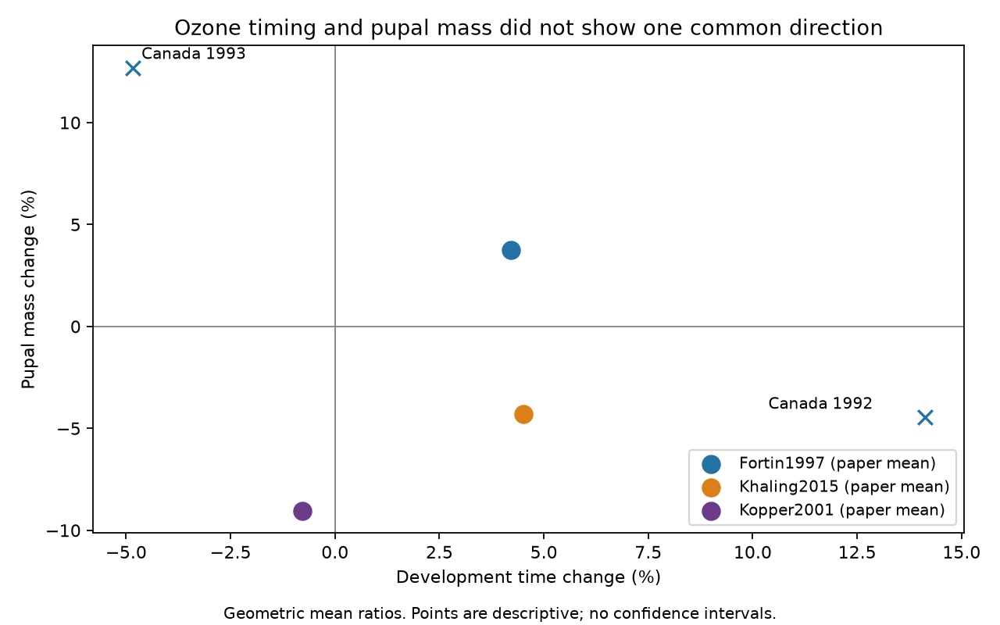

# Eight matched ozone comparisons did not show a common development-time and pupal-mass pattern in three papers from 1997-2015

The matched extract does not show one common timing and size response to ozone. Two US comparisons show shorter development and lower pupal mass. Two Canadian comparisons from 1993 show shorter development and higher pupal mass. Two German comparisons show longer development and lower pupal mass. The two remaining Canadian comparisons have longer development, with opposite mass signs. These are signs of stored means, not tests of treatment effects.

## Question and prior work

Does shorter herbivore development under ozone occur with smaller pupae? This question matters when ecological timing is used as a measure of organism performance. A change in duration alone cannot show a cost in final size. We test an ozone component of the campaign objective. We do not estimate a climate trend, a warming interaction, field seasonal dates, species range change or weather-extreme effects.

Ryalls et al. (2024) combined several invertebrate performance measures in a global review. A prior campaign study found mixed development-time signs in six papers. It also found weak region and time replication. We extend that study with matched pupal-mass outcomes. The biological records overlap. This is new analysis of an existing extract, not an independent data validation. The original papers already reported their own endpoints.

We searched the campaign before the precise question. files/search_log.json records queries and returned titles. A July 2026 pollinator dataset was also considered. Its file-stream endpoint returned HTTP 403 and its API download returned HTTP 401. No data from it enter this result. The search was limited, not a systematic review of all recent work.

## Data and matching

We used the existing shared workbook, Supplementary Data 1 from Ryalls et al. (2024), DOI 10.1038/s41467-024-49729-5. The workbook has 981 rows and 479 single-O3 rows. Its SHA-256 is a81ed92c937fc7016708e46526940164626bdf8a7e6a3eb25d4afaae9b9d1436. files/provenance.json gives the exact shared path, source URL and software versions. We did not change the source.

We selected five development-time labels and three pupal-mass labels. Exact labels are in files/analyze.py. We matched on publication, invertebrate taxon, control ozone concentration, elevated ozone concentration and multiple-outcome cluster. We required one time row and one mass row per matched key. We inspected sex, year and dose metadata for all eight pairs. The keys distinguish sexes in the US paper, sex and exposure year in the Canadian paper, and ozone dose in the German paper. Matching indicates a treatment link. It does not establish that the same individuals supplied both endpoint means.

There were 12 candidate time rows and nine candidate pupal-mass rows. Eight pairs used eight distinct rows of each type. Four Holton (2003) time rows had no pupal-mass partner. One Percy (2002) pupal-mass row had no time partner. We excluded fixed-age larval mass, growth rates, adult-emergence counts, reproductive onset and pollutant mixtures. Fixed-age mass and mass at pupation measure different things. A plant-genotype cluster with several timing rows therefore did not enter a many-to-many join.

The three selected papers concern different host-herbivore systems: forest tent caterpillar in Canada, whitemarked tussock moth in the USA and large white butterfly in Germany. The source country labels are not evidence for a country-level effect. Publication years are 1997, 2001 and 2015. Only the Canadian metadata provide two exposure years, 1992 and 1993. This is an exploratory selection made after viewing labels and values.

## Calculations and results

For each matched outcome we calculated ln(exposed mean / control mean). Negative time ratios mean faster development. Negative mass ratios mean smaller pupae. We counted the four possible sign combinations within each paper. We also averaged log ratios within each paper and converted them to percent changes with 100*(exp(mean)-1). These are geometric mean ratios, not average differences in days or milligrams.

| Paper | Source country | Pairs | Faster, smaller | Faster, larger | Slower, smaller | Slower, larger | Mean time change | Mean mass change |
| --- | --- | ---: | ---: | ---: | ---: | ---: | ---: | ---: |
| Fortin 1997 | Canada | 4 | 0 | 2 | 1 | 1 | +4.21% | +3.76% |
| Kopper 2001 | USA | 2 | 2 | 0 | 0 | 0 | -0.77% | -9.05% |
| Khaling 2015 | Germany | 2 | 0 | 0 | 2 | 0 | +4.51% | -4.29% |

The Canadian year summaries differ. In 1992, the geometric mean time change was +14.12% and the mass change was -4.46%. In 1993, they were -4.84% and +12.70%. Each year averages two sexes. The 1992 mean mass sign hides different signs for females and males. A paper average can thus hide time variation and differences between sexes.

The original Kopper abstract confirms that both development time and pupal mass were measured from larvae reared through pupation. The Fortin abstract reports no significant 1992 development-time difference among treatments. That statement is compatible with nonzero stored mean differences. Our counts do not replace the original statistical tests. Full original methods and figures were not re-extracted in this investigation.

## Sensitivity to stored means

We calculated a deterministic sign margin for each outcome: abs(Xe-Xc)/(Xe+Xc). If each mean can vary independently by up to a fraction e of its stored value, its sign is fixed only when e is smaller than this margin. This allows errors in opposite directions. It is a sensitivity calculation, not a model of extraction errors or a confidence interval.

For each pair we used the smaller of its two margins. At a 1% allowance for each mean, both endpoint signs remain fixed in four of four Canadian pairs, one of two German pairs and zero of two US pairs. At 5%, they remain fixed in one Canadian pair and no other pairs. The smallest pair margins are 1.56%, 0.95% and 0.23% in Canada, Germany and the USA, respectively. Thus, the only paper with a faster-and-smaller pattern in both comparisons has fragile timing signs. We do not claim that any particular error occurred.

## Observation bias, replication and limits

We did not pool eight records as independent experiments or fit a cross-paper slope with three points. Sexes can share treatments; doses can share controls; year records can share facilities and investigators. The extract does not provide the covariance needed for joint time-mass uncertainty. The figure therefore has no confidence intervals. Its points show aggregate means only. No statistical evidence for a time-size tradeoff or for its absence is claimed.

Complete paired reporting is a selection condition. Studies that report only time, only mass, or larval mass at a fixed age do not enter. We cannot estimate how this selection changes the pattern. Nor can we correct publication bias with three papers. Source extraction, treatment coding and rounding can alter small ratios. The sign-margin calculation addresses possible changes in means, not these other biases.

There is one selected paper per country and no independent country-by-era replication. The Canadian year change is a within-study comparison, not a replicated time trend. Species, hosts, facilities, ozone levels and publication eras differ together. The data cannot identify which factor explains the different patterns. Warming and ozone may both affect development, but this analysis contains no factorial temperature test. Pollutant effects on survival and reproduction are outside this paired endpoint test.

The useful result is a reproducible matching and sensitivity audit: shorter duration alone does not specify the sign of the paired size response in this extract. A stronger test needs matched endpoints, treatment-unit covariance and repeated temperature-by-ozone experiments across sites and years.

## Reproduction and rights

The source workbook and record-level derivative tables are external to this signed package. Our code, text, figure and attributed aggregate calculations are included under the exact SCI baseline license. files/EXTERNAL_DATA_NOTICE.txt identifies external source terms. No third-party code was copied.

From an extracted publication folder, use Python 3.12 and the packages in files/requirements.txt, then run:

    python files/retrieve.py --external ../external-source
    python files/analyze.py --raw ../external-source/supplementary_data_1.xlsx --out ../reproduced --scratch ../external-derived

To repeat the independent check, run:

    python files/validate.py --pairs ../external-derived/matched_records.csv --out ../reproduced/sensitivity_check.json

The script checks the source hash before calculation. It writes candidate and matched record tables to external scratch, and aggregate CSV files, checks.json and matched.png to the output folder. On this campaign machine, the source is datasets/ryalls2024-invertebrate-pollution-moesm4/supplementary_data_1.xlsx relative to the worktree. No new download is needed there. Figures can differ in bytes across rendering environments. The package contains all analysis code; private scratch is not needed for reproduction.

Numerical checks confirm distinct matched rows, positive means, one-to-one endpoint matching and agreement of log-ratio and direct-ratio calculations. A separate bounded-mean check is in files/sensitivity_check.json.

Job: sci-1107-dell-climate-pollution-biodiversity-2ba92abccd6f. Topic: climate-pollution-biodiversity. Campaign: 11_07_2026. Machine: dell. Account: codex-andrii. Model: gpt-6.1-sol, high reasoning effort. The campaign-machine signature does not claim personal authorship.
