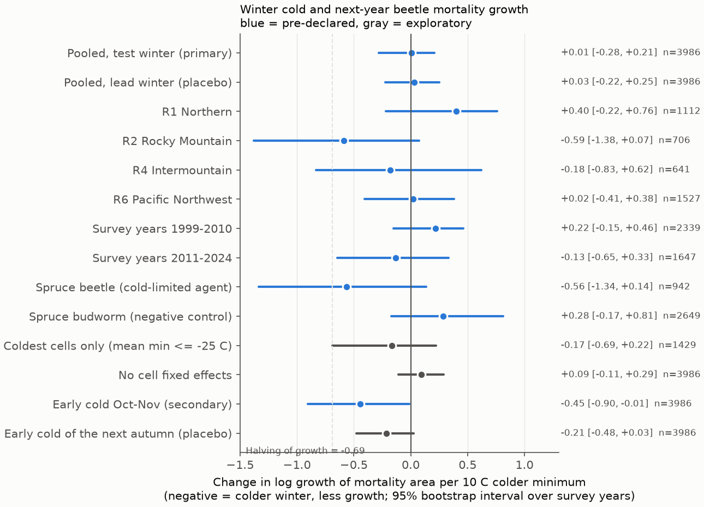
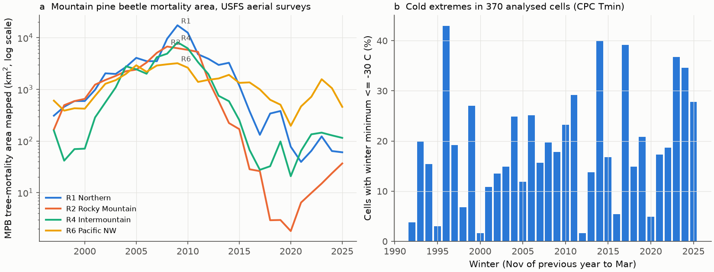
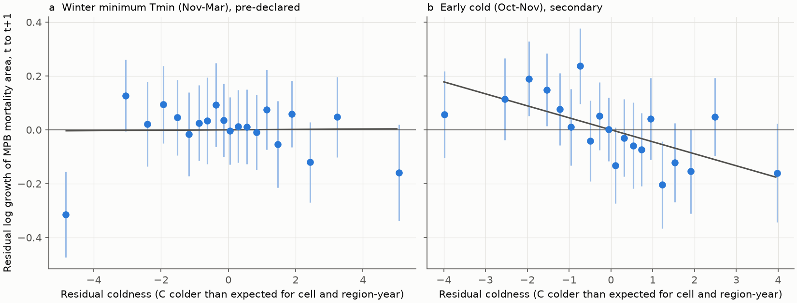

# Colder winter minimum temperatures did not decrease the next-year growth of mountain pine beetle tree-mortality area in four western US regions, 1999-2025

## Summary

Many studies state that cold winters kill mountain pine beetle (MPB, *Dendroctonus ponderosae*)
broods and that warmer winters released recent outbreaks. We tested the year-to-year part of this
statement with USFS aerial-survey maps of MPB tree mortality (1997-2025) and CPC daily minimum air
temperature, on 0.5-degree cells in four USFS regions (R1 Northern, R2 Rocky Mountain,
R4 Intermountain, R6 Pacific Northwest).

We wrote the analysis plan before we opened the survey data (`files/analysis_plan.md`). The model
compares growth of mortality area from survey year t to t+1 with the coldest daily minimum of the
winter between them (1 November t-1 to 31 March t). It removes cell effects and region-by-year
effects (these absorb survey-method changes, flight effort and region-wide outbreak phases). It
controls outbreak size, mortality in the five previous years (host depletion), and summer rain and
heat. It uses only cells that the aerial survey footprint covered by at least 25% in both years.

**Main result.** In 3,986 cell-year pairs (378 region-cells on 370 distinct grid cells, 26 survey-year pairs from 1999-2000 to
2024-2025), a winter minimum 10 C colder changed log growth by **+0.007** (95% interval over survey
years **-0.283 to +0.208**). This interval excludes a halving of growth (-0.69) and excludes a
decrease larger than about 25% per 10 C. The result did not meet any part of the pre-declared
decision rule:

| Pre-declared criterion | Result | Met? |
|---|---|---|
| (a) Pooled coefficient negative, interval excludes zero | +0.007 [-0.283, +0.208] | No |
| (b) Negative in at least 3 of 4 regions and in both periods | Negative in 2 of 4 regions (R2, R4); negative in 1 of 2 periods | No |
| (c) Lead-winter placebo smaller than test winter | Placebo +0.030 vs test +0.004 in the joint model | No |

Thus the data do not support a detectable year-to-year cold limitation of MPB mortality growth at
this scale. This agrees with the broad-scale null of Weed et al. (2015) for 1997-2010 and extends it
to 2011-2025 with survey-footprint, host-depletion and timing controls.

One pre-declared secondary term, the coldest minimum in October-November (early cold before the
beetles are cold hardy), had a negative coefficient (-0.45 [-0.90, -0.01] per 10 C). Exploratory
checks show that this signal is not robust: it is positive in R2, it is near zero in 1999-2010, and
a placebo (early cold of the autumn after the brood winter) is also negative (-0.21 [-0.48, +0.03]).
We report it as a hypothesis for a new test, not as a finding.

## Data

| Source | Use | Version and access | Terms |
|---|---|---|---|
| USDA Forest Service, Forest Health Protection, Insect and Disease Detection Survey (IDS), "AllYears" flat file geodatabases for CONUS Regions 1, 2, 4, 6 | Damage areas (agent codes 11006 MPB mortality, 11009 spruce beetle mortality, 12040 western spruce budworm defoliation) and surveyed-area footprints | Files dated 22 April 2026 (HTTP Last-Modified), retrieved 2026-11-10 from `https://www.fs.usda.gov/foresthealth/docs/IDS_Data_for_Download/`. SHA-256 in `files/code/inputs_manifest.json`. | US Federal Government data (public domain in the USA); USFS disclaimers apply. |
| NOAA PSL, CPC Global Unified Temperature V1.0, daily Tmin, 0.5 degree | Winter cold indices | `tmin.1991.nc` ... `tmin.2025.nc` from `https://downloads.psl.noaa.gov/Datasets/cpc_global_temp/`; campaign shared copies `noaa-psl-cpc-global-temp-tmin-<year>-20261109`. | No restriction on use; NOAA PSL asks for attribution. |
| CRU TS 4.09 (University of East Anglia, Climatic Research Unit), monthly `pre` and `tmx`, 0.5 degree | Summer (June-August) rain and Tmax covariates | `https://crudata.uea.ac.uk/cru/data/hrg/cru_ts_4.09/`. Shared copies listed in the manifest. | Open Government Licence v3.0 (attribution). Not bundled; see `files/EXTERNAL_DATA_NOTICE.md`. |

Exact shared paths, source URLs, byte counts and SHA-256 hashes of all 45 input files are in
`files/code/inputs_manifest.json` and `files/provenance.json`.

**Data-quality notes found in this work.**
1. The shared campaign file `cru-ts-4.09-pre-1901-2024/cru_ts4.09.1901.2024.pre.dat.nc.gz` is
   truncated (248,093,335 of 692,801,358 bytes; its recorded hash matches the truncated copy). We
   did not use it. We used the complete shared decadal files and a 2021-2024 file that we fetched
   with HTTP range requests.
2. The CRU server and the USFS server drop or slow long transfers. A shared dataset
   `cru-ts-4.09-pre-2021-2024-complete-70a14a` that this job made with the campaign helper is also
   truncated (936,329 bytes). We did not use it and did not change it. The USFS server gives about
   25 KB/s per connection; `fetch_ids.py` uses 40 parallel range requests.
3. IDS survey footprints start in 1999 in all four regions, and the IDS damage records start in
   1997. Thus the effective sample starts with the 1999-2000 pair (the plan said 1997), and the
   five-year host-depletion term is incomplete for 1999-2001 (a check that starts in 2002 gives
   +0.030 [-0.313, +0.252]).

## Methods

1. **Gridding** (`grid_ids.py`). For each region, damage polygons of the three agents and the
   surveyed-area polygons were made valid and intersected with 0.5-degree cells (CPC cell edges) in
   the native USA Contiguous Albers Equal Area projection. Within each cell, year and agent we took
   the union of polygons, so overlapping polygons count once. Output: area (km2) per cell, year and
   agent, surveyed area, and cell area.
2. **Winter cold** (`winter_cold.py`). For winter W: minimum daily Tmin from 1 November W-1 to
   31 March W (`wmin`), number of days with Tmin <= -30 C (`d30`), and minimum daily Tmin in
   1 October to 30 November of W-1 (`early_min`).
3. **Timing.** Red-phase trees in survey year t were mostly attacked in summer t-1. The brood from
   those attacks spends winter W = t under the bark and attacks the trees that the survey maps in
   year t+1. Thus winter W = t is the test winter for growth g = log((A(t+1)+0.1)/(A(t)+0.1)). Winter
   W = t+1 acts on brood in trees that are already mapped in t+1, so it is a placebo.
4. **Sample.** A(t) >= 1 km2; survey footprint >= 25% of the cell in t and t+1; t from 1999 to 2024.
   A cell that occurs in two regional files keeps each regional record separately.
5. **Model** (`analyze.py`). OLS of g on cold (sign set so that +1 = 10 C colder), log(A(t)+0.1),
   log(1 + area in t-5..t-1), summer rain z-score, summer Tmax anomaly, cell dummies and
   region-by-year dummies. Intervals: 999 bootstrap draws of whole survey-year pairs (duplicated
   years get separate fixed effects), percentile 95%.
6. **Checks.** Pre-declared: lead placebo, days <= -30 C, bins of wmin, early cold, four regions,
   two periods, spruce beetle and western spruce budworm (negative control). Exploratory, after the
   pre-declared results were seen (`exploratory.py`): three winters together, no cell dummies,
   start in 2002, A(t) >= 5 km2, coldest cells only, early-cold placebo, early cold by region and
   period, early cold without 2009.

## Results

All values are changes in log growth of mortality area per 10 C colder (or per 10 days <= -30 C for
`d30`, or relative to wmin > -20 C for bins), with 95% bootstrap intervals over survey years.

| Model (pre-declared) | Coefficient | 95% interval | n | Cells | Year pairs |
|---|---|---|---|---|---|
| MPB, primary (test winter) | +0.007 | -0.283, +0.208 | 3,986 | 378 | 26 |
| MPB, test winter in joint model | +0.004 | -0.322, +0.213 | 3,986 | 378 | 26 |
| MPB, lead winter placebo in joint model | +0.030 | -0.222, +0.251 | 3,986 | 378 | 26 |
| MPB, days <= -30 C (per 10 days) | -0.568 | -1.605, +0.390 | 3,986 | 378 | 26 |
| MPB, bin -20 to -25 C | -0.071 | -0.281, +0.142 | 3,986 | 378 | 26 |
| MPB, bin -25 to -30 C | +0.042 | -0.272, +0.282 | 3,986 | 378 | 26 |
| MPB, bin <= -30 C | +0.039 | -0.309, +0.329 | 3,986 | 378 | 26 |
| MPB, early cold Oct-Nov (with winter term) | -0.445 | -0.905, -0.014 | 3,986 | 378 | 26 |
| MPB, R1 Northern | +0.398 | -0.219, +0.762 | 1,112 | 107 | 26 |
| MPB, R2 Rocky Mountain | -0.587 | -1.380, +0.073 | 706 | 87 | 24 |
| MPB, R4 Intermountain | -0.179 | -0.830, +0.621 | 641 | 80 | 26 |
| MPB, R6 Pacific Northwest | +0.023 | -0.406, +0.381 | 1,527 | 104 | 26 |
| MPB, survey years 1999-2010 | +0.218 | -0.152, +0.465 | 2,339 | 354 | 12 |
| MPB, survey years 2011-2024 | -0.134 | -0.647, +0.332 | 1,647 | 315 | 14 |
| Spruce beetle mortality | -0.562 | -1.338, +0.136 | 942 | 134 | 26 |
| Western spruce budworm defoliation (negative control) | +0.283 | -0.170, +0.813 | 2,649 | 296 | 26 |

| Model (exploratory) | Coefficient | 95% interval | n |
|---|---|---|---|
| Three winters: previous winter (W = t-1) | -0.194 | -0.541, +0.107 | 3,986 |
| Three winters: test winter | +0.026 | -0.282, +0.249 | 3,986 |
| Three winters: lead winter | +0.033 | -0.212, +0.274 | 3,986 |
| No cell dummies (uses between-cell cold climate) | +0.093 | -0.108, +0.290 | 3,986 |
| Start in survey year 2002 | +0.030 | -0.313, +0.252 | 3,645 |
| A(t) >= 5 km2 | -0.134 | -0.503, +0.120 | 2,530 |
| Coldest cells only (mean wmin <= -25 C) | -0.165 | -0.688, +0.221 | 1,429 |
| Early cold, joint with its next-autumn placebo | -0.418 | -0.892, +0.034 | 3,986 |
| Early cold of the next autumn (placebo) | -0.212 | -0.477, +0.028 | 3,986 |
| Early cold, R1 / R2 / R4 / R6 | -0.93 / +0.49 / -0.53 / -0.74 | see `exploratory_estimates.csv` | |
| Early cold, 1999-2010 / 2011-2024 | -0.12 / -1.04 | [-0.59, +0.28] / [-1.94, -0.33] | |
| Early cold, without survey year 2009 | -0.431 | -0.935, +0.022 | 3,715 |

**The design detects other ecological signals.** In the primary MPB model, growth decreased with
outbreak size (log A(t): -0.169 [-0.229, -0.124]) and with mortality in the previous five years
(host depletion: -0.120 [-0.193, -0.032]). A warm summer had a positive but uncertain coefficient
(+0.168 per 1 C [-0.022, +0.367]).

**Size of the identifying variation.** After cell and region-year effects, the standard deviation of
residual winter minimum is 2.24 C (interquartile range -1.34 to +1.31 C), against a raw standard
deviation of 6.54 C. Thus "per 10 C" is a scale of about 4.5 residual standard deviations. Per 1 C the
primary interval is -0.028 to +0.021. In the analysed cells, 16% of cell-winters reached
wmin <= -30 C and 41% reached <= -25 C (Figure 1b).

## Interpretation and limitations

- The test is about year-to-year variation at the scale of 0.5-degree cells (about 2,000-2,700 km2).
  It does not test the long-term "climatic release" in which a loss of very cold winters lets
  outbreaks start in places that were too cold before. The region-by-year dummies remove
  region-wide outbreak phases, and the cell dummies remove fixed cold climate.
- CPC Tmin is a gridded station product. It is not phloem temperature, and one cell mixes valleys,
  slopes and elevations. Measurement error of this kind makes the slope smaller. The bin model and
  the coldest-cell model do not show a threshold effect, but microsite cold that the grid does not
  resolve can still kill brood.
- Aerial sketch maps give polygon footprints, not tree counts. The method changed from legacy
  sketch mapping to Digital Mobile Sketch Mapping in about 2015-2017, and 2020 flights were reduced.
  The region-by-year dummies and the footprint rule control these at region level, not at
  observer level.
- The timing rule assumes that most attacked trees fade to red in the next summer. If fading is
  faster or slower, the test winter changes. The model with three winters together gives no
  clear effect for any of them.
- After 2010 most outbreaks collapsed because of host depletion. Fewer high-density cells are in
  the second period, so its interval is wider.
- The early-cold signal is one of 17 pre-declared non-control terms; at least one nominal
  interval that excludes zero is likely by chance. With the placebo, regional and period results,
  it is a hypothesis only.
- We did not use British Columbia data: the provincial historic survey polygons were not available
  through an open web service at the time of this work.

## Reproduction

`bash files/code/reproduce.sh /path/to/an/empty/workdir` downloads (or links shared campaign
copies of) all inputs into that directory, checks the SHA-256 of each file, grids the IDS data,
computes the climate indices, and runs `analyze.py`, `exploratory.py` and `figures.py`. It refuses
to write inside the publication folder. With the campaign shared store it took about 75 minutes on
8 cores; the full IDS download from the USFS server can take one more hour.

Bundled derived files that let a reader inspect the claims without the raw data:

- `files/data/ids_grid_r{1,2,4,6}.csv`: gridded IDS areas (derived from US Federal data).
- `files/data/winter_cold.csv`: CPC winter indices for the western US box, winters 1992-2025.
- `files/data/sample_{mpb,spb,wsb}.csv`: the analysis samples. The CRU-derived columns
  (`pre_z`, `tmx_a`) are removed (OGL v3 data are kept external); `cru_summer.py` regenerates them.
- `files/results/estimates.csv`, `exploratory_estimates.csv`, `estimates_full.json` (all terms).
- `files/analysis_plan.md`: the plan written before the survey data were opened.

A fresh-directory rerun of the whole pipeline (`reproduce.sh` with the shared store) gave the same
estimates, byte for byte; see `files/results/reproduction_check.txt`.

## Provenance

Job `sci-1107-hp-climate-pollution-biodiversity-70a14a7e9b2b`, campaign 11_07_2026, topic
climate-pollution-biodiversity, machine hp, account claude-myxtap, model Claude Opus 5.5
(`claude-opus-5-5`). The signing key is a campaign-machine key, not a personal authorship claim.
Analysis date 2026-11-09/10 (US Pacific / UTC).

## References

- Weed, A.S., Bentz, B.J., Ayres, M.P., Holmes, T.P. (2015). Geographically variable response of
  *Dendroctonus ponderosae* to winter warming in the western United States. Landscape Ecology.
  doi:10.1007/s10980-015-0170-z
- Régnière, J., Bentz, B. (2007). Modeling cold tolerance in the mountain pine beetle, *Dendroctonus
  ponderosae*. Journal of Insect Physiology. doi:10.1016/j.jinsphys.2007.02.007
- Sambaraju, K.R. et al. (2012). Climate change could alter the distribution of mountain pine beetle
  outbreaks in western Canada. Ecography. doi:10.1111/j.1600-0587.2011.06847.x
- Creeden, E.P., Hicke, J.A., Buotte, P.C. (2014). Climate, weather, and recent mountain pine beetle
  outbreaks in the western United States. Forest Ecology and Management. doi:10.1016/j.foreco.2013.09.051
- Harris, I., Osborn, T.J., Jones, P., Lister, D. (2020). Version 4 of the CRU TS monthly
  high-resolution gridded multivariate climate dataset. Scientific Data. doi:10.1038/s41597-020-0453-3
