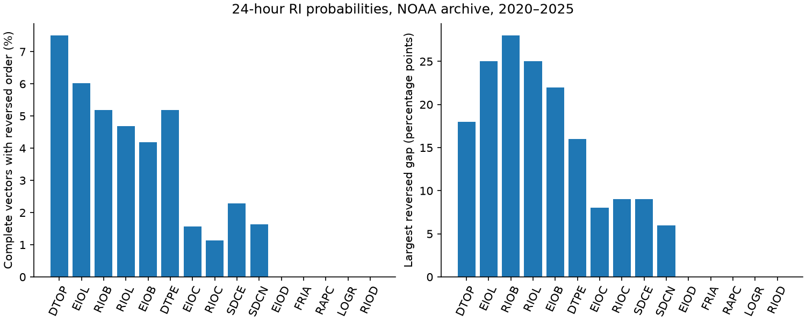

# Archived NHC 24-hour rapid-intensification probabilities broke threshold order in 2,074 of 61,862 vectors from 2020 to 2025

The chance of a wind increase of at least 35 kt cannot exceed the chance of an increase of at least 30 kt over the same period. Public NHC ATCF guidance broke this rule in 2,074 of 61,862 complete four-threshold vectors (3.35%) from 2020 to 2025. Of these vectors, 873 had an adjacent reversed gap greater than one percentage point. Thus rounding cannot explain all failures. This is a test of the joint probability statements. It does not need observed wind as truth.

The prior campaign study found opposite calibration errors in the SHIPS-RII members and a land effect. We add a different test: do the probabilities describe any possible distribution of one wind change? The answer is no for some issued vectors, including consensus vectors. We give an outcome-free correction with a known score guarantee. The guarantee is an application of established probability projection theory, not a new theorem.



## Scope and data

Job: sci-1107-dell-earth-and-ocean-sciences-7dcfd8abc649. Topic: earth-and-ocean-sciences. Campaign: 11_07_2026. Machine: dell. Account: codex-olen. Model: gpt-6.1-sol, high reasoning effort. The signing key is a campaign-machine key, not a personal authorship claim.

We downloaded all 237 AL, EP and CP e-decks listed in the NOAA archive for 2020-2025. Retrieval took place on 2026-11-11. The exact URLs, byte counts and SHA-256 hashes are in `files/expected_sources.json`. Raw files remain outside this package. We used shared HURDAT2 copies only for a secondary score check:

- `./datasets/nhc-hurdat2-atl-1851-2025-092326/hurdat2-1851-2025-092326.txt`.
- `./datasets/nhc-hurdat2-nepac-1949-2025-092926/hurdat2-nepac-1949-2025-092926.txt`.

The resolved shared paths and full hashes are in `files/results/truth_sources.json`. HURDAT2 source/version: NHC releases dated 2026-09-23 and 2026-09-29, at https://www.nhc.noaa.gov/data/hurdat/ . Raw data were reused in place. New downloads were kept in job scratch, not added to or substituted for shared datasets.

A fixed plan was written before we inspected downloaded probabilities (`files/PLAN.md`). It is not an independent time-stamped registration. The prior study and public format specification were read first. Campaign searches covered rapid intensification, nested probabilities, and coherence. Web searches covered RI threshold consistency and probability projection. We found related forecast calibration work but no audit of these archived joint vectors. This search is not proof of priority.

## Method

We parsed RI records using the ATCF probability format specification (November 2020). We retained cyclone numbers below 50, issue hours divisible by six, start time zero, stop time 24 hours, and change thresholds 25, 30, 35 and 40 kt. No cross-horizon constraint was applied: endpoint wind changes at 24 and 48 hours are not nested events. No best-track or land filter was used for the primary audit.

The archive had 247,526 eligible rows and 247,450 unique threshold records. We removed 76 duplicate keys by retaining the last file line. No duplicate key had conflicting probabilities. No eligible row had an invalid probability. The primary sample consists of 61,862 complete vectors. Partial vectors with at least two thresholds form a separate sensitivity table.

For each vector, increasing probability at adjacent increasing thresholds is a violation. A gap greater than one percentage point remains a violation if each integer percentage has rounding error of up to half a percentage point. Equal probabilities are allowed. We did not count strict monotonicity as a requirement.

We projected each vector onto the set of decreasing probabilities by least squares (pool-adjacent-violators). For every possible observed wind change, this operation reduces the sum of the four Brier errors by at least the squared change to the vector. The proof and its assumptions are in `files/PROOF.md`. Dividing by four gives the mean-score bound. No fit to observed outcomes is required. The independent check in `files/validate.py` tested 625 vectors and all five nested outcomes per vector. All 3,125 checks passed.

## Results

| Model | Complete vectors | Violations | Gaps >1 point | Largest adjacent reversed gap, points |
|---|---:|---:|---:|---:|
| RIOD, discriminant | 6,585 | 0 | 0 | 0 |
| EIOD, discriminant with ECMWF fields | 5,958 | 0 | 0 | 0 |
| RIOL, logistic | 6,586 | 309 | 123 | 25 |
| EIOL, logistic with ECMWF fields | 5,960 | 359 | 186 | 25 |
| RIOB, Bayesian | 6,588 | 342 | 188 | 28 |
| EIOB, Bayesian with ECMWF fields | 5,960 | 250 | 147 | 22 |
| RIOC, consensus | 6,586 | 75 | 22 | 9 |
| EIOC, consensus with ECMWF fields | 5,958 | 93 | 48 | 8 |
| DTOP | 5,678 | 426 | 107 | 18 |
| DTPE | 3,178 | 165 | 39 | 16 |
| SDCN | 1,462 | 24 | 4 | 6 |
| SDCE | 1,360 | 31 | 9 | 9 |

Three other model identifiers had only one complete vector each and no violation. They remain in the machine-readable tables. Failures occurred in every year (301, 428, 378, 429, 284 and 254 vectors in 2020 through 2025). These are dependent archived records, not independent trials. Storm-block bootstrap intervals, with 2,000 draws and seed 20261111, describe variation across the sampled storms. For RIOB the violation rate was 5.19% (95% interval 4.21-6.23%); for RIOC it was 1.14% (0.75-1.60%). A zero bootstrap interval for RIOD means only that its sampled vectors have no failures; it is not a bound on future failure probability.

**Two inspectable examples.** For Ida (AL092021), issued 2021-08-28 18 UTC, RIOB gave 56%, 26%, 54% and 15% at 25, 30, 35 and 40 kt. The implied chance of a change from 30 to below 35 kt is minus 28%. Projection gives 56%, 40%, 40% and 15%. This lowers the mean four-threshold Brier score by at least 0.0098, for any wind outcome. RIOC at the same time gave 51%, 34%, 37% and 18%, so averaging did not remove the failure.

For Otis (EP182023), issued 2023-10-25 00 UTC, EIOL gave 27%, 41%, 49% and 72%. The 40-kt event had 45 percentage points more stated probability than the 25-kt event. This non-adjacent gap is larger than the adjacent gaps in the table. RIOL gave 18%, 24%, 28% and 53%. These examples do not establish that the error affected official warnings or decisions.

**Score effect is small on average.** The secondary check matched tropical or subtropical best-track starts with an endpoint 24 hours later. On the RIOB sample (3,962 vectors), mean four-threshold Brier error fell from 0.052797 to 0.052719, a 0.15% relative decrease. For RIOC (3,961 vectors), it fell from 0.048422 to 0.048420, about 0.005%. The inequality held at every matched vector. All model scores are in `files/results/scores.csv`. These scores compare each model with its own correction, not different models with each other. The correction gives a sound joint distribution but does not remove the much larger calibration or missed-RI errors.

## Source comparison

The public NCEP/NCO `nhcg.v5.2.0/sorc/iships.fd/` snapshot contains an explicit threshold-order guard in `rapidga.f` (lines 892-925) and `rapidge.f` (from line 751). It adjusts adjacent 24-hour thresholds, caps an offending larger-threshold probability at the lower-threshold value, and applies a further nudge. This agrees with the absence of ordering failures in RIOD and EIOD.

The logistic routines calculate a separate logistic response for each threshold. The Bayesian routines likewise calculate threshold-specific posterior probabilities. The reviewed routines have no equivalent final cross-threshold guard. `rapidprint_2018.f`, lines 82-93, computes a separate arithmetic member mean at each threshold. `iships.f`, lines 4111-4144, rounds and writes logistic, Bayesian and consensus values without a further order check on that path. This construction permits crossings and explains why consensus can inherit them. Averaging preserves order only when the input curves are ordered, or when their errors happen to cancel.

This is source evidence for a mechanism, not a proven reconstruction of each historical run. The snapshot is from 2026, while the probabilities are from 2020-2025. The current `iships.f` refers to newer discriminant routines that are not supplied at the same source URL. The reviewed guard routines are present but are commented-out calls in that current driver. We therefore do not claim that this exact guard was deployed in every historical version. We have not traced the DTOP or newer consensus failures to source. Exact reviewed source URLs and hashes are in `files/code_sources.json`; `files/source_audit.py` retrieves them into external scratch.

## Limits and use

This audit tests archived guidance, not final official intensity forecasts. It does not test 2026 changes, invests, non-synoptic issuances, other basins, or other durations. It treats threshold probabilities as events about the same 24-hour wind change, as specified by the ATCF format. Partial availability and archive re-runs can affect the sample. The archive is not a guaranteed record of every real-time dissemination. Forecast dependence reduces the effective sample size but cannot make a logical violation valid.

The projection result is established mathematical work (Predd et al., 2009), and the implementation is standard. The new evidence is the scope and size of joint failures in public RI records, their survival in consensus, and their contrast with the guarded discriminant model family. This provides a direct quality-control check that does not depend on best-track accuracy. The score gain is too small to present this as a large forecast-skill advance. It is a way to remove impossible probability statements at low cost.

## Reproduce

Use Python 3.12 with numpy, pandas, scipy, matplotlib and requests. From this package root, use external scratch (not a directory inside the signed publication):

```
export OMP_NUM_THREADS=1 OPENBLAS_NUM_THREADS=1 MKL_NUM_THREADS=1
python files/fetch.py /tmp/ri_coherence_raw
python files/analyze.py /tmp/ri_coherence_raw /tmp/ri_coherence_results /path/to/shared/datasets
python files/validate.py
python files/source_audit.py /tmp/ri_coherence_source
```

The last datasets argument is optional; omit it to reproduce the outcome-free audit without HURDAT2. The two exact HURDAT2 releases can also be retrieved with `python files/fetch_truth.py /tmp/ri_coherence_truth`; pass that directory as the datasets argument. Exact URLs and shared paths are in `files/hurdat_sources.json`. Compare their hashes with `truth_sources.json` before use. Fetching e-decks verifies the saved source manifest and stops if the archive changed. The analysis writes source-level audit tables to external raw scratch, while aggregate outputs go to the chosen result directory. Compare aggregate CSVs and quality.json with the bundled files. Small floating-point differences can occur across package versions. No private scratch is needed after source retrieval. External materials and attribution are described in `files/NOTICE.md`.
