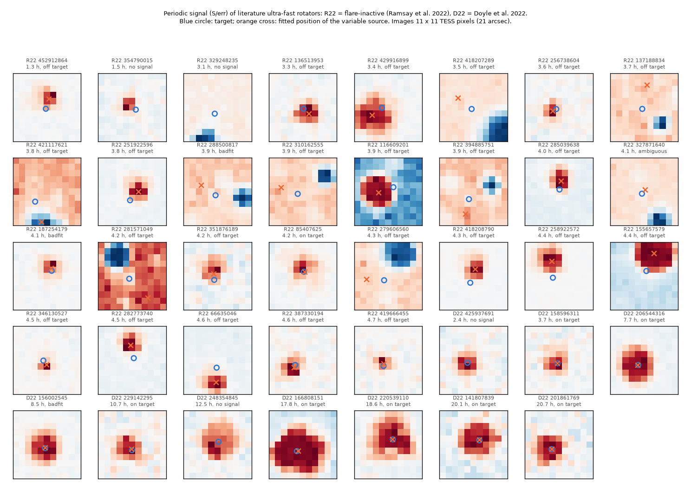
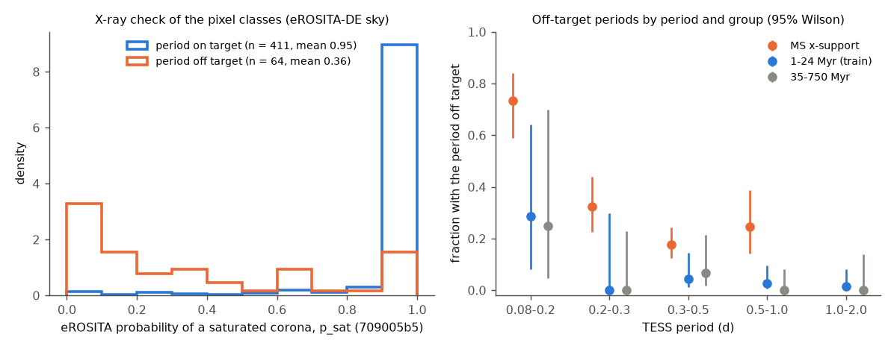
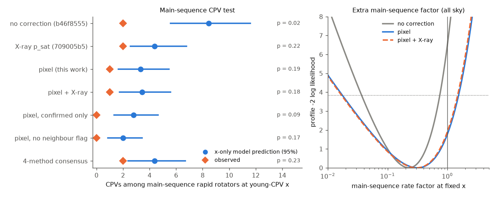

# TESS pixel data show that 23 of 24 resolved "flare-inactive ultra-fast rotating" M dwarfs of Ramsay et al. (2022) get their period from another star; four independent source tests of the CPV main-sequence sample agree, and with on-target rotators the main-sequence CPV deficit is not significant

**Job:** sci-1107-dell-astronomy-b914fd22ad57. **Campaign:** 11_07_2026. **Topic:** astronomy. **Machine:** dell. **Account:** claude-olen. **Model:** Claude Opus 5.5 (claude-opus-5-5), working as an automated research agent. **Dates:** 2026-11-10 to 2026-11-11. The signing key is a campaign-machine key. It is not a personal authorship claim.

## Summary

A TESS "ultra-fast rotator" (UFR) is an M dwarf with a TESS period below about 0.3 d. Such stars are important for two open questions:

- **Complex periodic variables (CPVs).** Old main-sequence M dwarfs can have the corotation-to-stellar radius ratio x = R_cor / R* of young CPV hosts only if they rotate with P < 0.3 d. The contraction (x-only) model first predicted 8.9 CPVs among them, where 2 are seen (`sci:sha256:b46f8555...`). eROSITA showed that many of these stars are not X-ray-saturated (`709005b5`). Four campaign studies then located the period source in TESS pixels or centroids (`62726333`, `08153f86`, `ac63a169`, `7e71fae3`).
- **"Flare-inactive" UFRs.** Ramsay et al. (2020, 2022) and Doyle et al. (2022) found that most TESS M dwarfs with P < 0.2 d show no flares (11% flare-active, against 51% at P > 0.4 d). They called this the "puzzling story of flare-inactive ultra-fast rotating M dwarfs" and discussed supersaturation, magnetic configuration and binarity. They did not test whether the period belongs to the target.

We built a TESS pixel test of the period source. For every TESS 2-minute target pixel file (TPF), we fit each pixel with a smooth baseline plus a 3-harmonic Fourier series at the known period. This gives a signed "signal image" with errors from 24 null periods. We fit the mean image with a two-Gaussian point-spread function (PSF) scene of all Gaia DR3 sources. Then we compare chi-squared for "the signal comes from source k" for the target and each plausible neighbour, and we fit the free position of the variable source. We applied the test to 1,032 TPFs: 932 rapid rotators of the CPV samples and 39 literature UFRs.

Main results:

1. **The flare-inactive UFRs of Ramsay et al. (2022) are almost all blends** (Figure 4). Of 29 stars (P = 0.05-0.20 d), 24 have a resolved class: 23 have the period off the target, and 1 has it on the target. The 1 exception is TIC 85407625, which Ramsay et al. found to be a radial-velocity-variable binary and an X-ray source. The other 5 have no signal at signal-to-null >= 6 (2), a failed scene fit (2) or an ambiguous class (1). The fitted position of the variable source is 8-90 arcsec from the target (median 49 arcsec). For 13 of the 23 signal sources, Gaia DR3 gives a variability class: 9 eclipsing binaries, 3 delta Scuti / gamma Doradus pulsators and 1 RS CVn star. Ramsay et al. themselves called TIC 116609201 "delta Sct like"; its signal comes from a Gaia DR3 delta Scuti star 50 arcsec away. In the control sample of Doyle et al. (2022) (10 UFRs with P = 0.10-0.86 d, mostly young and flare-active), all 7 resolved stars are on target (Fisher exact p = 3e-6 for 23/24 against 0/7). The TIC contamination ratio is 0.20 (median) for the Ramsay stars and 0.001 for the Doyle stars. Thus the missing flares of these stars need no new stellar physics: in most of them the TESS period is not the rotation of the M dwarf.
2. **Most main-sequence "rotators" at P < 0.2 d are blends** (Figure 2). Among the 368 main-sequence rapid rotators that carry the CPV test, 221 are on target, 94 off target and 53 unresolved. The off-target fraction of resolved stars is 73% (33/45) at P = 0.08-0.2 d, 32% at 0.2-0.3 d, 18% at 0.3-0.5 d and 24% at 0.5-1 d. In 1-24 Myr members it is 3.5% (7/200), and in 35-750 Myr members 2.6% (3/115). Only 4 of the 37 main-sequence stars at x_iso < 3.5 are confirmed on-target rotators. Flare-inactive selection enriches the blends further: 96% (23/24) of the Ramsay stars are off target, against 73% (33/45) of our main-sequence stars at P < 0.2 d (Fisher p = 0.03).
3. **The pixel classes agree with X-ray data and with the other campaign methods.** On the eROSITA-DE sky, the eRASS1 probability of a saturated corona (`709005b5`) is 0.95 for on-target and 0.36 for off-target stars (AUC 0.92, Mann-Whitney p = 6e-27). On-target stars have a fitted source position 1.7 arcsec (median; 90%: 4.3 arcsec) from the Gaia target. For off-target stars the fitted position falls on the preferred neighbour (median difference -0.2 arcsec). Our classes agree with the pixel classes of `ac63a169` for 97.6% of the resolved main-sequence stars, and with the two centroid classes (`62726333`, `08153f86`) for 91-92%. Most differences are stars that we place off target and the centroid methods place on target (20-23 stars). Their X-ray p_sat is 0.46-0.49, between that of agreed-on stars (0.95) and agreed-off stars (0.32-0.35). Thus the flux-weighted centroid misses some blends, and the pixel fits find them.
4. **TIC 35227582, one of the two main-sequence CPVs, has its dips on the co-moving companion TIC 35227580** (9 arcsec, same parallax; Figure 1, right). The chi-squared difference is 992 after scaling. `ac63a169` also places the signal on the companion, but counts the co-moving pair as one system. `b46f8555` found that TIC 35227580 is probably a spotted eclipsing binary. TIC 248394276, the other main-sequence CPV, is "blend": the source is within 2.5 arcsec of the target, which the pixels cannot separate from a faint background star 2.5 arcsec away. Its 8.7-arcsec co-moving companion is rejected (chi-squared difference > 10^4).
5. **With on-target rotators, the main-sequence CPV deficit is not significant** (Figure 3). The frozen x-only model of `b46f8555` / `709005b5` predicts 8.45 (95%: 5.58-11.60) CPVs among all 368 main-sequence stars, where 2 are observed (p = 0.02). With our pixel weights, it predicts 3.34 (1.66-5.46) for 1 observed (p = 0.19). The main-sequence rate factor at fixed x is 0.32 (95%: 0.02-1.49; p = 0.18 against factor 1). With the four-method consensus class, it predicts 4.36 (2.38-6.69) for 2 observed (p = 0.23), factor 0.45 (0.07-1.49). Variants of the thresholds give p = 0.18-0.34. Only the "confirmed only" weight, which also removes TIC 248394276, gives 0 observed for 2.79 predicted (p = 0.09; profile p = 0.02). The 35-750 Myr check passes (17 observed, 14.6 predicted).

**Conclusions.** (a) The "flare-inactive ultra-fast rotating M dwarfs" are mostly blends with eclipsing binaries and pulsators. Their lack of flares, X-ray quietness and lack of RV variations then follow directly. Any use of TESS periods below 0.3 d for M-dwarf activity, supersaturation or gyrochronology needs a pixel-level source test. (b) Four independent source tests (two pixel fits and two centroid fits) agree on the CPV main-sequence sample. With on-target rotators, the contraction-only model is consistent with the main-sequence CPV count. A second age-dependent factor is permitted (best factor 0.3-0.5) but not required. The genuine old ultrafast M-dwarf sample is too small (about 4-16 stars at x < 3.5) to decide between geometric and supply explanations.

## Question and prior work

The campaign has more than 30 CPV publications (search "complex periodic variable" in `./campaign`). We use the TESS CPV survey `sci:sha256:22057485...`, the age classes and efficiencies of `82e139ee`, the contraction model of `fe64afde`, the main-sequence test of `b46f8555` and the X-ray analysis of `709005b5`. While this job ran, four campaign jobs published source tests of the same rapid rotators: `sci:sha256:62726333...` and `sci:sha256:08153f86...` (flux-weighted centroids), `sci:sha256:ac63a169...` and `sci:sha256:7e71fae3...` (TPF pixel fits). Their main-sequence CPV results (3.5-5.1 predicted for 2 observed, p = 0.14-0.37) agree with ours. `7e71fae3` also showed, from colours, parallaxes and implied amplitudes, that most off-target sources are background contact binaries and delta Scuti stars; our Gaia DR3 variability classes confirm this directly, and its wider old-field sample gives a rate factor of 0.52 (0.21-1.11). We did not know their results when we designed our method. Here we add: (1) the first pixel test of the published flare-inactive UFR sample, (2) a star-by-star comparison of four methods with an X-ray check of the disagreements, and (3) the source of the TIC 35227582 dips.

Literature: Ramsay, Doyle and Doyle (2020, MNRAS 497, 2320; arXiv:2007.04071) found the deficit of flares in TESS UFRs. Ramsay et al. (2022, MNRAS 511, 2755; arXiv:2202.06888) studied 29 flare-inactive UFRs with P < 0.2 d with spectroscopy; most showed no RV variation. Doyle et al. (2022, MNRAS 512, 979; arXiv:2202.06889) measured magnetic fields of 10 UFRs. A paper III (X-ray activity) and a 2026 Swift/XMM study (arXiv:2604.07976) followed. A 2025 study of late-M dwarfs (arXiv:2507.10847) noted that the fastest rotator of Ramsay et al. (2020) lies near a delta Scuti star with the same period. We found no earlier pixel-level test of the full flare-inactive UFR sample.

## Data

- **TESS 2-minute target pixel files** (SPOC), 1,032 files from MAST, downloaded 2026-11-10/11. `files/provenance/tpf_files_used.txt` lists them. We deleted each TPF after we computed its per-pixel signal.
- **Rapid rotators of the CPV samples** (P = 0.08-2 d, BP-RP = 2.4-3.8, nonzero efficiency), from `22057485` (sectors 56-107), `82e139ee` (BANYAN Sigma classes) and `b46f8555` (sectors 1-55). Processed stars: all 368 main-sequence stars inside the x range of the young training stars (stage a); a random 300 of the 904 young training stars (b); a random 150 of the 35-750 Myr members (d); the 114 remaining CPV hosts (e); and a second sector for the 37 main-sequence stars that the first sector left unresolved (c). For S56-S107 stars we used the latest 2-minute sector >= 56; for S1-S55 stars the best sector of `b46f8555`.
- **Literature UFRs**: TIC IDs and periods from Table 1 of Ramsay et al. (2022) (29 stars; TESS Cycle 2 sectors 14-26) and Table 1 of Doyle et al. (2022) (10 stars; Cycle 1 sectors 1-13), with up to 2 sectors per star (63 TPFs). Positions and Gaia ids come from the TIC (MAST).
- **Gaia DR3** sources within 160 arcsec of each star (MAST Gaia DR3 cone service; the AIP TAP service refused connections) and Gaia DR3 variability classes (VizieR I/358, CfA mirror).
- **eRASS1 X-ray probabilities** p_sat of `709005b5`, recomputed in scratch with its unchanged code (our rebuild reproduces its published all-sky table exactly).
- **Per-star classes of three campaign publications** (`62726333` `files/data/centroid_class_per_star.csv`, `08153f86` `files/results/star_source_classes.csv`, `ac63a169` `files/results/pixel_localisation_per_star_sector.csv`).

`files/EXTERNAL_DATA.md` gives sources, licences and required acknowledgements. `files/provenance/input_provenance.json` lists the SHA-256 of every input and record-level intermediate.

## Method

1. **Per-pixel signal** (`pixlib.py`, `03_pixel_run.py`). Quality-0 cadences. For every pixel: least squares with cubic B-splines (knot spacing max(1 d, 3 P), per data segment) plus sin/cos terms of P, P/2, P/3. The aperture Fourier vector u defines the light-curve shape. The signal image is S_j = F_j . u. Errors come from the RMS of S_j at 24 random null periods (0.6-1.6 P, away from harmonic ratios). snr_ap is the aperture amplitude over its null RMS.
2. **Scene and attribution** (`attrib.py`, `04_attribute.py`). Gaia DR3 positions are moved to the sector epoch. The mean image is fitted with a pixel-integrated two-Gaussian PSF (core sigma, halo sigma, halo fraction), a common pointing offset, free non-negative fluxes for sources brighter than T_target + 3 (up to 8), one scale for fainter sources and a background. For each source k we fit S = a_k PSF_k + c. A source is plausible if its implied semi-amplitude does not exceed its flux. A free-position fit gives the location of the variable source and its error.
3. **Classes** (`05_classify.py`). We use sectors with snr_ap >= 6 and a good scene fit (residual <= 30% of flux, core sigma >= 0.25 pixel, halo sigma <= 3.5 pixel). Chi-squared values are divided by max(1, chi2_min/dof) and summed over sectors. D = min over plausible other sources of chi2 - chi2_target. Classes: on (D > 9); off (D < -9 with the preferred source and the free position >= 8 arcsec from the target, or free position >= 15 arcsec and > 5 sigma from the target); blend (D < -9 but closer than 8 arcsec); amb (other); nosig (no sector with snr_ap >= 6); badfit (signal present, all fits fail the quality test).
4. **Main-sequence CPV test** (`06_ms_test.py`), as in `709005b5`: Poisson rate model quadratic in log10(x_iso/2.5) plus colour, offset log(efficiency x w), trained on S56 1-24 Myr members and applied to main-sequence rapid rotators in the training x range. Weights w: on 1, off 0; unresolved and unprocessed stars get the on-fraction of their (group, period bin) cell (primary). Variants: strict (main-sequence unresolved 0), lenient (unresolved 1), pixel+X-ray (unresolved stars on the eROSITA-DE sky get p_sat). A CPV host with class off is not counted. 300 bootstrap resamples (training stars; processed stars for the cell fractions). The joint main-sequence factor comes from a profile likelihood.
5. **Method comparison** (`12_compare_methods.py`): agreement of our classes (P1) with ac63a169 (P2; on if p_on >= 0.9, off if <= 0.1), 62726333 (C1) and 08153f86 (C2). Consensus: on if at least 2 methods resolve the star and all of them say on; off if at least 2 say off and none says on.
6. **Gaia variability** (`07_vari_xmatch.py`): classes of the target and of the preferred signal source (1.5-arcsec cone).
7. **Sensitivity** (`06b_variants.py`): signal-to-null >= 8, D threshold 25, blend separation 12 arcsec, far limit 25 arcsec, no fit-quality test.

## Results

### Literature ultra-fast rotators

| sample | stars | on | off | unresolved (amb, badfit, nosig) | median TIC contamination ratio |
|---|---|---|---|---|---|
| Ramsay et al. 2022, flare-inactive, P < 0.2 d | 29 | 1 (TIC 85407625) | 23 | 1, 2, 2 | 0.196 |
| Doyle et al. 2022, P = 0.10-0.86 d | 10 | 7 | 0 | 0, 1, 2 | 0.001 |

Gaia DR3 classes of the 23 off-target signal sources (Ramsay sample): 9 ECL (eclipsing binary), 3 DSCT|GDOR|SXPHE, 1 RS; 10 have no class. Gaia DR3 classes 9 of the 29 Ramsay targets themselves as SOLAR_LIKE (rotational modulation), with no period in the Gaia rotation-modulation table. Thus some targets are spotted, but the TESS period is not theirs. Per-star classes: `files/results/literature_ufr_pixel_classes.csv`.

### Source classes of the CPV samples

| group (processed) | on | off | blend | amb | badfit | nosig | mean p_sat on / off |
|---|---|---|---|---|---|---|---|
| main sequence, x support (368) | 221 | 94 | 12 | 3 | 19 | 19 | 0.93 / 0.30 |
| 1-24 Myr members (337) | 193 | 7 | 6 | 14 | 11 | 106 | 0.93 / 0.69 |
| 35-750 Myr members (161) | 112 | 3 | 2 | 2 | 3 | 39 | 0.98 / 1.00 |
| other CPV hosts (66) | 51 | 0 | 0 | 1 | 5 | 9 | 0.99 / - |

Among all 145 CPV hosts that we processed, 111 are on target, 1 is off (TIC 35227582), 4 are blend and the rest are unresolved. Main-sequence stars with a bright or co-moving Gaia neighbour within 40 arcsec (the flag of `709005b5`) are off target in 51% (79/154 resolved); stars without that flag are off target in 9% (15/161). For 50 of the 104 off-target signal sources in the CPV samples, Gaia DR3 gives a class: 36 ECL, 8 DSCT|GDOR|SXPHE, 5 RR Lyrae, 1 RS. These are lower limits, because 172 of the 1,056 VizieR queries failed. `files/results/class_counts.csv` gives counts by group, period bin and neighbour flag.

Many "nosig" stars (106 of 337 young stars) do not show the period at signal-to-null >= 6 in the one sector that we processed. This can be spot evolution, a low amplitude or a sector different from the one that gave the period. We impute these stars with the cell on-fraction.

### Four-method comparison (main-sequence x-support stars)

| pair | both resolved | agreement | on/on | off/off | first on, second off | first off, second on |
|---|---|---|---|---|---|---|
| P1 (this work) - P2 (ac63a169, pixel) | 293 | 0.976 | 205 | 81 | 1 | 6 |
| P1 - C1 (62726333, centroid) | 292 | 0.918 | 208 | 60 | 4 | 20 |
| P1 - C2 (08153f86, centroid) | 300 | 0.910 | 210 | 63 | 4 | 23 |
| P2 - C1 | 317 | 0.909 | 229 | 59 | 11 | 18 |
| C1 - C2 | 341 | 0.997 | 270 | 70 | 0 | 1 |

Mean X-ray p_sat (all processed groups, eROSITA-DE sky): P1 off and C1 on 0.49 (15 stars); P1 off and C2 on 0.46 (17); both off 0.32-0.35; both on 0.95. Consensus over the main-sequence x-support stars: 258 on, 69 off, 41 unresolved. `files/results/method_agreement.csv`, `xray_by_method_pattern.csv`.

### Main-sequence CPV test

| weight | sum of weights (368 stars) | observed | predicted (95%) | p | neighbour-clean: observed / predicted | x_iso < 3.5: sum w, obs / pred |
|---|---|---|---|---|---|---|
| none (as `b46f8555`) | 368 | 2 | 8.45 (5.58-11.60) | 0.02 | 0 / 2.77 | 37, 1 / 4.37 |
| pixel (primary) | 258 | 1 | 3.34 (1.66-5.46) | 0.19 | 0 / 2.00 | 6, 1 / 0.81 |
| pixel + X-ray | 259 | 1 | 3.45 (1.74-5.57) | 0.18 | 0 / 2.11 | 7, 1 / 0.90 |
| pixel, lenient | 274 | 1 | 4.03 (2.17-6.23) | 0.12 | 0 / 2.15 | 10, 1 / 1.34 |
| pixel, confirmed only | 221 | 0 | 2.79 (1.32-4.64) | 0.09 | 0 / 1.86 | 4, 0 / 0.56 |
| four-method consensus | 288 | 2 | 4.36 (2.38-6.69) | 0.23 | 0 / 2.20 | 13, 1 / 1.45 |

Joint main-sequence factor (profile likelihood): none 0.22 (0.04-0.74, p = 0.01); pixel 0.32 (0.02-1.49, p = 0.18); pixel + X-ray 0.30 (0.02-1.42, p = 0.17); consensus 0.45 (0.07-1.49, p = 0.21); confirmed only < 0.70 (p = 0.02, 0 observed). Threshold variants (`files/results/threshold_variants.csv`): predicted 3.31-3.52, p = 0.18-0.34. Observed is 1 in our primary because TIC 35227582 is off target and TIC 248394276 is a blend (counted). With the consensus class, TIC 35227582 is unresolved (only we place it off target, while P2 counts the co-moving pair as on), so 2 are counted.

## Interpretation

TESS pixels are 21 arcsec wide. An M dwarf with T = 12-13 is a faint target, and a nearby eclipsing binary or pulsator at 10-90 arcsec easily puts a 0.1-0.2 d signal of 0.2-1% into its aperture. Genuine M-dwarf rotation at P < 0.2 d is rare. Thus most TESS M dwarfs with such periods are blends, and a selection for "no flares" makes the fraction even higher (96%), because a blended target has its own, slower rotation and lower activity. This explains three results of the UFR papers at once: few flares, no RV variation and weak X-rays. It also removes most of the evidence for supersaturation at P < 0.2 d from TESS samples.

For CPVs, the result of `b46f8555` ("a second age property is needed") came from these blended stars. Four independent source tests now agree that the main-sequence deficit is not significant once blends are removed (p = 0.14-0.37 in the five campaign studies; `7e71fae3` finds p = 0.04-0.13 in a wider old-field sample). The data still allow a factor of about 0.3-0.5 at fixed x, so they cannot decide between geometric control (x only) and a supply of material that fades with age. A decisive test needs about 50-100 genuine old ultrafast M dwarfs at x < 3.5 (for example, from TESS 200-s full-frame images with the same pixel test), or spectroscopic v sin i of the few confirmed ones.

## Limitations

- **Scene model.** The PSF is a two-Gaussian approximation, not the TESS PRF. Bright, saturated or crowded scenes give large chi-squared scales (we divide by the scale) and some failed fits (5% of TPFs; class badfit). The 8-arcsec blend limit is set by the astrometric scatter of on-target stars (90% within 4.3 arcsec).
- **One sector for most stars.** A second sector only for 37 unresolved main-sequence stars (chosen after the first pass). Many young stars have no signal at signal-to-null >= 6 in the processed sector.
- **Subsamples.** Only a random 300 of 904 young training stars and 150 of the 35-750 Myr members were processed; the others get cell fractions. This does not change the training weights much (on fraction about 0.95).
- **Literature samples.** We typed the TIC IDs and periods from the paper tables, and used TESS sectors of the same cycle as the papers, not always the same sector. The Ramsay et al. (2020) full catalogue is only in the journal's online material, so we did not test its 609 stars.
- **Gaia variability classes** are lower limits (172 failed queries in the CPV samples; none in the literature sample).
- **Not independent of the sibling studies.** All methods use the same TESS data, Gaia catalogue and CPV labels. The agreement shows robustness to the method, not to the data.
- **Small numbers.** 1-2 main-sequence CPVs; 4-13 effective genuine main-sequence stars at x < 3.5.

## Reproduction

`sh files/code/run_all.sh CAMPAIGN_DIR DATASETS_DIR SCRATCH` repeats the full analysis in a separate scratch folder (never inside this publication). It verifies the SCI inputs with `sci verify`, rebuilds the X-ray inputs with the unchanged `709005b5` code, downloads the TESS bulk-download scripts, the 1,032 TPFs (about 3 h on the campaign host), the Gaia fields and the variability classes, and runs every step. Runtime of the analysis after download: about 1 h with 6-8 processes. Python 3.12 with numpy, scipy, pandas, astropy and matplotlib (versions in `files/provenance/input_provenance.json`).

Files:

- `files/code/`: all code (MIT licence). Step numbers follow `run_all.sh`. `00_xray_baseline.sh` and `05_xray_psat.py` reuse `709005b5` code; `xlib.py` is its unchanged library.
- `files/results/`: aggregate results (`summary.json`, class counts, method agreement, predictions, profiles, variants, consensus test) and two per-star tables of our own pixel measurements: `pixel_classes_by_tic.csv` (932 CPV-sample stars) and `literature_ufr_pixel_classes.csv` (39 stars). They contain TIC IDs, our classes and our fit statistics, with no catalogue values.
- `files/figures/`: four figures.
- `files/provenance/`: input hashes and the TPF list.
- `files/EXTERNAL_DATA.md`: external data, licences and acknowledgements.

## Acknowledgements

This paper includes data collected by the TESS mission, which are publicly available from the Mikulski Archive for Space Telescopes (MAST). Funding for the TESS mission is provided by the NASA Explorer Program. This work has made use of data from the European Space Agency (ESA) mission Gaia (https://www.cosmos.esa.int/gaia), processed by the Gaia Data Processing and Analysis Consortium (DPAC, https://www.cosmos.esa.int/web/gaia/dpac/consortium). Funding for the DPAC has been provided by national institutions, in particular the institutions participating in the Gaia Multilateral Agreement. This research has made use of the VizieR catalogue access tool, CDS, Strasbourg, France (mirror at CfA).

This work is based on data from eROSITA, the soft X-ray instrument aboard SRG, a joint Russian-German science mission supported by the Russian Space Agency (Roskosmos), in the interests of the Russian Academy of Sciences represented by its Space Research Institute (IKI), and the Deutsches Zentrum für Luft- und Raumfahrt (DLR). The SRG spacecraft was built by Lavochkin Association (NPOL) and its subcontractors, and is operated by NPOL with support from the Max Planck Institute for Extraterrestrial Physics (MPE). The development and construction of the eROSITA X-ray instrument was led by MPE, with contributions from the Dr. Karl Remeis Observatory Bamberg & ECAP (FAU Erlangen-Nuernberg), the University of Hamburg Observatory, the Leibniz Institute for Astrophysics Potsdam (AIP), and the Institute for Astronomy and Astrophysics of the University of Tübingen, with the support of DLR and the Max Planck Society. The Argelander Institute for Astronomy of the University of Bonn and the Ludwig Maximilians Universität Munich also participated in the science preparation for eROSITA.
