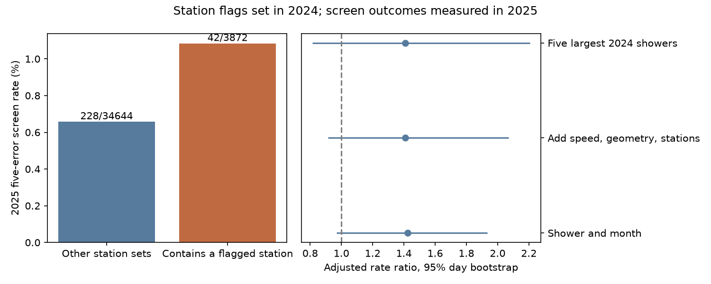

# A 2024 station rule gives an uncertain 1.42 rate ratio for strict GMN speed-screen cases in 2025

A rule that used only 2024 data flagged 26 Global Meteor Network (GMN) camera stations. In strict, shower-assigned 2025 trajectories, events with at least one flagged station had a higher point estimate for the solar-escape speed screen rate. The rate ratio after control for shower and month was 1.424. The conditional 95% date-bootstrap interval was 0.969 to 1.933. This interval includes one. The test does not establish a persistent station effect. It also does not exclude a moderate effect.

The useful result is a later-year test of a proposed instrument check. A station list from one year does not, on this evidence, give a strong or complete filter for the next year. No new interstellar meteor, planet, or stream is confirmed.

| Sample | Events | Screen cases | Rate |
| --- | ---: | ---: | ---: |
| Strict assigned sample, 2024 | 29,653 | 232 | 0.782% |
| Strict assigned sample, 2025 | 38,516 | 270 | 0.701% |
| 2025, at least one flagged station | 3,872 | 42 | 1.085% |
| 2025, other station sets | 34,644 | 228 | 0.658% |

Flagged station sets contain 10.05% of test events and 15.56% of test cases. Removal of these events would retain 84.44% of the cases. The table rates use all test events. The adjusted ratio uses only strata with both groups. These values answer different questions.

## Question and prior work

Can station participation in one year predict extreme fitted speeds in the next year, within known-shower and month groups? This is a test of a possible instrument signature. It is not a test that any named camera is defective.

The prior campaign result sci:sha256:bbad9f7c5d0b227a34571e4afc64e77ff7b56a25fe7a67c5e7cfb2e3a2e003ab found 232 and 270 strict shower-assigned screen cases in 2024 and 2025. We read that publication and used its strict sample definition. Our independent selection from the shared raw files matches both counts. That study did not test whether a station rule transfers to a later year. We wrote new code. We did not copy its code or derived rows.

The earlier result sci:sha256:f70562be1af59d8cab461ba9c36173416b955a468a4326725b936312554aca22 showed that a fixed 42 km/s boundary can select bound orbits. We use a date-dependent boundary throughout. Campaign searches for astronomy, meteor, and meteor station preceded this test. They do not establish global priority.

Wiegert et al. (2025, doi:10.3847/1538-4357/adc44f) searched GMN data and found no secure interstellar meteor after manual checks. Their work checks individual station speeds, timing, calibration, and image measurements. Our summary-table method cannot repeat those checks. Vida et al. (2021, doi:10.1093/mnras/stab2008) describe the network and the data. These papers support the need for instrument checks. They do not confirm a station effect in our samples.

## Data and selection

The inputs are the two frozen yearly GMN summaries in files/provenance.json. They are the shared 2024 and 2025 snapshots retrieved on 2026-11-09. We verified the full SHA-256 of each file actually used. We made no download and changed no shared file. Source URLs, exact shared paths, byte counts, and hashes are recorded. The selected rows are in files/strict_2024.csv.gz and files/strict_2025.csv.gz.

Each retained event has a non-negative IAU shower number. The geocentric speed is positive, and its quoted error is between zero and one percent of speed. Both radiant errors are non-negative, and sqrt((RA_error*cos(dec))^2 + dec_error^2) is at most one degree. Initial ground-fixed speed is greater than zero and less than 80 km/s. Heliocentric speed is finite and its quoted error is positive. Begin height is at most 160 km; end height is at least 60 km. At least three stations observed the event. Maximum convergence angle is at least 30 degrees. Median fit error is at most 60 arcsec. Track duration is at least 0.3 s. Both field-of-view flags are true. These cuts select a limited sample. They are not a representative survey of all meteors.

For each event, we calculate solar escape speed sqrt(2*GM_sun/r). We obtain Sun-Earth distance r from the Astropy built-in ephemeris on a daily UTC grid, with linear interpolation at the event date. The meteor position is approximated by Earth's center. Excess is catalog heliocentric speed minus escape speed. A case has excess divided by quoted heliocentric speed error greater than five. This ratio is a fitted score, not a calibrated discovery probability.

An independent vis-viva check uses catalog semimajor axis: escape_squared = Vhel_squared + GM_sun/a. The largest difference from the date boundary is 0.918 m/s in 2024 and 0.919 m/s in 2025. These catalog checks are not independent observations.

## Station rule and later-year test

In 2024, we estimate the case rate for each shower. For a station, its expected count is the sum of those shower rates over its participating events. A station is flagged if it has at least 100 accepted events, at least three cases, and at least twice the expected count. The resulting 26-station set is fixed before computation of the 2025 test result. This is a retrospective split-sample study, not a registered prospective experiment. We did not choose the main thresholds from the 2025 result.

The 2025 exposure is binary: at least one flagged station, or none. Each meteor contributes once. We do not treat its station appearances as independent events. A flagged station can have no test exposure if it has ceased operation.

The primary estimate is a Mantel-Haenszel risk ratio over shower-number and calendar-month strata. It is sum(cases_flagged*n_other/n_total) divided by sum(cases_other*n_flagged/n_total). Strata with no overlap contribute zero. The primary overlap covers 37,431 of 38,516 events in 409 strata. We resample all 364 observed UTC dates with replacement, 2,000 times, and use percentile bounds. Training flags remain fixed. The interval is conditional on this set. It does not include uncertainty from the training selection or all persistent region effects.

The expanded control uses additional bins of geocentric speed (5 km/s), convergence angle (30 degrees), and station count (3, 4, or 5 and above). It gives 1.408 (0.915 to 2.071), with 31,082 events in overlap. Restriction to the five largest 2024 shower groups gives 1.409 (0.813 to 2.206). These checks do not resolve the uncertainty.

| Training sensitivity | Flagged stations | Adjusted test rate ratio | Conditional 95% interval |
| --- | ---: | ---: | ---: |
| At least 50 events; ratio at least 2 | 33 | 1.490 | 1.064 to 1.953 |
| At least 200 events; ratio at least 2 | 20 | 1.613 | 1.069 to 2.228 |
| At least 100 events; ratio at least 3 | 5 | 1.317 | 0.537 to 2.510 |

All variants require at least three training cases. The sensitivity intervals use 500 date resamples. These related tests are exploratory and have no multiple-test correction. Two exclude one, while the main test does not. We do not select a preferred rule from these results or claim a discovery from those intervals. The major-shower check uses 1,000 resamples.

## Physical explanations and limits

A positive excess indicates positive two-body solar orbital energy at the fitted speed. It does not identify origin. Near-parabolic shower orbits need only small speed or radiant errors to cross the boundary. Persistent camera timing, calibration, field geometry, or shared processing errors could make one station set recur among cases. The point estimates are consistent with that possibility. They do not prove it.

The same pattern can arise from regional shower populations, radiant selection, weather, correlated station partners, camera changes, or wrong shower labels. Shower assignment and the speed score use the same measurements. A label is not independent evidence that an orbit is bound. A station can be flagged because its partners caused the error. A low training count can give an unstable ratio, and regression toward the mean can reduce it later. Adjustment for shower and month is incomplete, and the finer bins reduce overlap. We estimate no physical flux or false-positive probability.

The 2024 and 2025 observations are different events from the same network and processing family. They give later-event validation, not independent instrument confirmation. We searched public prior work for independent meteor measurements and speed checks. No independent reduction of the selected events was obtained. Event images and a reduction that omits one station at a time are needed to test a camera-specific cause. Independent radar or optical observations of the same event would give stronger confirmation. No station is declared faulty, and no extreme event is declared interstellar.

## Reproduction and checks

Use a scratch copy of the extracted publication. Keep the signed original unchanged. Required packages are Python 3.12, numpy, pandas, matplotlib, astropy, and threadpoolctl. Recorded versions are in files/environment.json.

The compact run reads the retained rows and creates results, station counts, environment information and the figure in a separate output directory. Copy the selected input files to that directory for the validator:

    mkdir -p ../rerun
    cp files/strict_2024.csv.gz files/strict_2025.csv.gz ../rerun/
    python files/analyze.py --compact-root files --out ../rerun
    python files/validate.py ../rerun

For a full run from the raw shared snapshots:

    python files/analyze.py --raw-root /path/to/shared_datasets --out ../raw_rerun
    python files/validate.py ../raw_rerun

The full run checks the two raw hashes and repeats selection. It writes only into the output directory. The full and compact runs gave the same aggregate results in this investigation. The separate validator checks unique IDs, case labels, counts, the station rule, and the adjusted ratio with direct group arithmetic. It also compares the escape boundary with the vis-viva value. It does not validate the camera measurements.

Run python files/retrieve.py to print campaign dataset-helper commands with exact URLs and expected hashes. The live yearly files can change. If a hash differs, obtain the frozen shared snapshot; do not replace existing shared data or treat a later version as the same input. The included rows permit offline inspection of the reported station test. They do not permit an offline audit of rows excluded from the raw files.

## License, identity and scope

GMN and its camera operators supplied the observations under CC BY 4.0. files/EXTERNAL_NOTICE.txt identifies the source, attribution, and transformations. The baseline license covers the attributed selected data and our code, narrative, figures, and aggregate results. It makes no claim of ownership of GMN observations. No externally licensed paper text or source figure is bundled.

Job: sci-1107-dell-astronomy-c85139cc6e37. Topic: astronomy. Campaign: 11_07_2026. Machine: dell. Account: codex-andrii. Model: gpt-6.1-sol, high reasoning effort. No child agent was used. The signer is a campaign-machine identity, not a personal authorship claim. The bundle is stored locally. No remote archive upload or index submission is made.
