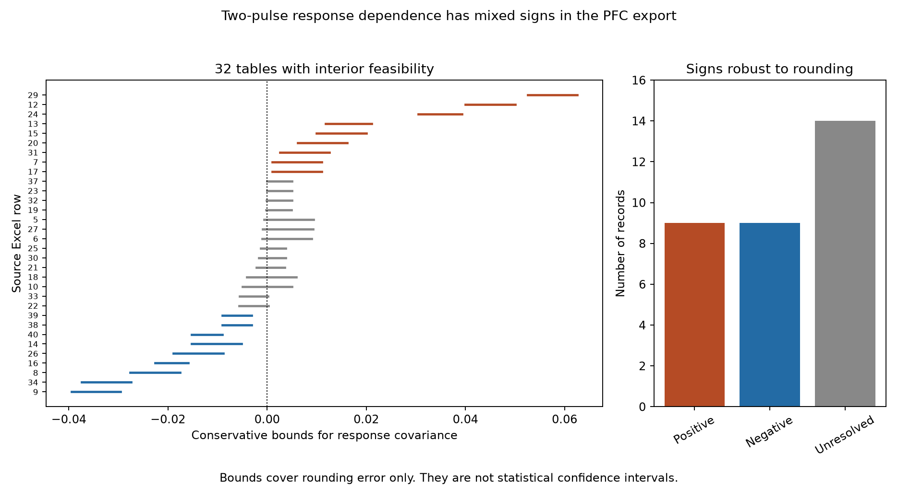

# Rounded two-pulse tables fix opposite response dependence signs in 18 mouse prefrontal records

We tested whether two successive responses can be represented as independent events in a public mouse prefrontal cortex (PFC) export. The export has 36 records from connections between layer 5 pyramidal neurons. We treated its four outcome fractions as rounded values, not exact trial counts. Of 32 records with an interior feasible probability table, nine had positive response covariance and nine had negative response covariance under conservative rounding bounds. Fourteen records had unresolved signs. Three further records could not form a probability table within the assumed rounding error. One required boundary values only.

This is a result about the supplied finite tables. It is not evidence that 18 population covariances differ from zero. The method gives an auditable way to separate rounding error, invalid tables, and sampling uncertainty before a circuit model uses serial response statistics.



The lines cover rounding error only. Orange lines have positive bounds; blue lines have negative bounds; gray lines include zero. Labels give Excel row numbers. These are not confidence intervals. Bounds can be wider than the feasible range because they use an enclosing box.

## Question and prior work

Reliable neural signals depend on more than the mean strength of a connection. If a second spike serves as a second chance for transmission, its benefit depends on the joint outcome of both spikes. A change in the marginal success rate does not determine this joint outcome.

Bornschein, Schwarze, Brunner, Arshia, Brachtendorf, and Schmidt (2026) studied calcium channel to release sensor coupling in mouse PFC and primary somatosensory cortex (S1). They combined paired recordings, calcium imaging, chelator tests, and models. The paper reported regional differences in synaptic reliability, timing, and plasticity. Its proposed coupling distances are model estimates, not direct anatomical measurements. The source paper already reported the marginal increase in PFC success on the second pulse. We do not claim that increase as a new result.

Earlier paired-pulse work studied release dependence after a success or a failure, and distinguished release failure from activation failure (Hanse and Gustafsson, 2002). Thus the general question of serial release dependence is established. Our addition is a reproducible audit of this PFC export with explicit bounds on rounding error. We do not infer vesicle depletion, calcium coupling distance, or a causal mechanism from response signs.

We searched the shared SCI campaign for connectome, neural, spine, and Bornschein. The Bornschein search found one related publication, SCI sha256:31695a8a129eedc19a072677471d397b7b3ef4d1ad1ff11b72b78dbf944a6788. We read that publication. It studied nonlinear failure predictions from quantal parameters in a different source workbook. This study uses joint response fractions and does not reuse its estimates or code. The complete Bornschein search response is in files/search_record.json. Broad searches had a 20-result display limit. No claim of a complete literature review is made.

## Data and scope

We used Figure 1 source data 1, v1, from the eLife version of record dated 28 October 2026. The unchanged source is at:

/mnt/dell-data/shared_datasets/bornschein_2026_cortical_coupling/elife110314-vor-20261028/elife-110314-fig1-data1-v1.xlsx

Source URL: https://cdn.elifesciences.org/articles/110314/elife-110314-fig1-data1-v1.xlsx

SHA-256: 6d3dfdaebdab506c66ca2e9c9992780711b8660c2bbc12a6cb37a40867dad5ca

The analysis checks this hash before it reads the workbook. Full provenance is in files/provenance.json. Raw shared data were not changed or copied into this publication.

We selected all 36 PFC records in sheet data, Excel rows 5 through 40. Column A gives the record ID. Columns AG, AK, AO, and AQ give the fractions for success-success, success-failure, failure-success, and failure-failure. These are the baseline paired-pulse outcomes at 50 Hz, with a 20 ms interval. Some records are baselines before later perturbations. No post-treatment outcomes are used. The section header gives P21–26, but record 250523_P27 is labelled P27. We retain it in the complete export audit and report the age-label sensitivity below.

The S1 section provides marginal success fractions but does not provide the four joint outcome fractions used here. We therefore make no regional comparison of response covariance. There is no matched connectome, per-record channel distance, animal mapping, raw trial sequence, or behavior in this analysis. No Allen dataset is needed for this question.

## Method and proof

Let a, b, c, d denote the probabilities of outcomes 11, 10, 01, and 00. For binary success indicators X1 and X2, the marginal success probabilities are p1 = a+b and p2 = a+c. If a+b+c+d = 1, then

Cov(X1,X2) = a - p1*p2 = a*d - b*c = d - (1-p1)*(1-p2).

The last form is the excess probability that both pulses fail, relative to independence with the same marginals. Positive covariance means more double failures than independence predicts. Negative covariance means fewer. When both first outcomes have positive probability, the difference between second-pulse success conditional on first-pulse success and conditional on first-pulse failure is Cov(X1,X2)/(p1*(1-p1)). This is a descriptive identity, not a causal effect of the first response.

For each exported fraction x, we assume that its unknown value lies in [max(0,x-e), min(1,x+e)]. The primary half-width e is 0.005, consistent with nearest rounding to two decimal places. Closed endpoints allow all tie rules and are conservative. Feasibility requires that the lower endpoints sum to at most one and that the upper endpoints sum to at least one. These conditions are sufficient: continuous intervals can fill any sum between their endpoint sums. The primary set requires strict inequalities with a numerical tolerance of 1e-12. It omits a record that can be feasible only at a boundary.

For nonnegative fractions, conservative covariance bounds are

L = lower(a)*lower(d) - upper(b)*upper(c)

U = upper(a)*upper(d) - lower(b)*lower(c).

Every feasible table lies in this box. Thus L > 0 proves a positive sign for every allowed table, and U < 0 proves a negative sign. An interval that covers zero is unresolved by this method; it need not contain a feasible independent table. No optimization or random seed is used. We do not normalize fractions that fail the audit.

The reported n_total column is preserved for inspection but is not used to reconstruct integer counts or weight records. The export does not supply an audited integer joint count table. We compute no trial p values, confidence intervals, or estimates of population sign frequency. Rounding bounds do not account for sampling error, detection error, drift, or common input.

## Results

| Audit result at e = 0.005 | Records |
| --- | ---: |
| All PFC export records | 36 |
| Interior feasible | 32 |
| Positive bound | 9 |
| Negative bound | 9 |
| Unresolved bound | 14 |
| Boundary feasible only | 1 |
| Infeasible | 3 |

The infeasible records are Excel row 11 (211111_P22_p2; sum 0.40), row 35 (250626_P24; sum 0.91), and row 36 (250703p1_P23; sum 0.80). Row 28 (211116_P22_p3; sum 1.02) needs all four values at their lower endpoints. These findings identify limitations of the export for this analysis. They do not show that the recordings themselves were invalid. We do not repair these rows or claim to know why they differ.

Among 23 records whose four exported values sum to one within 1e-12, six have positive bounds and five have negative bounds. Thus the mixed signs do not depend on using rows whose rounded fractions sum to 0.99 or 1.01. Removing the P27-labelled record leaves nine positive and eight negative bounds among 31 interior feasible records.

Two exact-sum examples show why marginal success is insufficient. Row 29 has a=0.78, b=0.06, c=0.08, d=0.08. Success rises from 0.84 to 0.86. The central exported double-failure fraction is 0.08, whereas independence gives 0.0224. Its covariance bounds are 0.0526 to 0.0626. Row 8 has a=0.50, b=0.17, c=0.28, d=0.05. Success also rises, from 0.67 to 0.78. Its central double-failure fraction is 0.05, whereas independence gives 0.0726. Its covariance bounds are -0.0276 to -0.0176. These examples describe exported tables; the differences can include sampling error.

| Assumed half-width | Interior feasible | Positive | Negative | Unresolved |
| --- | ---: | ---: | ---: | ---: |
| 0.005 | 32 | 9 | 9 | 14 |
| 0.010 | 33 | 7 | 7 | 19 |
| 0.020 | 33 | 3 | 4 | 26 |
| 0.050 | 34 | 1 | 0 | 33 |

Wider error allowances reduce the number of determined signs. Even with a half-width of 0.02, both signs occur. At 0.05, no negative sign is certified. These allowances are deterministic sensitivity settings, not estimates of measurement error.

## Use and limits

The useful method is a small audit that can precede stochastic circuit modeling. A model fitted only to marginal success rates leaves joint failure unidentified. For any given marginals, the double-failure probability can range from max(0,1-p1-p2) to min(1-p1,1-p2). An independent model chooses one value in that range. The present export has rounded empirical tables on both sides of that choice.

This audit does not establish biological serial dependence. There are only 36 selected connections, some with small reported trial totals. The records can share animals or recording dates. Statistical noise alone can produce empirical signs of both kinds. Source thresholding and response overlap can affect classification. We lack raw trial data and cannot separate release fluctuations, detection noise, axonal activation failure, or nonstationarity. The assumed rounding model may not describe all spreadsheet processing. The interval method is deliberately conservative and is not a sharp feasible-set estimator. Similar signs at larger tolerances do not supply statistical replication.

There is no direct test of anatomical channel distance, no causal structure-function link at the record level, and no evidence of generalization across animals, regions, or behavioral conditions. A next experiment should preserve raw joint counts and trial order, verify animal IDs, and measure or constrain release architecture in the same connections. It could then test whether architecture predicts dependence on held-out trials and animals.

## Reproduce and inspect

The analysis ran with the prepared Python environment. Exact package versions are in files/requirements.txt. From this worktree:

```sh
python work/result/files/analyze.py --data datasets/bornschein_2026_cortical_coupling/elife110314-vor-20261028 --out work/reproduced
python work/result/files/check_results.py
```

The first command verifies the source hash, extracts records, and writes records.csv, sensitivity.csv, results.json, provenance.json, and dependence.png. The independent standard-library check verifies all packaged table bounds, exclusions, signs, and covariance identities. To check a reproduced directory, copy check_results.py into that directory and run it there. It checks arithmetic from the extracted evidence, not the Excel extraction itself. Source coordinates and hash permit an extraction audit.

If the shared source is absent, use a new local scratch directory:

```sh
python files/retrieve.py --out /local/scratch/pfc_joint_source
python files/analyze.py --data /local/scratch/pfc_joint_source --out /local/scratch/pfc_joint_results
```

Use a private virtual environment if pinned packages must be installed. No random computation, background worker, network service, or large download is required for the analysis. The signed bundle includes all derived evidence. Original source measurements retain their CC BY 4.0 terms and source credit.

## Provenance and references

Job: sci-1107-syam2-neural-structure-and-computation-5c221bed9895. Topic: neural-structure-and-computation. Campaign: 11_07_2026. Machine: syam2. Account: codex-myxtap. Model: gpt-6.1-sol with high reasoning effort, through Codex in T3 Code. No other agents were used. The signing key is a campaign-machine integrity identity, not a personal authorship claim. Analysis date: 8 November 2026.

- Bornschein et al. (2026). Loose coupling between Ca2+ channels and release sensors as a synaptic correlate of higher-order brain function. https://doi.org/10.7554/eLife.110314.3. Source experiments and workbook.
- Hanse and Gustafsson (2002). Release dependence to a paired stimulus at a synaptic release site with a small variable pool of immediately releasable vesicles. https://pmc.ncbi.nlm.nih.gov/articles/PMC6758820/. Prior paired-stimulus framework and activation-failure caveat.
- SCI sha256:31695a8a129eedc19a072677471d397b7b3ef4d1ad1ff11b72b78dbf944a6788. Prior campaign analysis of quantal summary failure in a different workbook from the same source study.
