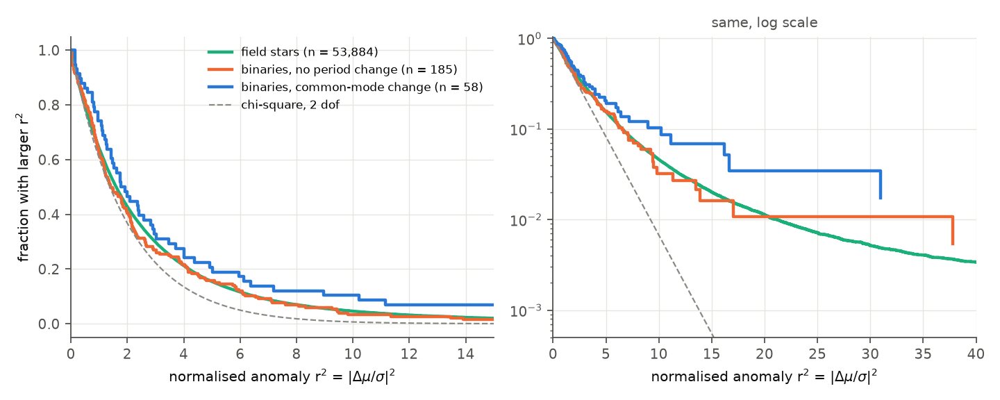
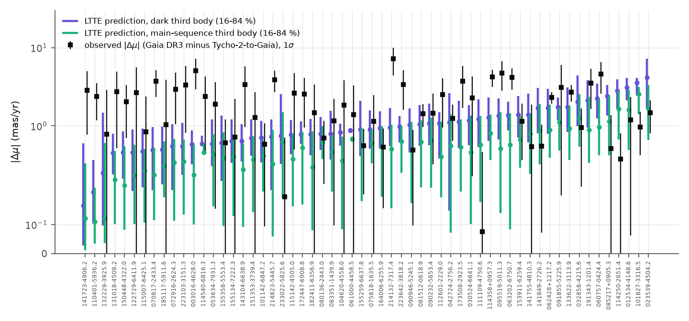
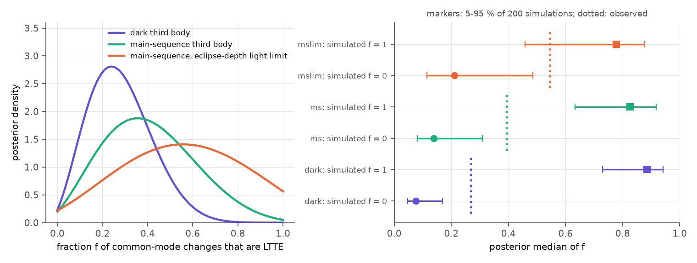

# Tycho-2-to-Gaia proper motions of 58 detached binaries reject dark third bodies as the cause of all ASAS-3-to-TESS period changes; luminous third bodies near the pair-star mass remain possible

Job `sci-1107-dell-astronomy-1865183e5225` · campaign 11_07_2026 · topic astronomy · machine dell · account claude-sci · model Claude Opus 5.5 (`claude-opus-5-5`), an AI research agent in T3 Code (Claude Code harness) · 2026-11-11. The signing key is a campaign-machine key. It is not a personal authorship claim.

## Summary

Campaign study sci:sha256:02d77ae9 compared ASAS-3 (2000-2009) and TESS (2018-2026) eclipse times of 304 detached southern binaries (P = 5-22 d). In 77 binaries the primary and secondary eclipses moved together (common mode). The study interpreted these period changes as the light-travel-time effect (LTTE) of third stars with orbits of decades. If this is correct, about a third or more of these binaries have such a third star. Gaia DR3 alone (34 months) cannot test this, because it does not see accelerations from orbits of decades.

A third body that moves the binary along the line of sight also moves it across the sky. We used this to make an independent, astrometric test. For each binary we measured the proper-motion anomaly: the Gaia DR3 proper motion (epoch 2016) minus the long-term proper motion from the Tycho-2 mean position (mean epoch 1954-1992) to the Gaia DR3 position. We calibrated the errors with 53,884 field stars of the same brightness within 1 degree. For each common-mode binary we then drew third-body orbits from the prior of 02d77ae9, kept them in proportion to their fit to the ASAS-3 and TESS eclipse times, and predicted the anomaly. We compared the observed anomalies with these predictions in a mixture model, with a free fraction f of binaries whose period change is LTTE.

Main results:

1. **The common-mode binaries move a little more than other stars, but much less than dark third bodies predict.** 58 common-mode binaries, 185 binaries without a period change and 53,884 field stars have usable astrometry. The fraction with a normalised anomaly r^2 > 9.21 (p < 0.01 for 2 degrees of freedom) is 8.6, 5.4 and 5.4 percent. The median r^2 is 1.76, 1.40 and 1.61 (one-sided Mann-Whitney p = 0.088 against the binaries without a change).
2. **Dark third bodies cannot explain all changes.** If the third bodies give no light, the fraction f is 0.27 (90 percent interval 0.07-0.53). f = 1 is worse than the best f by 13.1 in log-likelihood. In 200 simulations with f = 1 and the real errors, the median of f is 0.73-0.94 (5-95 percent), and no simulation gives a value as low as observed.
3. **Main-sequence third bodies reduce the test power, because the light centre then moves less.** For a third star with L proportional to M^4 next to a twin pair, the light centre does not move when the third star has the mass of one pair star (m3/M12 = 0.5). With main-sequence third bodies, f = 0.39 (0.10-0.77). f = 1 is worse by 3.6 in log-likelihood, and only 1 of 200 simulations with f = 1 (0.5 percent) gives a value as low as observed. With an added light limit from the TESS primary depth, f = 0.55 (0.13-0.93), and f = 1 is not rejected (8.5 percent of simulations are lower).
4. **If all changes are LTTE, the third bodies must have about the mass of one eclipsing star.** For main-sequence third bodies with m3/M12 = 0.65-1.0, f = 0.25 (0.08-0.50) and f = 1 is worse by 14.8. For m3/M12 = 0.10-0.35, f = 0.41 (0.07-0.83) and f = 1 is worse by 2.6. Only m3/M12 = 0.35-0.65, where the light centre stays almost at rest, agrees with f = 1 (worse by only 0.26).
5. **The common-mode group has a real astrometric excess.** In 200 simulations with f = 0, the posterior median of f is above the observed value in only 1-2 percent of cases (for the dark and main-sequence models). Four binaries have strong anomalies that agree with the LTTE predictions (Bayes factor ln B > 1 for the dark model): ASAS 062428+1217.2 (r^2 = 31.0), 133622-3113.9 (16.2), 114358+0957.3 (16.6) and 081512-0618.9 (9.0). Two binaries with large velocity changes are too quiet for dark third bodies: ASAS 114250-2651.4 (dv = -10.4 km/s, r^2 = 0.76; predictive p = 0.01) and 101827-3316.5 (dv = +9.1 km/s, r^2 = 3.0; p = 0.01).
6. **The result does not depend on the details.** A likelihood that uses only the two link-test numbers (as in 02d77ae9) instead of all eclipse times gives f = 0.26 (0.07-0.53) for dark and 0.39 (0.09-0.78) for main-sequence third bodies. A Gaussian noise model without the fitted outlier part gives 0.31 (0.12-0.56) and 0.46 (0.17-0.81). Removal of binaries with RUWE >= 1.4 or a multi-peak image fraction > 2 percent gives 0.20 (upper 95 percent 0.47) for the dark model. For the 31 binaries with the strongest timing signals (chi2_link > 30) the dark model gives 0.46 (upper 0.78).

What this changes: the astrometry independently supports third bodies in part of the common-mode sample (the group has an excess over field stars and over binaries without a change, and four single binaries show it clearly). But it does not support the assumption of 02d77ae9 that all common-mode changes are LTTE from a broad third-body population. That assumption holds only if most third bodies have almost the mass of one eclipsing star. Otherwise only about 10-75 percent of the changes are LTTE, and the tertiary fraction of 02d77ae9 ("at least 35 percent") becomes correspondingly lower, or other causes (for example dynamical third-body effects or ASAS-3 timing systematics in the weakest cases) contribute.



*Figure 1. Distribution of the normalised proper-motion anomaly r^2 for 53,884 field stars, 185 binaries without a period change and 58 binaries with a common-mode period change. Left: linear scale; right: logarithmic scale. Dashed: chi-square with 2 degrees of freedom. The field and the binaries without a change agree; the common-mode group has a small excess at r^2 = 3-30.*



*Figure 2. Predicted (16-84 percent) and observed proper-motion anomaly for each common-mode binary, sorted by the dark-model prediction. Violet: dark third body; green: main-sequence third body; black: observed value with its 1-sigma error. Predictions use the ASAS-3 and TESS eclipse times and the 02d77ae9 prior.*



*Figure 3. Left: posterior of the fraction f of common-mode period changes that are LTTE, for three light models. Right: posterior medians of f in 200 simulations with f = 0 and f = 1 (markers: median; bars: 5-95 percent) and the observed medians (dotted).*


*Figure 4. Posterior of f for main-sequence third bodies in three mass ranges (m3/M12), and for dark third bodies. Only m3/M12 = 0.35-0.65 agrees with f = 1.*

## Question and prior work

Question: are the common period changes of ASAS-3 and TESS eclipse times (sci:sha256:02d77ae92e9db972b5feaaf49f7f0a037d2f89ff9327000c7719cd6e44fc34fa) light-travel-time effects of third stars? An LTTE third body must also move the binary on the sky by a predictable amount. Does the sky motion agree?

Prior campaign work on this sample: the TESS timing screen (sci:sha256:521b99d2...), the ASAS-3 link test (02d77ae9), Gaia DR3 epoch-photometry times that confirm the period changes (sci:sha256:2ce9e2db...), and Gaia DR3 acceleration and RUWE tests (sci:sha256:3e1594f0..., sci:sha256:c7e532e1...). The Gaia DR3 tests found accelerations for only 2 of the binaries; a 34-month astrometric baseline cannot show orbits of decades. We searched the campaign archive (`sci search` for "proper motion", "Hipparcos", "HGCA", "anomaly", "Tycho") and found no study that used long-baseline proper-motion anomalies for eclipsing binaries. Hipparcos-Gaia anomalies (Brandt 2021; Kervella et al. 2019, 2022) are the standard method for bright stars. Only 15 of the 398 sample binaries are in Hipparcos, so we used Tycho-2 (328 of 398) instead.

## Data

| Data | Source and version | Use |
| --- | --- | --- |
| Sample, link-test results, TESS QLP eclipse times, ASAS-3 chunk times | SCI 02d77ae9 (`files/results/link_population.csv`, `asas3_timing_measurements.json.gz`, `files/data/tess_eclipse_times_521b99d2.csv`), baseline licence | timing data and observed link vectors |
| TIC v8.2 | MAST `Mast.Catalogs.Filtered.Tic`, retrieved 2026-11-11 | Gaia DR2 identifiers, pair masses (M12 = 2 x TIC mass, as in 02d77ae9) |
| Gaia DR3 `gaia_source`, `dr2_neighbourhood` | ESA Gaia archive TAP, retrieved 2026-11-11 | positions, proper motions, parallaxes at epoch 2016.0 |
| Tycho-2 (Høg et al. 2000) via `gaiadr3.tycho2tdsc_merge` and `tycho2tdsc_merge_best_neighbour` | ESA Gaia archive TAP, retrieved 2026-11-11 | mean positions, mean epochs and their errors |
| Field stars: Gaia DR3 x Tycho-2 within 1 degree of each target, G < 12.5 | same, 396 cone queries | error calibration and local offsets |
| Gaia DR3 `nss_acceleration_astro`, `nss_two_body_orbit` | same | descriptive positive control |

The SHA-256 hashes of the query results that we used are in `files/provenance/input_sha256.txt`. The hash of the SCI 02d77ae9 ZIP is 0e2a82eb02b500d2da853b1d96ed0593e0c7595d6cd74d2ed9b23ce3ef26ad51. No shared campaign dataset was used or created; all downloads stayed in private scratch.

## Method

**Proper-motion anomaly** (`pma.py`). The Tycho-2 mean position is given at J2000 with the Tycho-2 proper motion; we move it back to its mean epoch (where its error is given and is independent of the proper motion). The long-term proper motion is (Gaia DR3 position at 2016.0 minus Tycho-2 mean position) / (2016.0 minus mean epoch). The baseline is 24-62 years (median 28). The anomaly is the Gaia DR3 proper motion minus this long-term value. Its error is the Tycho-2 mean-position error divided by the baseline, combined with the Gaia errors; the median is 1.2 mas/yr per coordinate. We use only Tycho-2 entries without a photocentre or missing-position flag.

**Field calibration** (`calib_field.py`). For each target we select field stars within 1 degree with |G - G_target| < 1, RUWE < 1.4, `ipd_frac_multi_peak` <= 2 and no non-single-star flag. We subtract their median anomaly (local offset; typical error 0.2 mas/yr) and add its error. The normalised anomalies of the field stars (53,884 rows) fit a two-part model: 96.7 percent with a scale of 1.10 times the formal errors and 3.3 percent with a 3.3 times larger scale (accelerating stars and outliers). We use this noise model for all likelihoods. A Gaussian with scale 1.10 is a robustness case.

**LTTE predictions** (`mc_pma.py`). For each common-mode binary we draw 100,000 outer-orbit shapes from the prior of 02d77ae9: log-normal P2 (Raghavan et al. 2010), 5 P1 <= P2 <= 10^6 d, e2 uniform in 0-0.8, isotropic orientation, and integrate m3/M12 on a uniform grid of 46 values from 0.1 to 1. For each orbit we compute the LTTE at every TESS eclipse and every ASAS-3 eclipse in the chunks, and the sky motion. The weight of an orbit is its likelihood for all TESS times and ASAS-3 chunk offsets together (a generalised least-squares fit with free linear ephemeris, secondary offset and an ASAS-3-only secondary-offset change for apsidal motion; errors scaled as in 02d77ae9). A second version uses only the two link-test numbers (epoch offset and period difference). The predicted anomaly is the light-centre velocity averaged over the Gaia DR3 window (2014.57-2017.41) minus the mean light-centre velocity from the Tycho-2 mean epoch to 2016.0, times the parallax. The light centre moves by (beta - B) times the relative orbit, with B = m3/(M12 + m3) and beta the light fraction of the third body: beta = 0 (dark model) or beta from L proportional to M^4 for the third star and two equal pair stars (main-sequence model). The light-limited model also requires beta <= 1 - primary TESS depth.

**Tests** (`analyze.py`). Model-free: the r^2 distributions of the groups. Model-based: for each binary L1 = mean over the weighted orbits of the noise density at (observed minus predicted anomaly), and L0 = noise density at the observed anomaly. The mixture likelihood prod(f L1 + (1 - f) L0) gives the posterior of f (uniform prior). To measure the test power, we simulated 200 data sets with f = 0 (noise only) and 200 with f = 1 (an orbit drawn from each binary's weighted set plus noise) and applied the same analysis. `robustness.py` repeats the mixture on subsets.

## Results

### Groups (model-free)

| Group | n | median r^2 | r^2 > 9.21 | r^2 > 25 |
| --- | --- | --- | --- | --- |
| field stars | 53,884 | 1.61 | 5.4 % | 0.71 % |
| binaries without period change | 185 | 1.40 | 5.4 % | 0.54 % |
| apsidal-like binaries | 10 | 1.51 | 0 % | 0 % |
| common-mode binaries | 58 | 1.76 | 8.6 % | 1.7 % |

The tangential velocity anomaly does not correlate significantly with the size of the radial-velocity change (Spearman rho = 0.19, p = 0.15, 58 binaries); the anomaly noise is 3-10 km/s at the typical distance of 800 pc.

### Fraction of LTTE changes

| Model | n | f median | 90 % interval | lnL(f = 1) - max | simulations f = 1 below observed | simulations f = 0 above observed |
| --- | --- | --- | --- | --- | --- | --- |
| dark third body | 58 | 0.27 | 0.07-0.53 | -13.1 | 0 / 200 | 2 / 200 |
| main-sequence third body | 58 | 0.39 | 0.10-0.77 | -3.6 | 1 / 200 | 4 / 200 |
| main-sequence, light limit | 57 | 0.55 | 0.13-0.93 | -0.9 | 17 / 200 | 6 / 200 |
| main-sequence, m3/M12 = 0.10-0.35 | 55 | 0.41 | 0.07-0.83 | -2.6 | - | - |
| main-sequence, m3/M12 = 0.35-0.65 | 57 | 0.53 | 0.08-0.95 | -0.3 | - | - |
| main-sequence, m3/M12 = 0.65-1.00 | 58 | 0.25 | 0.08-0.50 | -14.8 | - | - |

"n" is the number of binaries for which the model can fit the eclipse times (in some mass ranges or with the light limit, no orbit fits). The full numbers are in `files/results/summary_joint.json` (all eclipse times), `summary_link_only.json` (link numbers only) and `summary_gaussian_noise.json`; subsets are in `robustness_subsets.json`.

### Subsets (dark model; main-sequence model in brackets)

| Subset | n | f median | upper 95 % |
| --- | --- | --- | --- |
| all | 58 | 0.27 (0.39) | 0.53 (0.77) |
| RUWE < 1.4 and ipd_frac_multi_peak <= 2 | 48 | 0.20 (0.26) | 0.47 (0.64) |
| parallax S/N > 10 | 57 | 0.28 (0.39) | 0.55 (0.76) |
| abs(dv) > 5 km/s | 15 | 0.13 (0.18) | 0.45 (0.62) |
| chi2_link > 30 | 31 | 0.46 (0.56) | 0.78 (0.91) |
| chi2_link > 100 | 19 | 0.35 (0.35) | 0.73 (0.81) |
| predicted median anomaly > 1 mas/yr (dark) | 25 | 0.33 (0.50) | 0.62 (0.86) |

### Single binaries

`files/results/per_binary_ltte_test.csv` gives, for each common-mode binary, the timing numbers of 02d77ae9, r^2, the predicted anomaly (16, 50, 84 percent) for each model, the Bayes factors ln B = ln(L1/L0), the predictive probability that an LTTE anomaly is as small as observed (`p_small_*`), and the posterior medians of P2 and m3/M12. Eight binaries have p_small < 0.05 for the dark model (2.9 expected if all are LTTE); four have p_small < 0.05 for the main-sequence model.

The strongest timing changes (ASAS 061000-4458.5, 114540-6816.3, 104620-4558.0; dv = 8-25 km/s) are at 1.1-1.4 kpc. Their predicted anomalies (0.6-0.9 mas/yr for the dark model) are below the Tycho-2 errors (about 2 mas/yr), so this test cannot check them. With the light limit, no main-sequence third star fits the timing of 114540-6816.3.

ASAS 063202-6750.7, whose TESS and ASAS-3 times follow one LTTE orbit (02d77ae9), has r^2 = 10.2, larger than predicted (ln B = 1.0 for the dark model).

### Relation to the Harvard plate study

A sibling study (sci:sha256:58b1af3b90ea9af844c097fe7e4f9269a0f87eb924de7c8aade33146ec805a47), which we found in the campaign folder after our analysis, tested the same 77 changes with Harvard plates (1889-1990). It found that the plate periods confirm the changes, but that LTTE from a third star with m3 <= M12 fails for 7-9 of the 18 largest changes; it concluded that these need dark massive companions or another cause. Our test is independent of the plates and checks the dark-companion option at the population level: dark third bodies cannot explain all common-mode changes (f <= 0.53 at 95 percent). For the plate-rejected binaries that have Tycho-2 data (061000-4458.5, 114540-6816.3, 172447-6908.8, 173508-2923.5), the predicted anomalies are at or below the Tycho-2 errors, so our test cannot check them one by one. Three binaries that the plates accept (101827-3316.5, 085217+0905.3, 012534-4148.6; plate mass-limit Delta chi-square 0-4) are too quiet for dark third bodies (p_small = 0.01-0.05). The two studies thus agree that LTTE is not the full explanation of the common-mode changes.

### Positive control

Field stars with a Gaia DR3 acceleration solution have r^2 > 9.21 in 6.5 percent (accelerations < 1 mas/yr^2, n = 352), 10.3 percent (1-3 mas/yr^2, n = 1,776) and 20.3 percent (> 3 mas/yr^2, n = 404) of cases, against 5.2 percent for stars without a non-single-star flag. Stars with Gaia orbits of 700-5,000 d have 8.9 percent. Thus the anomaly responds to real companions, but most Gaia DR3 accelerations come from orbits of a few years that average out over the Tycho-2 baseline (`files/results/control_gaia_nss.json`). This control is descriptive; the power of the main test comes from the simulations above.

## Limitations

- The Tycho-2 errors (median 1.2 mas/yr after division by the baseline) limit the test to binaries within about 1 kpc and to anomalies of about 1 mas/yr or more. The test cannot check single binaries with small predictions.
- The predictions depend on the third-body prior of 02d77ae9 (log-normal P2, m3/M12 uniform in 0.1-1, e2 uniform in 0-0.8). Different priors change the predicted anomalies. A third body that is itself a binary is fainter for its mass and moves the light centre more (between our main-sequence and dark models).
- The light model assumes twin pair stars and L proportional to M^4 in the Gaia band. For unequal pairs the cancellation mass changes. TESS QLP depths in the SCI 521b99d2 table are template amplitudes; for 6 binaries the two depths add to more than 1, so we use only the primary depth in the light limit.
- The long-term proper motion uses the Tycho-2 mean position, which also contains old catalogue positions with their own epochs. We treat it as one position at the mean epoch.
- The Gaia DR3 proper motion of a binary with a resolved or blended companion can have extra errors; the RUWE and multi-peak subset tests did not change the result.
- f is the fraction of changes whose astrometry matches LTTE under the prior. A low f does not identify the other cause. The weakest timing signals of 02d77ae9 (chi2_link 14-30) can include ASAS-3 noise (its split-half test showed heavier tails than Gaussian).
- No spectroscopy was used. Radial velocities over several years remain the direct test.

## Reproduce

Python 3.12 with numpy 2, scipy, pandas, matplotlib and requests. Use at most two processes and set OMP_NUM_THREADS=1.

```
bash files/code/run_all.sh /path/to/scratch /path/to/campaign
```

The script unpacks the SCI 02d77ae9 ZIP from the campaign folder, repeats the TIC and Gaia archive queries (about 20 min for 396 field cones), runs the two Monte Carlo versions (about 40 min each with one process), the tests (about 10 min) and the figures. It writes only to the scratch folder. Archive query results can change; compare `files/provenance/input_sha256.txt`. The Monte Carlo uses fixed seeds (TIC number + 11). `files/code/p02d77_code/` contains the unchanged 02d77ae9 modules that `mc_pma.py` imports (set `P02D77_CODE` to use another copy).

## Files

- `files/code/`: all code (`run_all.sh` gives the order).
- `files/results/summary_joint.json`, `summary_link_only.json`, `summary_gaussian_noise.json`: noise model, group statistics, mixture posteriors, power simulations.
- `files/results/per_binary_ltte_test.csv`, `per_binary_ltte_test_link_only.csv`: per-binary test statistics and predictions (no catalogue values).
- `files/results/binary_groups_r2.csv`: r^2 and group of each binary.
- `files/results/field_calibration_per_target.csv`: number of field stars, local offsets, their errors and robust scales for each target (aggregates).
- `files/results/robustness_subsets.json`, `control_gaia_nss.json`.
- `files/provenance/input_sha256.txt`, `files/NOTICE.md`.
