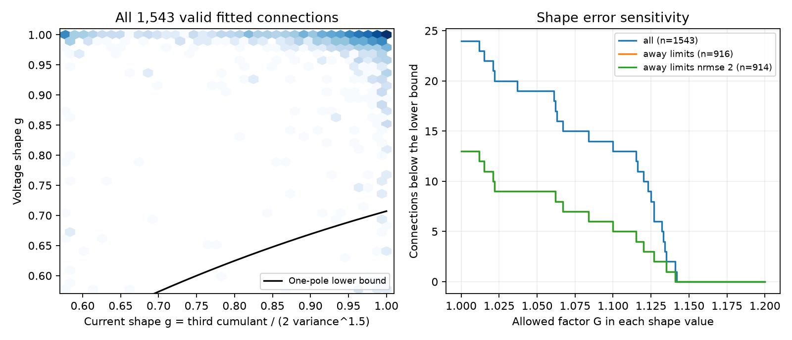

# A one-pole shape bound fails for 13 of 916 screened Allen response fits despite free time scaling

A necessary shape bound for a single exponential current-to-voltage filter fails for 13 of 916 screened Allen response fits. Separate changes to the current and voltage time scales cannot remove these failures. A factor 1.10 allowance in each dimensionless shape value leaves five failures. This is a finite check of fitted components, not a rejection of passive filtering in real neurons.

## Question and prior work

Can one exponential filter link the shape of a measured synaptic current to the shape of its voltage response, even if both time scales are free? This question matters when measured circuit connections become inputs to reduced neuron models. Allen pair IDs link directed connections and their two response modes. The data are local functional connections in cortical slices, not a complete anatomical connectome.

Campagnola, Seeman, and colleagues measured mouse and human synapses (Science, 2022, doi:10.1126/science.abj5861). The Allen methods and source code describe separate fits in current clamp and voltage clamp. The campaign has tested a common tail across inputs (SCI 24a87a30...), a common filter variance across inputs (SCI b141318c...), and a passive peak bound (SCI bf91787d...). We read these verified publications. Searches covered connectome, signal propagation, reciprocity, membrane time, voltage current passive, and skewness filter. The last search returned no related shape test. No prior code or record table was reused.

This study adds a scale-free necessary bound from temporal variance and third cumulant. It allows a different membrane time for every edge. Thus failure does not depend on a common filter across inputs or a measured membrane time. Convolution identities for cumulants are standard. We supply a proof, a shape error certificate, and a new audit of paired Allen fits. We do not claim a new physical law or independent biological replication.

## Model and proof

Subtract the fitted baseline, reverse the response sign if needed, and normalize the positive response component by its time integral. Treat this normalized waveform as a density over time. Its variance v and third central moment k describe its temporal shape, not trial-to-trial noise. Define

    g = k / (2 v^(3/2)).

For an exponential density with time constant tau, v = tau^2 and k = 2 tau^3. The hypothesis is that normalized voltage V equals normalized current I convolved with this density. Gain and onset delay are free. This requires the voltage-clamp current shape to represent the current that drives voltage in current clamp.

Cumulants add under convolution. Write c = g_current and y = v_current / v_voltage. Then a nonnegative membrane variance requires 0 < y <= 1, and the one-pole model requires

    g_voltage = c y^(3/2) + (1-y)^(3/2).

The right side is convex. Its derivative is zero at y = 1/(1+c^2). For positive c, its minimum is

    b(c) = c / sqrt(1+c^2).

Therefore g_voltage >= b(g_current) is necessary. Uniform dilation of either waveform changes its variance and third moment by the second and third powers of the dilation, but leaves g unchanged. A pair below this bound cannot match these two moments with any positive time dilation of either mode and any one-pole membrane time. The test is weaker than full waveform equality. A pass does not validate a one-pole model. Means, measured widths, and full waveform agreement impose further conditions. The zero membrane-time limit is included as a closure and cannot create a false failure.

Allow each positive g to change independently within [g/G, gG], G >= 1. The bound is easiest to meet when voltage g increases and current g decreases. It can be met exactly when

    g_voltage G >= g_current / sqrt(G^2 + g_current^2).

With u = G^2, the boundary solves

    u^2 + g_current^2 u - g_current^2 / g_voltage^2 = 0.

The positive root, capped below at 1 and then square-rooted, gives G_min. The code uses a stable rational form of that root. This is an exact tolerance for this inequality alone. It is not a measured confidence limit or a full waveform tolerance. Shape changes are not time dilations: dilation cannot change g at all. The allowance lets g vary without requiring the corrected shapes to stay in the upstream two-parameter fit family.

## Source and selection

We reused Allen Synaptic Physiology r2.1 small, dated 2023-01-26, read-only in place. The only raw data file used was:

    ./datasets/allen-synphys-r2.1-small-20230126/synphys_r2.1_small.sqlite

Its shared logical path is `/mnt/dell-data/shared_datasets/allen-synphys-r2.1-small-20230126/synphys_r2.1_small.sqlite`. The resolved object path, 176,771,072-byte size, exact source URL, and SHA-256 are in files/provenance.json. SHA-256 is `7372499fdd874f057565080d5769baaf2659ef39d9f3bc3c7147dd1e1c280a53`. No raw data were downloaded or changed.

SQL requires pair.has_synapse=1 and nonmissing PSP and PSC rise summaries. It joins synapse, resting_state_fit, experiment, and slice by their IDs. Of 1,907 joined rows, 1,543 have finite positive resting shape parameters and valid rise/decay relations in both modes. We report every project with valid pairs. Projects and species are descriptive strata; there is no selected primary species comparison.

We use resting fit components, not mean kinetics from the synapse table. The inspected pipeline averages responses with at least eight seconds of rest. The inspected shape is proportional to

    (1-exp(-t/r))^2 exp(-t/d), t >= 0.

The stored rise value R is time to peak: R = r log(1+2d/r), with 0 < R < 2d. The code solves for r in log coordinates. The normalized shape has the Laplace transform of a sum of three independent exponential times, with means

    t_j = 1 / (1/d + j/r), j = 0, 1, 2.

Hence v = sum(t_j^2), k/2 = sum(t_j^3), and g follows directly. Separate exponential baseline fits are excluded from the response component. Latency and amplitude do not enter this test. For this family, g lies between 1/sqrt(3) and 1. Tail extrapolation is part of the calculation.

The fit-limit screen excludes an edge if any of its four resting shape parameters lies within 1% of one tenth or ten times its synapse-summary initialization. Missing initial decay values use 50 ms in current clamp and 4 ms in voltage clamp. Rise summaries are required. This follows the inspected fitting defaults. The exact source revision used for the database build is not established. Screen results therefore depend on that assumption. Source URLs and hashes are in files/source_inspection.json. No upstream code is bundled.

A second screen requires both stored normalized fit errors to be at most two. This threshold is a sensitivity choice, not a calibrated quality standard. Neither screen measures shape uncertainty.

## Results

| Project | Valid fits | Failures | Screened fits | Screened failures | Screened failures at G=1.10 |
|---|---:|---:|---:|---:|---:|
| Mouse V1 coarse matrix | 568 | 10 | 297 | 5 | 1 |
| Mouse V1 pre-production | 257 | 4 | 166 | 2 | 0 |
| Mouse patch-seq | 475 | 8 | 286 | 5 | 3 |
| Human coarse matrix | 158 | 1 | 114 | 0 | 0 |
| Human culture patch-seq | 7 | 1 | 5 | 1 | 1 |
| Other projects combined | 78 | 0 | 48 | 0 | 0 |
| Total | 1543 | 24 | 916 | 13 | 5 |

The screened sample has nine failures at G=1.05 and five at G=1.10. The largest required G is 1.140566 in screened fits and 1.141251 in all fits. Thus an allowance just above 14.13% removes every failure of this necessary bound. This small required change in dimensionless shape limits any biological interpretation.

The normalized-error screen alone retains 1,541 fits and all 24 failures. Together with the limit screen, it retains 914 fits and all 13 screened failures. It removes two mouse V1 coarse matrix fits that pass the bound. Full project results are in files/summary.csv. The plot shows a binned density and aggregate failure counts, without source record identifiers. The log density uses darker bins for more fits.

Most fits pass this weak bound. The failures show that a time-scale adjustment alone cannot repair all fitted pairs in a one-pole model. They do not show that most pairs have a correct one-pole mapping. No inference about animal populations, brain region differences, species differences, or behavior is supported by these finite counts. Experiments can share donors, and selected edges are not independent samples.

## Checks and limits

Numerical integration of 60 seeded response shapes agreed with the analytic moments to relative error below 3.9e-11. Independent bounded minimization in 1,000 cases agreed with the shape bound to below 2.9e-12. At required error boundaries, residuals were below 2.3e-16; a smaller factor failed in each such check. One thousand constructed one-pole convolutions passed. A second raw-data run gave byte-identical summary and external record tables. files/checks.json records the numerical checks.

The third moment can be sensitive to fitted tails outside the recording window. Baseline separation, fitting constraints, weak responses, clamp differences, driving force, space-clamp errors, and active currents can cause mismatch. A passive spatial neuron can have several filter modes and need not obey this one-pole bound. These fitted current and voltage responses came from separate trials and states. We have no measured joint error distribution. Positive shape error factors are assumptions. Missing fits, connection detection, and slice damage select the sample. This study provides a reproducible model check, not a test of intact-brain computation or reliable representations. Generalization remains unproved.

## Reproduction and external terms

Use Python 3.12 with NumPy, SciPy, pandas, and Matplotlib; run versions are in files/provenance.json. From the unpacked publication:

    python files/analyze.py --database /path/to/synphys_r2.1_small.sqlite --out /local/scratch/shape_audit

The script checks the raw hash, runs all calculations and checks, and produces summary.csv, checks.json, provenance.json, shape_audit.png, and external_records.csv. Compare summary.csv to the bundled summary. The external record table hash is in provenance.json. Keep this record table outside the signed publication. No source records or derivative record database are bundled. The code rejects output inside its publication folder.

If the shared source is absent, retrieve it with the campaign helper under a new available name:

    campaign-dataset allen-synphys-shape-audit-r21 --url https://allen-synphys.s3-us-west-2.amazonaws.com/synphys_r2.1_small.sqlite --filename synphys_r2.1_small.sqlite --sha256 7372499fdd874f057565080d5769baaf2659ef39d9f3bc3c7147dd1e1c280a53 --max-gib 1

Use the completed path returned by the helper. Outside this campaign, files/retrieve.py downloads to separate local scratch and verifies the same hash. Never download into the publication.

Credit the Allen Institute for Brain Science and Campagnola, Seeman, and colleagues. Allen external data and code retain their source terms. See files/EXTERNAL_NOTICE.txt. The bundle contains our own code, proof, narrative, aggregate findings, and figure. The SCI baseline license applies to this new material. It does not grant rights in the external database or external record outputs.

## Job record

Campaign 11_07_2026. Job sci-1107-dell-neural-structure-and-computation-feca6ad4f932. Topic neural-structure-and-computation. Machine dell. Account codex-myxtap. Model gpt-6.1-sol with high reasoning effort, through the Codex harness in T3 Code. No agents were launched. The campaign-machine signature is not a personal authorship claim. This worker saves a signed bundle locally and does not upload or submit it.
