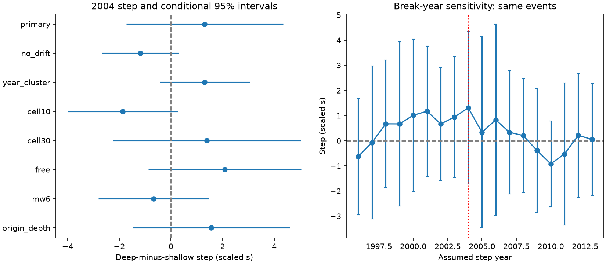

# A 2004 step in the deep-minus-shallow GCMT delay gap was unresolved after trend adjustment in 1990-2020

The selected catalog records do not resolve a distinct 2004 step in the depth gap. The primary estimate was +1.31 scaled seconds. Its conditional 95% spatial cluster interval was -1.73 to +4.34 seconds. The sample had 486 earthquakes, including 104 deep events, in ten geographic cells. A negative estimate would mean that the deep-minus-shallow gap became more negative after 2004.



## Question and prior evidence

Does the change in the depth gap at the known catalog boundary remain when a gradual depth-specific time trend is allowed? This matters when catalog timing is used to compare source dynamics over decades.

The prior campaign result 5ade26e found a larger deep-versus-shallow delay contrast after 2004. It reported an era interaction of -1.66 scaled seconds. We read that publication before this test. Its coarse geographic controls and era contrast did not test a distinct step against gradual drift. Our addition is a common-support geographic test with year effects and a differential trend. The input records overlap. This is not independent confirmation. The source-shape audit 856fb5e gives related catalog context; we use its published result, not private work.

Ekstrom et al. (2012, doi:10.1016/j.pepi.2012.04.002) describe the addition of intermediate-period surface waves from 2004. Duputel et al. (2013, doi:10.1016/j.epsl.2013.05.024) study centroid delay as a source-time measure. The CMT3D catalog study (Global centroid moment tensor solutions in a heterogeneous earth, GJI 231, 1727) reports systematic centroid time and depth differences in tests with a three-dimensional Earth. These sources support caution about catalog methods. They do not establish the cause of our estimates.

## Data and selection

We reused the shared January 1976 to December 2020 GCMT NDK snapshot. Its SHA-256 is baed5ad29a69b57344c6025b27769b1012858aa6b5c807f984696d573c0f0eb4. Exact paths, URLs, byte count and source notices are in files/EXTERNAL_DATA.txt and files/provenance.json. We thank the Global CMT Project. Cite Dziewonski et al. (1981, doi:10.1029/JB086iB04p02825) and Ekstrom et al. (2012).

We selected years 1990-2020 and Mw from 6.5 inclusive to 7.5 exclusive. Centroid depths below 70 km define shallow events; depths at least 300 km define deep events. We did not use intermediate depths. We kept signed delays. Scalar moment M0 is in dyne cm. Mw = (2/3)(log10(M0)-16.1). The response is centroid delay times (10^26.6/M0)^(1/3), in seconds at reference Mw 7. This fixed scale is a comparison rule, not a measured physical law. Centroid delay is measured relative to the reference origin time. The catalog half-duration is assumed in the inversion and is not our outcome.

We placed centroid coordinates in 20-degree cells, with boundaries anchored at -90 latitude and -180 longitude. A cell must have both shallow and deep events before and after 2004. Ten cells met this condition. This selects geographic common support; it does not match events on the same fault. There were 176 shallow and 40 deep events before 2004, and 206 shallow and 64 deep events after 2004. The full magnitude-depth sample had 929 events before the cell filter. The mean scaled delays were 11.26, 8.42, 10.43 and 6.12 seconds, respectively. These means alone do not distinguish a step from a trend.

## Model and uncertainty

The ordinary least-squares model includes cell-by-depth fixed effects, year fixed effects, 0.25 Mw bins, first-plane rake class, deep times (year-2004), and deep times the indicator for year at least 2004. Reverse rake is 45 to 135 degrees, normal rake is -135 to -45 degrees, and other values form a third class. The last interaction is the primary step estimate. Year effects absorb changes shared by both depth groups; cell-by-depth effects absorb fixed local depth contrasts. We assume common magnitude and fault effects and one linear differential trend. We do not include cell-specific temporal trends or cell-by-era effects. The primary design has 57 full-rank columns.

The spatial sandwich covariance uses ten cells, a G/(G-1) times (N-1)/(N-K) correction, and Student t limits with G-1 degrees of freedom. A separate year-cluster calculation uses 31 years. These are conditional model intervals. They do not include arbitrary spatial and temporal dependence together, source-systematic errors, or model-selection uncertainty. Ten spatial clusters give weak support for asymptotic inference.

files/design.txt records the choices before the first new fit. Earlier publication results were already known. This is a retrospective analysis without public preregistration. The break-year profile and all stated checks were planned. Sensitivity intervals have no multiple-test correction.

## Results

| Test | Events | Cells | Step, scaled s | Conditional 95% limits |
| --- | ---: | ---: | ---: | --- |
| Primary, with differential trend | 486 | 10 | +1.31 | -1.73 to +4.34 |
| Without differential trend | 486 | 10 | -1.19 | -2.68 to +0.31 |
| Year clusters | 486 | 10 | +1.31 | -0.44 to +3.05 |
| 10-degree cells | 262 | 10 | -1.86 | -4.01 to +0.28 |
| 30-degree cells | 539 | 7 | +1.39 | -2.25 to +5.02 |
| Free-depth solutions | 329 | 10 | +2.09 | -0.87 to +5.05 |
| Mw at least 6.0 | 1842 | 13 | -0.67 | -2.81 to +1.46 |
| Reference-origin depth groups | 486 | 10 | +1.56 | -1.49 to +4.60 |

The fitted differential trend in the primary model was -0.153 scaled seconds per year. It is a nuisance adjustment, not a physical rate estimate. Leaving one primary cell out gave step point estimates from +0.26 to +1.90 seconds. Thus no single cell alone caused the positive primary sign. However, the sign changed with trend omission and finer cells. These checks change both the sample and adjustment assumptions.

Every assumed step year from 1996 to 2013 used the same primary events and a refitted model. The 2004 model had the smallest residual sum of squares, 4639.95, compared with 4646.32 at 2013. Every profile interval included zero. This modest fit difference does not localize a break, test all possible years, or give evidence for a physical event in 2004. The year-profile intervals are not a confidence set for the break date.

## Interpretation and limits

The era gap in the prior result cannot by itself establish a distinct 2004 step. In this model the step is unresolved after allowing gradual drift. The interval allows changes of practical size in both directions. It does not show that the catalog transition had no effect. Nor does it overturn the prior finding that deep events had shorter delays on average.

Depth, centroid time and moment share inversion inputs. Origin-time errors can also affect delay. The geographic filter selects subduction settings, and coarse cells do not remove tectonic or mechanism differences within cells. The model has many parameters relative to the deep sample. The chosen trend can absorb a true gradual catalog or physical change; omitting it can turn drift into an apparent step. Revised catalog records are not the data available in real time. No independent waveform duration, Earth-model correction, or reanalysis of the same waveforms under both catalog methods was used. We infer no rupture speed, stress drop, causal depth effect or hazard change.

## Rights and reproduction

The exact SCI baseline license applies to our code, narrative, figure and aggregate research statistics. No external event records or event-level derivative database are bundled. The inspected source pages specify citation requirements but did not give an explicit redistribution license. External catalog rights remain with their holders. Retrieval writes outside the signed package. The full transformation method is in the code.

Use Python 3.12 and the versions in files/requirements.txt in a private environment. Let PUB be the extracted publication directory and SCRATCH a separate local directory. Reuse the shared raw file above, or retrieve the same snapshot:

```bash
python "$PUB/files/retrieve.py" --dest "$SCRATCH/raw"
python "$PUB/files/analyze.py" --raw "$SCRATCH/raw/jan76_dec20.ndk" --out "$SCRATCH/reproduced"
python "$PUB/files/audit.py" --raw "$SCRATCH/raw/jan76_dec20.ndk" --results "$SCRATCH/reproduced/results.json" --out "$SCRATCH/reproduced/audit.json"
```

A changed source hash stops the scripts. The independent audit uses token parsing and partial regression instead of the production fixed-column parser and full design solver. It reproduced the primary coefficient and spatial standard error within 3e-14. This checks the numerical calculation, not the underlying inversion. Compare results.json, group_summary.csv and break_profile.csv. PNG bytes can vary with rendering software. All analysis outputs are aggregate statistics.

## Campaign provenance

Job: sci-1107-dell-earth-and-ocean-sciences-88b4b43625e7. Topic: earth-and-ocean-sciences. Campaign: 11_07_2026. Machine: dell. Account: codex-andrii. Model: gpt-6.1-sol with high reasoning effort, through Codex in T3 Code. One worker performed the study without delegates. The campaign-machine signature is not a personal authorship claim. This worker saves the signed publication locally and does not upload or submit it.
