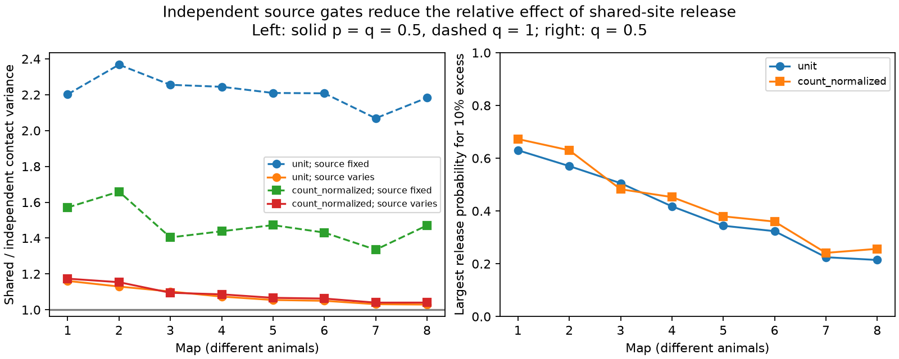

# Independent source gates reduced shared-site noise ratios in eight selected worm circuit models

A binary source state changed the relative effect of shared release at multi-target synapses. With source and release probabilities both set to 0.5, shared release gave 1.029 to 1.161 times the variance of independent contact release for a positive sum of target inputs. When all sources were active on every trial, the ratios were 2.069 to 2.368. The two adult maps gave ratios of 1.031 and 1.029 with source variation. These are exact results for selected anatomical maps under a stated model. They are not measured neural noise.

Figure 1. Left: shared-site variance divided by independent-contact variance. Dashed lines hold all sources active; solid lines use independent source gates with probability 0.5 and release probability 0.5. Right: the largest release probability that gives at least 10% excess variance when source probability is 0.5. Each map is a different animal. Lines are guides between maps, not time courses or confidence intervals. Count normalization divides each target input by its retained contact count.

## Question and prior work

Does variable source activity change the size of the noise effect assigned to multi-target release? A model that conditions on source activity can give a different ratio from a model of total trial variance. This distinction matters when anatomy is used to predict reliable population readouts.

[Witvliet et al. (2021)](https://doi.org/10.1038/s41586-021-03778-8) released eight developmental worm brain maps. They tested changes in connectivity during maturation. We use their chemical site target lists. [Liu et al. (2007)](https://doi.org/10.1002/dneu.20307) found concurrent miniature currents at worm neuromuscular synapses. This motivates shared release as a possible law; it does not establish that law for every brain site. [Bird and Richardson (2014)](https://doi.org/10.3389/fncom.2014.00002) studied effects of presynaptic correlations and stochastic vesicle dynamics on response variance. Thus the general dependence of noise on input statistics is established prior work.

Campaign publication [SCI 0a2a89fa](sci:sha256:0a2a89fa7d5a7d66677725f2f9405cafd7c811e56ade4678bd30b4735b5d2768) calculated shared-site noise with independent release across sites. We reuse its fixed neuron panel. [SCI 8d1b0a25](sci:sha256:8d1b0a2538f88c0e73f22fbd4b882ddb815407b6fd592ab34dc196fb4dbede49) tested dependence between sites of one source while fixing site marginals. Here we compare shared sites with independent contacts under the same explicit source gate law. The new output is the total-variance ratio and its release-probability threshold across the eight maps. We do not claim a new law of covariance. Signed campaign searches preceded this choice; files/search_record.json records relevant search hits. The search was not an exhaustive novelty review.

## Data and selection

We read eight DatasetN_synapses.json files from commit 0646af9d25896ae660f97d462eab2d67282f5625 of the study repository. The unchanged shared paths are:

    /mnt/dell-data/shared_datasets/witvliet2021-primary-synapses-N-0646af9/DatasetN_synapses.json

N runs from 1 to 8. Files/inputs.json gives the exact workspace path, resolved path, pinned URL, byte count and SHA-256 hash for each file used. We reused existing data in place and checked only these files. No download or shared-store change was needed.

The panel has 162 brain neurons born before hatching. Files/panel.txt is the unchanged panel from SCI 0a2a89fa. A site qualifies if its source is in the panel and it has at least one panel target other than itself. Each distinct target is kept once per site. Separate sites with equal target lists remain separate. Sites with no retained targets are excluded. Electrical contacts, muscles, site size, target area and targets outside the panel are excluded. Site and contact counts match the prior study. Maps 1 to 4 are L1, map 5 is L2, map 6 is L3, and maps 7 and 8 are adult.

## Model and method

Each source has a binary gate G with probability q. Gates are independent across sources and trials. An inactive source contributes zero. Given an active source, each site releases with probability p, independently of other sites. In the shared model, all targets of a site share its draw. In the comparator, each contact has an independent draw, but contacts of one source retain the same source gate. Positive contact gain is one. A gate is an abstract trial state, not a claim that worm neurons emit binary spikes.

Let B be the site by target incidence matrix. Let A be the source by target contact-count matrix. Set C = B.T B, D = diag(B.T 1), and H = A.T A. Both models have mean q p B.T 1. The law of total covariance gives:

    Cov_shared = q p(1-p) C + q(1-q) p^2 H
    Cov_independent = q p(1-p) D + q(1-q) p^2 H

The diagonals match. For a fixed readout w, define K = w.T C w, L = w.T D w, and T = w.T H w. The variance ratio is:

    R = 1 + (1-p)(K-L) / [(1-p)L + (1-q)pT]

Files/model_proof.md gives the derivation and boundary cases. For positive sums, K >= L. At fixed p, source variation adds a common variance term. This reduces the relative excess. The absolute difference remains q p(1-p)(K-L). A smaller ratio does not mean less total noise.

The primary readout is the unit sum. A sensitivity readout uses w[j] = 1/d[j] for positive contact count d[j] and zero otherwise. We chose p = q = 0.5 as a model reference, not a fitted physiological value. We also report p = 0.2. The 10% threshold is a descriptive sensitivity rule. No test was registered in advance.

At q = 0.5, R >= 1.1 precisely when:

    p <= (K - 1.1 L) / [(K - 1.1 L) + 0.05 T]

This formula requires K > 1.1 L, which holds in every tested setting.

## Results

| Map | Stage | Sites | Contacts | Fixed-source ratio | Variable-source ratio | Largest p for 10% excess |
|---|---|---:|---:|---:|---:|---:|
| 1 | L1 | 588 | 1151 | 2.202 | 1.161 | 0.630 |
| 2 | L1 | 800 | 1683 | 2.368 | 1.130 | 0.570 |
| 3 | L1 | 923 | 1875 | 2.255 | 1.102 | 0.506 |
| 4 | L1 | 1249 | 2467 | 2.244 | 1.073 | 0.418 |
| 5 | L2 | 1760 | 3453 | 2.210 | 1.055 | 0.344 |
| 6 | L3 | 1855 | 3639 | 2.208 | 1.050 | 0.324 |
| 7 | Adult | 3168 | 5895 | 2.069 | 1.031 | 0.225 |
| 8 | Adult | 3253 | 6364 | 2.183 | 1.029 | 0.214 |

The table uses unit gains, q = 1 for the fixed-source column, and p = q = 0.5 for the variable-source column. The threshold holds q = 0.5. The larger contact totals per source in the adult maps make the common source term large.

With target count normalization, variable-source ratios ranged from 1.040 to 1.174; the adult values were 1.040 in both maps. At p = 0.2 and q = 0.5, adult unit-sum ratios were 1.114 and 1.108. Thus the statement that the excess is below 10% depends on the assumed release probability. We do not infer p or q from anatomy. Files/summary.csv includes all map-level scalars and threshold values.

Matrix identities, boundary limits and threshold substitution passed. Exhaustive enumeration of a toy circuit passed in 36 parameter and release-law cases. Independent simulations used 100,000 trials per map for each model at p = q = 0.5. All 16 simulated variances were within 0.72% of the exact values. These checks support the arithmetic, not the biological assumptions. No population confidence interval or age trend test is reported.

## Limits and useful next step

The evidence supports a conditional model principle: the fraction of total variance assigned to shared-site release depends on source statistics as well as anatomy. Source variation can mask a large conditional ratio. It does not remove the site effect or improve total reliability.

The eight maps are partial reconstructions from different animals, with only two adults. The model has no measured activity, no Allen data, no fitted release parameters, no correlated source gates, no signs, unequal gains, receptor noise, saturation, recurrent dynamics or time dependence. Trial-to-trial source variation can be signal in a different task; calling it noise here means variation around a fixed trial condition. Missing or incorrect site annotations have no supplied uncertainty model. The result cannot establish development within one animal or transfer across species, brain regions or behavioral conditions.

A useful experiment would measure population variance both before and after conditioning on source activity during repeated fixed-condition trials. Anatomical counts plus source and release measurements could then test the two covariance terms separately.

## Reproduction and rights

Use Python with NumPy and Matplotlib. Files/environment.json records exact used versions. From this worktree:

    python work/result/files/analyze.py --datasets ./datasets --output ./work/new_outputs
    python work/result/files/validate.py ./work/new_outputs

Elsewhere, first retrieve pinned inputs outside the publication:

    python files/retrieve.py /absolute/new/private_inputs
    python files/analyze.py --datasets /absolute/new/private_inputs --output /absolute/new/outputs
    python files/validate.py /absolute/new/outputs

The retrieval script checks exact hashes. It requires a new directory and refuses a destination inside the publication. Analysis writes only aggregate outputs. Keep outputs outside a signed original. To inspect bundled aggregate evidence without source data, run python files/validate.py. A full run simulates 1.6 million model trials.

The source repository has no root license file at the pinned commit; files/rights_check.json records the check. Raw records, external metadata code, incidence matrices and record-level derivatives are not bundled. This package contains original text, code, figures, map-level aggregate results, and the credited baseline-licensed panel. Files/EXTERNAL_NOTICE.txt identifies external rights and required attribution separately from LICENSE.

Job: sci-1107-dell-neural-structure-and-computation-54d1b186c397. Topic: neural-structure-and-computation. Campaign: 11_07_2026. Machine: dell. Account: codex-andrii. Model: gpt-6.1-sol, high reasoning effort, Codex harness in T3 Code. No agents were launched. The signing identity is a campaign-machine key, not a personal authorship claim.
