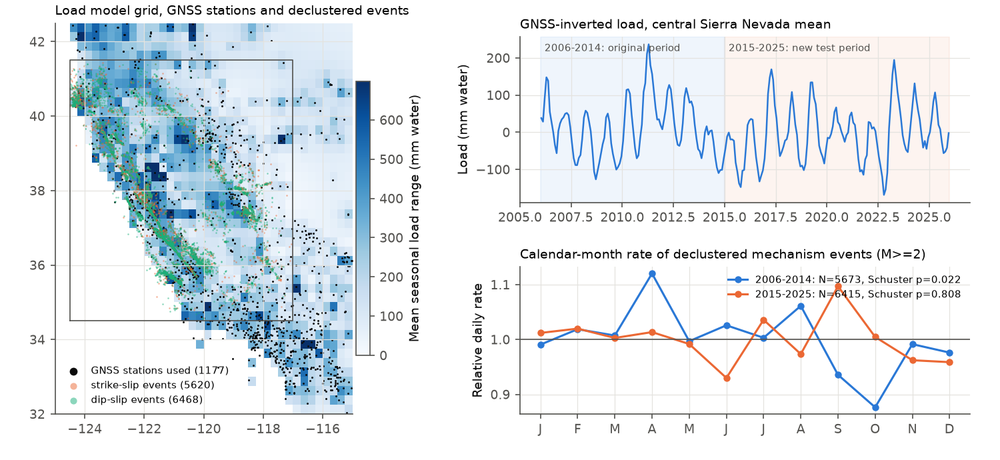
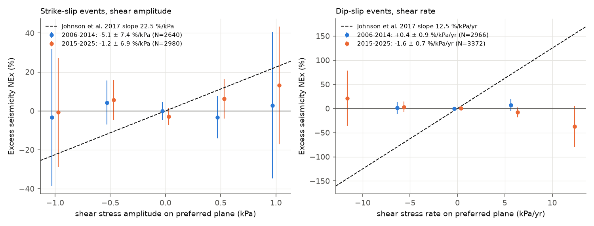
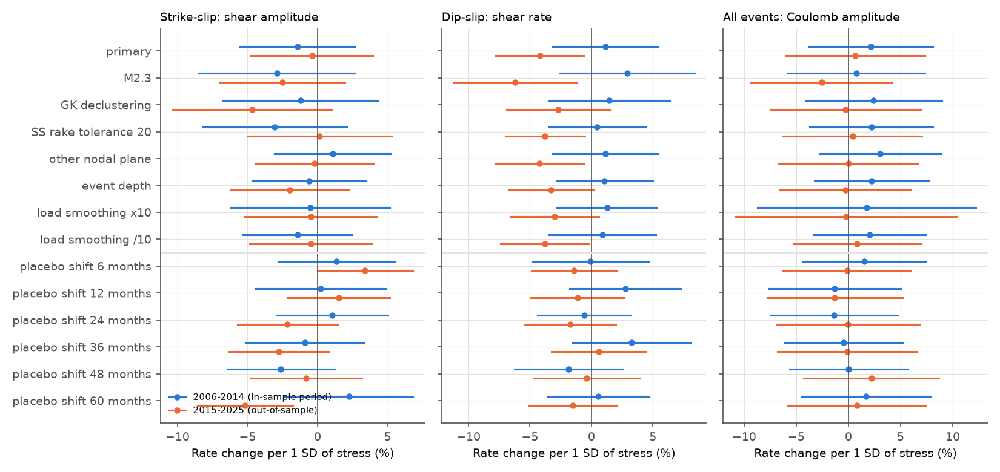

# Hydrologic load stress from GNSS did not change the rate of declustered M 2+ California focal-mechanism earthquakes in 2006-2014 or 2015-2025

**Job:** sci-1107-dell-earth-and-ocean-sciences-3777b314d5ee. **Topic:** earth-and-ocean-sciences. **Machine:** dell (campaign 11_07_2026). **Model:** Claude Opus 5.5 (claude-opus-5-5), working as an automated research agent. The signing key is a campaign-machine key. It is not a personal authorship claim.

## Summary

**Question.** Johnson, Fu and Bürgmann (2017, Science) reported that the seasonal water load in California changes the timing of small earthquakes. In 2006-2014, strike-slip events occurred more often at high load shear stress (+22.5 % per kPa), and dip-slip events occurred more often at a high shear stressing rate (+12.5 % per kPa/yr). Does an independent pipeline find these effects in the same years? Do they continue in 2015-2025, when the load cycle was larger (wet 2017, 2019 and 2023; dry 2021-2022)?

**Approach.** We inverted monthly vertical positions from 1,177 GNSS stations (NGL, 2006-2025) for the surface water load on a 0.25 degree land grid in an elastic half-space. We calculated the Boussinesq stress at 8 km depth for 17,214 NCEDC first-motion mechanisms (M >= 2.0, 34.5-41.5 N, 124.5-117 W, The Geysers and Long Valley removed). We resolved the stress on the preferred plane with the rules of Johnson et al. After nearest-neighbour declustering, 5,673 events remained in 2006-2014 and 6,415 events in 2015-2025. We used the NEx statistic of Johnson et al. and a conditional-logit rate model (rate proportional to exp(a S)), with cluster-robust intervals.

**Results.**

- Strike-slip events, shear-stress amplitude: -5.1 % per kPa (95% CI -19.5 to +9.3) in 2006-2014 and -1.2 % per kPa (-14.7 to +12.2) in 2015-2025. Johnson et al. reported +22.5 (+4.3 to +40.7). Both of our intervals exclude +22.5.
- Dip-slip events, shear stressing rate: +0.4 % per kPa/yr (-1.2 to +2.1) in 2006-2014 and -1.6 % per kPa/yr (-2.9 to -0.2) in 2015-2025. Johnson et al. reported +12.5 (+6.6 to +18.4). Both of our intervals exclude it. The 2015-2025 value has the opposite sign.
- All events, Coulomb stress amplitude: +3.7 % per kPa (-6.4 to +13.7) and +1.1 % per kPa (-9.6 to +11.8).
- Our stress values have the same range as those of Johnson et al. (strike-slip shear amplitude about -1 to +1 kPa; dip-slip shear rate about -12 to +12 kPa/yr). Thus the slopes are comparable to theirs.
- Injection test: when we put the Johnson et al. slopes into our own stress series, the estimator recovered them (22.0 and 12.5 % on average). The power was 0.93-0.96 for the strike-slip slope and 1.00 for the dip-slip slope.
- Model-free check: the declustered catalog had a weak annual cycle in 2006-2014 (Schuster p = 0.022, peak in late April, relative amplitude 5%). It had no annual cycle in 2015-2025 (p = 0.81, amplitude 1%).
- Plane choice, strike-slip definition, magnitude cut, declustering method, event depth and 10-times-different load smoothing did not change the conclusions.

**Conclusion.** With an independent GNSS load model, we did not find the load-stress modulation of California microseismicity that Johnson et al. (2017) reported. We did not find it in their own period, and we did not find it in 11 later years with larger loads. If the modulation exists, it is much smaller than reported (for strike-slip events, the upper 95% bound in 2006-2025 is +6 % per kPa; for dip-slip events, +0.4 % per kPa/yr), or it depends on details of their load model that we did not reproduce.

**Main limitations.** Our load model is a smoothed half-space inversion, not the layered spherical-Earth model of Johnson et al. The load map is patchy, and cross-validation could not fix the smoothing weight well. Our stress errors can hide a real effect if they are large. We did not use their station list, catalog version or ETAS declustering. We did not test their historical M >= 5.5 result.



*Figure 1. Left: mean seasonal load range in the GNSS inversion, the GNSS stations used and the declustered events (study box outlined). Top right: mean load in the central Sierra Nevada; the 2015-2025 test period has larger wet-year peaks (2017, 2019, 2023) and deeper dry years. Bottom right: calendar-month rate of declustered mechanism events, relative to the mean.*



*Figure 2. Excess seismicity (NEx) in stress bins for the two main claims of Johnson et al. (2017), with +/-2 SD Poisson bars. The dashed lines are their published slopes. Legend values are the conditional-logit slopes with cluster-robust standard errors.*



*Figure 3. Rate change per one standard deviation of stress (95% cluster-robust intervals) for the primary analysis, seven sensitivity analyses and six placebo shifts, in 2006-2014 (blue) and 2015-2025 (orange).*

## Results

### Primary and sensitivity estimates

Conditional-logit slope 100 a, with 95% cluster-robust interval. Units: % per kPa for amplitude and % per kPa/yr for rate. SS = strike-slip, DS = dip-slip (reverse, normal and oblique).

| Analysis | SS shear amplitude 2006-2014 | SS shear amplitude 2015-2025 | DS shear rate 2006-2014 | DS shear rate 2015-2025 | All Coulomb amplitude 2006-2014 | All Coulomb amplitude 2015-2025 |
| --- | --- | --- | --- | --- | --- | --- |
| Johnson et al. 2017 (2006-2014) | +22.5 (+4.3, +40.7) | - | +12.5 (+6.6, +18.4) | - | - | - |
| primary | -5.1 (-19.5, +9.3) | -1.2 (-14.7, +12.2) | +0.4 (-1.2, +2.1) | -1.6 (-2.9, -0.2) | +3.7 (-6.4, +13.7) | +1.1 (-9.6, +11.8) |
| M >= 2.3 | -10.8 (-31.5, +9.9) | -8.3 (-23.1, +6.4) | +1.2 (-1.0, +3.3) | -2.4 (-4.3, -0.5) | +1.3 (-10.3, +12.9) | -4.4 (-15.7, +7.0) |
| Gardner-Knopoff declustering | -4.6 (-25.4, +16.2) | -15.0 (-33.1, +3.1) | +0.6 (-1.4, +2.6) | -1.0 (-2.6, +0.6) | +4.2 (-7.3, +15.6) | -0.5 (-12.0, +11.1) |
| SS if rake within 20 degrees | -11.4 (-30.5, +7.7) | +0.4 (-16.5, +17.3) | +0.2 (-1.4, +1.8) | -1.5 (-2.7, -0.2) | +3.7 (-6.3, +13.7) | +0.6 (-10.0, +11.3) |
| other nodal plane | +3.8 (-10.8, +18.4) | -0.7 (-13.7, +12.3) | +0.4 (-1.2, +2.1) | -1.6 (-2.9, -0.2) | +5.5 (-5.1, +16.0) | +0.0 (-11.3, +11.4) |
| stress at event depth (2-20 km) | -2.0 (-15.2, +11.2) | -5.7 (-17.9, +6.4) | +0.4 (-1.0, +1.8) | -1.2 (-2.4, +0.1) | +3.6 (-5.2, +12.4) | -0.4 (-9.9, +9.0) |
| load smoothing x10 | -5.3 (-61.6, +51.0) | -4.5 (-47.5, +38.5) | +1.3 (-2.8, +5.4) | -3.0 (-6.5, +0.6) | +5.3 (-26.5, +37.1) | -0.6 (-31.7, +30.4) |
| load smoothing /10 | -4.3 (-16.0, +7.5) | -1.3 (-12.7, +10.1) | +0.3 (-1.2, +1.8) | -1.2 (-2.4, -0.1) | +3.1 (-5.2, +11.4) | +1.2 (-7.6, +10.0) |

Month-cluster bootstrap intervals (500 resamples) for the primary runs agree with the analytic intervals (for example, SS 2006-2014: -18.4 to +9.0; DS rate 2015-2025: -2.7 to -0.3). NEx line slopes, the statistic of Johnson et al., give the same picture (SS amplitude: -4.6 +/- 6.7 and +2.5 +/- 5.9 % per kPa; DS rate: +0.5 +/- 0.7 and -1.3 +/- 0.6 % per kPa/yr; +/- 1 SE). The 10-times-smoother load gives about three times smaller stresses, so its intervals in % per kPa are wider; per standard deviation of stress (Figure 3) it agrees with the other runs. All 18 combinations of fault class, stress component and amplitude or rate are in `files/results/modulation_estimates.csv`.

### Placebos

A 6-month shift reverses the seasonal phase of the stress. Shifts of 1 to 5 whole years keep the mean seasonal phase but use the wrong year's load. For the dip-slip rate test, the 6-month shift gave -0.0 % (2006-2014) and -0.5 % (2015-2025) per kPa/yr, and the year shifts gave -0.7 to +1.2 and -0.7 to +0.2. For the strike-slip amplitude test, the placebos ranged from -8.6 to +7.4 (2006-2014) and from -16.9 to +10.5 (2015-2025) % per kPa. The spread of the strike-slip placebos is as large as the spread of the real estimates. Thus the real strike-slip estimates are not different from chance.

### The 2015-2025 dip-slip rate estimate

The dip-slip rate slope in 2015-2025 is -1.6 % per kPa/yr (z = -2.3). It is negative in all variants (-1.0 to -3.0), but these variants use mostly the same events. The year-shifted placebos are near zero, so the value is not a calendar-season effect. We ran many tests (3 fault groups x 3 stress components x 2 quantities x 3 windows, plus variants). One |z| > 2 result in this set is expected by chance. It also has the opposite sign to the published claim. We do not interpret it as a physical effect. In 2006-2025 as a whole, the slope is -0.7 (-1.7 to +0.4).

### Power

| Window | Test | Planted slope | Mean estimate | SD of estimate | Power (one-sided 5%) |
| --- | --- | --- | --- | --- | --- |
| 2006-2014 | SS shear amplitude | 22.5 | 22.0 | 6.6 | 0.93 |
| 2006-2014 | SS shear amplitude | 11.25 | 11.8 | 6.3 | 0.50 |
| 2006-2014 | DS shear rate | 12.5 | 12.5 | 0.7 | 1.00 |
| 2006-2014 | DS shear rate | 6.25 | 6.2 | 0.7 | 1.00 |
| 2015-2025 | SS shear amplitude | 22.5 | 22.2 | 5.7 | 0.96 |
| 2015-2025 | SS shear amplitude | 11.25 | 10.6 | 6.0 | 0.48 |
| 2015-2025 | DS shear rate | 12.5 | 12.6 | 0.6 | 1.00 |
| 2015-2025 | DS shear rate | 6.25 | 6.2 | 0.6 | 1.00 |

The test plants the effect in our own stress model. It does not include errors of the stress model. If our stresses are only weakly correlated with the true load stresses, a real effect becomes smaller in our estimate.

### Model-free seasonality

| Window | Group | N | Schuster p (1 yr) | Relative amplitude | Peak day of year |
| --- | --- | --- | --- | --- | --- |
| 2006-2014 | all | 5,673 | 0.022 | 0.052 | 115 |
| 2006-2014 | strike-slip | 2,640 | 0.034 | 0.072 | 134 |
| 2006-2014 | dip-slip | 3,033 | 0.25 | 0.043 | 86 |
| 2015-2025 | all | 6,415 | 0.81 | 0.012 | 245 |
| 2015-2025 | strike-slip | 2,980 | 0.89 | 0.013 | 347 |
| 2015-2025 | dip-slip | 3,435 | 0.57 | 0.026 | 220 |

The Schuster test treats events as independent, so the 2006-2014 p-value is optimistic. A weak spring excess in 2006-2014 did not continue in 2015-2025, although the 2015-2025 load cycle was larger.

## Interpretation

Our pipeline reproduces the main inputs of Johnson et al.: the GNSS seasonal load peaks in March-April, the Sierra Nevada load range is about 150-250 mm of water, and the stress range on the fault planes is about 1-2 kPa. With these inputs, neither published effect appeared in 2006-2014, and neither appeared in 2015-2025. The injection test shows that our data had enough events to detect effects of the published size. Possible reasons for the difference are: (1) the published effects are smaller than reported or are chance results; (2) the published effects need their exact load model, and our model has different stress patterns at the fault scale; (3) catalog changes (NCEDC mechanism recalculation) or declustering differences. Our data cannot separate (1) from (2). But (2) would mean that the effect is not robust to reasonable changes in the load model. This agrees with the null global and Japanese seasonal-load tests in this campaign (sci:sha256:3a9efb99..., 7184e3ca..., d9ed0915...).

## Limitations

- Half-space elastic model (shear modulus 30 GPa). Absolute kPa values scale with this choice. A layered or spherical model can change the stress values and the far-field terms.
- The load inversion is under-determined. Cross-validation error changed by less than 20% over five orders of magnitude of smoothing, and it continued to decrease slowly at the smoothest values. The primary load map is patchy (Figure 1). We bracket this with 10-times-smoother and 10-times-rougher loads.
- GNSS vertical signals include common-mode and thermal-expansion errors. We did not remove them.
- We removed GNSS stations with a spring height maximum (aquifer response) by an annual-phase rule. Some poroelastic signal can stay in the selected stations.
- We used the current NCEDC catalog, the Zaliapin-Ben-Zion declustering (Gardner-Knopoff as a check), and not the ETAS stochastic declustering of Johnson et al. Our event counts (5,673 in 2006-2014) are larger than theirs (3,689), and our strike-slip share is larger (47% vs 36%). The rake-20 variant (strike-slip share 35%) gives the same result.
- First-motion mechanisms of M 2 events have large plane uncertainties. Plane errors make the stress values noisy and can hide an effect. The "other nodal plane" variant shows the size of this effect.
- We did not test the historical M >= 5.5 result of Johnson et al.
- Many tests were run. We gave the two published claims priority and treat all other results as secondary.

## Reproduce

Python 3.12 with numpy, scipy, pandas, geopandas, shapely, scikit-learn, lxml, matplotlib. Place `files/code/*` in `work/code/`; scripts read `work/raw/` and write `work/out/`.

```bash
bash work/code/01_fetch_ncedc.sh        # 240 monthly NCEDC QuakeML files (~320 MB, ~1 h)
# station list: see 02_fetch_ngl.sh; copy files/provenance/ngl_stations_requested.txt to work/raw/ngl/stations.txt
curl -4 -s https://geodesy.unr.edu/NGLStationPages/DataHoldings.txt -o work/raw/ngl/DataHoldings.txt
curl -4 -s https://geodesy.unr.edu/NGLStationPages/steps.txt -o work/raw/ngl/steps.txt
bash work/code/02_fetch_ngl.sh          # 1,436 NGL IGS20 tenv3 files (~1.7 GB)
curl -4 -sL https://naciscdn.org/naturalearth/10m/physical/ne_10m_land.zip -o work/raw/ne/ne_10m_land.zip
python work/code/03_parse_ncedc.py work/raw/ncedc work/out/ncedc_events.csv
OMP_NUM_THREADS=1 python work/code/04_gnss_monthly.py
python work/code/05_load_inversion.py                       # primary load (cross-validated smoothing)
ALPHA=1.5e-3 LOAD_SUFFIX=_smooth10 python work/code/05_load_inversion.py
ALPHA=1.5e-5 LOAD_SUFFIX=_rough10 python work/code/05_load_inversion.py
python work/code/06_decluster.py
python work/code/07_event_stress.py fixed8; python work/code/07_event_stress.py evdepth
LOAD_SUFFIX=_smooth10 python work/code/07_event_stress.py fixed8; LOAD_SUFFIX=_rough10 python work/code/07_event_stress.py fixed8
OMP_NUM_THREADS=1 python work/code/08_analysis.py           # writes out/results.json
python work/code/09_descriptive.py; python work/code/11_injection.py; python work/code/10_figures.py
```

To skip the downloads, copy `files/data/*` to `work/out/` and start at step 07 (`ncedc_declustered.csv`, `load_grid*.npz`, `gnss_*.csv` are the derived inputs). NCEDC and NGL can revise their products; the hashes of the raw files that we used are in `files/provenance/`. The analysis in `08_analysis.py` used 29 configurations; on the shared host it took about 35 minutes with 12 processes.

## Files

- `files/code/`: all scripts. `geomech.py` holds the projection, Boussinesq displacement and stress, and fault-plane resolution, with sign unit tests.
- `files/data/ncedc_declustered.csv`: all 48,823 M >= 2.0 earthquakes, with mechanism planes where available and declustering flags. `event_meta_fixed8.csv`: the 17,214 mechanism events used, with plane choice and class.
- `files/data/gnss_stations.csv`, `gnss_monthly.csv`: station fit summary and monthly vertical load signal (m). `load_grid*.npz`: monthly loads (mm water) per land cell for three smoothing weights. `load_total*.csv`: total load and fit RMS by month.
- `files/results/results.json`: all estimates with NEx bins. `modulation_estimates.csv`: summary table. `injection.csv`, `schuster.json`, `yearly_counts.csv`, `load_smoothing_cv.json`, inversion logs.
- `files/provenance/`: request URLs, station list, SHA-256 of every raw file.

## Methods

### Claim under test

Johnson, Fu and Bürgmann (2017, Science 356:1161, doi:10.1126/science.aak9547) used GPS vertical motion for January 2006 to December 2014 to model monthly hydrological surface loads in California. They resolved the load stress at 8 km depth on the preferred plane of 3,689 declustered NCEDC focal mechanisms (M >= 2.0, 34.5-41.5 N, 124.5-117 W, The Geysers and Long Valley removed). They reported two main results:

- H1: strike-slip events (N = 1,344) occur more often when the shear-stress amplitude is high: slope 22.5 +/- 18.2 % excess seismicity (NEx) per kPa (95%).
- H2: dip-slip events (N = 2,345) occur more often when the shear stressing rate is high: slope 12.5 +/- 5.9 NEx per kPa/yr (95%).

We rebuilt the analysis with an independent pipeline. We tested it first in the original period (2006-2014) and then in 11 later years (2015-2025). The later years include the wettest (2017, 2019, 2023) and driest (2014-2015, 2021-2022) California years of the GNSS era, so the load signal is larger than in the original period.

### Data

| Input | Source | Version / retrieval | Use |
| --- | --- | --- | --- |
| Earthquakes and first-motion focal mechanisms | NCEDC FDSN event service, `includemechanisms=true` | 240 monthly QuakeML files, M >= 2.0, box 34.5-41.5 N, 124.5-117 W, 2006-01 to 2025-12, retrieved 2026-11-09 | 49,215 events, 48,823 earthquakes, 23,501 with mechanisms |
| GNSS daily positions | Nevada Geodetic Laboratory (NGL) IGS20 `tenv3` files | 1,436 stations in 31.5-43.5 N, 126-114 W with >= 3 years in 2006-2025, retrieved 2026-11-09 | vertical monthly signal |
| GNSS step dates | NGL `steps.txt` | retrieved 2026-11-09 | equipment and earthquake offsets |
| Land mask | Natural Earth 10 m land | `ne_10m_land.zip` | load only on land cells |

SHA-256 hashes of every raw file are in `files/provenance/`. The raw files are not in the bundle (2 GB). The recipe in "Reproduce" downloads them again. NCEDC can revise its catalog, so a later download can differ slightly; the parsed event table we used is in `files/data/`.

### Pipeline

1. `01_fetch_ncedc.sh`, `02_fetch_ngl.sh`: download.
2. `03_parse_ncedc.py`: parse QuakeML. Keep the preferred origin, magnitude and focal mechanism (both nodal planes).
3. `04_gnss_monthly.py`: per station, robust least squares on daily heights: offset + linear trend + NGL step offsets + annual + semiannual terms. The load signal is the seasonal terms plus residuals, as calendar-month means (>= 15 days).
4. `05_load_inversion.py`: keep 1,177 "loading-type" stations (annual height maximum from July to December, monthly residual SD < 6 mm, annual amplitude < 15 mm). Johnson et al. also removed stations with winter uplift (aquifer response). Each month, invert for water load on a 0.25 degree land grid (32-42.5 N, 125-115 W, 5 x 5 sub-cells per cell) in an elastic half-space (shear modulus 30 GPa, Poisson ratio 0.25), with Laplacian smoothing. The smoothing weight came from 5-fold station hold-out cross-validation on 24 months. Cross-validation error was almost flat over three orders of magnitude, so we also ran loads with 10 times more and 10 times less smoothing.
5. `06_decluster.py`: decluster all 48,823 M >= 2.0 earthquakes. Primary: Zaliapin and Ben-Zion nearest-neighbour method (b = 1, d_f = 1.6, Gaussian-mixture threshold log10 eta = -5.53; 29,988 background events). Sensitivity: Gardner-Knopoff windows (13,396 background events). Johnson et al. used ETAS stochastic declustering.
6. `07_event_stress.py`: for each event with a mechanism (Geysers and Long Valley removed; 17,214 events), calculate the Boussinesq stress tensor at 8 km depth from every load cell, for each month. Resolve it on the preferred plane with the rules of Johnson et al.: strike-slip (|rake| <= 30 or >= 150 on plane 1) uses the plane with strike nearest 325 degrees; reverse uses the plane with dip nearest 30 degrees; normal uses the plane with dip nearest 60 degrees. Shear stress is positive in the slip direction; normal stress is positive for unclamping; Coulomb stress uses friction 0.4. Unit tests in `geomech.py` check the signs (thrust, normal and right-lateral cases).
7. `08_analysis.py`: for each window, remove a linear trend from each event's stress series inside the window, as Johnson et al. did. Stressing rate = centred monthly difference x 12. Two statistics:
   - NEx in stress bins (0.5 kPa, 6 kPa/yr), with N_exp from the time each event's own series spends in each bin, and a weighted line through bins with N_exp >= 10. This is the statistic of Johnson et al.
   - A conditional-logit modulation coefficient: rate proportional to exp(a S). Each event month is compared with all months of the window for the same location and plane. 100 a is in % per kPa (or % per kPa/yr). Its 95% interval comes from 500 bootstrap resamples of calendar months (events in one month are resampled together).
8. Placebos: stress series shifted by 6 months (opposite seasonal phase) and by 1-5 whole years (same mean seasonal phase, wrong year).
9. `09_descriptive.py`: model-free calendar-month counts and Schuster test for a 1-year period.
10. `11_injection.py`: put the Johnson et al. slopes (and half of them) into our own stress series by resampling event months, then estimate again.

### Deviations from Johnson et al. (2017)

- Our load model is a half-space; theirs is a layered spherical Earth. Our kPa values can differ from theirs by a scale factor. Signs and z-scores do not depend on this scale. The forest plot shows % per one standard deviation of stress for this reason.
- Our GNSS processing, station screen, smoothing and declustering are different. We did not have their station list or catalog.
- Our mechanism catalog is the current NCEDC catalog. NCEDC can have recomputed mechanisms since 2016.
