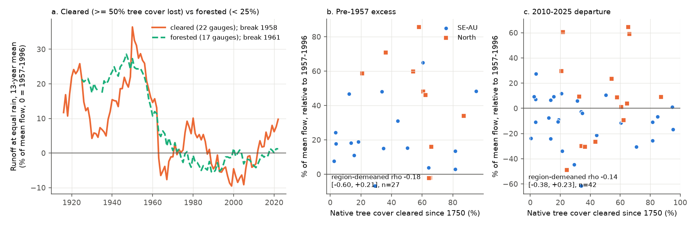
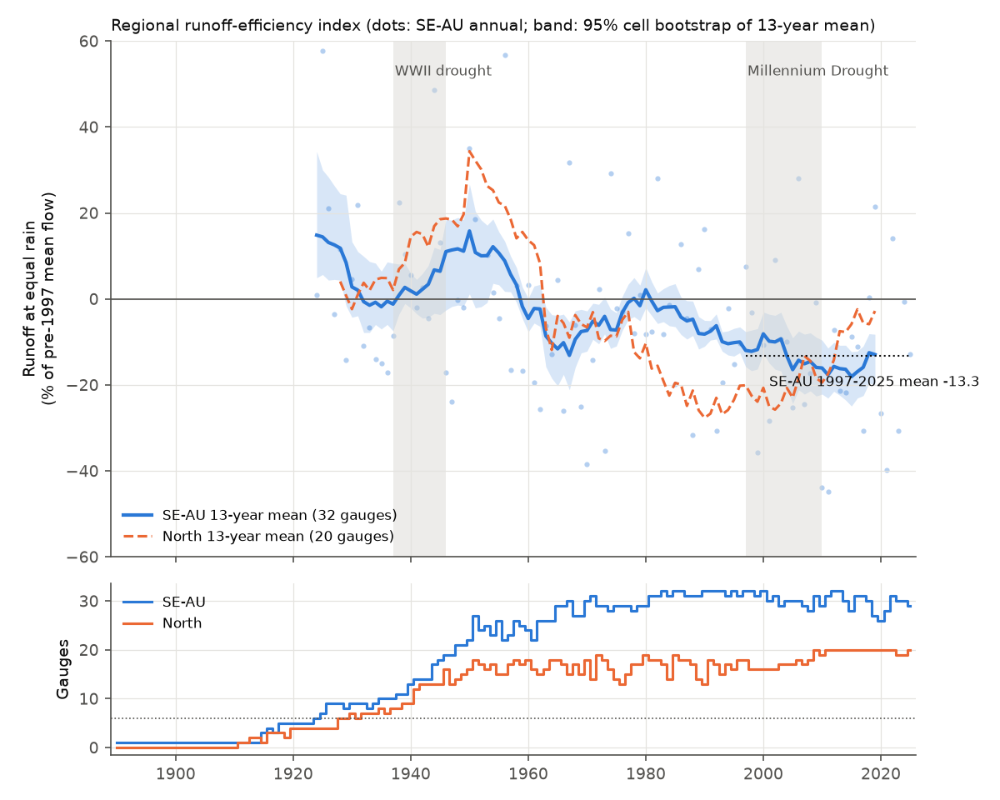
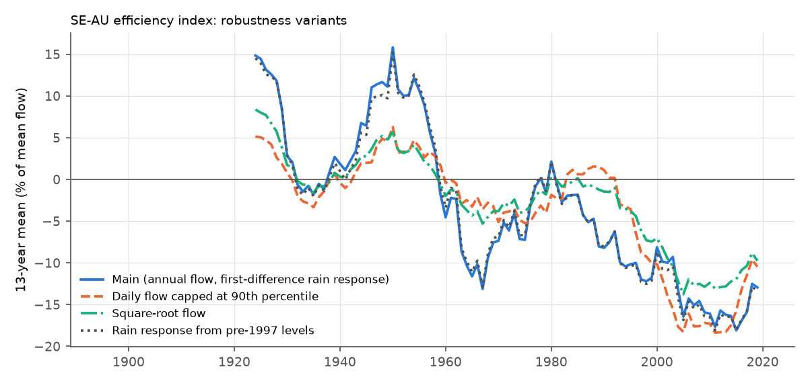

# Forested and cleared catchments had the same pre-1957 runoff excess in long eastern Australian records, so land clearing does not explain it (52 BoM gauges, 1889-2025)

Job `sci-1107-dell-earth-and-ocean-sciences-8f4ccf3ddddf`, campaign 11_07_2026, topic
earth-and-ocean-sciences, machine dell, account claude-sci. Model: Claude Opus 5.5
(`claude-opus-5-5`) in Claude Code (T3 Code). The signing key is a campaign-machine key. It is not a
personal authorship claim.

## Summary

**Background.** After 1997, runoff in south-east Australia (SE-AU) fell 12-25% below each
catchment's rainfall-runoff relation and stayed low. Long Bureau of Meteorology (BoM) records
(bundle 4e9ae7e7) show that runoff at equal rain was also about 20% higher before 1957 than in
1957-1996. Sibling bundles found that measured climate does not explain these changes (33c96211,
50974694, f7a9b749, ee211978). They leave one question open: is the century-scale change a
catchment change or a flow-measurement effect? Before about 1955, cleared land in eastern Australia
had a rabbit plague (ended by myxomatosis in 1950-1953) and unimproved, overgrazed pasture (before
the superphosphate and clover expansion of the 1950s). These land processes act on cleared land
only. Thus they predict a larger early excess in cleared catchments than in forested ones.

**Question.** (1) Does the pre-1957 excess, or the post-1997 deficit, depend on how much native
tree cover the catchment lost (land-cover fingerprint), or on the state agency that measured the
flow? (2) Replication with a new index: is the post-1997 SE-AU deficit outside the stationary
variation of the pre-1997 efficiency?

**Data.** The 58 CAMELS-AUS gauges with BoM daily flow from 1950 or earlier (the set of 4e9ae7e7;
410033 removed), 32 in SE-AU (south of 33.5 S, east of 140 E) and 20 in the North control. SILO
monthly rain 1889-2025, CRU TS 4.09 Tmax, ERSST v5 IPO index, CAMELS-AUS v2.03 attributes. Our
rebuilt flow and rain tables are byte-identical to those of 4e9ae7e7.

**Method.** A new efficiency index that does not need a reference period. Per gauge, the rain
response (b, c) comes from year-to-year changes before 1997: dq = k + b dP + c dP(t-1), with q in %
of the gauge's pre-1997 mean flow. A slow efficiency change does not enter year-to-year changes.
The efficiency residual is E = q - b(P - Pbar) - c(P(t-1) - Pbar). A two-way fixed-effect model
E = a_g + u_t gives the regional annual index u_t; u_gt = E - a_g is the gauge-level efficiency.
Per gauge, X57 = mean u before 1957 minus mean u in 1957-1996; D10 = mean u in 2010-2025 minus
mean u in 1957-1996. Clearing C = NVIS pre-1750 forest + woodland % minus extant forest + woodland
% (CAMELS-AUS). Intervals: 2-degree cell bootstrap (2,000 draws in the main runs). The plan
(`files/ANALYSIS_PLAN.md`) was written before any index was calculated. Addendum 1 (land-cover and
agency tests) was added after four sibling bundles covered the original tests, and before any
flow-based result was calculated.

## Main results

**1. No land-cover fingerprint (planned test L1; Figure 1).** The pre-1957 excess was as large in
forested catchments as in cleared ones:

| Gauges with >= 10 pre-1957 years (n = 27) | Pre-1957 excess X57 (% of mean flow, 95% CI) |
| --- | --- |
| Cleared (C >= 50%, n = 14) | +31.0 (+11.5 to +46.1) |
| Forested (C < 25%, n = 8) | +25.4 (+15.2 to +42.8) |
| Cleared minus forested | +5.6 (-20.8 to +24.5) |
| Spearman rho(X57, C), region-demeaned | -0.18 (-0.60 to +0.21) |
| Spearman rho(X57, C), SE-AU only (n = 17) | +0.01 (-0.53 to +0.52) |

All 8 forested gauges had an excess (+7.6 to +58.7), and 12 of 14 cleared gauges. By the planned rule the decision is **"no land-cover fingerprint"**: the forested group alone had
a clear excess, and the contrast interval includes 0. The group indices (Figure 1a) were near 20-28%
above the 1957-1996 level in 1941-1953 in both groups, and both fell in the late 1950s. The best
single break year was 1958 (cleared, 22 gauges) and 1961 (forested, 17 gauges).

The result held in all planned variants (decision unchanged in each):

| Variant | Cleared X57 | Forested X57 | Contrast (95% CI) | rho(X57, cover) |
| --- | --- | --- | --- | --- |
| Main (C, annual flow) | +31.0 | +25.4 | +5.6 (-20.8 to +24.5) | -0.18 (-0.60 to +0.21) |
| Agricultural fraction A instead of C | +21.5 | +25.3 | -3.8 (-36.9 to +17.3) | +0.12 (-0.35 to +0.41) |
| Daily flow capped at the 90th percentile | +8.2 | +16.8 | -8.6 (-24.5 to +1.4) | -0.56 (-0.75 to -0.13) |
| Rain response from pre-1997 levels | +28.7 | +23.0 | +5.8 (-15.6 to +22.8) | -0.11 (-0.53 to +0.24) |
| Square-root flow | +13.7 | +12.6 | +1.1 (-13.2 to +11.9) | -0.23 (-0.63 to +0.18) |
| Without regulated gauges | +32.3 | +25.4 | +6.9 (-20.7 to +27.2) | -0.13 (-0.65 to +0.32) |

With capped flow, the forested catchments had a *larger* excess than cleared ones. This is the
opposite of the land-cover prediction.

**2. The post-1997 deficit also has no land-cover fingerprint (L2).** D10 against C: rho -0.14
(-0.38 to +0.23), cleared minus forested +4.9 (-9.5 to +23.0), n = 42. This agrees with the
protected-area result of bundle 5eddb9c5.

**3. Agency (L3).** All three agencies had a pre-1957 excess: Victoria +18.1 (+5.4 to +28.9; n = 9),
NSW +40.2 (+21.5 to +57.7; n = 14), Queensland +17.6 (-2.3 to +58.7; n = 4). NSW gauges had about
twice the Victorian excess. The NSW gauges are also more often in the North, where the excess was
larger (+41.5 vs +22.4 in SE-AU), so region and agency cannot be separated here.

**4. Break timing (post hoc).** At 17 gauges with >= 15 years before 1951, the best single break in
the gauge's own efficiency (1940-1975) had median 1957 (quartiles 1945-1961), and 13 of 17 steps were
down (median -21 points). The break years were not more clustered than in block-shuffled series
without a dated break (interquartile range 16 years, null median 20, P = 0.25). Thus the per-gauge
data cannot show a common date. The medians were 1957 (cleared), 1959 (forested), 1955 (VIC), 1958
(NSW).

**5. Replication: the post-1997 SE-AU deficit is outside stationary pre-1997 variation (T1;
Figures 2-3).** The SE-AU index (u = 0 for the 1924-1996 mean) was +8.1 before 1957 (+4.4 to +10.6),
-6.7 in 1957-1996, -9.3 in 1997-2009 and -16.5 in 2010-2025 (-23.1 to -11.6). The 1997-2025 mean
was D = -13.3 (-19.9 to -8.0) below the 1924-1996 mean. Under three stationary models fitted to
1924-1996 (AR(1), AR(2), and Gaussian series with the sample autocovariance, which is equivalent to
phase-randomized surrogates), the probability of D this low was 0.006, 0.008 and 0.011. The planned
decision is "outside stationary pre-1997 variability". It held in all variants (P <= 0.023; Table
below). But a single post-1997 13-year window was not unusual: its minimum was below the pre-1997
minimum in 16-18% of null series. The North was "consistent with pre-1997 variability" (P 0.09-0.22).

| SE-AU variant | Gauges | D 1997-2025 (95% CI) | P (AR1, AR2, acov) |
| --- | --- | --- | --- |
| Main | 32 | -13.3 (-19.9 to -8.0) | 0.006, 0.008, 0.011 |
| Capped daily flow | 32 | -13.4 (-21.1 to -7.4) | < 0.001 for all |
| Square-root flow | 32 | -10.4 (-15.6 to -5.6) | < 0.001 for all |
| Level-based rain response | 33 | -13.8 (-20.2 to -8.0) | 0.004, 0.003, 0.006 |
| Without regulated gauges | 29 | -12.3 (-18.7 to -7.1) | 0.005, 0.016, 0.023 |
| Minimum 4 gauges per year (from 1918) | 32 | -14.7 (-24.1 to -8.9) | 0.003, 0.008, 0.017 |
| Minimum 10 gauges per year (from 1935) | 32 | -12.2 (-19.1 to -5.9) | 0.011, 0.015, 0.017 |
| Null fitted on 1940-1996 | 32 | -12.2 (-18.8 to -5.6) | 0.011, 0.022, 0.023 |

**6. The early excess and the late deficit are in different parts of the flow range (Figure 5).**
With daily flows capped at each gauge's 90th percentile, the SE-AU pre-1957 excess fell from +8.1 to
+2.6 (index units), but the 2010-2025 deficit stayed large (-11.8, against -16.5 uncapped). Thus the
early excess was mostly in high flows (as f7a9b749 found), and the late deficit is also in ordinary
flows.

**7. Replication: no low-frequency driver predicts the deficit (T2; Figure 4).** Panel models fitted on
1924-1996: none met the planned rule (prediction at least half of the observed 1997-2025 departure,
same sign, and block CV R2 > 0). All leave-one-block-out R2 values were negative. Tmax alone
predicted -3.4 (-8.8 to +2.6) of the observed -13.2. A low-frequency Tmax term predicted -13.7, but
with an interval that includes 0 (-23.8 to +2.2) and CV R2 -0.42. Rain memory of 20 years had a
*negative* coefficient (more runoff at equal rain after dry decades; -0.96, -1.40 to -0.51 % per %
rain) and thus predicted a surplus after the dry Millennium Drought (+4.5, +0.5 to +7.7). The IPO
(-0.5) and the cool-season share (-2.8, -4.6 to -0.9) explained little. A linear trend (reference)
predicted -13.7 (-18.0 to -5.2), as in 33c96211, but with CV R2 -0.98 for the pre-1997 blocks.

**8. Regional coherence (T3).** Before 1997 the 13-year SE-AU and North indices were correlated
(r = 0.78). The SE-AU minus North difference was -13.4 in 2010-2025, inside the pre-1997 13-year
range (-21.4 to +20.6), as in fa5a3bf9.

## Interpretation

- **The pre-1957 high era is not a land-clearing effect.** Rabbit grazing before myxomatosis,
  unimproved pasture and other processes on cleared land predict a larger excess in cleared
  catchments. The excess was as large, or larger, in catchments that keep more than 75% of their
  native forest and woodland, and it ended at about the same time in both groups (late 1950s). A
  cause that acts on all catchments is necessary: a regional climatic factor that annual and daily
  climate terms do not contain (siblings found none), a forest-specific process that happens to
  match the timing in cleared land (for example regrowth after the 1939 fires reduces yield in ash
  forests from the 1950s, but cannot act in cleared catchments), or a change in flow measurement
  that affected all agencies. The excess was mostly in high flows, where early ratings were
  extrapolated. Thus flow measurement is now the most direct remaining candidate. Our data cannot
  test ratings directly.
- **The post-1997 deficit is a different event.** It also has no land-cover fingerprint, but it is
  in ordinary flows, not in high flows. Its 29-year mean is outside the stationary variation of
  1924-1996 at P <= 0.023 in every variant. No pre-1997 low-frequency relation predicted it, and the
  relation with long rain memory points the wrong way. Together with sibling results, the SE-AU
  record is best described as a high-flow excess that ended in the late 1950s, then a separate
  ordinary-flow deficit after 1997. It is not one oscillating multidecadal efficiency mode.
- **A linear trend fits the end points but not the path.** The trend reproduces the post-1997 level
  (as 33c96211 found), but it has no skill for the pre-1997 blocks. The data fit two separate drops
  (late 1950s and after 1997; see also 50974694) better than a smooth decline.

## Limitations

- Few gauges: 27 gauges with >= 10 pre-1957 years (8 forested), in 13 2-degree cells. The
  land-cover contrast interval is wide (about +-22 points). The test can exclude a land-cover
  effect that makes the excess two times larger in cleared catchments; it cannot exclude a smaller
  difference.
- Land cover is from about 2000 (NVIS extant cover, DLCD). Most clearing in these catchments occurred
  before 1940, but some forest catchments were logged or burned (1939, 2003, 2006-2007, 2009). We do
  not have historical rabbit density or pasture-improvement data.
- Agency and region are confounded (NSW gauges dominate the North).
- Early flows: manual readings and extrapolated ratings. We cannot test rating curves.
- Annual linear models; one rain product family (SILO); CRU Tmax before 1950 depends on few
  stations. The two-way index uses equal gauge weights; composition changes before 1940.
- Several analyses were added after the original plan (Addendum 1 is pre-result; the break-year
  analysis is post hoc). Tests T1-T4 largely replicate published sibling bundles with a different
  index.

## Figures

**Figure 1.** (a) 13-year efficiency index of cleared (>= 50% of native tree cover lost) and
forested (< 25%) gauges, both regions. (b) Pre-1957 excess and (c) 2010-2025 departure of each gauge
(relative to 1957-1996) against clearing.

**Figure 2.** Regional efficiency index u_t (SE-AU annual dots, 13-year means with 95% cell
bootstrap band; North dashed) and gauge counts.

**Figure 3.** SE-AU: median and lower 2.5% limit of the 1997-2025 departure under three stationary
models fitted to 1924-1996, and the observed value with its bootstrap interval (shaded).

**Figure 4.** SE-AU: 1997-2025 departure predicted by low-frequency drivers fitted before 1997.

**Figure 5.** SE-AU index (13-year means) for the main model and three variants. Capped daily flow
removes most of the early excess but not the post-1997 deficit.

## Files

- `files/ANALYSIS_PLAN.md`: plan (before any index) and Addendum 1 (before any flow-based result).
- `files/code/`: `reproduce.sh` (full pipeline into a scratch folder), `run_all.sh` (all variants),
  `efficiency_index.py` (index, T1-T3), `landcover_fingerprint.py` (L1-L4), `gauge_breaks.py`
  (post hoc), `figures.py`, data scripts (`fetch_bom_flow.py`, `build_flow.py`,
  `fetch_silo_rows.py`, `silo_catchment_rain_rows.py`, `cru_tmx_catchment.py`, `tpi_ersst.py`),
  `gauge_list.txt`, `silo_row_blocks.txt`. `silo_catchment_rain.py` is the 4e9ae7e7 script; our row
  version gives identical values (checked on 1959).
- `files/results/index_<variant>/`: `summary.json` (all T1-T3 statistics), `gauges.csv` (rain
  response per gauge), `index_series.csv` (regional annual index, 13-year means and bootstrap band).
- `files/results/lc_<variant>/`: `summary.json` (L1-L4), `gauge_departures.csv` (X57, D97, D10, C,
  A, state per gauge), `group_index_series.csv`.
- `files/results/breaks_posthoc/`: per-gauge break years and the clustering null.
- `files/provenance/`: BoM request log with SHA-256 of each response; SILO file and row-array
  hashes; shared-dataset records; hashes of private derived tables.
- `files/DATA_NOTICE.md`: third-party terms and credit lines. No flow or rain values are in this
  bundle.

## Reproduction

From an empty scratch folder outside the publication:
`bash <bundle>/files/code/reproduce.sh <bundle>/files/code <campaign>/datasets`. It needs the shared
CAMELS-AUS v2.03 boundaries and master table, CRU TS 4.09 tmx and ERSST v5 copies (hashes in
`files/provenance/shared_dataset_records.txt`), and network access to BoM KiWIS and the SILO S3
bucket. The SILO step reads only the needed rows of each file with HTTP range requests (about
0.7 GB; checked byte-identical to the full files). BoM values can be revised; compare hashes with
`files/provenance/bom_kiwis_fetch_log.tsv`. Seeds are fixed. Compute: about 40 minutes on 2 CPUs.
Software: `files/environment.txt`.
