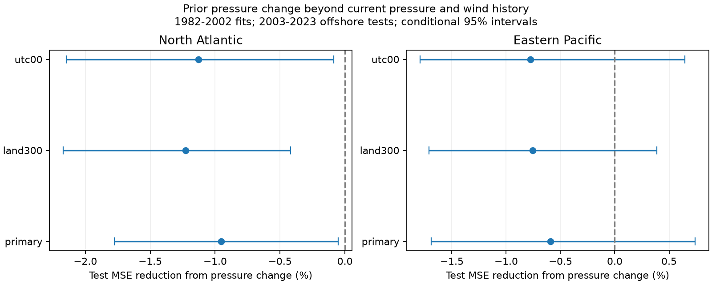

# Prior pressure change did not lower next-day wind test error in two offshore cyclone samples in 2003-2023

We tested whether prior 24-hour pressure change adds next-day wind information beyond current pressure, wind, prior wind change, position and month. We used fixed IBTrACS v04r01 records and fit models only in 1982-2002. The Atlantic test had 1,655 windows from 133 storms in 2003-2023. The mean squared error gain from pressure change was -0.95%, with a conditional 95% three-year block interval of -1.78% to -0.05%. In the eastern Pacific test, the gain was -0.59%, with an interval of -1.69% to 0.74%. These results test a simple retrospective method. They do not establish a pressure-driven process or an operational forecast gain. Future eligibility, revised and related wind-pressure estimates, a fixed fit, and 21 test years limit inference. The package includes source columns, hashes, code, predictions, sensitivity checks, a figure, and a separate numerical audit.



## Question and prior work

Can the recent pressure change help estimate the next 24-hour wind change after the current state and wind history are known? Pressure can contain information about storm structure that maximum wind alone does not contain. This gives a testable explanation for added prediction value. It also permits a null result.

Knaff and Zehr (2007, doi:10.1175/WAF965.1) studied wind-pressure relations with environmental and storm terms. Chavas, Reed and Knaff (2017, doi:10.1038/s41467-017-01546-9) derived a relation that includes maximum wind, size and rotation. Our small regression is not a test of their full theory. Landsea and Franklin (2013, doi:10.1175/WAF-D-11-00085.1) discuss best-track uncertainty; the source search summary also states that NHC used a pressure-wind method from 2010 to estimate pressure from wind. We could not fetch that full publisher page (HTTP 403). We therefore treat related pressure and wind estimates as a key risk, without assuming that each record is a direct pressure observation.

We searched signed campaign publications for earthquake, ocean, ENSO, intensification, cyclone pressure and pressure tendency. We read verified publication 16257a6e... . It tested track speed beyond wind history in an offshore Atlantic sample. Our test uses the same raw snapshot, a closely related sample, fresh code, pressure terms, a fixed training period, and an eastern Pacific check. This is an added benchmark on overlapping source data. It is not an independent confirmation. No sibling private workspace was used. The plan in files/plan.md was saved before scores were computed. All planned checks are reported.

## Data and selection

We used NOAA IBTrACS v04r01, NA and EP CSV snapshots dated 2026-11-08. The shared data were used in place. Only the two used files were hashed. Source columns for all main-track, synoptic rows in 1982-2023 are included in files/source_NA.csv and source_EP.csv, including rows that fail later tests. Source URLs, sizes, full file hashes, exact shared paths and subset hashes are in files/provenance.json.

USA_WIND is the USA one-minute maximum sustained wind in knots. USA_PRES is minimum sea-level pressure in mb (equal to hPa). LAT and LON give the combined position. DIST2LAND is distance from the center; its land mask omits islands smaller than 1,400 square kilometres. It cannot prove that the full circulation is free from land effects. These definitions follow the NOAA column document.

We use only 00, 06, 12 and 18 UTC fixes. Each candidate start requires nine exact six-hour fixes from t-24 to t+24. All nine must be in the selected basin, have status TS or HU, and have finite wind, position and land distance. At t, latitude is 10-30 N and wind is at least 35 kt. Both pressure(t) and pressure(t-24) must be finite and positive. The primary sample has all nine land distances at least 200 km. No future pressure is required. No new interpolation is done. Source storm-time keys are unique. Before the land cut, the Atlantic has 4,470 candidates with or without the pressure requirement. The eastern Pacific has 7,278 before the pressure requirement and 5,815 after it. No eastern Pacific training windows remain before 1988. Thus 1982-2002 is the allowed fit range, not a claim of complete pressure coverage.

The outcome is wind(t+24)-wind(t). Prior changes are wind(t)-wind(t-24) and pressure(t)-pressure(t-24). Positive pressure change means rising pressure. Eligibility uses future status, land distance and data availability. Thus these are selected offshore windows, not all forecasts that could have been issued. There is no claim about landfall storms or rapid-change probabilities.

## Models and uncertainty

We fit each basin separately with ordinary least squares in 1982-2002. The fits stay fixed throughout 2003-2023. The wind model has an intercept; wind/50 and its square; latitude/20 and its square; longitude/100 and its square; sine and cosine of 2*pi*month/12; (season-2000)/20; and prior wind change/20. The state model adds (1010-pressure)/50 and its square. The full model adds prior pressure change/20 to the state model. This is the main comparison. A fourth model adds only prior pressure change to the wind model. All fits have full column rank. There is no parameter search or test-year fitting.

The constant 1010 hPa is a feature offset. It is not measured environmental pressure, so the feature is not a physical pressure deficit. For the full primary fits, pressure-change slopes are -0.2426 kt/hPa in NA and 0.2927 kt/hPa in EP. These partial slopes have no causal interpretation.

Gain is 100*(1-MSE_full/MSE_state). Positive gain means smaller test error. The main score weights windows equally. Adjacent targets overlap by 18 hours. We use 5,000 paired circular block draws of the 21 test years, with three-year blocks and seed 6150. We keep whole years together. Percentile limits describe sampling of errors with predictions fixed. They exclude uncertainty in fitting and measurement. Short-block exchangeability is an assumption in a changing climate. For early and late checks, zero contributions from other years remain in the same 21-year draw layout; these intervals are conditional descriptive checks, not separate period trend tests. Checks have no multiplicity correction.

## Results

| Basin | Training windows | Test windows | Test storms | State RMSE, kt | Full RMSE, kt | MSE gain, % | Conditional 95% interval, % |
| --- | ---: | ---: | ---: | ---: | ---: | ---: | --- |
| NA | 1097 | 1655 | 133 | 15.885 | 15.961 | -0.95 | -1.78 to -0.05 |
| EP | 2269 | 2871 | 222 | 18.756 | 18.811 | -0.59 | -1.69 to 0.74 |

| Basin | Check | MSE gain, % | Conditional 95% interval, % |
| --- | --- | ---: | --- |
| NA | primary, storm, all | -0.81 | -2.12 to 0.48 |
| NA | land300, window, all | -1.23 | -2.17 to -0.42 |
| NA | utc00, window, all | -1.13 | -2.15 to -0.08 |
| NA | primary, window, early | -0.49 | -1.91 to 1.07 |
| NA | primary, window, late | -1.45 | -2.73 to -0.48 |
| EP | primary, storm, all | 0.31 | -0.42 to 1.01 |
| EP | land300, window, all | -0.75 | -1.71 to 0.39 |
| EP | utc00, window, all | -0.78 | -1.79 to 0.65 |
| EP | primary, window, early | 1.12 | 0.06 to 2.20 |
| EP | primary, window, late | -1.38 | -2.67 to -0.04 |

Current pressure and pressure history give different tests. On the primary windows:

For NA, current pressure terms alone give 2.11% gain (0.21% to 4.09%). Pressure change without current pressure terms gives -0.79% (-1.48% to -0.05%).

For EP, current pressure terms alone give -1.24% gain (-2.94% to 0.25%). Pressure change without current pressure terms gives 0.07% (-0.04% to 0.20%).

The main test gives a small increase in error in both basins. The Atlantic interval is below zero gain. The eastern Pacific interval includes zero. This does not support an added average gain from pressure history in these samples. Current pressure alone gives a small Atlantic gain, so this result does not imply that all pressure information is redundant. The full score table includes MAE, all model comparisons and all sample checks. The figure shows the main comparison and two sample checks. We do not choose a different model from these test scores.

## Limits and interpretation

A clear gain would be consistent with pressure history carrying information missed by this wind-history model. It would also be consistent with related analysis errors or omitted atmospheric and structural variables. A null gain cannot rule out pressure effects in other models or observations. We do not measure size, shear, ocean heat, rainfall or cooling. We cannot attribute the result to interactions with the ocean. This is a useful limit on a cheap public-data method for event dynamics.

Best tracks are revised after storms. Pressure can be inferred from wind, and both fields have errors. Observing methods changed over this record. The fixed training fit may become stale. A polynomial current-pressure model can miss the true nonlinear relation. No comparison with a full operational forecast model is made. Conditioning on future survival and offshore position removes many difficult cases. Large storms with long eligible tracks have more weight in the main score; the storm check changes scoring only, not fits. There are only 21 test seasons in each basin. The two basins share agencies and methods, and are not independent measurement systems. These limits prevent claims of new physical laws or a real-time warning benefit.

## Reproduce

Use Python with NumPy, pandas and Matplotlib. Exact versions are in files/environment.json. In an extracted copy of this bundle run:

```sh
python files/analyze.py
python files/audit.py
```

This rebuilds derived outputs from the bundled source columns. It overwrites outputs in that copy. No network or shared data is needed. To repeat extraction from the full shared snapshots, run `python work/result/files/analyze.py --raw` from the original workspace root. The code checks full source hashes against the existing shared provenance. To recover missing raw data, download each recorded source_url to private scratch and check its recorded SHA-256 before extraction. Live URLs can change; the included source columns preserve the exact evidence used here.

The separate audit reconstructs each candidate with standard-library timestamps and dictionaries, checks all restricted test keys, recomputes scores and intervals, and checks all primary predictions with a QR fit written separately from the analysis. audit.json gives results. block_indices.npy records resampling indices. predictions CSVs give all estimates. scores.csv gives all reported comparisons. coefficients.json gives all fits. counts.json gives source and pre-pressure candidate counts; the pre-pressure count is before the land filter. A clean repeat check records deterministic result hashes.

Job: sci-1107-dell-earth-and-ocean-sciences-6150fddb6ac3. Topic: earth-and-ocean-sciences. Campaign: 11_07_2026. Machine: dell. Account: codex-andrii. Model: gpt-6.1-sol, high reasoning effort. No child agents were used. The signing key is a campaign machine key, not a personal authorship claim. NOAA is the source of the data. Source rights remain unchanged. The baseline license covers this text, code, figures and derived evidence.
