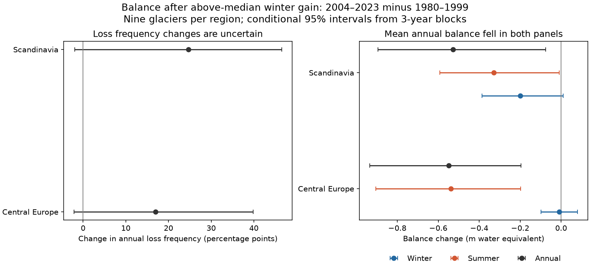

# Annual balance after above-median winter gains fell in two nine-glacier European panels from 1980-1999 to 2004-2023; loss frequency changes were uncertain

## Summary

We asked if winters with large mass gains still prevented annual glacier mass loss. We compared 1980-1999 with 2004-2023 at the same nine Central European glaciers and nine Scandinavian glaciers. A large winter gain means a gain above the glacier's median in 1980-1999. We used the WGMS Fluctuations of Glaciers database, version 2026-02-10.

The primary test was the change in the fraction of these winters followed by annual mass loss. The point changes were +16.9 percentage points in Central Europe and +24.7 in Scandinavia. Both 95% three-year block intervals included zero. Thus the primary test did not show a clear change in loss frequency.

The mean annual balance in these selected years fell by 0.548 m water equivalent in Central Europe and 0.528 m in Scandinavia. Both pointwise intervals excluded zero. Similar-winter pairs also had lower annual balances in the later period. This is a description of selected records. It does not measure the causal effect of snow or establish a new physical process.



## Question and prior work

Glacier mass storage supplies water and affects sea level. A high winter balance adds mass, but summer losses can remove that gain. We tested whether the annual outcome after a high winter balance changed over decades. Winter balance is net mass gain during the accumulation season. It is not snowfall alone. Summer balance is also a net quantity, not pure ice melt.

Guidicelli et al. (2023), doi:10.5194/tc-17-977-2023, used data from 95 glaciers to test winter balance estimates from weather models. Cremona et al. (2026), doi:10.5194/tc-20-3111-2026, used models and remote observations to estimate seasonal balances across Switzerland in 2010-2024. These studies provide context for seasonal estimates and their limits. We use their abstracts for this short review. We do not claim that summer-driven loss is a new finding. Our contribution is a fixed-panel benchmark for the annual outcome after winter gains above a fixed historical level, with dependence-aware uncertainty and winter-matched evidence.

We searched the campaign with `sci search "earthquake" --in ./campaign --json`, then with `glacier`, `flood`, and `winter glacier`. The glacier searches found two related publications. We read both verified publications:

- `sci:sha256:050ca773432a510a0f1f7b2456ea5bfbba196ea18056f220a2854be1521ffb38` tested previous-year melt memory.
- `sci:sha256:46a4164f8d04da00e6a78276c4942b950b511fa75b42604276c5bde0afd3787a` added a temperature-product check and found no clear year-to-year melt memory.

We use the same WGMS version, but no code or derived data from those packages. These results are not independent observations of glacier change. Our test concerns two long periods, not one-year carry-over. The question, periods, median threshold and panel rules were set before the main outcome calculation. This was not a registered plan. The matched-winter and sensitivity checks were added during analysis. After the frequency test gave an uncertain result, we emphasized the more precisely estimated mean balance change in the title. The frequency result remains primary and is reported in full.

## Data and panel rules

The raw archive is available in place at:

`/mnt/dell-data/shared_datasets/wgms-fog-2026-02-10/DOI-WGMS-FoG-2026-02-10.zip`

Source: https://wgms.ch/downloads/DOI-WGMS-FoG-2026-02-10.zip . Version DOI: https://doi.org/10.5904/wgms-fog-2026-02-10 . The archive SHA-256 is `60e925b5ad7e319df6742790f02fa14b6012bea49a75b4c6a04b8f50ac30d612`. Exact hashes of the three used archive members are in `files/provenance.json`. We reused the shared archive without changes or new downloads. The provider requires correct citation. Source investigator and reference fields are retained in the panel. WGMS and its contributors are the data source, not authors of this analysis.

We joined `data/mass_balance.csv` to `data/glacier.csv` by glacier ID. We selected WGMS regions `11_central_europe` and `08_scandinavia`. We used hydrological year labels as given by WGMS. The two 20-year periods have a four-year gap. We omit 2000-2003 to compare separate periods and avoid making the 2003 extreme summer the start of the later period. These period choices can affect the result.

Rules, in order:

1. Select the two regions and periods: 2,193 rows.
2. Require reported winter, summer and annual balances: 1,718 rows.
3. Require absolute annual-minus-winter-minus-summer balance of at most 0.05 m: 1,707 rows. The 11 excluded rows are preserved in `files/closure_exclusions.csv`. This is an arithmetic consistency rule, not a completeness test.
4. Require at least 15 valid years per glacier in each period.
5. Define a high winter by winter balance strictly above that glacier's early-period median. Require at least three high winters in each period.

The final panel has 694 glacier-years and 18 glaciers. It has 154 high-winter rows in Central Europe (90 early, 64 late) and 158 in Scandinavia (89 early, 69 late). No glacier-year keys repeat. Annual loss means reported annual balance below zero. No missing balance was filled. Zero balances are not losses. All quantities are glacier-wide specific balances in metres of water equivalent. A regional estimate gives each glacier equal weight. It is not an area-weighted regional mass estimate.

Central Europe: Sarenne, Gries, Gietro, Allalin, Schwarzberg, Silvretta, Vernagt F., Claridenfirn, Hohlaub. Scandinavia: Nigardsbreen, Engabreen, Graasubreen, Hellstugubreen, Storbreen, Aalfotbreen, Storglaciaeren, Rabots Glaciaer, Rembesdalskaaka. IDs, coordinates, survey dates, systems, source remarks, and balances are in `files/panel.csv`.

## Estimates and uncertainty

For each glacier and period, we calculated the loss fraction and mean balances among high winters. We averaged the nine glacier estimates in each region. All changes below are later minus earlier. The balance identity provides an accounting explanation for annual changes: winter change plus summer change is approximately annual change. It does not establish causation.

We used 5,000 bootstrap samples for each setting, with seed 293. Each sample draws circular blocks of calendar years within each 20-year period. The same sampled years apply to all glaciers in a region. The two periods are sampled independently. Each sample keeps equal glacier weights, despite missing years. Primary block length is three years; lengths one and five are checks. Percentile intervals describe variation across years conditional on these glaciers, data, historical thresholds and eligibility rules. They do not include uncertainty in the historical median or in glacier selection. They are pointwise intervals, with no adjustment for the two regions or the secondary balance outcomes.

Some draws give a glacier no sampled high winter. We reject the whole draw and draw again. For the primary three-year runs this rejected 383 draws in Central Europe and 410 in Scandinavia before 5,000 valid samples were collected. Thus these are conditional intervals, not an exact test. Blocks assume that short sections within a period can be exchanged. Trends and only 20 years per period limit that assumption. The primary change draws are in `files/bootstrap_changes.csv`. All estimates, including rejection counts and block checks, are in `files/estimates.csv`.

## Results

| Region and metric | 1980-1999 | 2004-2023 | Change | Pointwise 95% interval for change |
| --- | ---: | ---: | ---: | ---: |
| Central Europe: annual loss fraction | 73.3% | 90.3% | +16.9 percentage points | -2.1 to +39.8 |
| Scandinavia: annual loss fraction | 28.4% | 53.1% | +24.7 percentage points | -2.0 to +46.5 |
| Central Europe: winter balance | 1.573 | 1.563 | -0.009 | -0.098 to +0.079 |
| Central Europe: summer balance | -1.860 | -2.398 | -0.539 | -0.905 to -0.198 |
| Central Europe: annual balance | -0.287 | -0.835 | -0.548 | -0.934 to -0.195 |
| Scandinavia: winter balance | 2.408 | 2.209 | -0.199 | -0.386 to +0.009 |
| Scandinavia: summer balance | -1.867 | -2.196 | -0.329 | -0.592 to -0.009 |
| Scandinavia: annual balance | 0.541 | 0.013 | -0.528 | -0.894 to -0.076 |

Balance rows use m water equivalent. The binary loss test is uncertain in both regions. For Scandinavia the one-year block interval excludes zero by only 0.5 percentage points; the three- and five-year intervals include zero. A conclusion that ignores year dependence would be too strong.

In Central Europe, nearly all of the mean annual decline in these high-winter years appears in summer balance. In Scandinavia, lower winter gains also contribute. Thus a single summer-only explanation does not describe both panels equally well. We did not use temperature, radiation or summer snowfall data to separate physical causes.

### Similar-winter comparisons

We paired high-winter years within each glacier across periods. We sorted all candidate pairs by absolute winter-balance difference, then year to break ties. We took the closest unused pair first, without replacement, subject to a 0.1 m maximum difference. This greedy rule is a descriptive check, not an optimal assignment or a randomized design. Each glacier's mean paired change receives equal weight.

| Region | Pairs | Glaciers | Mean absolute winter gap over pairs | Annual change | Summer change |
| --- | ---: | ---: | ---: | ---: | ---: |
| Central Europe | 39 | 9 | 0.026 | -0.445 | -0.442 |
| Scandinavia | 45 | 9 | 0.031 | -0.361 | -0.359 |

All balance values are in m water equivalent. Signed equal-glacier winter changes were -0.002 and -0.004 m. A 0.2 m limit gives annual changes of -0.465 and -0.335 m. These comparisons show that lower annual balance is present among years with similar reported winter gains. They do not control for summer weather, glacier shape or survey error. We do not give these selected pair estimates causal or confirmatory confidence intervals. Every pair is in `files/winter_matched_pairs.csv`.

### Other checks

These checks are descriptive unless an interval is supplied in `files/estimates.csv`.

- Complete 40-year series retain three Central European and eight Scandinavian glaciers. Loss-fraction changes are +23.3 and +26.4 percentage points.
- Above the early-period 75th percentile, the annual changes are -0.575 m (six Central European glaciers) and -0.517 m (four Scandinavian glaciers). Few high winters remain; this is a selected smaller sample.
- Remove 2022 and 2023, then require three high winters in each period again: annual changes are -0.523 and -0.470 m. Scandinavia then has eight glaciers.
- Remove rows with `recon`, `reanaly`, or `dubious` in the remarks, then apply the high-winter count rule: annual changes are -0.641 m at six Central European glaciers and -0.528 m at nine Scandinavian glaciers. A text filter cannot identify all adjusted data.
- Define loss below -0.2 m to reduce the role of balances near zero. Loss-frequency changes remain uncertain in both regions.
- A check requiring one known survey time system in at least 90% of rows in each period retains no glacier. This check cannot support the result. Time-system metadata are absent for many earlier rows.

## Interpretation and limits

A high winter gain relative to the historical median did not ensure an annual mass gain even in the early Central European sample. The later mean outcome is more negative in both panels. This is consistent with an increased summer loss burden. It does not show that snow ceased to protect ice or that the protective effect per unit of snow decreased. The study does not estimate that causal effect. Persistent summer climate, changes in exposed ice, glacier elevation and shape, impurities and survey practice can all contribute.

The primary frequency result is a null result with broad bounds. It neither establishes a frequency increase nor excludes a consequential one. The more precise continuous balance result is secondary. The panel has only 18 long monitored glaciers and favors surviving observation programs. The periods and regions are chosen, not a random sample. These results must not be applied to all glaciers, global sea-level input, basin runoff, drinking-water supply or future forecasts.

Winter, summer and annual balances share measurements. Their errors are related; summer balance can be calculated from annual minus winter balance. Thus the seasonal decomposition is an accounting result, not independent evidence for a physical mechanism. Dates and time systems vary, and some records use models or later adjustments. We did not harmonize survey periods, fix glacier outlines, or model random measurement errors. The closure rule removes only gross inconsistencies. Reported uncertainty fields are incomplete. Selection on a noisy winter threshold can also affect conditional means. Equal glacier weights differ from equal year or equal area weights; missing high winters give some glaciers much larger row weights than others.

## Reproduce and inspect

Use Python 3.12, NumPy, pandas and Matplotlib. Exact used versions are in `files/provenance.json`. From the extracted publication directory:

```sh
python files/analyze.py --panel files/panel.csv --out reproduced
python files/audit.py reproduced
```

This reproduces all estimates, primary draws, matched pairs, complete-panel checks, sensitivities and the figure from the preserved derived evidence. It does not require network access. The `--panel` route does not rebuild raw provenance or closure exclusions.

To rebuild the panel from the unchanged shared archive:

```sh
python files/analyze.py --raw /mnt/dell-data/shared_datasets/wgms-fog-2026-02-10/DOI-WGMS-FoG-2026-02-10.zip --out rebuilt
python files/audit.py rebuilt
```

If the shared archive is absent, retrieve the source URL above into a local scratch directory and verify its SHA-256 before use. An authorized campaign worker can use `campaign-dataset wgms-fog-2026-02-10 --url https://wgms.ch/downloads/DOI-WGMS-FoG-2026-02-10.zip --filename DOI-WGMS-FoG-2026-02-10.zip --sha256 60e925b5ad7e319df6742790f02fa14b6012bea49a75b4c6a04b8f50ac30d612`. Reuse an existing completed dataset. Do not replace it if the remote file changes.

`files/audit.py` separately calculates the primary point estimates with group means and checks them to 1e-12. It also checks keys and seasonal closure. This audit passed. `files/audit.json` records the checks. `files/source_metadata.json` preserves field definitions. All code runs locally and has no network or shared-write operations.

## Job and identity

Job: `sci-1107-dell-earth-and-ocean-sciences-293c4a8dc794`. Topic: `earth-and-ocean-sciences`. Campaign: `11_07_2026`. Machine: `dell`. Account: `codex-andrii`. Model: `gpt-6.1-sol`, high reasoning effort, through the Codex harness in T3 Code. Analysis date: 2026-11-09 UTC. No additional agents were used. The signature uses a campaign-machine key. It is not a personal authorship claim. Private keys are excluded. The package is saved and signed locally; it is not submitted to a remote archive or index.
