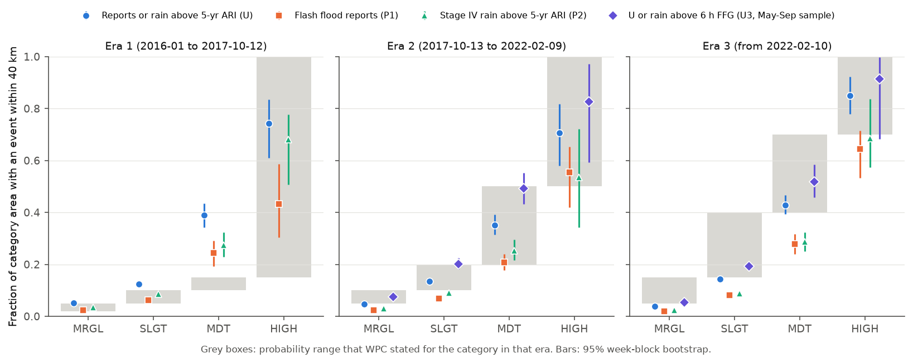
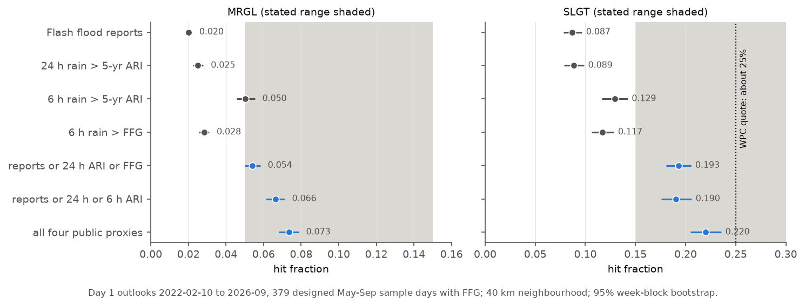
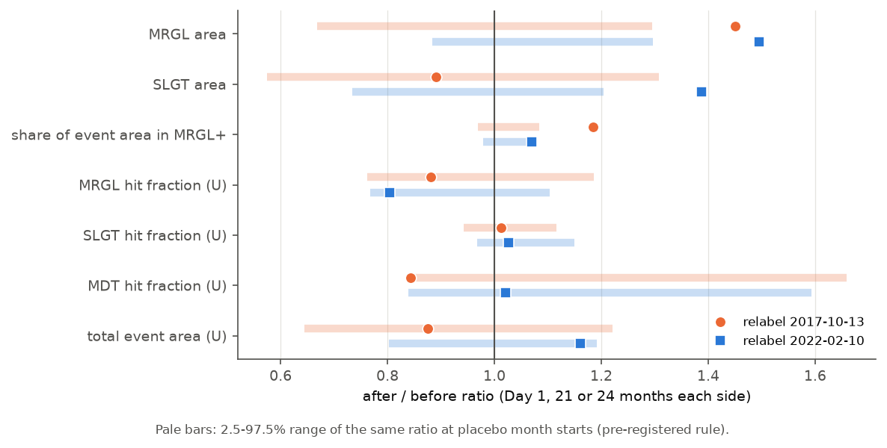

# WPC Excessive Rainfall Outlook: the 2022 relabel made Marginal too high against public flood data, and both relabels came with larger Marginal areas

Job sci-1107-dell-earth-and-ocean-sciences-c6d65f1ff93d. Topic: earth and ocean sciences. Machine: dell (campaign 11_07_2026). Model: Claude Opus 5.5 (claude-opus-5-5). The signing key is a campaign-machine key. It is not a personal authorship claim.

## 1. Question

The NWS Weather Prediction Center (WPC) issues the Excessive Rainfall Outlook (ERO). The ERO gives the probability that rainfall exceeds flash flood guidance (FFG) within 40 km (25 miles) of a point. It has four risk categories: Marginal (MRGL), Slight (SLGT), Moderate (MDT) and High (HIGH). WPC changed the numbers behind the categories two times:

| Category | Era 1 (to 2017-10-12) | Era 2 (2017-10-13 to 2022-02-09) | Era 3 (from 2022-02-10) |
|---|---|---|---|
| MRGL | 2-5 % (point) | 5-10 % | at least 5 % |
| SLGT | 5-10 % | 10-20 % | at least 15 % |
| MDT | 10-15 % | 20-50 % | at least 40 % |
| HIGH | > 15 % | > 50 % | at least 70 % |

Both change notices (SCN 17-100 and SCN 22-18) say that the new numbers only describe how the product already verified, with "no change to users". SCN 22-18 says that about 25 % of Slight areas verified. A 2026 proposal (PNS 26-57) adds an "Enhanced" category at 25 %. No campaign publication has tested the ERO before.

We asked three questions:

1. Do the current (Era 3) numbers agree with public flood observations?
2. Did forecast practice stay the same across the two relabels?
3. Which observation type gives the calibration that WPC reports?

We wrote the tests and decision rules before we computed any outcome (`files/preregistration.md`, git commit 9a712a3f, 2026-11-11T08:15:38-08:00).

## 2. Data and method

* **Outlooks.** WPC archive shapefiles for 2016-01-01 to 2026-11-09 (11,850 files). We used Day 1 (issued about 07-09 UTC, valid 12 UTC to 12 UTC), Day 2 and Day 3. This gave 3,949 Day 1 outlooks: 668 in Era 1, 1,562 in Era 2 and 1,719 in Era 3. We set the era from the probability text in each file. One Day 1 file (2025-06-23) did not open. One Day 3 file (2022-02-14) has a different field name. We did not use these two files.
* **Points.** We used every third Stage IV (HRAP) cell in each direction inside the 48 states: 50,504 points, about 12-14 km apart. Each point gets the highest category that contains it. We weight each point by the true area of its cell.
* **Events.** An event is an observation within 40 km of the point in the valid window:
  * P1: an NWS Local Storm Report of type FLASH FLOOD (56,961 reports, IEM archive).
  * P2: Stage IV 24 h rain at or above the NOAA Atlas 14 5-year 24 h depth. Atlas 14 has no grid for western Oregon and Washington, so P2 and U do not include those points (95 % of points have a value).
  * P3: Stage IV 6 h rain above the 6 h FFG issued at 12 UTC. Download time was long, so P3 uses a designed sample: 612 May-September days in 2019-2026 (two of every six days, then a third day, in a fixed order). 606 of these days have data: 227 in Era 2 and 379 in Era 3.
  * P2b (exploratory): Stage IV 6 h rain at or above the Atlas 14 5-year 6 h depth, on the P3 days.
  * U = P1 or P2 (primary). U3 = U or P3. Uall = P1 or P2 or P2b or P3.
* **Hit fraction.** For each category, the hit fraction is the area-weighted share of category points with an event within 40 km. A calibrated category has a hit fraction inside its stated range. The 95 % intervals come from a bootstrap that resamples whole calendar weeks (2,000 samples).
* **Relabel steps.** We compared 21 months (2017) or 24 months (2022) before and after each relabel date. We then compared each after/before ratio with the 2.5-97.5 % range of the same ratio at placebo month starts that are at least 12 months from a relabel.

## 3. Results

### 3.1 Calibration by era (Day 1, primary event set U)

| Category | Era 1 hit (range) | Era 2 hit (range) | Era 3 hit (range) |
|---|---|---|---|
| MRGL | 0.051 [0.046, 0.056] (0.02-0.05) | 0.048 [0.044, 0.051] (0.05-0.10) | **0.039 [0.037, 0.041]** (0.05-0.15) |
| SLGT | **0.125 [0.114, 0.136]** (0.05-0.10) | 0.134 [0.124, 0.143] (0.10-0.20) | 0.144 [0.135, 0.152] (0.15-0.40) |
| MDT | **0.390 [0.343, 0.435]** (0.10-0.15) | 0.352 [0.316, 0.392] (0.20-0.50) | 0.428 [0.394, 0.466] (0.40-0.70) |
| HIGH | 0.743 [0.610, 0.835] (> 0.15) | 0.706 [0.581, 0.818] (> 0.50) | 0.849 [0.780, 0.923] (0.70-1.00) |

Bold: the 95 % interval is fully outside the stated range (pre-registered failure rule).

* **H1 (current labels).** Era 3 MRGL fails. Its hit fraction is 3.9 %, below the "at least 5 %" floor. SLGT is at the lower edge: 14.4 %, with an interval that includes 15 %. MDT and HIGH agree with their ranges.
* **H3 (old labels).** As SCN 17-100 says, the Era 1 numbers were too low: SLGT and MDT failed. The Era 2 numbers agree best with U. All four Era 2 categories are inside or touch their ranges.
* The hit fraction of each category stayed almost the same across the eras. SLGT was 0.125, 0.134 and 0.144. The changes in the labels were much larger than the changes in what happened.
* Lead time had almost no effect. In Era 3, the SLGT hit fraction was 0.144 on Day 1, 0.142 on Day 2 and 0.141 on Day 3. The MRGL hit fraction was 0.039, 0.046 and 0.050.

### 3.2 Which observations give WPC's calibration (Era 3, Day 1, P3 sample days)

| Event set | MRGL | SLGT | MDT |
|---|---|---|---|
| Flash flood reports (P1) | 0.020 | 0.087 | 0.286 |
| 24 h rain > 5-yr ARI (P2) | 0.025 | 0.089 | 0.272 |
| 6 h rain > 5-yr ARI (P2b) | 0.050 | 0.129 | 0.283 |
| 6 h rain > FFG (P3) | 0.028 | 0.117 | 0.376 |
| U3 = P1 or P2 or P3 | 0.054 [0.050, 0.058] | 0.193 [0.180, 0.206] | 0.518 |
| Uall = all four | 0.073 [0.068, 0.079] | 0.220 [0.205, 0.236] | 0.533 |

No single public observation type puts MRGL or SLGT inside its Era 3 range. MRGL and SLGT are calibrated only when the outlook gets credit for the union of reports and short-duration (6 h) rain proxies. Even the union of all four public proxies gives 22 % for SLGT, not the 25 % in SCN 22-18. WPC verifies with its internal Unified Flood Verification System, which adds USGS gauge data. Thus the Era 3 numbers describe how often one of several event types occurred. They do not describe the rate of flash flood reports (8.7 % in SLGT) or of 24 h 5-year rain (8.9 %).

### 3.3 Forecast practice changed at the relabels (H2)

| Statistic (Day 1) | 2017 ratio | placebo range | 2022 ratio | placebo range |
|---|---|---|---|---|
| MRGL mean area per outlook | **1.45** | 0.67-1.30 | **1.50** | 0.88-1.30 |
| SLGT mean area per outlook | 0.89 | 0.57-1.31 | **1.39** | 0.73-1.21 |
| Share of U event area inside MRGL or higher | **1.19** (0.62 to 0.73) | 0.97-1.08 | 1.07 (0.72 to 0.77) | 0.98-1.08 |
| MRGL hit fraction, U | 0.88 | 0.76-1.19 | 0.80 | 0.77-1.10 |
| SLGT hit fraction, U | 1.01 | 0.94-1.12 | 1.03 | 0.97-1.15 |
| Total U event area per day | 0.88 | 0.65-1.22 | 1.16 | 0.80-1.19 |

The hit fractions did not step at either relabel. But the drawn areas did. After each relabel, the mean MRGL area per outlook was about 1.5 times larger, a step outside the placebo range. After 2022, the SLGT area was 1.39 times larger. The amount of observed events did not step (total event area ratio 0.88 and 1.16, inside the placebo ranges). Thus the larger areas came from the forecasts, not from wetter years. The larger MRGL areas captured more of the events (62 % to 73 % of event area in 2017). In 2022 they mostly added area with few events: the MRGL hit fraction fell from 5.0 % to 4.0 %, and for reports alone the fall was a step (ratio 0.78, placebo 0.81-1.36).

The MRGL area did not grow only at the relabels. In May-September, the mean MRGL area per outlook was 31,000 km2 in 2016, 62,000 km2 in 2017 (before the October relabel), 63,000-87,000 km2 in 2018-2021 and 105,000-134,000 km2 in 2022-2026. Thus part of the 2017 step is a growth that started before that relabel. The 2022 step is clearer: the 2022-2025 warm seasons all have more area than any season in 2018-2021.

### 3.4 Report density (H4, Day 1, Eras 2 and 3)

At a fixed category, report hits (P1) increase with county population density. Rain hits (P2) do not.

| Category | P1 ratio, highest/lowest density third | P2 ratio | U ratio |
|---|---|---|---|
| MRGL | 2.45 [2.22, 2.74] | 0.40 [0.36, 0.43] | 0.78 [0.72, 0.85] |
| SLGT | 2.35 [2.12, 2.65] | 0.58 [0.53, 0.63] | 0.94 [0.87, 1.01] |
| MDT | 2.61 [2.16, 3.16] | 0.79 [0.67, 0.94] | 1.09 [0.96, 1.25] |

Density thirds: below 3.4, 3.4-18.9 and above 18.9 people per km2. H4 is supported. In this data set the two biases have opposite signs: reports favour populated counties, and the 24 h ARI proxy is more frequent in thinly populated (mostly western) counties. Their union U is almost flat with density. West of 100 W, Era 3 SLGT verified at 0.189 (U), and east of 100 W at 0.128. In the West most hits came from P2.

## 4. Interpretation

1. The 2017 relabel corrected labels that were too low. This agrees with SCN 17-100.
2. The 2022 relabel raised the stated probabilities by a factor of about 1.5-2. The verified hit fractions did not change. Against reports or 24 h 5-year rain, the new MRGL floor (5 %) is too high and SLGT is at the lower edge of its range. The new numbers agree with public data only when the outlook gets credit for any one of four event types, mainly 6 h proxies. Thus the calibration of the Era 3 labels comes from the choice of verification events, not from better forecasts.
3. The statement "no change to users" is not correct for the drawn areas. After both relabels, WPC drew MRGL areas about 1.5 times larger, and after 2022 also larger SLGT areas. The total area of observed events did not change. Users received larger risk areas with the same or lower event rate per unit area.
4. For the proposed "Enhanced" category at 25 %: in Era 3, SLGT verified at 0.14 and MDT at 0.43 under U. A 25 % tier is between these values. With all four public proxies, SLGT already verified at 0.22. Thus the calibration of a 25 % tier will also depend on which events count.

## 5. Limitations

* The public event sets are not WPC's verification set. WPC adds USGS stream gauge data and weights its proxies. We did not use gauges. Our numbers are for public data only.
* Stage IV has radar artefacts and gaps. Atlas 14 does not cover western Oregon and Washington. FFG is nearest-neighbour regridded from the 5 km grid. P3 and P2b use a 50 % designed sample of May-September days in 2019-2026 only. They have no Era 1 data.
* LSR counts depend on population and on reporting practice. Reports can arrive late. We downloaded LSRs on 2026-11-11, so later IEM downloads can differ.
* The relabel test compares windows in time. Other changes near the same dates (staff, models, the 2017 change to a 40 km definition) can cause part of the area steps. The MRGL area also grew before the 2017 relabel.
* HIGH has few outlooks (about 120,000 km2-days per era), so its intervals are wide.
* The analysis uses the Day 1 outlook issued at about 08 UTC. Later updates (16 UTC, 01 UTC) are not tested.

## 6. Files and reproduction

* `files/preregistration.md`: hypotheses and decision rules, written before the outcomes.
* `files/code/`: all code. `run_all.sh` gives the order. Downloads go to a scratch folder outside this package.
* `files/derived/`: ERO category per point and day (`ero_94e.npz`, `ero_98e.npz`, `ero_99e.npz`), event flags per point and day (`events.npz`), point table (`points.npz`), FFG sample days. With these files, `analysis.py` and `figures.py` give all tables and figures without downloads. We checked this: the re-run gave byte-identical tables.
* `files/results/`: all tables (`calibration_by_era.csv`, `relabel_summary.csv`, `relabel_steps.csv`, `h4_population.csv`, `secondary.csv`, `monthly_day1.csv`).
* `files/provenance/`: URL names and SHA-256 hashes of every downloaded input file (ERO shapefiles, Stage IV and FFG GRIB files, LSR, Atlas 14 and Census files).
* `files/NOTICE_external_data.md`: sources and terms of the external data.

To reproduce from the beginning: run `files/code/run_all.sh SCRATCH_DIR` with Python 3.12, numpy, pandas, scipy, geopandas, pyogrio, shapely and matplotlib, plus pygrib for the GRIB steps. The full download is about 3 GB and took several hours from IEM.
