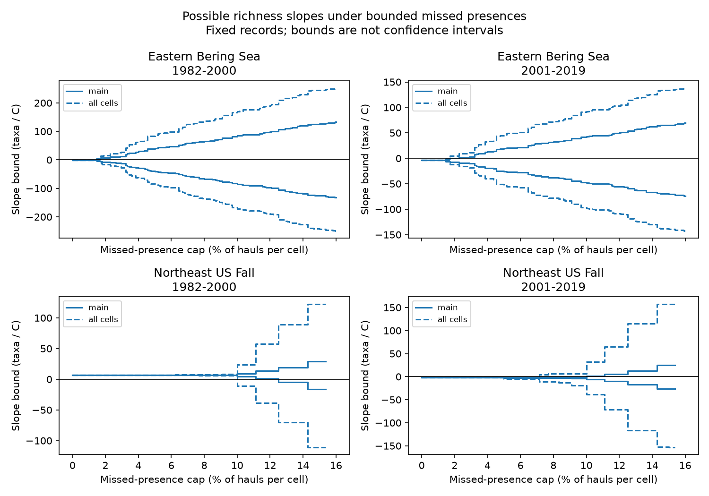

# Integer missed-presence bounds permit both richness slope signs at cell caps of 1.45-12.5% in four US trawl samples in 1982-2019

We tested how missed presences could change four reported links between sea surface temperature (SST) and fixed-effort trawl richness. Under the stated integer count model, the first caps that permit both slope signs are 1.45%, 1.72%, 12.5% and 10.0% of hauls per taxon-stratum-year cell. These are exact thresholds for the fixed evidence table and model. They are not estimated error rates, confidence limits, or minimum overall error fractions.

The two prior slopes with intervals clear of zero were late Bering and early Northeast. At their thresholds, explicit permitted completions change their slopes from -3.54 to +0.39 and from +6.69 to -4.56 taxa per C. These completions add 9,366 and 4,702 presences across many cells. Such changes require coordinated corrections across years. The evidence does not show that those errors occurred.

## Question and prior work

Does fixing haul effort also protect the sign of a richness-temperature slope against missed presences? The prior campaign study SCI 3551fe2177f2406d73e5b6fcb8046eed5e9d392af34b4b87cbdde5a73f3c2d7d found opposite temperature links to fixed-effort richness in late Bering and early Northeast samples. The later label-removal audit, SCI 035f99036d461651f4c077e1f3568d9ab09f2b10cc881cd28bb1f18642be8322, found that their point signs required 49 and 36 whole-label deletions to reverse. Neither audit tested added presences in recorded hauls. We searched the campaign and read both signed publications before this test. These are shared observations, not new independent biological data.

Gotelli and Colwell (2001, doi:10.1046/j.1461-0248.2001.00230.x) explain why effort matters for richness comparisons. MacKenzie et al. (2003, doi:10.1890/02-3090) show how imperfect detection can affect occupancy and change estimates. Their methods require suitable repeat observations. We do not estimate detection probabilities from this catch table. Pinsky et al. (2013, doi:10.1126/science.1239352) provide the wider distribution and climate context. A survey review (doi:10.1111/gcb.15404) describes differences in sampling and catchability that can limit comparisons. Our contribution is a conditional bound calculation, exact integer thresholds, and attainable count evidence. It is not a new rarefaction method or a causal test of climate change.

## Data and sample

We use OceanAdapt commit 0d4bcaffe649e970674fe165fe892ab4d787e76a and NOAA ERSST v5, snapshot retrieved on 2026-11-08. We inherited sufficient evidence and raw build code from the verified richness publication. We then ran the raw build on existing shared files. All five inherited evidence tables matched the rebuilt parsed tables. No download or change to shared data was needed. The inherited provenance retains the original job attribution; files/provenance.json records this job and the raw files actually read.

Exact shared raw paths, sizes and SHA-256 values are:

- `/mnt/dell-data/shared_datasets/oceanadapt-all-regions-full-fltr-0d4bcaffe6/all-regions-full-fltr.csv.gz`; 30,884,574 bytes; `cb632fe63d5dd0ff0000288673e59ebe59ae15e34a320b38e9308859353e2a41`.
- `/mnt/dell-data/shared_datasets/ersst-v5-psl-sst-mnmean-20261108-olen/sst.mnmean.nc`; 162,376,295 bytes; `952fad739abab3e3c33c955b168f298b9884d2fe48ab259ebf19ac531d8d8386`.

These compatibility paths point to the shared SSD store. The provenance gives resolved paths, source URLs, versions and package versions. We did not access the failed disk or sibling private workspaces. The bundle gives hashes for all inherited entries in files/inherited.json.

The Eastern Bering Sea sample has 10 fixed strata and 13,427 hauls. Northeast US Fall has 46 fixed strata and 7,945 hauls. Each stratum has at least two recorded hauls in every available year from 1982 to 2019. Northeast has no 2017 rows; we do not fill them. We test 1982-2000 and 2001-2019 separately. Each regression has 18 or 19 annual units. Regions give separate geographic checks. Periods share survey history and taxa; they are not independent experiments.

All recorded haul IDs define effort. Positive catch weight per unit effort defines detection. Two-word genus-species labels pass a text filter, not a taxonomic validation. Identical haul-label repeats are reduced to one. A label with conflicting catches in any retained haul is excluded. This removes Platichthys stellatus in Bering and Placopecten magellanicus in Northeast. The fixed regional lists have 541 and 332 labels. A missing label row in a recorded haul is a nondetection. Missing hauls cannot be recovered.

Temperature is a fixed-area mean of ERSST values at fixed stratum grid points. Seasons are May-August in Bering and September-November in Northeast. The two-degree surface grid is a coarse seasonal proxy, not measured bottom exposure or haul-date weather. Bundled monthly data and grid choices preserve the tested climate values.

## Completion model and proof

Let n_st be the number of recorded hauls and k_jst the number that detect label j in stratum s and year t. One draw from every stratum gives expected richness

    R_t = sum_j [1 - product_s (1 - k_jst/n_st)].

It is an expectation over draws from recorded hauls, not a count of all species present. Taxa need not be independent. The main correction model adds an integer a_jst with

    0 <= a_jst <= min(n_st - k_jst, floor(epsilon * n_st)).

A cell is a taxon, stratum and year. Additions are allowed only when that taxon was detected in that stratum at least once in the full 1982-2019 table. Other cells stay fixed. Thus the model holds geographic support fixed but permits missed presences in years with no detection. It assumes that reported presences are correct. The support rule uses all years; it is a sensitivity restriction, not a prediction rule.

There is no shared cap on total additions, no coupling between taxa, and no restriction on their dependence on SST. Additions can be placed in distinct absent haul slots for each taxon; different taxa can use the same haul. Thus every permitted count table has a haul-level completion if there are no further ecological constraints. This assumption matters. The cap is a maximum correction as a fraction of all recorded hauls in each cell. It is not a fraction of occupied hauls missed, nor an overall fraction of erroneous records.

For fixed counts, richness increases or stays constant with every count. Let L_t be observed richness and U_t(epsilon) be richness when every allowed count reaches its cap. These are attainable annual extrema. Fit richness to an intercept, SST and centered year. Let c_t be the row of the least-squares inverse that gives the SST coefficient. Then b = sum_t c_t R_t, and its sharp bounds are

    lower = sum_t c_t L_t + sum_t min(c_t, 0) (U_t - L_t)
    upper = sum_t c_t L_t + sum_t max(c_t, 0) (U_t - L_t).

To attain an endpoint, use the upper count table in years whose coefficient weight has the required sign, and leave all other years unchanged. Counts and years have no shared constraint, so these assignments are feasible. These are fixed-record possibility bounds, not confidence intervals. A set of attainable slopes can have gaps because counts are integers. We claim that each endpoint is attainable and that both signs occur; we do not claim that every interior value is attainable.

Counts change only at epsilon = m/n_st. We search the sorted set of these breakpoints. The first crossing and preceding breakpoint establish the exact threshold for each panel. An unchanged table supplies the original sign; files/witness.csv.gz supplies the opposite sign. Witnesses reach an extremum and are not selected to minimize total additions. The plan in files/plan.txt was saved before fits. It was not externally registered.

## Results

Bounds and slopes have units of expected taxa per C. Percentages are caps per cell.

| Survey | Period | Original slope | First cap | Bounds at cap | Witness slope | Added presences |
| --- | --- | ---: | ---: | --- | ---: | ---: |
| Bering | 1982-2000 | -0.265 | 1.449% | [-1.165, 1.564] | 1.564 | 1,870 |
| Bering | 2001-2019 | -3.542 | 1.724% | [-7.142, 0.388] | 0.388 | 9,366 |
| Northeast | 1982-2000 | 6.686 | 12.500% | [-4.558, 19.057] | -4.558 | 4,702 |
| Northeast | 2001-2019 | -2.056 | 10.000% | [-5.924, 1.359] | 1.359 | 978 |

The preceding late Bering cap, 1.695%, gives upper bound -1.007. The preceding early Northeast cap, 11.111%, gives lower bound +1.261. Thus smaller caps cannot reverse those signs under the main assumptions. The early Bering and late Northeast original sampling intervals already include zero in the prior study. Their thresholds are point-sign sensitivity measures, not tests that overturn clear findings.

The late Bering witness adds 5.72% as many presences as were recorded in its panel; early Northeast adds 10.97%. These ratios are descriptive. They are not minimum total changes or estimated false-negative fractions. Many corrections share the same year and depend on the coefficient weights. Applying the same cap-saturated rule in all years gives late Bering slope -3.211 and early Northeast +7.813. Thus allowance for coordinated year-dependent error is central to the reversal result.

Planned checks change the target or assumption. Allowing additions in all regional taxon-stratum cells lowers the late Bering threshold to 1.667% and early Northeast to 10.0%. Restricting the list to taxa recorded in at least 80% of regional years raises these thresholds to 3.226% and 14.286%. A post-2008 step changes the late Northeast slope but leaves its 10.0% threshold. The step cannot isolate gear effects. All 20 panel and variant results are in files/bounds.csv.

A continuous-frequency relaxation replaces floor(epsilon*n) with epsilon*n. Its four zero-reaching thresholds are 0.0203%, 0.5130%, 0.6725% and 0.1954% in table order. Fractional count corrections can operate in every cell even below one missed haul. They describe a different probability model and are not finite-table completions. Their much smaller thresholds show why the count assumption must be stated. Cross-region threshold differences also depend on haul denominators and support size. They must not be read as differences in ecological resilience.

## Limits and use

This audit neither estimates missed detections nor shows that bias explains the richness slopes. The completion set can permit many coordinated changes. It can also exclude real changes outside recorded support, previously unseen species, false positives, missing hauls and label errors. More ecological constraints could narrow the set; unmodeled errors could widen it. The lower epsilon threshold is not a general measure of study quality.

Short annual series, gear changes, identification, fishing, ice, within-stratum positions and unmeasured conditions remain concerns. Fixed effort does not fix detection. SST is not bottom temperature. We do not propagate uncertainty in the raw catches, support rule or SST into these deterministic bounds. We do not estimate causal warming, daily extremes, pollution, ecological timing, or total species loss. The result identifies a limitation in interpreting climate-biodiversity associations and gives a reproducible way to test explicit error assumptions.

## Reproduce and inspect

From the extracted bundle root:

    python files/analyze.py --out reproduced
    python files/verify.py

The first command rebuilds bounds, thresholds, annual evidence, integer witnesses and the figure from bundled sufficient evidence without network access. The second checks published witnesses with a separate temperature-residual calculation, validates count constraints, checks bound ordering, and enumerates all 6,561 completions of a small synthetic case. To check newly generated files, copy verify.py and the three unchanged evidence inputs plus source_annual.csv into the output folder and run verify.py there. Python 3, numpy, pandas, scipy and matplotlib are required.

For a full source rebuild:

    python files/source_build.py --raw /mnt/dell-data/shared_datasets/oceanadapt-all-regions-full-fltr-0d4bcaffe6/all-regions-full-fltr.csv.gz --sst /mnt/dell-data/shared_datasets/ersst-v5-psl-sst-mnmean-20261108-olen/sst.mnmean.nc --out rebuilt

This inherited command also rebuilds the earlier richness models, which are not new findings here. It needs xarray, a NetCDF backend and statsmodels. It checks both raw hashes. Compare rebuilt design.csv, incidence.csv.gz, annual.csv, monthly_sst.csv.gz and sst_cells.csv with the bundled tables; annual.csv maps to source_annual.csv. Our raw comparison passed. To use rebuilt evidence in this audit, place design.csv, incidence.csv.gz and annual.csv (renamed source_annual.csv) beside a copy of analyze.py. The analysis reads evidence beside its script.

If raw files are absent, use the URLs and hashes in provenance.json to retrieve them into private scratch. Use the campaign dataset helper for new shared downloads; do not replace existing data. The ERSST URL changes over time, so later bytes can fail the snapshot hash. Bundled monthly values preserve the exact tested SST. Source code, sufficient evidence, count witnesses, checks and provenance are included. The baseline license applies to original text, code, figures and derived evidence; upstream terms remain in force. Inherited code and data are attributed through the SCI citation.

Job: sci-1107-dell-climate-pollution-biodiversity-cbb64785c5a8. Topic: climate-pollution-biodiversity. Campaign: 11_07_2026. Machine: dell. Account: codex-andrii. Model: gpt-6.1-sol with high reasoning effort. No agents were launched. The campaign-machine key is not a personal authorship claim. No private key is in this package. This publication is saved locally, without remote archive or index submission.
