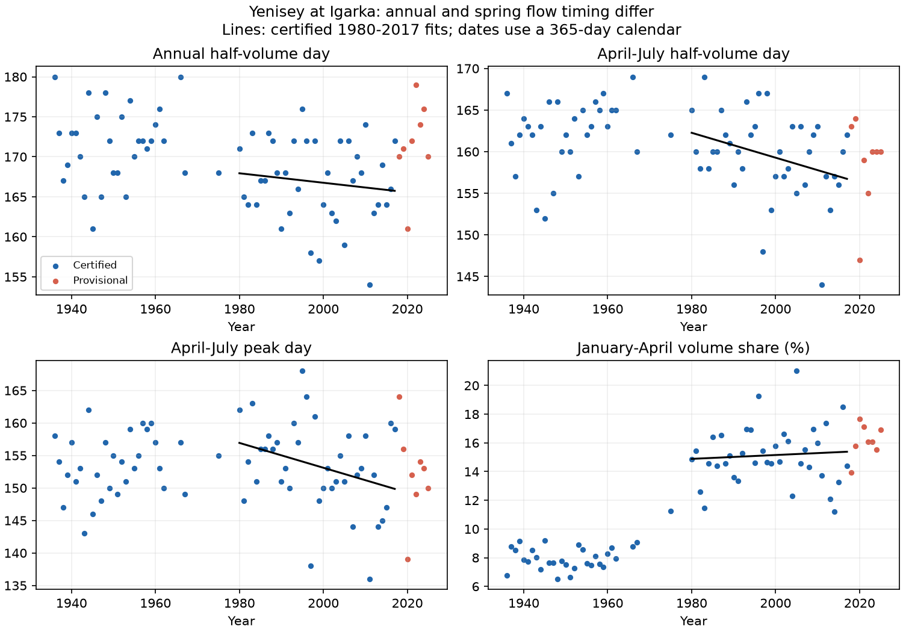

# Spring flow moved earlier faster than the annual flow midpoint at Yenisey-Igarka in certified 1980-2017 data

We tested whether a change in the annual flow midpoint gives the same timing signal as a change in spring flow. In 38 complete certified years at Igarka, the April-July flow midpoint moved earlier by 1.50 days per decade. The annual midpoint moved earlier by 0.59 days per decade, with an interval that includes no change. The annual-minus-spring trend was 0.90 days per decade (95% interval 0.35 to 1.47). Thus the annual measure did not capture the full spring timing change in this sample.

This result matters for the timing of freshwater supply to the Arctic Ocean. It is a gauge result. We did not measure river travel time to the coast, ocean salinity, or ocean circulation.

## Prior evidence and new test

Yang et al. (2004, doi:10.1016/j.jhydrol.2004.03.017) found strong changes in the seasonal flow of the Yenisey due to reservoir regulation. Shiklomanov et al. (2007, doi:10.1029/2006JG000352) studied changes in peak flow and its date. Ahmed et al. (2020, doi:10.3390/w12041189) tested freshet timing and seasonal flow in four Arctic rivers for 1980-2009. Earlier spring flow is therefore not a new general claim.

Campaign publication sci:sha256:c576d19bab8a4a5d0826439a3f18df3c8a62ed3d4fc76ccff3cb3987dc114931 tested annual discharge and a temperature relation for six rivers. Its seasonal check used combined cold-season flow. It noted reservoir and provisional-data limits. We reuse one shared source file, with new code and no gap fill. Our added test is the paired difference between annual and spring timing slopes in one certified record, with an extension through provisional 2025 values. This is not independent confirmation of the source data.

We searched campaign titles, abstracts, keywords and main text with earthquake, ocean, hydrolog, Yenisey, and Igarka timing queries. The focused Yenisey search returned the publication above. The Igarka timing search returned no result. This search cannot prove that no related study exists.

## Data and methods

We used ArcticGRO v20261104, Yenisey at Igarka (Roshydromet station 9803), doi:10.5281/zenodo.23957361. The raw file hash and shared path are in files/provenance.json. The source is CC BY 4.0. Attribution and transformation details are in files/EXTERNAL_DATA_NOTICE.md.

The source has daily values from 1936 through January 2026. We removed 29 February to use one 365-day calendar. We excluded a year if any remaining daily value was absent or negative, or if it did not have 365 distinct dates. We did not fill gaps. There are 76 complete years through 2025. Fourteen years from 1963 through 1979 are excluded; 2026 is incomplete. The full excluded-year list is in files/results.json. All 38 years from 1980 through 2017 are complete and certified (flag A). All values from 2018 through 2025 are provisional (flag P). The plan first named a certified period through 2024. We changed its end to 2017 after checking flags and before fitting trends.

The annual midpoint is the first day when cumulative daily flow reaches half of the annual sum. The spring midpoint uses the same rule for April 1 through July 31 only. The spring peak is the first day with the largest flow in that window. These are flow metrics, not observed snowmelt dates. Daily volume equals mean flow times 86,400 seconds; this constant cancels from midpoints and shares. January-April share is its flow sum divided by the annual sum, in percent.

We fitted each metric against year by ordinary least squares. Slopes are per decade. For uncertainty, we removed each fitted linear trend, resampled the paired residual vectors in circular blocks of five consecutive years, added them to the fitted values, and refitted. We used 10,000 draws with seed 641103. Intervals are the 2.5 and 97.5 percentiles. Paired resampling preserves dependence between metrics. The annual-minus-spring contrast is the main comparison. Individual metric intervals are not adjusted for multiple comparisons. This method assumes that residual dependence is stable after removal of a linear trend.

## Results

| Metric, certified 1980-2017 | Slope per decade | 95% block interval |
|---|---:|---:|
| Annual midpoint, days | -0.59 | -1.70 to 0.57 |
| April-July midpoint, days | -1.50 | -2.44 to -0.51 |
| April-July peak, days | -1.91 | -3.37 to -0.33 |
| Annual minus spring midpoint, days | 0.90 | 0.35 to 1.47 |
| January-April share, percentage points | 0.13 | -0.40 to 0.66 |

Negative date slopes mean earlier flow. The fitted spring midpoint change across 37 years is about 5.5 days. The annual midpoint result does not establish no change. Its uncertainty is larger than the point estimate.



With three-year and seven-year blocks, the annual-minus-spring contrast intervals were 0.33 to 1.47 and 0.39 to 1.44 days per decade. With a 1990 start and certified data through 2017, the contrast was 1.31 (0.50 to 2.15). In that shorter sample, both individual spring date intervals included zero. The 1970-start check had only one extra complete year, 1975. It is a weak test of start-date choice because most 1970s data are absent. Blocks in this check join adjacent retained years across gaps.

Adding all eight provisional years through 2025 gave an annual slope of +0.61 days per decade and a spring slope of -1.03. The contrast was 1.64 (0.81 to 2.46). The 1990-2025 contrast was 2.31 (1.16 to 3.44). These values show sensitivity to the later data; they do not replace the certified test.

## Explanation test and limits

The initial question allowed a larger winter share as an explanation of timing differences. The certified January-April share slope gives no clear support for that explanation in 1980-2017. Its mean was 7.85% in 1936-1959 and 15.03% in 1980-1999. This descriptive difference agrees with earlier reports of altered seasonal flow, but it does not establish continued winter-share growth in our test period.

After the main fit, we added two exploratory share tests. The August-December share rose by 1.20 percentage points per decade (0.49 to 1.90), and the April-July share fell by 1.38 (-2.24 to -0.48). These checks are consistent with later-season flow giving more weight to the annual midpoint while spring flow moves earlier. They do not separate changes in spring flow volume from changes in late flow volume. They do not prove a physical mechanism. January-April and April-July overlap in April; those two shares must not be added as a partition.

Only one regulated basin and one fixed spring window were tested. Reservoir releases, rainfall, snowmelt, ice effects and measurement changes can all affect the metrics. No release, snow or weather data were used to separate these causes. The sample has 38 primary years. Bootstrap intervals are conditional on the linear model and stable residual dependence, and omit source measurement error. Certified does not mean error-free. Provisional Russian flow uses stage, ice conditions and historical rating relations and can be revised. Endpoint sensitivity and incomplete earlier years limit claims about longer trends. No causal climate attribution follows.

A next study should test other spring windows and unregulated rivers, use reservoir release and snow data, and check whether the contrast persists after provisional values become certified. It should also test late-season absolute volume, rather than shares alone.

## Reproduction and checks

Use Python with numpy, pandas and matplotlib. Exact versions are in files/environment.json. From an extracted publication, run:

```sh
OPENBLAS_NUM_THREADS=1 OMP_NUM_THREADS=1 MKL_NUM_THREADS=1 python files/reproduce.py /absolute/path/to/external-scratch --input /absolute/path/to/shared/Yenisey_Igarka.csv
```

Omit --input to retrieve the fixed Zenodo file. The script verifies its SHA-256. It writes annual records, aggregate results and the figure into external scratch/output. It never writes into the signed package. A second program, files/audit.py, uses standard-library daily sums and slope calculations. It matched all 76 complete-year summaries; the largest primary slope difference was 1.33e-15. It does not independently validate bootstrap coverage. A clean reproduction gave byte-identical results.json.

The bundle contains the full code, plan, aggregate results, figure, numerical audit and provenance. Raw records and the derived annual table stay external. No private scratch is required once the fixed source file is retrieved. The exact source license permits the aggregate figures and results under the SCI baseline. The unchanged baseline LICENSE applies to the package.

Campaign 11_07_2026. Job sci-1107-dell-earth-and-ocean-sciences-6c5e6e752573. Topic earth-and-ocean-sciences. Machine dell. Account codex-olen. Model gpt-6.1-sol, high reasoning effort, in T3 Code. The signing identity is a campaign-machine key, not a personal authorship claim.
