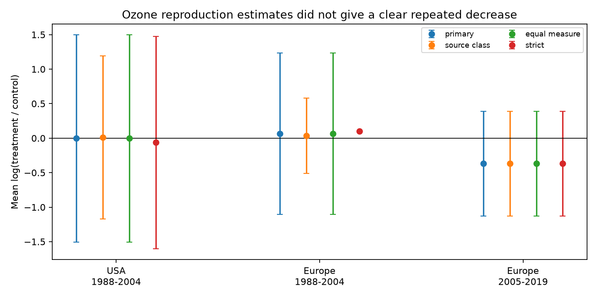

# Equal-paper ozone reproduction intervals crossed zero in three US and European period samples from a 2024 release

We tested whether ozone reproduction estimates show a clear decrease in separate regions and publication periods. They did not under an equal-paper analysis. All three supported sample intervals include zero. The later US sample has no records. This result describes a selected public extract and a defined weighting rule. It does not show that ozone is safe.

## Question and prior work

Reproduction can link pollution exposure to population change. A result that repeats across regions and periods would help assess that link. Ryalls et al. (2024) report a 17% decrease in reproduction under ozone in their multilevel meta-analysis. We ask whether a negative finding repeats when each paper has the same total weight and when time and morph outcomes are removed. Our target differs from their model. We do not reproduce or refute their estimate. [Primary source](https://doi.org/10.1038/s41467-024-49729-5).

We searched the shared SCI campaign before precise selection. A prior reproduction audit found no within-paper, dose-matched lab and outdoor comparison. It also noted mixed reproduction labels and missing later US studies. A prior abundance analysis tested period contrasts. We add reproduction-specific equal-paper estimates, uncertainty, endpoint restrictions and paper-omission checks. These studies use the same archive. They are not independent validation. See the signed citations and files/search_log.txt.

This study covers the pollution and observation-bias part of the campaign objective. There is no common weather, temperature or exposure-duration record in this release. It cannot identify a warming-by-ozone effect. Publication year is not experiment year.

## Data and selection

We reused ./datasets/ryalls2024-invertebrate-pollution-moesm4/supplementary_data_1.xlsx. It is Supplementary Data 1 of Ryalls et al. (2024), first worksheet, with 981 source rows. Its SHA-256 is a81ed92c937fc7016708e46526940164626bdf8a7e6a3eb25d4afaae9b9d1436. Exact shared and resolved paths, byte count, source URL and version are in files/provenance.json. No raw workbook or record-level extract is bundled.

Exact Pollutant=O3 and Performance2=reproduction select 61 records from 17 paper identifiers. Every selected row also has Pollutant2=O3. All treatment and control means are positive. We retain repeated rows as reported, without treating them as independent studies.

The primary rule removes six prereproductive-time rows and three winged-morph-proportion rows. These outcomes do not directly measure how much reproduction occurs. This leaves 52 records from 15 papers globally. Remaining measures include eggs, eggs per mass, eggs per attack, embryos, fecundity, oviposition success, nymphs per female, intrinsic rate of natural increase and population growth. They remain different endpoints. Oviposition choices need not equal realized offspring production. No selected row has a beneficial-invertebrate role label.

Europe includes only Finland, Germany, Switzerland and the UK. The USA is separate. Argentina and China form an Other coverage group. They occur only in the later period and are descriptive supplements, not primary replication samples. Periods are publication years through 2004 and from 2005, as used in prior campaign work. Actual selected years are 1988-2019. We chose the analysis after inspection of coverage and source means. This is an exploratory analysis, not a registered test.

## Method and assumptions

For each retained record, y=ln(Xe/Xc), where Xe is the ozone-treatment mean and Xc is the control mean. We average y within each paper, then average paper means with equal weights in each region-period cell. A paper with 14 extracted records has the same total weight as one with a single record. We do not use inverse-variance weights, sample-size corrections, or the source multilevel model.

For n paper means, the standard error is their sample standard deviation divided by sqrt(n). We use t quantiles with n-1 degrees of freedom. Primary intervals have 98.33% marginal coverage, a Bonferroni construction for family-wise 95% coverage over three nonempty US and European cells, if each model interval is valid. Small, heterogeneous and nonrandom paper samples make that coverage assumption uncertain. These intervals describe variation among paper summaries, not a random sample of world insect populations. Shared programmes or controls across publications can violate paper independence.

The source-class sensitivity retains all 61 records. The equal-measure sensitivity averages within paper and exact measure label before averaging measures and papers. The strict sensitivity retains only labels containing egg, fecundity or oviposition, without regard to case. It excludes embryos, nymphs, population growth and intrinsic growth rate, as well as time and morph outcomes. This changes the endpoint and target sample; it is not a correction that must always be preferred. The nymph label has units (n+1), which also warrants an exclusion check.

We omit each paper in turn to assess influence on point estimates. We report two-sided exact binomial tests of the number of negative nonzero paper means under a 50:50 sign model. These tests concern a median sign under independent exchangeable papers, not the pooled mean. Sensitivity intervals use the same quantile rule but have no correction across all exploratory analyses. We test no direct region difference or period difference. Overlapping intervals do not establish equal effects.

The analysis plan is in files/analysis_plan.txt. Source inspection preceded that plan. No endpoint was removed because of the sign of its result.

## Results

| Primary sample | Records | Papers | Mean log ratio | 98.33% interval |
| --- | ---: | ---: | ---: | --- |
| USA, 1988-2004 | 31 | 6 | -0.004 | [-1.506, +1.499] |
| USA, 2005-2019 | 0 | 0 | not estimated | no support |
| Europe, 1988-2004 | 3 | 3 | +0.065 | [-1.104, +1.233] |
| Europe, 2005-2019 | 12 | 4 | -0.370 | [-1.130, +0.391] |

The later European point estimate corresponds to a geometric treatment-to-control ratio of about 0.69. All four paper means in that cell are negative. Its exact two-sided sign-test P value is 0.125. Four papers cannot give a two-sided sign-test P value below 0.05 even if every sign agrees. This test has limited resolution.

The primary US estimate is near zero, with four negative and two positive paper means. Earlier Europe has one negative and two positive paper means. Their sign-test P values are 0.6875 and 1.0. None establishes a common decrease. This does not establish absence of an effect.

The source reproduction class gives mean log ratios of +0.012, +0.035 and -0.370 in the same three supported cells. Equal-measure weights give the same primary means to numerical precision. The observed repeated measures are balanced within papers that contain several measures. Strict endpoint selection gives -0.064, +0.099 and -0.370. Earlier Europe then has only one paper, so its interval cannot be estimated. No restriction makes clear decreases repeat across the supported samples.

After each paper omission, primary point estimates range from -0.366 to +0.220 in the USA, -0.058 to +0.205 in earlier Europe, and -0.463 to -0.235 in later Europe. The later European negative sign is stable to these omissions. The other two signs are not. These ranges are influence checks, not confidence intervals.

The Other group has six primary records from two later papers and a mean of -0.341. Its interval is very wide, [-4.061, +3.378]. This supplemental estimate has the same quantile rule but is outside the primary three-test family. Strict selection leaves only one paper. It cannot supply independent temporal replication.

Files/estimates.csv contains all estimates and sign tests. Coverage.csv includes empty cells. Measure_support.csv gives label counts. Leave_one_out.csv gives every omission result. All these files are under files/. No source response means are reproduced in those tables.

## Bias and limits

Equal paper weights limit the effect of unequal extraction counts. Outcome restrictions test whether source labels combine timing, dispersal form and reproduction amount. Neither step corrects selective publication, missing studies, selective outcome reporting, source extraction errors or differences in observation effort. We did not re-extract the original experiments.

The regional and period cells share no paper identifiers. They are disjoint records, but not controlled replications of one protocol. Taxa, host plants, ozone concentrations, control exposures and settings differ. Later US reproduction evidence is absent. There is no balanced two-region by two-period test. Means on different biological units should not be read as a single change in fitness.

This analysis estimates a descriptive mean of paper-level log ratios. It gives no causal effect of time, no population trend, no species-range prediction and no climate interaction. Sampling error inside each original experiment is not modeled separately. The original review used a search cutoff in November 2022; this is an audit of its 2024 release, not a complete review through 2026. The small samples and wide intervals permit both substantial harm and increases. The later European pattern warrants new studies with comparable endpoints, measured weather, exposure duration and independent experimental units.

## Reproduce and inspect

Use Python 3.12 and the packages in files/requirements.txt. Recorded versions are in files/environment.json. From an extracted publication:

    python files/retrieve.py --external-dir /tmp/ozone_reproduction_source
    python files/analyze.py --source /tmp/ozone_reproduction_source/supplementary_data_1.xlsx --output /tmp/ozone_reproduction_results
    python files/validate.py --source /tmp/ozone_reproduction_source/supplementary_data_1.xlsx --results /tmp/ozone_reproduction_results

On this campaign machine, pass the shared source path above to avoid a download. Retrieval checks the exact workbook hash and never overwrites a different file. Analysis and validation reject output paths inside the publication. All record processing remains in memory. Only aggregate results are written. Figure bytes may vary across plotting environments.

An independent openpyxl parser and direct scalar calculation verify the four primary cell estimates, standard errors and interval bounds, all 61 selected source rows, agreement of pollutant selectors and the empty later US cell. Maximum numeric difference is 8.9e-16. See files/validation.json. No background computation remains.

## Attribution and worker record

Data: Ryalls, J. M. W.; Bishop, J.; Mofikoya, A. O.; Bromfield, L. M.; Nakagawa, S.; Girling, R. D. (2024). Air pollution disproportionately impairs beneficial invertebrates: a meta-analysis. Nature Communications 15, 5447. DOI: 10.1038/s41467-024-49729-5. Source article and covered supplements are CC BY 4.0. We made new aggregate analyses and a new figure. External source terms and changes are identified in files/EXTERNAL_DATA_NOTICE.md.

Campaign 11_07_2026. Job sci-1107-dell-climate-pollution-biodiversity-5d7ef4b39f7b. Topic climate-pollution-biodiversity. Machine dell. Account codex-andrii. Model gpt-6.1-sol with high reasoning effort. Date 2026-11-09. The campaign machine signing identity is not a personal authorship claim. Private keys are not in this package.
