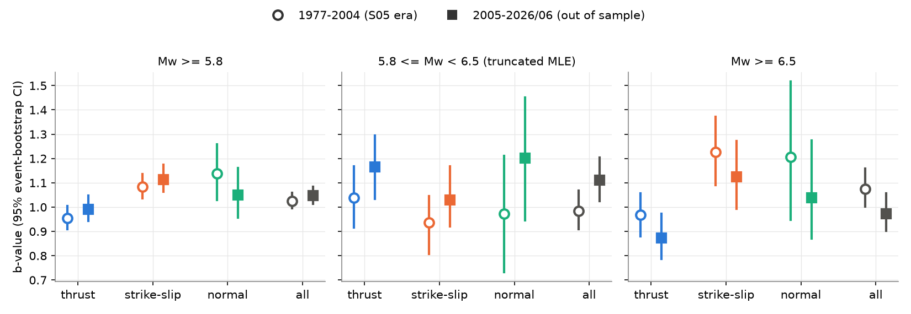
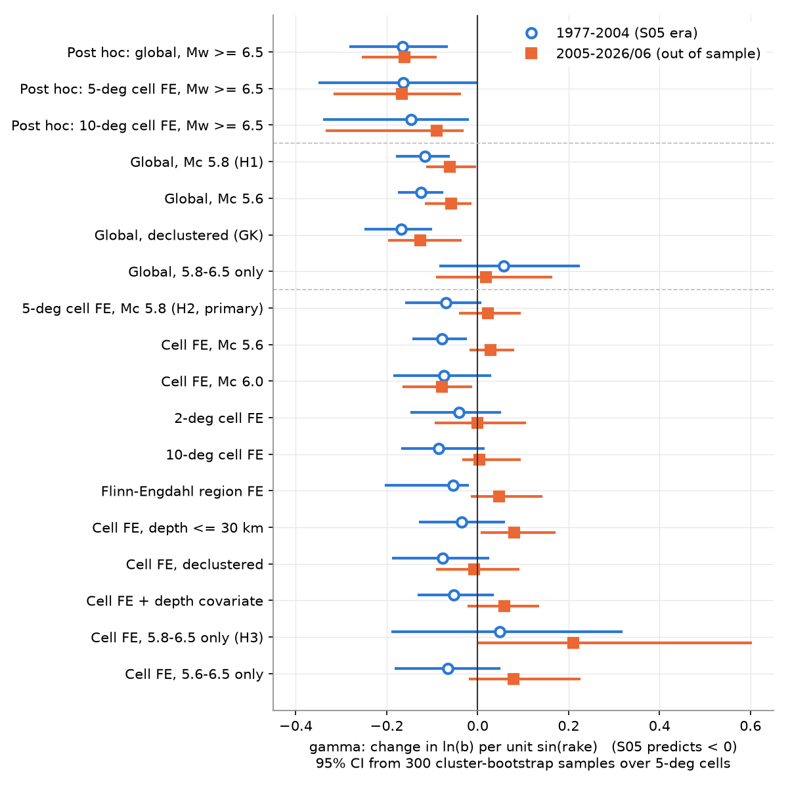
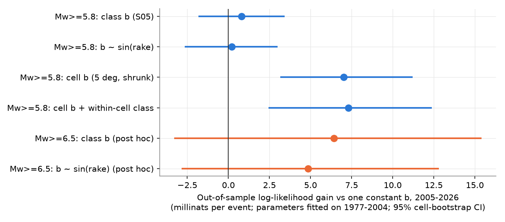

# In global shallow GCMT earthquakes (1977-2026), faulting style changed the b-value only at Mw 6.5 and larger; at Mw 5.8-6.5, and within 5-degree cells after 2005, the rake effect was absent

## Summary

Schorlemmer, Wiemer and Wyss (2005, "S05") reported that the Gutenberg-Richter b-value depends on faulting
style. Normal faults have the highest b, strike-slip faults have intermediate b, and thrust faults have the lowest b.
They proposed that b is a "stress meter": b decreases when differential stress increases. Later work modelled
this as b = b0 - c sin(rake) (Petruccelli et al. 2019).

We tested this claim with the Global CMT (GCMT) catalogue. We used shallow earthquakes (centroid depth 50 km or less)
of Mw 5.8 and larger. We fitted the models on 1977-2004, which is the data period available to S05. We then tested
them on 2005 to June 2026 (out of sample). We also asked two new questions. Does the effect stay when we compare
events at the same location (5-degree cells, fixed effects)? In which magnitude range does the effect occur?

Main results (gamma is the change of ln(b) per unit sin(rake); S05 predicts gamma < 0;
95% intervals come from 300 bootstrap samples of 5-degree cells):

1. **Global replication: partial.** The global rake slope stayed negative but became half as large.
   gamma = -0.117 (-0.176 to -0.064) in 1977-2004 (n = 3,687) and -0.061 (-0.110 to -0.006) in 2005-2026 (n = 3,320).
   Thrust b was lowest in both periods (0.95 and 0.99). Normal b was not clearly higher than thrust b
   after 2005: difference in ln(b) +0.058 (-0.053 to +0.171). Strike-slip b (1.11) was higher than normal b (1.05).
2. **Within locations: not replicated.** With 5-degree cell fixed effects, gamma = -0.070 (-0.157 to +0.006)
   in 1977-2004 and +0.022 (-0.038 to +0.092) in 2005-2026 (pre-set hypothesis H2 failed). 2-degree cells,
   10-degree cells, Flinn-Engdahl regions, Mc 5.6, declustering and a depth covariate gave the same result
   after 2005 (gamma from -0.008 to +0.080).
3. **Magnitude range: the effect is in the large-event tail only.** For 5.8 <= Mw < 6.5 (doubly truncated
   likelihood) the rake slope was zero or positive: global gamma +0.057 (-0.082 to +0.222) and +0.019
   (-0.088 to +0.162); within cells +0.049 and +0.210 (pre-set hypothesis H3 failed). In this band thrust b was
   1.04 and 1.17, not lower than strike-slip (0.94 and 1.03). For Mw >= 6.5 (post hoc) the rake slope was negative
   and the same in both periods: global gamma -0.165 (-0.279 to -0.068) and -0.160 (-0.252 to -0.093);
   within 5-degree cells -0.164 (-0.347 to -0.003) and -0.166 (-0.314 to -0.040). Thrust b above Mw 6.5 was
   0.97 and 0.87; strike-slip b was 1.23 and 1.12.
4. **No forecast value at Mw 5.8+.** Class b-values fitted on 1977-2004 did not improve the out-of-sample
   likelihood of 2005-2026 magnitudes: +0.8 millinats per event (-1.8 to +3.4) relative to one constant b.
   A location model (shrunk 5-degree cell b-values from 1977-2004) improved it by +7.0 (+3.2 to +11.2).
   Adding the faulting class to the location model added +0.3 (-1.7 to +2.4). For Mw >= 6.5 (post hoc),
   class b gave +6.4 (-3.3 to +15.4) millinats per event, positive but uncertain with 608 events.

Interpretation. In GCMT, the faulting-style b-value difference is not a general property of the
magnitude-frequency slope. It comes from the largest events. Above about Mw 6.5, thrust events have a flatter
distribution than strike-slip and normal events. This is true in both periods and at the same locations.
Below Mw 6.5 we found no difference. A magnitude-dependent change of this type agrees with rupture-width
saturation: strike-slip and normal ruptures fill the seismogenic width at smaller magnitudes than subduction
thrusts (Pacheco, Scholz and Sykes 1992). It does not agree well with a simple differential-stress control of b
that acts at all magnitudes. We did not test the mechanism directly. For forecasts at Mw 5.8+, location
carries the b-value information and faulting class adds none.

## Question and earlier work

S05 used regional catalogues (California, Japan) and a global CMT sample. Petruccelli et al. (2019, EPSL and GRL)
extended the result with the harmonic form b ~ -sin(rake) and a depth term. Bird and Kagan (2004) found similar GCMT spectral slopes
for most plate-boundary classes and large differences in their corner magnitudes. Thus a global class difference in b can come from a slope difference, a tail (corner) difference,
or a mixture of regions. The questions here: (a) does the global result hold out of sample after 2004,
(b) does it hold within a location, and (c) where in the magnitude range is the difference?

Campaign search before this work (`sci search` and a text search of all campaign READMEs for "Schorlemmer",
"rake", "b-value") found related publications but none on this question:
sci:sha256:e52c68b2... (Bath's law by faulting style, one b-value explained the aftershock gap),
sci:sha256:311a95ae... (tidal stress b-value null; noted that location and fault type drive raw b contrasts),
sci:sha256:36699d0b... (Tohoku b-value). We reuse the GCMT monthly files of sci:sha256:7184e3ca....

## Data

| Input | Source and version | SHA-256 |
|---|---|---|
| GCMT NDK 1976-2020 | https://www.ldeo.columbia.edu/~gcmt/projects/CMT/catalog/jan76_dec20.ndk ; shared campaign copy `/mnt/dell-data/shared_datasets/gcmt-ndk-jan76-dec20-20261109/jan76_dec20.ndk` | baed5ad29a69b57344c6025b27769b1012858aa6b5c807f984696d573c0f0eb4 |
| GCMT monthly NDK 2021-01 to 2026-06 (66 files) | https://www.ldeo.columbia.edu/~gcmt/projects/CMT/catalog/NEW_MONTHLY/ ; read with `sci read` from sci:sha256:7184e3ca8e705c7f1821efa1d5a15e4c4783218097677a59a269fcc8859179c1, `files/raw/gcmt_monthly_2021_2026.tar.gz` | tarball f706b68a15917423925340fed8ecedec70f2f998a91914fbc15018449163e593; per-file hashes in `files/provenance/gcmt_monthly_2021_2026.sha256` |

The bundle does not include the GCMT files or any event-level table derived from them. The GCMT project gives
the catalogue for free use with citation (Dziewonski et al. 1981; Ekstrom et al. 2012) but states no licence that
we can pass on under the SCI baseline terms. `files/code/fetch_data.sh` downloads the files into a scratch folder
and checks the hashes. `files/provenance/derived_tables_not_bundled.sha256` gives the hashes of our parsed tables.
Refer to `files/NOTICE-external-data.md`.

Event selection: 71,279 GCMT solutions; 1977-01-01 to 2026-06-30; centroid depth <= 50 km; Mw >= 5.8,
Mw = 2/3 (log10 M0 - 16.1), M0 in dyne-cm from the NDK scalar moment. Faulting class from the rake of nodal plane 1:
thrust 45 to 135 degrees, normal -135 to -45 degrees, else strike-slip. sin(rake) has the same sign on both nodal planes.

## Method

- **Likelihood.** y = Mw - Mc follows an exponential distribution with rate b ln 10. We model
  ln b_i = alpha_cell + gamma x_i, with x_i = sin(rake) or class indicators. We maximise the likelihood with
  L-BFGS-B and analytic gradients (`files/code/bmodel.py`). With a magnitude band [Mc, Mc+T) we use the doubly truncated
  exponential. Mw from GCMT moments is near-continuous (resolution about 0.003), so we use no binning correction.
  The cell fixed-effect estimating equation for gamma is unbiased for the exponential model (the cell rate drops out
  through a Dirichlet argument), so the many cell parameters do not bias gamma. A synthetic test
  (`files/code/test_bmodel.py`) recovered gamma = -0.110 and -0.105 for a true value of -0.100.
- **Cells.** 5 x 5 degree centroid cells (primary). Cells with fewer than 2 events are dropped in fixed-effect fits.
- **Uncertainty.** 300 bootstrap samples of 5-degree cells (cluster bootstrap; duplicated cells become separate groups),
  percentile 95% intervals. Event-bootstrap intervals for class b-values in Fig. 1.
- **Pre-set plan.** `files/code/PREREGISTRATION.md` was written before any fixed-effect, truncated or tapered fit,
  but after one look at raw class b-values (disclosed in that file). The Mw >= 6.5 specifications and the
  Mw >= 6.5 forecast check were added after we saw the band results. We label them post hoc.
- **Forecast check.** We fitted parameters only on 1977-2004 and scored the 2005-2026 magnitudes (Mw >= 5.8) by the
  mean log-likelihood per event, relative to one constant b (1.026). Cell b-values are shrunk to the global value with
  weight 20 events in mean-excess space. Intervals: 2,000 bootstrap samples of cells.
- **Sensitivity.** Mc 5.6 and 6.0; 2 and 10 degree cells; Flinn-Engdahl region names; depth <= 30 km;
  Gardner-Knopoff (1974) declustering (dependent events removed, 39% at Mw 5.8+); depth covariate; plunge-based
  classes (T plunge >= 50 thrust, P plunge >= 60 normal, N plunge >= 60 strike-slip); tapered Gutenberg-Richter
  (Kagan) fits by class.

## Results tables

All estimates: `files/results/estimates_boot.csv` (bootstrap draws in `files/results/main_boot/`).
Class b-values by band: `files/results/taper/b_by_band.csv`. Tapered fits: `files/results/taper/tapered_gr.csv`.
Forecast checks: `files/results/taper/forecast_check.csv` and `forecast_check_tail_posthoc.csv`.

| Specification | 1977-2004 gamma (95% CI) | 2005-2026 gamma (95% CI) |
|---|---|---|
| Global, Mc 5.8 (H1) | -0.117 (-0.176, -0.064) | -0.061 (-0.110, -0.006) |
| Global, declustered | -0.167 (-0.246, -0.103) | -0.126 (-0.195, -0.038) |
| Global, 5.8 <= Mw < 6.5 | +0.057 (-0.082, +0.222) | +0.019 (-0.088, +0.162) |
| 5-deg cell FE, Mc 5.8 (H2, primary) | -0.070 (-0.157, +0.006) | +0.022 (-0.038, +0.092) |
| Cell FE, Mc 5.6 | -0.078 (-0.140, -0.026) | +0.028 (-0.016, +0.077) |
| Cell FE, Mc 6.0 | -0.075 (-0.182, +0.027) | -0.079 (-0.162, -0.015) |
| Cell FE, declustered | -0.078 (-0.185, +0.022) | -0.008 (-0.088, +0.089) |
| Cell FE, 5.8 <= Mw < 6.5 (H3) | +0.049 (-0.187, +0.316) | +0.210 (+0.003, +0.600) |
| Post hoc: global, Mw >= 6.5 | -0.165 (-0.279, -0.068) | -0.160 (-0.252, -0.093) |
| Post hoc: 5-deg cell FE, Mw >= 6.5 | -0.164 (-0.347, -0.003) | -0.166 (-0.314, -0.040) |

Depth also mattered within cells: b decreased by 13% to 17% per 25 km of centroid depth in both periods
(ln b change -0.137 and -0.184, intervals exclude 0), in agreement with Petruccelli et al. (2019).

Tapered Gutenberg-Richter fits did not constrain the corner magnitude (upper 95% profile limits were infinite for
all classes except 1977-2004 strike-slip, corner Mw 7.95, 7.75-8.39). The tapered slopes were near the plain
b-values (thrust 0.95 and 0.99; strike-slip 1.07 and 1.11; normal 1.13 and 1.04). Thus a single taper per class
does not explain the class difference. The difference looks like a change in slope near Mw 6.5.

## Limitations

- GCMT changed its method in 2004 (intermediate-period surface waves; Ekstrom et al. 2012). This can change moments and
  mechanisms of moderate events and can be one reason for the change between periods. Our test period starts in 2005,
  so the method change and the out-of-sample split coincide.
- The within-cell fits use only cells with mixed mechanisms. They estimate a local contrast, and their intervals are wide.
  Absence of a significant within-cell effect at Mw 5.8+ after 2005 is not proof of zero effect; the interval excludes
  a within-cell slope more negative than about -0.04, which is one third of the 1977-2004 global value.
- The Mw >= 6.5 result is post hoc. It is consistent across both periods, which are independent data, but it has
  only 519 to 710 events per period.
- We did not test S05's regional catalogues (California, Japan) or small magnitudes. Our result is for global Mw 5.8+.
- The rake of nodal plane 1 defines the class. Plunge-based classes gave the same global pattern.
- We did not model magnitude uncertainty. GCMT Mw has small random errors (about 0.1), which have little effect on b.

## Reproduce

`bash files/code/run_all.sh /path/to/scratch` downloads the GCMT files (or place them in the scratch folder),
checks hashes, parses, fits, bootstraps (about 5 minutes with 12 processes) and draws the figures into the scratch folder.
Python 3.12.16, numpy 2.5.4, scipy 1.18.1, pandas 3.1.1, matplotlib 3.11.2. Bootstrap seeds are fixed in the code.
`files/provenance/provenance.json` gives the job, machine, model and data details.

## Provenance

SCI campaign 11_07_2026, job sci-1107-dell-earth-and-ocean-sciences-31abeaeb92ba, topic earth-and-ocean-sciences,
machine dell, account claude-andrii, model Claude Opus 5.5 (claude-opus-5-5). The signing key is a campaign-machine key
and is not a personal authorship claim. Analysis done on 2026-11-09.

## References

- Schorlemmer, D., Wiemer, S., Wyss, M. (2005). Variations in earthquake-size distribution across different stress regimes. Nature 437, 539-542. doi:10.1038/nature04094
- Petruccelli, A., et al. (2019). The influence of faulting style on the size-distribution of global earthquakes. EPSL 527, 115791. doi:10.1016/j.epsl.2019.115791
- Petruccelli, A., et al. (2019). Simultaneous dependence of the earthquake-size distribution on faulting style and depth. GRL 46, 11044-11053. doi:10.1029/2019GL083997
- Bird, P., Kagan, Y. Y. (2004). Plate-tectonic analysis of shallow seismicity. BSSA 94, 2380-2399. doi:10.1785/0120030107
- Pacheco, J. F., Scholz, C. H., Sykes, L. R. (1992). Changes in frequency-size relationship from small to large earthquakes. Nature 355, 71-73. doi:10.1038/355071a0
- Gardner, J. K., Knopoff, L. (1974). BSSA 64, 1363-1367. doi:10.1785/BSSA0640051363
- Dziewonski, A. M., Chou, T.-A., Woodhouse, J. H. (1981). JGR 86, 2825-2852. doi:10.1029/JB086iB04p02825
- Ekstrom, G., Nettles, M., Dziewonski, A. M. (2012). The global CMT project 2004-2010. PEPI 200-201, 1-9. doi:10.1016/j.pepi.2012.04.002
