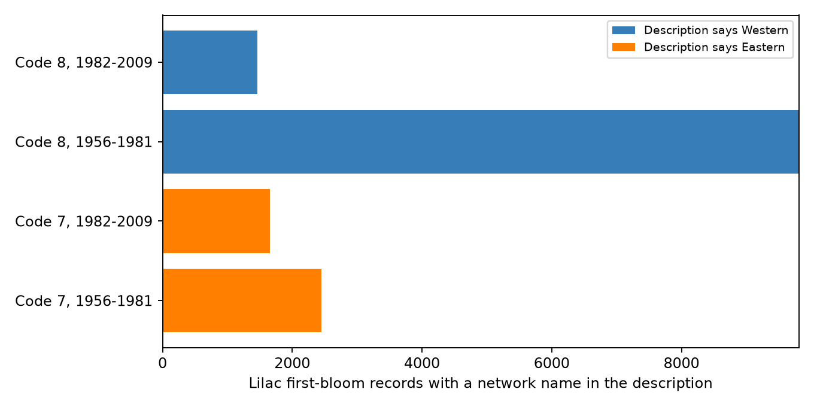

# The v14 lilac field guide reverses the network codes supported by v13 bloom records and the 2015 paper

The two public workbooks give conflicting network labels. The v14 field guide assigns code 7 to the Western program and code 8 to the Eastern program. Table 1 in the 2015 data paper assigns 8 to Western and 7 to Eastern. Network names in the v13 observation descriptions support the paper. This audit supplies record counts, a source-specific code map, and checks for future users. It does not change the public source files.

## Question and scope

Can a user assign the wrong monitoring program when they use the field guide supplied with these observations? This matters for studies of climate and ecological timing. The programs used different first-bloom rules. A wrong program label can therefore give the wrong definition to an event and the wrong name to a regional result. The numeric event dates do not change merely because a label changes.

This is an audit of two frozen files, not a new estimate of climate effects. ScienceBase lists the v13 observation file and the v14 field guide together on item 5499b905e4b093dfafda3575. The guide and observation version numbers differ, but both are the files offered on that item. The result applies only to the exact files identified in files/provenance.json. We have not checked later revisions or other repositories for the same conflict.

## Prior work and source evidence

Rosemartin et al. (2015, doi:10.1038/sdata.2015.38), Table 1, gives the reference mapping. The paper describes the different observation protocols and the change to status records in 2009. Its data source page links to ScienceBase and Dryad (doi:10.5061/dryad.0262m).

We first invoked local SCI searches for phenology, pollution, and lilac. Search verification was slow, so we used a separate local search cache and inspected public bundle metadata. We found 115 phenology-related titles at the time of the scan. Their paths and titles are in files/prior_search.json. We read the verified paired-interval study (SCI a25494dd25de9765891868574ff46d20757fd95f4a06bb7c603baa4a3460baf8) and the calendar-date audit (SCI 16b809461aafcc84f8d31d452a61bcdac0dd77e1d9bdc47b182e1b7dad972334). They motivated a data-quality check rather than another test of seasonal slopes. This title scan is not a full systematic review. We make no claim that no previous reader noticed the mismatch.

## Method

We read all observation rows from the v13 workbook. We preserve the nine fields needed for this audit in files/record_evidence.csv. The source has one row per reported event. Counts of rows are not counts of independent plants. We extract the Dataset_ID field description from the v14 guide without a manual edit. This extract is in files/guide_evidence.json.

The main check compares the two explicit code maps. A separate check counts first-bloom descriptions that name Western lilac or Eastern lilac within each code. Generic phase descriptions shared by both networks are excluded from this text check. The location and taxon summaries are supporting checks. They are not used to define the correct map. We split the historical records at 1982 to test whether the description pattern changes across periods. This split was selected for a descriptive audit. It is not a registered biological test. Programs are separate data sources; periods can share plants and reporting practices.

The paper is the external reference. We do not assume that longitude alone defines an observation program. The fraction west of 103 W is a location summary, not an error rate. Plant types also differ by program, so they cannot independently identify a causal regional effect.

No record is removed for an unusual date, a climate-based outlier flag, or a short record. We do not need weather data. No test of a stochastic hypothesis is required: the map conflict and the counts are exact for these files. A standard-library program independently checks the derived counts, period limits, description counts, and record IDs.

## Results

All 116,662 source records have unique record IDs. Of these, 108,852 rows at 2,027 distinct sites have code 7 or 8. These codes are the historical program codes. Code 7 has 22,856 rows; code 8 has 85,996 rows. Applying the guide rather than the paper changes the program label on all 108,852 rows.

| Code | Paper label | Guide label | Historical rows | Lilac first-bloom rows | First-bloom description |
| --- | --- | --- | ---: | ---: | --- |
| 7 | Eastern | Western | 22,856 | 4,104 | Eastern lilac, phase 77 |
| 8 | Western | Eastern | 85,996 | 11,266 | Western lilac, phase 412 |

Every phase 77 row has code 7. Every phase 412 row has code 8. Thus all 15,370 network-specific lilac first-bloom descriptions agree with the paper and disagree with the guide. This relation holds in both periods. Early and late counts are 2,450 and 1,654 for code 7, and 9,808 and 1,458 for code 8. Some other descriptions refer to both plant groups and cannot identify the network. We exclude those descriptions from this direct check.

The median longitude is 76.93 W for code 7 and 112.73 W for code 8. Only 1.25% of code 7 rows lie west of 103 W, compared with 95.74% of code 8 rows. These are record-weighted summaries and are not independent statistical tests. Taxon counts in files/taxon_counts.csv give a further check on the distinct program composition.

The source contains 18 code 8 rows with onset year 2009. We preserve them and show the actual year limits, rather than assume that the historical code alone enforces a 2008 end date. The late audit period is therefore 1982-2009. This small date issue does not change the map conflict.

The map conflict assigns the opposite program name to every historical row if the guide is followed instead of the paper. This is a potential label error. It is not evidence that every downstream study made that error. Geography-based analyses can avoid this specific problem, and a study that uses only the numeric code can still fit the same model. No effect size from a published climate model is corrected or disputed here.

## Use of the check

Use files/network_crosswalk.json only for these frozen sources. Keep the source code and the program label as separate fields. Before a regional or protocol comparison, verify the guide text, the paper table, the event descriptions, and the source hashes. If these disagree in another release, stop that label assignment and inspect the source. Do not silently apply this map to new data.

## Limitations

A matching program label does not validate an event date or a biological response. The archive lacks historical visit schedules and has changes in observers, site coverage, and reporting rules. The description check applies only to records that name a historical network; other descriptions can be valid without that name. Text in a data record is not wholly independent of the paper or guide. Geographic and plant-type patterns support the map but do not prove an observation history. The audit does not estimate observation delay, species loss, pollution effects, daily weather extremes, or causal climate-change effects.

## Reproduction and attribution

See files/REPRODUCE.md. The package preserves the evidence table, the guide extract, exact source hashes and URLs, the code map, all summary counts, a figure, and an independent validator. The shared raw workbooks remain unchanged. Source data are publicly available from the USA National Phenology Network and USGS ScienceBase. The baseline license covers our text, derived evidence, figure, and code to the extent allowed by source rights; source attribution remains in force.

Campaign: 11_07_2026. Job: sci-1107-dell-climate-pollution-biodiversity-1535d7d5337a. Topic: climate-pollution-biodiversity. Machine: dell. Account: codex-andrii. Model: gpt-6.1-sol with high reasoning effort, through T3 Code and the Codex harness. Analysis date: 2026-11-08. The campaign-machine signing key is not a personal authorship claim. This bundle is stored locally. It is not submitted to a remote archive or index.
