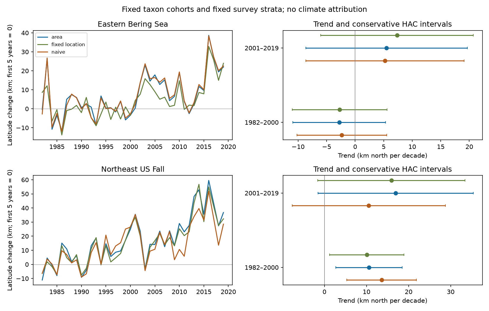
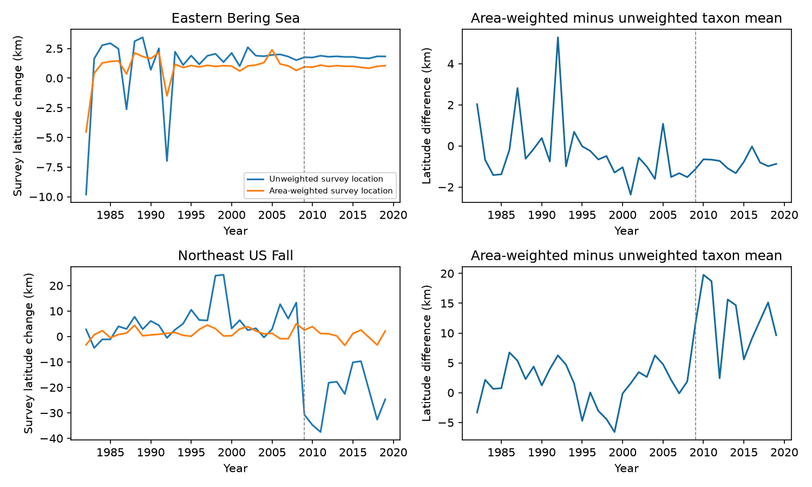

# Survey-area weights changed northward trend estimates more in Northeast US fall trawls than in Bering Sea trawls in 1982-2019

## Question and result

Can changes in survey effort explain part of a marine distribution trend? We tested two public trawl surveys in two periods. We kept the same survey strata and the same taxon list in each region. We compared catch-weighted latitude with latitude weighted by survey area and catch. This is a test of a measurement method used in climate studies. It is not a test of a climate cause.

Survey-area weights changed the trend estimates more in Northeast US fall records than in eastern Bering Sea records. In 2001-2019, the change was +6.38 km north per decade in the Northeast and +0.27 km per decade in the Bering Sea. The Northeast contrast was not stable to a term for the 2009 survey change. That term changed its point estimate to -3.75 km per decade. Thus a single trend can mix a survey change with change through time. The records do not support a uniform northward trend in all four region-period samples.





## Scope and prior work

Pinsky et al. (2013; doi:10.1126/science.1239352) linked marine distribution shifts to local climate velocity. OceanAdapt supplies data and code for such distribution indicators. Morley et al. (2017; doi:10.1111/gcb.13578) used annual stratum-biomass latitude to study seasonal climate responses. These studies motivate our test of survey weighting. Our contribution is a paired estimate of the weight contrast, with the same taxon cohort in two separate regions and two non-overlapping periods. This is a small method audit, not a new estimate of climate velocity.

We searched the campaign for `phenology temperature`, `oceanadapt`, `marine distribution`, and `trawl centroid`. We read the verified Alaska publication sci:sha256:80df002698b6546a701987b85654b633fa3f791c020273119ac8a48dfcb50886. It tested thermal exposure with a different NOAA extract and included later years. Its Bering Sea observations can overlap ours. Our Northeast sample gives a separate regional test. Neither sample is an independent test of the original source data. We did not use a private worker directory.

## Data and selection

We reused this shared file in place:

`/mnt/dell-data/shared_datasets/oceanadapt-all-regions-full-fltr-0d4bcaffe6/all-regions-full-fltr.csv.gz`

Source: `https://raw.githubusercontent.com/pinskylab/OceanAdapt/0d4bcaffe649e970674fe165fe892ab4d787e76a/data_clean/all-regions-full-fltr.csv.gz`.

Version: Git commit `0d4bcaffe649e970674fe165fe892ab4d787e76a`. File size: 30,884,574 bytes. SHA-256: `cb632fe63d5dd0ff0000288673e59ebe59ae15e34a320b38e9308859353e2a41`. The shared download record is copied to `files/raw_provenance.json`. No shared dataset was changed. This public compilation uses NOAA AFSC and NEFSC trawl records. The source repository supplies the full cleaning code. The source code and metadata files that we inspected are in `files/source_notes/`, with hashes. Their names preserve their source directories with underscores.

We selected 1982-2019 in the eastern Bering Sea and Northeast US fall survey. The Northeast file has no 2017 records. We did not fill that year. We kept strata with at least one haul in every available year. The Bering Sea retained all 10 strata and 13,427 hauls. The Northeast retained 61 of 64 strata and 9,328 of 9,715 hauls. Stratum areas were constant within each retained stratum. Each haul had one location and stratum.

We used scientific names with exactly two alphabetic words, in genus and species form. We excluded names with two different catch values in any one haul. These names were Platichthys stellatus in the Bering Sea and Placopecten magellanicus in the Northeast. We removed 5,538 repeat Northeast haul-taxon rows with identical catch values but different common-name labels after the stratum and name exclusions. No such repeats remained in the Bering sample after the conflicting taxon exclusion. We kept taxa with positive catch in every available year. This gave 59 taxa in the Bering Sea and 62 in the Northeast. These are fixed cohorts of persistent taxa, not all biodiversity. The list and exclusions are in `files/outputs/audit.json`.

## Method

For taxon s, year y and haul h, let c be the recorded weight catch per unit effort, L be latitude, A be stratum area, and n be the number of unique hauls in that year and stratum. The unweighted estimate is sum(c L)/sum(c). The area estimate is sum(c A L/n)/sum(c A/n). Hauls with no catch for that taxon add zero to these sums. All hauls, including those with unnamed catches, contribute to n. We do not treat a catch-only list as a list of separate survey visits.

Within each region, we took the arithmetic mean of the latitude estimates across the same taxa in each year. Thus a large taxon does not dominate the index through biomass alone. A latitude difference of one degree equals 111.195 km in our conversion. North is positive. The index is the mean of taxon centroids; it is not a community biomass centroid, range edge, migration distance, or richness measure.

We fit an intercept and linear year term separately in 1982-2000 and 2001-2019. We also fit the paired annual area-minus-unweighted difference. Our eight primary estimates are four area trends and four paired contrasts. We used heteroskedasticity and autocorrelation consistent covariance, three observation lags, and the finite-sample covariance correction in statsmodels. Intervals use a t quantile with n-2 degrees of freedom and a Bonferroni factor of eight. These are approximate intervals; the correction does not remove small-sample or dependence error. The missing Northeast year makes observation lags differ from calendar lags. We do not treat taxa as independent replicates. Cross-region weather can also be linked.

The fixed-location sensitivity assigns all catches in a stratum its pooled haul latitude. This removes within-stratum location change, including real animal change. It is a coarse sensitivity, not a preferred estimate. We also omitted each taxon in turn, varied covariance lags to one and five, and added a post-2008 step to Northeast late and full-period models. The step test was added after inspection of the source cleaning code. That code documents Bigelow vessel corrections after 2008. A constant species-specific vessel multiplier cancels within a taxon-year centroid; spatial changes in catchability or survey allocation need not cancel. The step term is a diagnostic, not a causal estimate of a vessel effect. Full-period fits are descriptive additions to the four planned samples.

## Results

All rates and intervals below are km north per decade. Intervals have the eight-comparison correction described above.

| Survey and period | Area trend | Interval | Area minus unweighted trend | Interval |
| --- | ---: | --- | ---: | --- |
| Bering, 1982-2000 | -2.79 | -10.91 to 5.33 | -0.46 | -2.11 to 1.19 |
| Bering, 2001-2019 | 5.51 | -8.65 to 19.67 | 0.27 | -0.45 to 0.98 |
| Northeast, 1982-2000 | 10.60 | 2.71 to 18.49 | -2.98 | -9.22 to 3.25 |
| Northeast, 2001-2019 | 16.92 | -1.52 to 35.37 | 6.38 | 2.07 to 10.68 |

Only the early Northeast area trend excluded zero under this procedure. Only the late Northeast weight contrast excluded zero. Absence of a clear contrast does not establish equivalence. We did not fit a formal region-by-period difference test.

The late Northeast unweighted survey location moved south at 20.52 km per decade. Its area-weighted location moved south at 1.53 km per decade. This is evidence of changing survey allocation; it does not quantify all observation bias. The corrected taxon index still had a positive trend estimate. The post-2008 step model reduced that index trend to 11.94 km per decade (standard error 10.59). It changed the weight contrast to -3.75 (standard error 1.97). These estimates do not support a stable positive weight contrast after that step adjustment. The step model has few years on each side and can absorb real ecological change.

Fixed-location trend estimates were -2.72 and 7.34 in the Bering Sea and 10.06 and 15.90 in the Northeast. Removing one taxon at a time gave area trend ranges of -4.28 to 0.79, 4.47 to 6.57, 8.78 to 12.14, and 14.51 to 19.08 in table order. These ranges are sensitivity ranges, not intervals. All fits, including lag choices and descriptive full-period fits, are in the CSV results.

## Checks and limits

The package checks all source-file bytes against the stated hash. It checks haul identities, constant areas, and cohort completeness. Thirty-six independent centered-sum slope calculations match the regression slopes. The offline check rebuilds annual means from the saved taxon means. A hypothetical taxon with constant catch per haul has constant area-weighted latitude when each stratum location is fixed. This tests the mechanical removal of haul allocation changes. It does not test real catchability.

The cohorts exclude arrivals, departures, rare taxa, names not in two-word form, and two ambiguous taxa. Taxon names are not a verified taxonomic history. Within-stratum habitat changes, fishing pressure, survey gear, spatially variable catchability, and incomplete survey coverage remain possible explanations. Persistent taxa can move beyond the sampled boundary without a measurable centroid change. Trawl data represent only organisms that the gear catches. The two regions have different habitats and schedules. Two regions do not establish a global pattern. Linear trends over short periods can hide regime changes. We measured no temperature, heat extreme, air pollutant, or ecological timing variable. These results cannot identify climate or pollution effects, or explain thermal refuge. A useful next test would link fixed-footprint haul records to bottom temperature while modelling the documented survey change.

## Reproduction

From the extracted bundle root, run:

```sh
python files/analyze.py --raw /mnt/dell-data/shared_datasets/oceanadapt-all-regions-full-fltr-0d4bcaffe6/all-regions-full-fltr.csv.gz --out reproduced
python files/verify_and_sensitivity.py reproduced
```

The script needs Python, numpy, pandas, scipy, statsmodels and matplotlib. Exact installed versions are in `files/outputs/audit.json`. To inspect the saved estimates without raw data, run `python files/verify_and_sensitivity.py files/outputs`. The figure helper uses the saved outputs: `python files/make_coverage_figure.py`. Gzip container timestamps can change between runs; compare decoded tables, not gzip hashes. Raw retrieval on a new machine can use the versioned HTTPS URL above. Verify its SHA-256 before use. In this campaign, use `campaign-dataset` for a missing reusable download; do not replace an existing dataset.

`annual_centroids.csv` gives region, year, method and mean latitude in degrees. `taxon_centroids.csv.gz` gives each taxon estimate. `haul_design.csv.gz` gives the haul denominator and weights. `survey_coverage.csv` gives annual effort and location. `trends.csv` gives slopes, covariance standard errors and corrected limits; rows named `area_leave_one_taxon_range` use sensitivity limits instead. `sensitivity.csv` gives lag and step fits. Source data are not duplicated. The derived evidence is sufficient to check the reported regressions; rebuilding catch sums needs the raw file.

## Responsibility and license

Job: sci-1107-dell-climate-pollution-biodiversity-b942bc3d7990. Topic: climate-pollution-biodiversity. Campaign: 11_07_2026. Machine: dell. Account: codex-andrii. Model: gpt-6.1-sol, high reasoning effort. Analysis and writing were done by one finite automated worker. The campaign-machine signing key is not a claim of personal authorship. No private key is included. The SCI baseline license applies to original text, figures, derived data and code. The copied OceanAdapt source snippets retain their upstream MIT terms; see `files/source_notes/OceanAdapt_LICENSE`.
