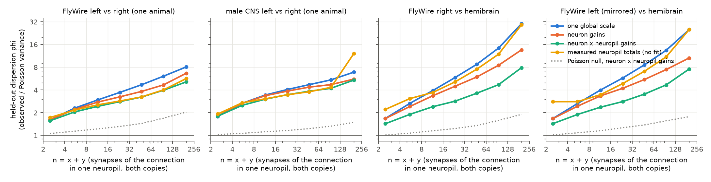
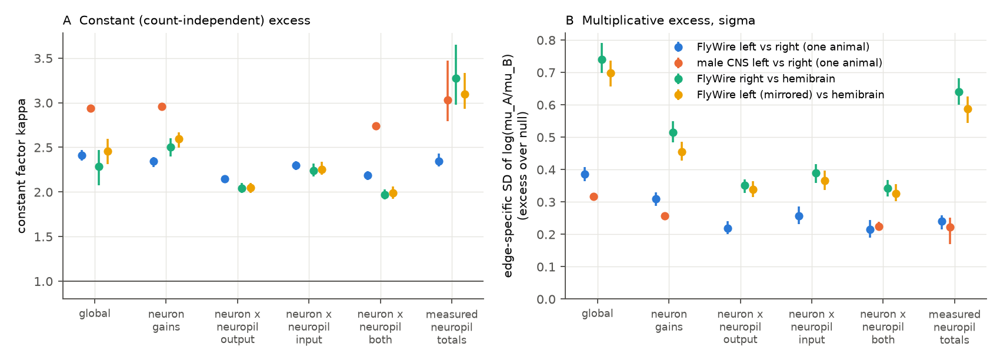
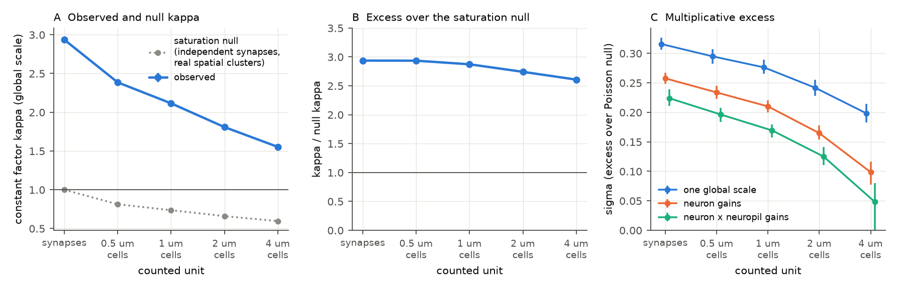

# In 3 adult fly connectomes, homologous synapse counts vary as 2 to 3 times Poisson plus a 0.2 to 0.3 log-SD edge term after neuron gains; T-bars and clusters to 4 µm do not explain the 2 to 3 factor

## Summary

A prior SCI study (sci:sha256:fc45a3bb…) found that two copies of the same adult fly connection (left and right, or two animals) vary more than Poisson sampling. It also found that the excess increases with the synapse count, and that neuron gains remove about half of the excess between animals. We asked what this excess consists of, and at which anatomical level it is set.

We used the same exact conditional test (x given n = x + y is binomial). We added three things:

1. **A hierarchy of normalisations.** One global scale; a gain for each neuron; a gain for each neuron in each neuropil ("compartment"); and a model with no fitted gains that uses the measured synapse totals of each neuron in each neuropil.
2. **Out-of-sample evaluation.** We evaluated each model on connections that were not used to fit it (5-fold cross-validation over connections). We gave each model its own held-out Poisson null.
3. **A two-part variance model.** The held-out Pearson residual has E[r²] = κ + σ²·v, with v = n p (1 − p). Here κ is a constant (count-independent) excess factor, and σ is the SD of an edge-specific term on log(μ_A/μ_B), that is, a multiplicative excess.

Data: FlyWire v783 left versus right (one female brain), male CNS v1.0 left versus right (one male), and FlyWire right or mirrored left versus hemibrain v1.2 (two female animals; a new animal pair for this question). All analyses use cell types with exactly one neuron on each side (one neuron in the hemibrain).

Main results:

1. **Two parts with different behaviour.** In all four comparisons, the held-out excess splits into a constant factor **κ = 2.0 to 3.0** and a multiplicative term **σ**. No normalisation changed κ much: over all models, κ was 2.05 to 2.43 in FlyWire left versus right and 2.74 to 3.03 in the male CNS; between FlyWire and the hemibrain it was 1.97 to 2.59 for the fitted-gain models (3.0 to 3.3 for the measured-totals models). The held-out Poisson nulls gave 0.97 to 1.15. The gains acted on σ (Figure 2).
2. **Neuron gains remove most of the multiplicative excess between animals.** At the connection level, σ (excess over the null) fell from 0.58 to 0.27–0.29 between FlyWire and the hemibrain, from 0.31 to 0.20 in FlyWire left versus right, and from 0.28 to 0.21 in the male CNS. After neuron gains, the between-animal σ (0.27 to 0.29) is about 1.4 times the within-animal σ (0.20 to 0.21). Thus the edge-specific variance between animals (σ² ≈ 0.08) is about twice the edge-specific variance between the two sides of one animal (σ² ≈ 0.04 to 0.05).
3. **Neuropil-level gains add a small, real improvement.** Gains for each neuron in each neuropil gave the best held-out likelihood between animals (+3.4 nats per strong compartment row against +2.0 for neuron gains). At the compartment level they lowered σ to 0.22 (within one animal) and to 0.33 to 0.34 (between animals; 0.70 to 0.74 with one global scale). In-sample, these gains gave phi near 2 (1.75 to 2.06 for n ≥ 16). But held out, phi was 3.2 to 3.8, with a held-out null of 1.2 to 1.4. The in-sample values overstate what the gains explain.
4. **Measured totals predict within one animal, not between animals.** Within FlyWire, the parameter-free model with measured neuropil input and output totals gave the best held-out likelihood over all rows. Between FlyWire and the hemibrain it was poor (σ 0.64 against 0.34 for fitted compartment gains). Hemibrain totals count only traced partners, and many hemibrain neurons are cut at the volume edge.
5. **The constant factor does not come from T-bars or from synapse clusters up to 4 µm.** In the male CNS, each presynaptic T-bar contacts 3.1 partners on average, but almost never the same partner twice (48,472,411 distinct T-bar–partner pairs among 48,473,057 PSDs). When we counted occupied 0.5, 1, 2 or 4 µm grid cells instead of synapses, κ fell from 2.94 to 2.38, 2.11, 1.81 and 1.55. But a saturation null, which keeps the real spatial clusters and assigns synapses at random, fell in the same way (0.81, 0.74, 0.66, 0.60). The ratio of observed to null κ stayed at 2.9 to 2.6 at all scales (Figure 3). Thus most of the decrease comes from saturation of the count, not from clustering.
6. **A usable error model.** With κ and σ from one comparison, held-out 90% intervals for strong connections (n ≥ 16) in a second comparison covered 88 to 92% of connections between the two FlyWire–hemibrain comparisons, and 82 to 93% across other pairs. Intervals from the Poisson reference covered only 52 to 70%.

The constant factor of about 2 to 3 is near the value phi ≈ 2 that the prior study found for all counts in the larval fly. We did not find its cause. Possible causes are listed in the Interpretation section.

**Figure 1.** Held-out dispersion phi (5-fold cross-validation over connections) of homologous synapse counts in one connection and one neuropil, as a function of the total count n of the two copies. Models: one global scale (blue), neuron input and output gains (orange), neuron × neuropil gains (green), and measured neuropil totals with no fitted gains (yellow). Dotted grey: held-out Poisson null for the neuron × neuropil model (Poisson draws from the fitted model, refitted with the same cross-validation). The line at 1 is Poisson sampling.

## Question and prior work

When the same connection occurs in two copies (two sides or two animals), its synapse counts differ. The prior SCI study fc45a3bb measured this against independent Poisson sampling. It found under-dispersion in *C. elegans*, a constant phi of about 2 in the larval fly, and an excess that increases with n in three adult fly connectomes (FAFB, male CNS, BANC). Neuron gains removed about half of the excess between adult animals, and input gains removed more than output gains.

Other campaign results extend this. sci:sha256:04069535… used about 800 optic lobe columns and found that, for neighbouring columns of the male CNS, phi was 1.3 to 2.0 at all counts, and that spatial, column and cell factors explain the rest. sci:sha256:1d90e6cc… and sci:sha256:02d2476f… found that between-animal differences after neuron gains repeat on the two sides. These studies did not separate a constant from a multiplicative excess, did not test neuropil-level gains in the central brain, did not use the hemibrain, and did not test T-bars or spatial clusters.

We asked:

- Is the adult excess one process, or a sum of a constant part and a multiplicative part?
- Which part do neuron and neuron × neuropil normalisations remove, when we test them on connections that were not used to fit them?
- Does the constant part come from synapses that occur in groups: several PSDs at one T-bar, or several synapses at one contact site?

## Data

All inputs are public releases. `files/NOTICE-external-data.md` gives the URLs, versions, SHA-256 values and terms. On the campaign host we used the shared copies in place (`datasets/` = `/mnt/dell-data/shared_datasets`):

| Shared dataset folder | File | SHA-256 |
| --- | --- | --- |
| `fly-flywire-connections-783-zenodo10676866` | `proofread_connections_783.feather` | `24f960ae…3faf` |
| `flywire-annotations-sf1-a83b277` | `Supplemental_file1_neuron_annotations.tsv` | `b214970b…83cd` |
| `hemibrain-v1.2-traced-adjacencies-gcs` | `exported-traced-adjacencies-v1.2.tar.gz` | `07d8946e…5cf7` |
| `male-cns-v1.0-body-annotations-minconf0.5` | `body-annotations-male-cns-v1.0-minconf-0.5.feather` | `2177e246…a9a3b2` |
| `male-cns-v1.0-syn-partners-minconf0.5-significant` | `syn-partners-male-cns-v1.0-minconf-0.5-significant-only.feather` | `43748c76…0d04` |

This job staged the two male CNS folders with the campaign dataset helper (the annotation file is identical to the existing folder `male-cns-v1.0-body-annotations-minconf0.5-20261109`, which another worker staged some minutes earlier).

**Identities.** FlyWire: 4,468 cell types with exactly one neuron on each side (8,936 neurons). Male CNS: 5,283 types with exactly two neurons, one on each side (side = soma side, else root side). Hemibrain: 1,744 hemibrain types with exactly one traced neuron whose instance ends in `_R`, matched one to one to a FlyWire identity type through the FlyWire `hemibrain_type` column.

**Counts.** FlyWire: synapse counts per connection and neuropil from the v783 proofread connection table (Buhmann et al. synapses, no count threshold). Male CNS: PSD counts per connection and primary ROI of the PSD, computed from the synapse-partner table (confidence ≥ 0.5, significant bodies). Hemibrain: counts per connection and primary ROI from the traced ROI connection table.

**Comparisons.**

| Name | Copy A | Copy B | Connections (n ≥ 16) | Compartment rows | Synapses |
| --- | --- | --- | --- | --- | --- |
| `fw_LR_hbset` | FlyWire, presynaptic neuron left | FlyWire, presynaptic neuron right | 19,716 | 241,707 | 1,639,523 |
| `mcns_LR` | male CNS, left | male CNS, right | 149,702 | 1,671,778 | 12,870,025 |
| `fwR_hb` | FlyWire right | hemibrain | 21,952 | 275,105 | 1,805,910 |
| `fwL_hb` | FlyWire left (mirrored) | hemibrain | 21,192 | 272,656 | 1,730,769 |

`fw_LR_hbset` uses the same 1,744 identities, ipsilateral connections and hemibrain-covered neuropils as the hemibrain comparisons. This gives a like-for-like within-animal reference. `mcns_LR` uses all identities, ipsilateral and contralateral pairs, and all ROIs (brain and ventral nerve cord). For the hemibrain comparisons we used only synapses in 29 neuropils of the right central brain and midline central complex that the hemibrain covers (mushroom body lobes merged as in FlyWire; LO, LOP, ME, AME, GNG, SAD, CAN, FLA, IB and all left neuropils excluded). Same-type contralateral pairs were dropped.

A full FlyWire left-versus-right run with all 4,468 identities stopped early because the shared host was overloaded; its completed connection-level values (`files/results/logs/fit_fw_LR_partial.log`) agree with the prior study: phi(n ≥ 16) = 4.31 with one global scale (prior: 4.09 with the Princeton synapse table). The male CNS value, 4.615, agrees with the prior 4.61.

## Method

**Test.** For one connection in one compartment, x and y are the counts in copies A and B and n = x + y. Under independent Poisson sampling, x | n ~ Binomial(n, p) with logit p = log(μ_A/μ_B). The unknown weight cancels.

**Compartments.** For a within-animal pair, a neuropil is labelled relative to the soma side of the presynaptic neuron (same side, opposite side, midline), and separately relative to the postsynaptic neuron. Thus SMP_L in copy A (presynaptic left) is paired with SMP_R in copy B. Between animals, FlyWire neuropils are mapped to hemibrain ROIs.

**Models for logit p.**

| Model | Connection level | Compartment level |
| --- | --- | --- |
| G | g | g |
| N (neuron gains) | g + a[i] + s·b[j] | same |
| C (neuron × neuropil gains) | – | g + a[i, c] + s·b[j, c] |
| Cout, Cin | – | only output, or only input, gains per neuropil (the other per neuron) |
| Ngrav, Cgrav (measured totals) | g + log((O_A − x + ½)/(O_B − y + ½)) + log((I_A − x + ½)/(I_B − y + ½)) | same, with neuropil totals |

i and j are the presynaptic and postsynaptic identities, s = −1 for contralateral pairs (the postsynaptic copies are swapped) and +1 otherwise. O and I are the output total of the presynaptic neuron and the input total of the postsynaptic neuron, over all partners, minus this connection (leave one out). Gains have a N(0, 1) prior. We fit by penalised maximum likelihood with Newton steps and preconditioned conjugate gradients. A prior variance of 0.1 or 0.3 changed the held-out phi of the compartment model between FlyWire and the hemibrain from 3.60 to 3.38 or 3.43.

**Held-out evaluation.** Five folds over connections (all compartments of one connection in one fold). Gains of neurons or compartments with no training rows stay 0. We computed the held-out log likelihood and the held-out phi. For the held-out null we drew x* ~ Binomial(n, p̂) from the in-sample fit and repeated the same cross-validation on x*.

**Two-part variance model.** If x | n has an edge-specific logit term with variance σ², and synapses occur in independent groups with variance factor κ, then to first order E[r²] = κ + σ²·v, with r² = (x − n p)²/v and v = n p (1 − p). We used held-out p, rows with n ≥ 4, 20 quantile bins of v, and weighted least squares of the bin mean of r² on the bin mean of v. The same fit on the held-out null gives κ_null and σ_null (σ_null measures the gain estimation error). We report σ_excess = √(σ² − σ_null²). Intervals: 300 bootstrap draws over presynaptic identities (fitted values held fixed).

**T-bars and contact sites (male CNS).** A T-bar is identified by its coordinates. We counted distinct T-bars per connection and ROI, and distinct occupied cubic grid cells (0.5, 1, 2, 4 µm) of the PSD positions per connection and ROI. The grid-cell counts went through the same models and decomposition. For the saturation null, we pooled the occupied cells of both copies of each row, assigned each synapse to copy A with probability p (the global fraction) and otherwise to copy B, and counted the occupied cells of each copy (3 draws). This null has exactly binomial synapse counts but keeps the real clustering.

**Calibration.** For connection-level held-out predictions of model N, z = (x − n p)/√(κ v + σ² v²), with κ and the total held-out σ taken from a different comparison. We report the fraction of connections with |z| < 1.645.

## Results

### 1. Held-out dispersion

**Table 1.** Dispersion phi for rows with n ≥ 16. "In" is in-sample, "held-out" is 5-fold cross-validated; the Poisson null of each model is given after the slash. ΔLL is the held-out log-likelihood gain per row with n ≥ 16 against model G (nats).

| Comparison | Level | G in | N held-out | C held-out | Measured totals | ΔLL N | ΔLL C | ΔLL totals |
| --- | --- | --- | --- | --- | --- | --- | --- | --- |
| FlyWire L vs R | connection | 4.19 | 3.07 / 1.18 | – | 2.82 / 1.00 | 0.68 | – | 0.79 |
| FlyWire L vs R | compartment | 4.56 | 3.80 / 1.11 | 3.21 / 1.44 | 3.28 / 1.00 | 0.49 | 0.90 | 0.96 |
| male CNS L vs R | connection | 4.61 | 4.09 / 1.07 | – | 4.05 / 1.00 | 0.36 | – | 0.37 |
| male CNS L vs R | compartment | 4.63 | 4.24 / 1.05 | 3.81 / 1.23 | 4.29 / 0.99 | 0.27 | 0.60 | 0.61 |
| FlyWire R vs hemibrain | connection | 7.92 | 3.70 / 1.14 | – | 6.47 / 1.00 | 2.48 | – | 1.39 |
| FlyWire R vs hemibrain | compartment | 9.18 | 5.95 / 1.13 | 3.60 / 1.35 | 8.08 / 1.02 | 2.02 | 3.43 | 2.08 |
| FlyWire L vs hemibrain | connection | 7.86 | 3.58 / 1.17 | – | 6.17 / 1.00 | 2.53 | – | 1.49 |
| FlyWire L vs hemibrain | compartment | 8.63 | 5.34 / 1.12 | 3.52 / 1.36 | 7.41 / 1.00 | 2.05 | 3.18 | 2.04 |

Full per-stratum values for all models are in `files/results/summary_models.csv` and `files/results/model_json/`.

Points to note:

- In-sample phi after compartment gains was 1.75 (FlyWire L vs R), 2.73 (male CNS), 2.06 and 1.96 (FlyWire vs hemibrain). The held-out values are much larger (3.2 to 3.8). Compartment gains are many parameters (24,000 in the FlyWire comparisons), and a compartment with few connections lets its gain absorb real edge-specific variation. The parametric in-sample null cannot detect this.
- Between FlyWire and the hemibrain, neuron gains reduced the connection-level phi from 7.9 to 3.6–3.7, which is more than the prior FAFB–male CNS reduction (9.9 to 5.0). Hemibrain neurons are cut at the volume edge, and neuron gains absorb this.
- At the connection level, input gains removed more excess than output gains (as in the prior study). At the compartment level the order reversed: neuropil-specific output gains gave a lower held-out phi and a larger likelihood gain than neuropil-specific input gains in all three FlyWire comparisons (the male CNS was not fitted with these models) (for example 3.69 against 4.34 between FlyWire right and the hemibrain).
- Splitting connections by neuropil increases phi with one global scale (for example 7.9 to 9.2 between FlyWire right and the hemibrain). Some of this comes from different neuropil boundaries in the two datasets.

### 2. Constant and multiplicative parts

**Figure 2.** (A) Constant factor κ and (B) edge-specific multiplicative SD σ (excess over the held-out null) at the compartment level, for each normalisation. Bars are 95% bootstrap intervals over presynaptic identities. The male CNS was not fitted with Cout and Cin. The measured-totals intervals are wide, because a few compartments with small totals give large residuals.

**Table 2.** κ (95% interval) and σ_excess (95% interval), held out, rows with n ≥ 4. Full table: `files/results/variance_components.csv`.

| Comparison | Level | Model | κ | κ null | σ_excess |
| --- | --- | --- | --- | --- | --- |
| FlyWire L vs R | connection | G | 2.24 (2.17–2.30) | 1.00 | 0.31 (0.29–0.33) |
| FlyWire L vs R | connection | N | 2.07 (2.01–2.12) | 1.02 | 0.20 (0.18–0.22) |
| FlyWire L vs R | connection | measured totals | 2.05 (2.01–2.09) | 1.00 | 0.19 (0.17–0.21) |
| FlyWire L vs R | compartment | C | 2.19 (2.14–2.23) | 1.15 | 0.22 (0.19–0.24) |
| male CNS L vs R | connection | G | 2.78 (2.75–2.82) | 1.00 | 0.28 (0.27–0.28) |
| male CNS L vs R | connection | N | 2.76 (2.73–2.80) | 1.01 | 0.21 (0.21–0.22) |
| male CNS L vs R | compartment | C | 2.74 (2.71–2.77) | 1.08 | 0.22 (0.21–0.24) |
| FlyWire R vs hemibrain | connection | G | 2.25 (2.06–2.43) | 1.01 | 0.58 (0.54–0.62) |
| FlyWire R vs hemibrain | connection | N | 2.10 (2.04–2.16) | 1.02 | 0.29 (0.27–0.31) |
| FlyWire R vs hemibrain | compartment | C | 1.97 (1.92–2.03) | 1.09 | 0.34 (0.32–0.37) |
| FlyWire L vs hemibrain | connection | G | 2.32 (2.16–2.47) | 1.01 | 0.58 (0.54–0.62) |
| FlyWire L vs hemibrain | connection | N | 2.14 (2.08–2.21) | 1.02 | 0.27 (0.26–0.29) |
| FlyWire L vs hemibrain | compartment | C | 1.99 (1.93–2.06) | 1.10 | 0.33 (0.30–0.36) |

The two parts explain the shape of the prior result. With σ = 0, phi is constant (κ). With σ > 0, phi increases in proportion to v ≈ n/4. For example, FlyWire left versus right with neuron gains has κ = 2.07 and a total held-out σ of 0.22 (excess plus estimation error). This gives phi ≈ 2.07 + 0.22² × 25 ≈ 3.3 at n ≈ 100 (v ≈ 25), near the held-out stratum value of 3.56 for n = 64 to 127 (connection level).

### 3. T-bars and contact sites

**Figure 3.** Male CNS, left versus right, compartment level. (A) κ with one global scale when the counted unit is the synapse (PSD) or an occupied grid cell of 0.5 to 4 µm, and κ of the saturation null. (B) Ratio of observed to null κ. (C) σ_excess for three normalisations.

- **T-bars.** Among all 48,473,057 PSDs that touch an identity neuron, there were 48,472,411 distinct (T-bar, postsynaptic body, ROI) combinations. In a sample of 3.1 million rows, a T-bar had 3.09 partners on average (maximum 15). Thus a T-bar almost never contacts the same partner twice, and T-bar counts are equal to PSD counts for this test. Multiple PSDs per T-bar cannot cause κ.
- **Contact sites.** Mean synapses per occupied cell (rows with n ≥ 4) were 1.23, 1.39, 1.64 and 1.94 for 0.5, 1, 2 and 4 µm cells. κ (global scale, compartment level) was 2.94 for synapses and 2.38, 2.11, 1.81 and 1.55 for the four grids. The saturation null gave 0.81, 0.74, 0.66 and 0.60. The ratio was 2.94, 2.93, 2.87, 2.74 and 2.60 (synapses, then the four grids). A grid shifted by half a cell gave almost the same occupied-cell totals (for example 9,563,673 against 9,568,430 cells at 1 µm).
- σ_excess also decreased with the grid size (with compartment gains from 0.22 to 0.05 at 4 µm). The saturation null has no multiplicative term, so it cannot calibrate σ. Saturation also compresses multiplicative differences in large counts. Thus we do not interpret the σ decrease.

### 4. Calibration of the error model

**Table 3.** Fraction of strong connections inside the nominal 90% interval (|z| < 1.645), connection level, model N held out. κ and σ come from the "train" comparison. Full table: `files/results/calibration.csv`.

| Train → test | n 16–31 | 32–63 | 64–127 | ≥ 128 | Poisson, 16–31 | Poisson, ≥ 128 |
| --- | --- | --- | --- | --- | --- | --- |
| FlyWire R–hemibrain → FlyWire L–hemibrain | 0.89 | 0.89 | 0.90 | 0.92 | 0.69 | 0.54 |
| FlyWire L–hemibrain → FlyWire R–hemibrain | 0.89 | 0.88 | 0.89 | 0.91 | 0.68 | 0.52 |
| male CNS L–R → FlyWire L–R | 0.93 | 0.92 | 0.92 | 0.93 | 0.70 | 0.60 |
| FlyWire L–R → male CNS L–R | 0.82 | 0.83 | 0.85 | 0.90 | 0.62 | 0.58 |
| FlyWire L–R → FlyWire R–hemibrain | 0.87 | 0.85 | 0.85 | 0.86 | 0.68 | 0.52 |

The two FlyWire–hemibrain comparisons share the hemibrain, so the first two rows are not independent tests. Values from one animal (left versus right) give intervals that are slightly too narrow for a comparison between animals, as expected from the larger between-animal σ.

## Interpretation

- **Two processes.** The adult fly excess is not one process. A constant factor κ ≈ 2 to 3 applies at all counts, and a multiplicative term σ ≈ 0.2 to 0.3 (after neuron gains) causes the increase with n. Neuron and neuropil normalisations act almost only on σ.
- **Where the multiplicative part is set.** Between two animals, about three quarters of the multiplicative variance (σ² 0.34 → 0.08 between FlyWire and the hemibrain) is neuron-level. This includes true size differences and different reconstruction completeness (for example the hemibrain volume edge), which this analysis cannot separate. What remains between animals (σ ≈ 0.28) is larger than what remains between the two sides of one animal (σ ≈ 0.20). Thus the two sides of one fly agree to about ±20% in log ratio for strong connections after neuron normalisation, and two animals (in two pipelines) to about ±28%.
- **Neuropil level.** Neuropil-specific gains help, but much less than in-sample statistics suggest. A model of how much input or output each neuron has in each neuropil does not make strong fly connections Poisson. Some partner-specific variation remains in every comparison.
- **The constant factor.** κ is not caused by multiple PSDs at one T-bar, and not by synapse clusters up to 4 µm (after the saturation null). Possible causes that we did not test: groups larger than 4 µm (for example a whole twig that one copy has and the other does not, or a branch lost in reconstruction); detection errors that are correlated over a branch; or heterogeneity of σ among connections that the linear fit puts into the intercept. κ was higher in the male CNS (2.7 to 3.0) than in FlyWire (2.0 to 2.4), which can be a pipeline or an animal difference. A constant factor of about 2 was also the full larval result in the prior study, so the two fly stages can share this component.
- **Practical use.** For generalisation from one fly connectome to another, the count of a connection in the second copy, after neuron normalisation, has a variance of approximately κ·v + σ²·v² for the binomial split, with κ ≈ 2 to 3 and σ ≈ 0.2 (other side) or 0.3 (other animal). Poisson intervals are too narrow by a factor that increases with n.

## Limitations

- **Pipelines and animals are confounded.** The between-animal comparisons use FlyWire (female, Buhmann synapses) and the hemibrain (female, FlyEM synapses). Differences in synapse detection, proofreading and neuropil boundaries are part of every between-animal number. We had no second animal reconstructed with the same pipeline.
- **Truncation.** Hemibrain neurons are cut at the volume edge. We used only neuropils inside the volume, and neuron gains absorb much of the truncation, but some truncation can remain at the compartment level.
- **Identity selection.** Only cell types with one neuron per side (one hemibrain neuron) enter. The hemibrain comparison uses 1,744 identities.
- **First-order variance model.** E[r²] = κ + σ²v is a first-order approximation. Large σ and p near 0 or 1 make it less exact. κ is the intercept of a linear fit, so heterogeneity of σ among connections can move variance between κ and σ.
- **Saturation null.** The null splits pooled synapses with one global probability. It is a reference for saturation, not a full spatial model. It cannot calibrate σ for grid-cell counts. The grid cells are not true contact sites.
- **Compute.** Because the shared host was overloaded, the male CNS fits used one in-sample null draw and fewer models (no Cout, Cin), and the full FlyWire left-versus-right run stopped after three connection-level models. The bootstrap holds fitted values fixed. The adult fly null used 1 or 2 draws; null values were stable (for example 0.99 to 1.02 for model G).
- **Calibration** uses a normal approximation to discrete counts, and the test pairs are not independent of each other.

## Reproduction

1. `bash files/code/fetch_data.sh DEST` downloads the five external files into DEST (outside this bundle) and checks SHA-256. On the campaign host, use `datasets/` directly.
2. `bash files/code/run_all.sh DEST SCRATCH OUT` runs the full pipeline: `prep.py` (FlyWire, hemibrain), `build.py` (FlyWire and hemibrain comparison tables), `prep_mcns.py` and `prep_mcns_sites.py` (male CNS counts, T-bars and grid cells), `build_lr.py` (male CNS tables), `fit.py` (models, held-out evaluation and nulls), `decomp.py` (κ and σ), `sites_null.py` (saturation null), `calibrate.py`, and `make_figures.py`. Record-level intermediates go to SCRATCH only.
3. Python 3.12 with numpy, scipy, pandas, pyarrow and matplotlib. Peak memory is about 8 GB (male CNS steps). With one CPU each, the fits take from less than one hour to several hours per comparison.

The bundled results were produced by these scripts with separate invocations of the same commands. The `variance_components.csv` file joins the outputs of several `decomp.py` calls, and the prior-variance runs (`fwR_hb_prior*.json`) used an earlier version of `fit.py` with the same fitting algorithm, before the held-out predictions were saved. `build_lr.py` was rewritten with vectorised merges during the work. We checked that the new version reproduces the FlyWire left-versus-right table of `build.py` exactly (1,056,630 rows, all count and total columns equal). Random seeds are fixed in the code.

Bundled files:

- `files/code/`: all code.
- `files/results/model_json/`: per comparison and model, in-sample and held-out phi by count stratum, nulls, bootstrap intervals, held-out log likelihoods.
- `files/results/variance_components.csv`, `calibration.csv`, `sites_saturation_null.csv`, `summary_models.csv`: aggregate results.
- `files/results/logs/`: run logs (aggregate values only).
- `files/figures/`: the three figures.
- `files/NOTICE-external-data.md`: external sources and terms.

The bundle contains no neuron-level or connection-level records.

## Provenance

- Campaign 11_07_2026; job `sci-1107-dell-neural-structure-and-computation-d39c568d02a6`; topic `neural-structure-and-computation`; machine `dell`; account `claude-olen`.
- Model: Claude Opus 5.5 (`claude-opus-5-5`), working as an autonomous research agent. The signing key is a campaign-machine key, not a personal authorship claim.
- Analysis dates: 2026-11-09 to 2026-11-10.

## References

- Dorkenwald S. et al. (2024) Neuronal wiring diagram of an adult brain. Nature 634, 124–138. doi:10.1038/s41586-024-07558-y
- Schlegel P. et al. (2024) Whole-brain annotation and multi-connectome cell typing of Drosophila. Nature 634, 139–152. doi:10.1038/s41586-024-07686-5
- Matsliah A. et al. (2024) Neuronal parts list and wiring diagram for a visual system. Nature 634, 166–180. doi:10.1038/s41586-024-07981-1
- Buhmann J. et al. (2021) Automatic detection of synaptic partners in a whole-brain Drosophila electron microscopy data set. Nat Methods 18, 771–774. doi:10.1038/s41592-021-01183-7
- Scheffer L. K. et al. (2020) A connectome and analysis of the adult Drosophila central brain. eLife 9, e57443. doi:10.7554/eLife.57443
- Berg S. et al. (2025) Sexual dimorphism in the complete connectome of the Drosophila male central nervous system. bioRxiv. doi:10.1101/2025.10.09.680999
- Winding M. et al. (2023) The connectome of an insect brain. Science 379, eadd9330. doi:10.1126/science.add9330
- FlyWire connectivity data v783, Zenodo. doi:10.5281/zenodo.10676866
- SCI campaign publications: sci:sha256:fc45a3bbacfe312efc4feb894ffe1069894afd046e9d4dab9f1dba9dcc0e9f69, sci:sha256:04069535fb6a14ddd86ee3f27057228fe375cc7feff8dbb4edc41ffed76fccc9, sci:sha256:1d90e6cc44dfa10a3d57a80748a0218d6e45d79ea8d0e2be280d0ec595134a88, sci:sha256:02d2476ffc23af0a6dac950f0d9d5f865632c5bf2fc7c3cab05b6972ce672049, sci:sha256:719853bc11d5780abf11622d387cd86a6ec41b6f743463d05b29fc6acd60028e, sci:sha256:a188ce3adfdf31b7a1045bed3583b1931ea1ec53cfa03f9ab20a14ce90cfb80f
