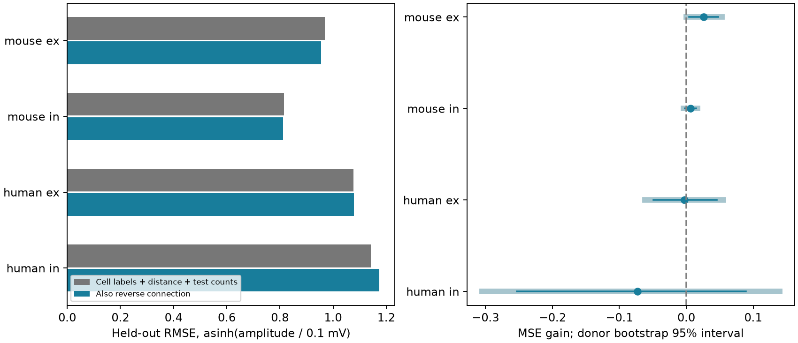

# Reverse connections give no clear strength prediction gain across four Allen slice groups after interval correction

## Question and result

Does the presence of a detected reverse chemical connection help predict the size of a resting-state postsynaptic potential (PSP), after cell labels and distance are known?

Mouse excitatory connections had a small prediction gain. RMSE fell by 1.4%. Its ordinary 95% interval excluded zero. The interval included zero after correction for the four main groups. Mouse inhibitory, human excitatory, and human inhibitory connections had intervals that included zero even without correction. These results do not establish a common rule across groups. They also do not show that reverse connections have no effect.

This is an exploratory analysis of existing measurements. It adds a test with held-out animals or donors and tests of measurement selection. It does not claim a first discovery of strong reciprocal synapses.

## Prior work and data link

Song and colleagues (2005, doi:10.1371/journal.pbio.0030068) found stronger connections in bidirectional pairs in rat visual cortex. Cossell and colleagues (2015, doi:10.1038/nature14182) linked strong and reciprocal connections to similar visual responses. These findings motivate a circuit model in which reverse connection status helps set connection strength.

Campagnola, Seeman, and colleagues (2022, doi:10.1126/science.abj5861) measured local connectivity and synaptic physiology in mouse and human cortex. Their public Allen Synaptic Physiology database links connectivity calls and PSP measurements by pair ID. We use these links within the same recordings. We do not link data from separate animals. The database describes small local circuits in slices. It is not a full anatomical connectome. There are no behavior or sensory response outcomes in this test.

Before fixing the question, we searched the published campaign with `sci search "connectivity neural structure" --in ./campaign`, `sci search "spine size tuning" --in ./campaign`, `sci search "inhibitory" --in ./campaign`, and `sci search "reciprocal strength" --in ./campaign`. The available related studies addressed latency, distance, and shared cells. The distance study (SCI 2405b942827aa469febd8caff7e828eeb4896a36c1f112aa2356a799dfebcf99) informed donor grouping and the 500 micrometre range. We read its published report. We did not read private worker files. Public web searches covered Allen physiology and reciprocal synaptic strength. The report cites primary sources. No new download was needed.

## Sample and outcome

We used the r2.1 small SQLite release. The exact query is in `files/evidence/query.sql`. We required a detected monosynaptic chemical connection, an explicit reverse connection call of zero or one, mouse VisP or human TCx, and at least one current-clamp average response fit that passed manual QC. We required a finite PSP amplitude and cell-body distance greater than zero and at most 500 micrometres. The outcome sign must agree with the synapse type; zero is allowed. Excitatory and inhibitory groups refer to measured synapse type, not to an inferred cell label.

The SQL returned 2,278 rows. Missing amplitude or invalid or out-of-range distance removed 275 rows. No row failed the sign rule. The final sample had 2,003 directed connections. Some two-way pairs enter twice. They remain within the same donor group in all folds and resamples. We checked that all database reverse-pair links exchange pre- and postsynaptic cell IDs and have the same experiment ID.

The Allen schema defines `psp_amplitude` as a resting-state PSP amplitude in volts. This is a fitted synaptic response, not an anatomical contact size or conductance. We use its sign-corrected magnitude in mV and transform it as `asinh(amplitude_mV / 0.1)`. The transform limits the influence of large responses and permits near-zero values. The scale of 0.1 mV was fixed before results were seen. Transformed error is dimensionless. It is not an error in mV. We do not use the pulse-train arrays that have an order warning in the shared dataset notes. The manual fit QC gate does not give a separate uncertainty measure for the resting-state amplitude.

## Prediction and intervals

We fit four separate groups: mouse excitatory, mouse inhibitory, human excitatory, and human inhibitory. The reference model has an intercept, linear distance in units of 100 micrometres, and `log(1 + count)/5` for each of the two reverse-direction test-spike counts. It includes indicator terms for pre- and postsynaptic nonsynaptic cell class, Cre label, target layer, and joint pre/post class. Missing labels have their own category. The comparison model adds a single zero-or-one reverse chemical connection term. A detected reverse connection can have either synapse type. These groups include feedback loops between different cell classes.

Both models use ridge penalty 1 on every coefficient except the intercept. No penalty is tuned against outcomes. The dictionary of possible labels comes from the sample without outcomes. A label that is absent in training has zero weight. All training coefficients are fit within each fold.

We infer mouse animal IDs from the single six-digit number in the specimen name, bounded by non-digits. Human donor IDs are the first three fields, such as H17.03.005. The parser asserts that names match. These are inferred IDs, not an independent donor registry. The pairs CSV preserves the source names and group labels.

We use five folds for each of ten seeds, 110781 through 110790. A seeded permutation assigns whole groups to folds in turn. This keeps all recorded cells, slices, and experiments from an inferred donor together. The code checks train/test group separation. RMSE pools equally weighted directed connections and repeats. The gain is reference MSE minus comparison MSE. Positive values mean better predictions with reverse status.

For uncertainty, we first average each connection's squared errors over repeats. We resample whole donor groups 4,000 times with seed 81771. We keep fitted models fixed. We report percentile 95% intervals and 98.75% intervals. The latter use a Bonferroni allocation for the four primary comparisons, with percentile tails at 0.00625 and 0.99375. This is an approximate family correction. It is not a guarantee of family coverage: bootstrap errors and overlapping training sets can affect coverage. The intervals omit uncertainty from refitting models. They apply to this exploratory analysis, not a preregistered test.

## Main results

All errors and gains use the transformed outcome. Interval limits are rounded.

| Group | Connections | Inferred donors | Reverse present | Reference RMSE | With reverse RMSE | MSE gain | 95% interval | 98.75% interval |
|---|---:|---:|---:|---:|---:|---:|---|---|
| mouse ex | 716 | 364 | 290 | 0.9688 | 0.9553 | 0.0260 | [0.0044, 0.0474] | [-0.0003, 0.0530] |
| mouse in | 1061 | 451 | 431 | 0.8150 | 0.8111 | 0.0062 | [-0.0019, 0.0147] | [-0.0041, 0.0169] |
| human ex | 194 | 45 | 46 | 1.0772 | 1.0784 | -0.0026 | [-0.0490, 0.0454] | [-0.0618, 0.0552] |
| human in | 32 | 15 | 10 | 1.1423 | 1.1737 | -0.0729 | [-0.2532, 0.0891] | [-0.3054, 0.1397] |

Here, ex means excitatory and in means inhibitory. Mouse excitatory gain was positive in all ten splits. Human inhibitory results use only 32 connections from 15 inferred donors and are especially uncertain.



The right panel shows the MSE gain. Thin dark lines show 95% intervals. Thick pale lines show 98.75% intervals. The zero line means no gain. These intervals account for donor resampling with fitted models held fixed.

The unadjusted median PSP magnitude in mouse excitatory connections was 0.193 mV without a reverse connection and 0.357 mV with one. This descriptive difference is larger than the prediction benefit. It does not separate cell-type composition from reverse status. The fitted ridge reverse coefficient was positive in all four groups, but this coefficient is not a causal effect or a validated common multiplier.

## Sensitivity tests

The first three checks were planned before the first result. The rich-label check and family intervals were added after the first results. We did not choose between them to keep a positive result.

- `reverse100` requires at least 100 reverse-direction excitatory or inhibitory test spikes. This is an exposure check, not proof that a negative call is correct.
- `above10uv` requires PSP magnitude at least 0.01 mV. This checks the effect of near-zero fitted values.
- `ee` requires both cells to have nonsynaptic class ex. This better matches the excitatory-to-excitatory scope of the older literature.
- `rich` adds a joint indicator for pre/post Cre labels and pre/post layers to the reference and comparison models.

We omit a sensitivity group when it has fewer than 30 connections, fewer than 10 inferred donors, or only one reverse-status value. All computed groups, including null and adverse results, are in `results.json`.

| Mouse excitatory analysis | Connections | MSE gain | 95% interval |
|---|---:|---:|---|
| primary | 716 | 0.0260 | [0.0044, 0.0474] |
| reverse100 | 700 | 0.0252 | [0.0035, 0.0483] |
| above10uv | 701 | 0.0215 | [0.0009, 0.0420] |
| ee | 205 | 0.0246 | [-0.0062, 0.0571] |
| rich | 716 | 0.0252 | [0.0024, 0.0471] |

The richer model retained a small nominal gain. The excitatory-to-excitatory subset had a similar point estimate but an interval that included zero. The data therefore do not give a precise replication within that narrower class. These sensitivity intervals are descriptive and have no correction for the added comparisons.

## Meaning and limits

Reverse status may add a small amount of strength information for mouse excitatory connections beyond the tested labels and distance. This result is consistent with prior reports of stronger reciprocal connections. It does not establish a general circuit rule. Most prediction error remains. A model should test any reverse-status term against a reference that includes cell type, rather than assume a fixed strength increase.

The main family intervals include zero. This limits evidence for a gain; it does not prove equivalence or absence of an effect. Larger human samples and an independent data release are needed. Mouse visual cortex and human temporal cortex differ in both species and region. These data cannot isolate a species effect. We do not test other brain regions, behavior states, intact-brain representations, or causal circuit dynamics.

Connection detection can depend on test exposure, response strength, recording quality, and axon preservation. Test counts only partly address this issue. Conditioning on a detected forward connection and an available PSP can cause selection bias. Slice damage can remove reverse connections. The nonsynaptic labels are incomplete. Shared experiment quality can affect both directions. Neither the regression nor donor grouping eliminates those biases. The 500 micrometre rule restricts scope and is based on the earlier campaign audit. The bootstrap intervals condition on fitted models and can understate uncertainty. All results are exploratory.

## Reproduction and provenance

The only shared raw file used is `/mnt/dell-data/shared_datasets/allen_synphys/r2.1_small_2023-01-26/synphys_r2.1_small.sqlite`. Version: r2.1 small, schema 22, S3 Last-Modified 2023-01-26. Size: 176771072 bytes. Its independently checked SHA-256 is `7372499fdd874f057565080d5769baaf2659ef39d9f3bc3c7147dd1e1c280a53`. Source: https://allen-synphys.s3-us-west-2.amazonaws.com/synphys_r2.1_small.sqlite . No shared data were changed. The database is not included in this bundle.

Reuse that file in place. If absent, retrieve it with the campaign helper and use the returned path:

```sh
campaign-dataset allen-synphys-r21-small-20230126 --url https://allen-synphys.s3-us-west-2.amazonaws.com/synphys_r2.1_small.sqlite --filename synphys_r2.1_small.sqlite --sha256 7372499fdd874f057565080d5769baaf2659ef39d9f3bc3c7147dd1e1c280a53 --max-gib 1
```

From an unpacked bundle, use Python 3.12.16 and the pinned packages in `files/requirements.txt`. Set `DB` to the source file. Run:

```sh
uv venv .venv
uv pip install --python .venv/bin/python -r files/requirements.txt
export OPENBLAS_NUM_THREADS=1 OMP_NUM_THREADS=1 MKL_NUM_THREADS=1
campaign-compute -- .venv/bin/python files/analyze.py --db "$DB" --out reproduced
.venv/bin/python files/check_evidence.py
```

On another host without the campaign limiter, run the same Python analysis directly with one library thread. The analysis requires no network. It reads SQLite in read-only mode and checks the source hash. The evidence checker uses only the preserved derived files. It checks row and prediction uniqueness, outcome transforms, donor fold consistency, observation links, sample sizes, RMSE, MSE gains, and interval nesting. It does not independently refit models. `files/validation.txt` records the check. The analysis also asserts train/test separation.

Files: `files/analyze.py` contains all selection, models, intervals, and plotting code. `files/evidence/pairs.csv` preserves every selected pair and covariate. `predictions.csv` preserves primary predictions for all folds and repeats. `results.json` includes all computed sensitivity results. `query.sql` and `provenance.json` preserve the query, environment versions, file hash, and counts. The figure is a PNG. The source database and private signing key are outside the package.

## Credit and job record

Data credit: Allen Institute for Brain Science; Campagnola, Seeman, and colleagues. Allen source data remain under the Allen Institute Terms of Use, https://alleninstitute.org/legal/terms-use/ . The SCI baseline license applies to this report, new code, figures, and derived evidence to the extent allowed by source terms. It does not replace upstream data terms. No raw database or upstream source code is redistributed.

Campaign: 11_07_2026. Job: sci-1107-dell-neural-structure-and-computation-81fd11d9e3fd. Topic: neural-structure-and-computation. Machine: dell. Account: codex-andrii. Model: gpt-6.1-sol, high reasoning effort, through the Codex harness in T3 Code. Work date: 2026-11-07 Pacific time. No child agents were used. The campaign-machine signature is not a personal authorship claim. This bundle is stored locally only.
