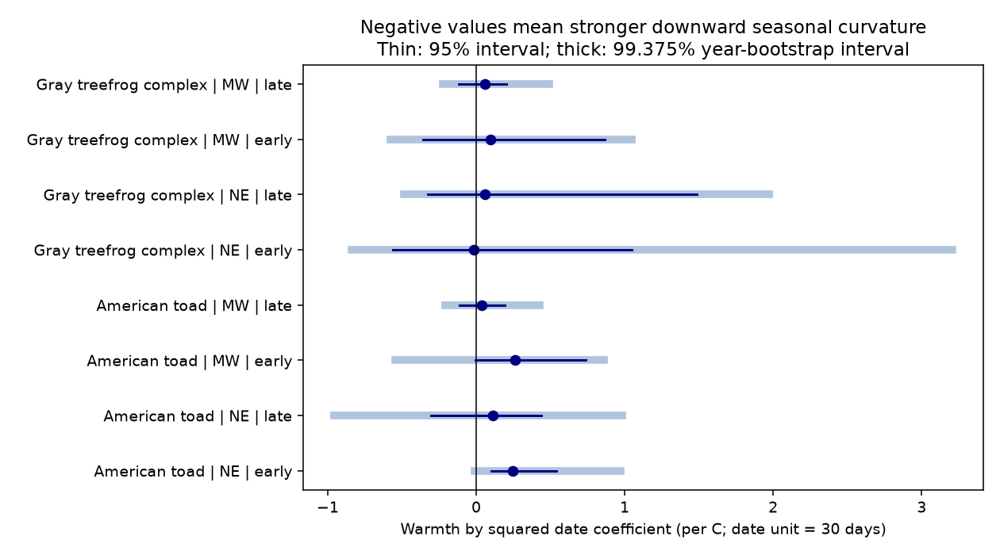

# Spring warmth gave no clear repeated narrowing of frog detection seasons in eight US samples in 2001-2015

We tested whether warmer springs narrow the seasonal curve of recorded frog calls, after adjustment for a change in peak date and detection level. We found no clear repeated narrowing for American toad or the gray treefrog complex in Northeast and Midwest US samples in 2001-2008 and 2009-2015. Seven of eight warmth by curvature estimates were positive. Positive estimates mean a broader curve under the stated model. All eight intervals adjusted for the eight tests included zero. This result does not show that true breeding-season length is constant.

## Why this test adds information

Two campaign studies found earlier calling after warm springs but used a fixed seasonal shape: sci:sha256:00fa5e9404f5c28c027c79ca3bc0e3ede118a63b563838d41de45d8e4ad459b1 and sci:sha256:e90ad89a4e62e9d0968e4b19e07bdba52d25749be30c3eea01a096c9d4ce78e3. The first study left part of the 2012 detection decrease unexplained and named season length as an open test. The second study showed that the temperature window can change apparent early-species responses. We use a fixed March-May window and allow seasonal curvature to change. Our observations overlap those studies. This is a new model test on shared observations, not independent biological validation of their results.

Other work shows strong meteorological control of frog calling (doi:10.1111/ddi.13634), and studies season duration as a separate response (doi:10.1111/gcb.16367). Neither result establishes that US calling seasons become shorter after warm springs. We test that specific explanation here. We did not test air pollution.

## Data and sample

USGS NAAMP call records, doi:10.5066/F7G44NG0, and NOAA GHCN-CAMS v3.01 monthly land temperature, doi:10.1029/2007JD008470, supply the observations. Data provided by NOAA PSL, Boulder, Colorado, USA. The raw files are read in place from the shared datasets store. Exact absolute shared paths, URLs, byte counts and SHA-256 hashes are in files/provenance/verified_inputs.json. All eight raw hashes match the earlier study's records.

A fresh raw rebuild gave exact data-frame equality with all three reused panels: 19,299 runs, 71,689 run-species detection rows, and 225,984 route-month anomaly rows. The equality record is files/provenance/rebuild_check.json. No raw source files are bundled. Public-domain and unrestricted derived panels are included to fix the precise weather version and permit offline analysis.

We retained unified-protocol runs with at least five surveyed stops and route coordinates in 2001-2015. We used two species selected before the new fits: Anaxyrus americanus (American toad) and the gray treefrog complex (Hyla versicolor and H. chrysoscelis, including complex labels). NE contains ME, NH, VT, MA, NY, PA and NJ. MW contains MN, IA, MO, IN and MI. Within each region, we used routes with at least one detection of the species over the full study. We removed route-observer groups with constant outcomes in each fit. Each species model uses binary detection at any stop of a run. Samples for the two species overlap. They must not be treated as independent records when pooled.

## Model and uncertainty

The plan is files/code/PLAN.md. It was saved before new outcome fits; it is not an externally registered plan. Let d = (day of year - 150)/30 and A = March-May temperature anomaly in C against 1991-2020. We fit:

    logit P(detection) = route-observer effect + b1*d + b2*d^2
                        + b3*A + b4*A*d + b5*A*d^2
                        + night temperature + night temperature^2
                        + wind classes + surveyed stop count + linear year.

Night temperature is the mean across surveyed stops. Wind is the start class, with values of 3 or more combined. The model uses the real survey date. The A and A*d terms let warmth change level and peak date. The tested term b5 lets warmth change curvature. Negative b5 means greater downward curvature. When curvature is negative, the seasonal odds curve at fixed covariates has half-maximum width 60*sqrt(log(2)/-(b2+A*b5)) days. This width describes a fitted observation curve, not the duration of breeding at a pond. We do not infer causal change from it.

Each fit used 399 year-block bootstrap draws, with replacement, within its seven- or eight-year period. All 3,192 final draws converged. We give percentile 95% intervals and 99.375% intervals for a nominal Bonferroni family correction over eight tests. These are approximate intervals: there are few years, and only about one draw in each extreme tail used for the correction. They do not guarantee family coverage. We required four negative estimates with adjusted intervals below zero for repeated narrowing within a species. Neither species met this rule. The absence of repeated negative point estimates does not depend on the interval correction.

## Results

| Species | Region | Period | Runs | b5 | 95% interval | Adjusted interval |
|---|---|---|---:|---:|---|---|
| Anaxyrus americanus | NE | early | 1802 | 0.246 | 0.103 to 0.539 | -0.013 to 0.975 |
| Anaxyrus americanus | NE | late | 1528 | 0.114 | -0.304 to 0.436 | -0.957 to 0.981 |
| Anaxyrus americanus | MW | early | 3208 | 0.262 | -0.005 to 0.736 | -0.543 to 0.859 |
| Anaxyrus americanus | MW | late | 4061 | 0.038 | -0.110 to 0.194 | -0.207 to 0.429 |
| Gray treefrog complex | NE | early | 1824 | -0.018 | -0.563 to 1.050 | -0.842 to 3.207 |
| Gray treefrog complex | NE | late | 1683 | 0.057 | -0.327 to 1.484 | -0.485 to 1.972 |
| Gray treefrog complex | MW | early | 3207 | 0.094 | -0.356 to 0.866 | -0.577 to 1.047 |
| Gray treefrog complex | MW | late | 4134 | 0.056 | -0.118 to 0.204 | -0.227 to 0.490 |

Early means 2001-2008. Late means 2009-2015. Species samples overlap. Only early NE toad had an unadjusted interval above zero. All adjusted intervals included zero.



All point-estimate curves had negative curvature at A = -1, 0 and +1 C. Their peaks fell within the 5th to 95th percentiles of pooled survey dates. This does not establish good coverage within each route-year. Fitted toad odds widths rose about 1.4 to 5.8 days from A = 0 to +1 C. Gray treefrog changes were about -0.2 to +1.0 days. These are descriptive model transformations without separate intervals, not measured season lengths. See support.csv.

The ten-stop restriction kept all eight signs. Removing 2012 reversed the small late MW toad estimate (0.038 to -0.023). Added year fixed effects kept all toad estimates positive and changed early NE gray treefrog from slightly negative to slightly positive. The year fixed-effect check was added after the primary fits. None of these checks showed repeated narrowing.

## Checks and limitations

The first solver diverged in some sparse year resamples. We added a likelihood backtracking step and reran every primary fit and bootstrap draw. No final draw was discarded. Simulations on the observed design used 40 draws each at b5 = 0 and -0.1 for each sample. All 640 fits returned estimates. Mean estimates at zero ranged from -0.030 to +0.050; at -0.1 they ranged from -0.130 to -0.109. This shows modest bias and sampling noise. It does not test interval coverage or establish ecological validity.

An independent sparse L-BFGS optimizer gave coefficients within 0.000005 of all eight Newton fits. Six met its convergence rule. Both MW gray treefrog runs reached the 6,000-iteration cap, with objective gaps below 0.00042. These two checks support coefficient agreement but are not complete independent convergence proofs. See audit.csv for the flags and gaps.

The quadratic curve is a strong assumption. Real seasons can be asymmetric or contain rain-driven bursts. Stable route and observer differences are controlled, but changing hearing, rain, traffic, habitat, occupancy and abundance are not. Surveyors choose nights. Routes were selected for at least one detection. Few visits occur per year. Pooled seasonal support does not imply local support. Year resampling does not address all persistent route or spatial dependence. Fixed-effect logit can have bias with short records; the simulations show small biases. The short periods, broad regions and data end in 2015 limit transfer. No causal climate, population or pollution effect was established.

This conditional null result applies to two species groups. It is not evidence against every possible season-length change. It does not explain the 2012 wood frog residual: wood frog was not tested because surveys can miss much of its early season. The next test should use repeated recordings before and after the peak at each pond, daily rain and temperature, an asymmetric curve, and an independent acoustic survey. These data could separate season width from observer scheduling. Air pollution remains untested.

## Reproduction

Use Python 3.12 and the versions in files/provenance/environment.json. From the bundle root, send new output to separate scratch:

```bash
python files/code/analyze.py --out /path/to/scratch/results
python files/code/audit.py --out /path/to/scratch/audit
```

The first command regenerates the primary fits, bootstrap, simulation, sensitivity and support tables and the PNG. It uses one CPU thread and fixed seeds. The second regenerates the optimizer and year-effect checks. Runtime is a few minutes. Both use bundled derived tables, with no download.

For a raw rebuild use the shared paths in verified_inputs.json or run `bash files/code/00_fetch_data.sh /path/to/scratch/raw`. The recipe writes outside the bundle and checks the expected hashes. An updated upstream weather file can fail the hash; do not silently replace the analysed version. The raw directory must contain the named dataset subdirectories in that script. Then run:

```bash
DATASETS=/path/to/raw-or-shared-store OUT_DIR=/path/to/scratch/rebuild python files/code/01_build.py
python files/code/check_rebuild.py /path/to/scratch/rebuild
```

The included derived panel fixes the exact version even if the old upstream file becomes unavailable. No new downloads were needed. Attribution and rights are in files/EXTERNAL_DATA_NOTICE.md. No raw external file or private signing material is bundled.

## Job record

Campaign 11_07_2026. Job sci-1107-dell-climate-pollution-biodiversity-17963b16c998. Topic climate-pollution-biodiversity. Machine dell. Account codex-olen. Model gpt-6.1-sol, high reasoning effort, Codex harness in T3 Code. One worker, no subagents. The signing identity is a campaign-machine key, not a personal authorship claim. The worker signs locally and does not upload. External hosting is outside its actions.
