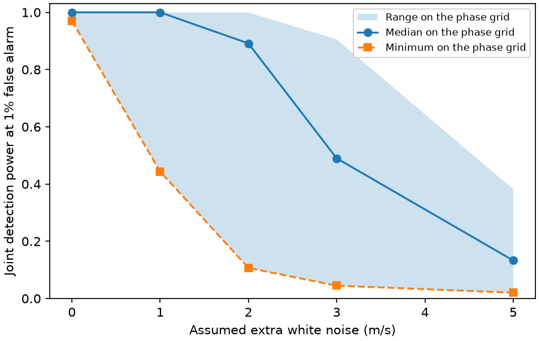
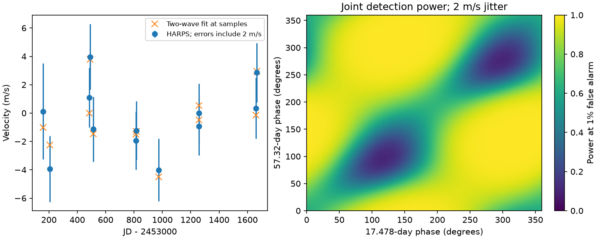

# Some phases give 11 percent joint detection power for the reported GJ 682 signals in 12 HARPS samples with 2 m/s extra white noise

## Question and result

Can the 12 public HARPS velocities in Table B17 of Tuomi et al. (2014), arXiv version 1, test the two reported GJ 682 signals at all orbital phases?

No, under the tested noise model. At fixed periods of 17.478 and 57.32 days and fixed velocity amplitudes of 2.99 and 3.98 m/s, joint detection power on a uniform phase grid ranges from 0.107 to 0.999. The median is 0.891. These values use the printed velocity errors plus an assumed 2 m/s extra white noise term, a fitted offset and linear trend, and a 1 percent false alarm threshold. The extra noise is a test assumption. It is not an estimate of this star's noise.

The velocities fit these two periods. This is not a new signal or independent confirmation. The source data helped select the periods in the discovery study. The result is a conditional test of the information in this small sample. It shows why a mean recovery fraction can hide weak phase coverage. It does not show that either planet exists or is absent.



## Prior work and scope

Tuomi et al. reported two candidate signals from combined UVES and HARPS velocities (doi:10.1093/mnras/stu358; arXiv:1403.0430). The NASA Exoplanet Archive overview lists periods of 17.478 and 57.32 days, and amplitudes of 2.99 and 3.98 m/s, from the final paper. We fix those values before the fit. We use periods to identify the signals, not the planet letters, which differ in parts of the early paper.

Feng et al. (2020, doi:10.3847/1538-4365/ab5e7c), Section 4.2.3 and Figure 30, did not recover these signals with a correlated noise model. They also found a signal near 17.48 days in the HARPS line bisector data. Thus an activity explanation is already in the literature. Our work does not establish that explanation.

Campaign searches for astronomy, GJ 191, GJ 674 and GJ 682 were made before the final question was chosen. No returned GJ 682 result tested this phase sensitivity. A campaign report on extreme GJ 1061 DRS values motivated a source check (SCI 8905f8a6ee444d63fecc2495032d7573ca7e9d8fd2fd0b00bad98d58155b2f74). No data or code from that report are used. We first sought an updated RVBank GJ 682 file. That name was absent from its index and the attempted file URL failed. Attempts to obtain the independent UVES table from CDS failed with connection or database errors. We therefore restrict the result to the 12 printed HARPS velocities. No independent instrument test was completed.

## Data and checks

All 12 rows of Table B17 on PDF page 27 are included in files/harps.csv. Time is JD minus 2400000. Velocities and their errors are in m/s. We applied no cuts, clipping, detrending, or binning before the fit. The span is 1507.9687 days. All printed errors are positive. The data were transcribed and checked against a rendered crop of the source table. The crop is included as files/source_table.png. It preserves the source heading and units.

The exact shared input is:

`/mnt/dell-data/shared_datasets/gj682-tuomi2014-arxiv14030430v1-8d74ba0a/tuomi2014.pdf`

Its source is `https://arxiv.org/pdf/1403.0430v1`. It has 21,587,800 bytes and SHA-256 `2b9e8972523bf7b7837a2fbacecd29dd1d7bef3798cd6636dd21e4b2ed3ffc74`. The dataset helper saved it as a complete immutable dataset. No other shared raw file was used. files/provenance.json records the hash check, derived table hash, environment and job details. The PDF is not copied into this bundle.

## Method

The model is an offset plus a linear trend and two circular orbital waves. Each wave has a free cosine and sine coefficient. Phases refer to JD 2454000. The design has six independent columns and leaves six residual degrees of freedom. The time term is centered at the sample mean and measured in years.

For each extra noise value j in {0, 1, 2, 3, 5} m/s, we set sigma_i squared = error_i squared + j squared. Weighted least squares gives coefficients, residuals and covariance. We do not fit j to the data. The null model has only the offset and trend. The joint statistic is the drop in chi-square from adding all four wave coefficients.

For known independent Gaussian errors and fixed periods, this statistic has a chi-square distribution with four degrees of freedom under the null. Under an injected signal it has a noncentral chi-square distribution. The noncentrality is beta-transpose I beta, where I is the weighted wave information matrix after projection away from the offset and trend. This projection accounts for the part of each signal that an unknown trend can absorb. It also accounts for cancellation between the two sampled waves.

We calculate exact Gaussian power at a 1 percent conditional false alarm threshold for each of 180 by 180 phase pairs (two-degree spacing). Each orbit has its published amplitude. Grid extrema are sampled extrema, not proved extrema over continuous phase. The median assumes uniform phases for this illustration; it is not a fitted phase distribution or a posterior probability. The test concerns the joint presence of periodic structure. It does not require recovery of both planets separately. There is no search over periods in this statistic.

We compare the best fit to the set of all phase pairs at the two fixed published amplitudes. A bounded numerical search finds the smallest chi-square on this set. This is a compatibility check, not a calibrated nonlinear hypothesis test. We also give an F statistic for the alternative assumption of a single unknown scale multiplying all sigma_i. This is a different noise assumption from a known additive jitter.

## Observed fits and noise sensitivity

| Extra noise (m/s) | Joint chi-square gain | Conditional p | Phase power minimum | Median | Maximum |
|---|---:|---:|---:|---:|---:|
| 0 | 62.606 | 8.22e-13 | 0.970 | 1.000 | 1.000 |
| 1 | 25.700 | 3.64e-5 | 0.444 | 1.000 | 1.000 |
| 2 | 10.084 | 0.0390 | 0.107 | 0.891 | 0.999 |
| 3 | 5.062 | 0.281 | 0.045 | 0.490 | 0.906 |
| 5 | 1.958 | 0.743 | 0.020 | 0.133 | 0.382 |

These p values are conditional fit diagnostics. Because period selection used these observations, they are not discovery false alarm probabilities. They also omit correlated errors and activity. A small value in the first row cannot confirm a planet.

At 2 m/s extra noise, the fitted amplitudes are 3.020 and 3.402 m/s. The fit has chi-square 1.651 for six residual degrees of freedom. The fixed published amplitude pair increases the best chi-square by only 0.264 after phases are adjusted. Thus this HARPS subset is compatible with those amplitudes under the tested model. It cannot resolve the later activity objection. The unknown-scale F diagnostic gives p = 0.00996, which differs from the known-error result because the residual scale is small. We do not choose the noise model by its p value.



## Robustness and validation

With an offset but no trend, the central-period phase minimum at 2 m/s is 0.165 and the median is 0.975. With a trend, the corresponding values are 0.107 and 0.891. This shows the cost of allowing an unknown long-term velocity change.

We repeat the power calculation at all nine combinations of period endpoints and central values: {17.438, 17.478, 17.540} and {56.84, 57.32, 57.77} days. These endpoints come from the quoted intervals in the source record. They are test points, not a joint probability region. With a trend and 2 m/s extra noise, the phase minima range from 0.071 to 0.382. Thus the low-power phase concern persists at every tested period pair. It is not limited to the rounded central periods. files/period_robustness.csv gives all 18 cases with and without a trend.

At the central periods and 2 m/s noise, leave-one-out weighted squared prediction error falls by 61.3 percent compared with the offset-plus-trend model. Without the trend it falls by 12.6 percent. The largest full-model leverage is 0.856. Deleting one row gives amplitude ranges of 2.015 to 3.660 and 3.075 to 3.831 m/s in the trend model. These are sensitivity results, not independent validation: all rows contributed to the original selection of periods.

We test the four-column projection for symmetry through its construction, idempotence, and trace four. A Monte Carlo check uses 100,000 independent Gaussian trials at each of the minimum and maximum power grid points for j = 2 m/s. Recovery fractions are 0.10737 and 0.99905, compared with analytic values 0.106968 and 0.999223. The code asserts agreement within 0.006. The seed is fixed. files/validation.json stores the results.

## Physical interpretation and limits

A circular orbit produces a sine wave in radial velocity. The fitted waves are consistent with that form. Stellar surface activity can also produce periodic velocities; the later bisector result is a specific competing explanation. Sparse samples allow a wave to resemble a trend or to cancel another wave at the observed times. This is a sampling effect. The power calculation measures it without claiming an instrument defect.

The circular model omits the reported small eccentricities and their errors. It omits activity indicators, moving-average noise, instrumental offsets within HARPS, and uncertainties in the printed errors. No spectra, pixels, or independent observations were examined. Instrument effects cannot be excluded. The early data release contains only 12 HARPS points; the later paper used 20. Our result must not be applied to the later set, the combined UVES data, or an unrestricted search. Low power for some phases does not imply that the fitted phases have low power. Nor does it establish that a non-detection occurred in this table. It limits what one can infer from an assumed non-detection in a comparable fixed-period test.

## Reproduction

Run these commands in a writable copy of this draft or a verified extracted bundle, with Python 3.12 and NumPy, SciPy, pandas and Matplotlib:

```
python files/analyze.py
python files/robustness.py
python files/make_summary.py
```

The commands need no network access. They use the frozen 12-row table, write result tables, and recreate both figures. Normal calculation takes less than a minute on this machine. Exact library versions are in files/provenance.json. Floating point and optimizer outputs can vary slightly across versions.

For source inspection, use the shared PDF above. To retrieve it on another machine, download the exact version URL and check its SHA-256 before use. Do not replace an existing shared dataset. Compare all rows with Table B17 and the included crop. PyMuPDF 2.1 in a private environment produced the crop; it is not needed for the numerical analysis.

## Work record and attribution

Job: sci-1107-dell-astronomy-8d74ba0ad14f. Topic: astronomy. Campaign: 11_07_2026. Machine: dell. Account: codex-andrii. Model: gpt-6.1-sol, high reasoning effort. This worker used no child agents. The campaign-machine key identifies this bundle's signer and is not a personal authorship claim. Source measurements and table image are attributed to Tuomi et al. All conclusions above are restricted to the stated data and assumptions.
