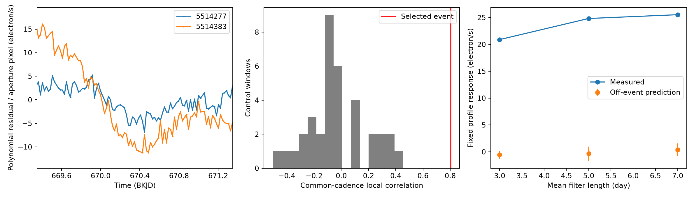

# Local flux residuals of KIC 5514277 and KIC 5514383 correlate at 0.80 during the selected Kepler quarter 7 dip

We find similar local flux structure on two targets that are about 76 detector columns apart. The raw-flux residual correlation is 0.804 in 92 common exposures near the known KIC 5514277 dip. None of 36 comparison windows has a correlation this large. However, a linear relation set by data outside the event predicts only -2.5 to +1.5 percent of the candidate response in three filter tests. These results show local agreement and a failure of stable linear transfer. They do not identify a comet or the detector cause.

## Question and prior work

Does the selected KIC 5514277 dip have a matching feature on a distant target at nearly the same detector row? Can an off-event relation predict that response?

Dumond et al. list candidate exocomet transits in public Kepler data [doi:10.1051/0004-6361/202556033](https://doi.org/10.1051/0004-6361/202556033). Their survey supplies the scientific context. A prior campaign study tested two of these targets, KIC 5514200 and KIC 5514277, near BKJD 670.1 and 670.4. It found that subtraction of faint same-row pixels removed most of each aperture loss. We read that signed study, SCI a96d8efb8ec4153fb79ce207fb9fb0bda04f8a4821d111bb830fdb51b62b0785. We use its measurement profile and shared data, but no source code. Its verified text is in files/prior_read.txt.

Our new test uses a separate star across the detector channel. The earlier study retained fixed-time coefficients for 37 stars. It did not report the local correlation, center comparison, or off-event transfer tested here. Thus, this is an extension of an existing artifact investigation, not a discovery of the original dips.

We ran SCI searches for astronomy and Kepler before selection, then inspected published metadata. A focused verified search for 5514277 is in files/campaign_search.json. We did not inspect other workers' private workspaces. A pilot fit of the 37 available light curves showed the distant target's local structure. The exact pilot code and printed results are in files/selection_pilot.py and files/selection_pilot.txt. The pilot uses point-sampled profiles and a slightly different center window; it serves selection only. The final exposure-averaged analysis replaces these preliminary fit values. All 37 pilot input hashes and paths are in files/pilot_sources.json. We selected the final pair after this inspection. Thus, all correlation comparisons are exploratory. They do not have a survey false-alarm probability.

The Kepler instrument handbook describes a row-dependent detector bias that can change with time. Clarke et al. describe row-by-cadence flags and possible errors in stellar interpretation [NASA report 20140011633](https://ntrs.nasa.gov/citations/20140011633). These facts motivate a spatial test. They do not establish the cause of these particular flux changes.

## Data and selection

We use five public Kepler DR25 quarter 7 long-cadence light curves. The shared directory for each is /mnt/dell-data/shared_datasets/kepler-kicNUMBER-q7-dr25, with NUMBER equal to 5514277, 5514383, 5514283, 5514303, or 5514200. We also use /mnt/dell-data/shared_datasets/nasa-kepler-dr25-koi-ephemeris-20261107/koi.csv. Exact absolute paths, source URLs, sizes, and SHA-256 hashes for all six files are in files/outputs/sources.json. The analysis checks their hashes. No shared data were changed. No new download was required.

All five stars are on channel 79. Their median image coordinates and aperture pixel counts are in files/outputs/geometry.csv. KIC 5514277 has coordinates (column,row) = (698.333,1008.775). KIC 5514383 has (622.289,1007.087). The differences are 76.044 columns and 1.687 rows. This separation makes ordinary overlap of these two target apertures implausible. It does not exclude electronic cross-talk or other instrument coupling. KIC 5514283 has nearly the same centroid as KIC 5514277, so it is not an independent spatial confirmation. KIC 5514303 and KIC 5514200 provide context at lower rows. These context stars are not a random control sample.

KIC 5514383 is Kepler-506, which has a known planet. We use the frozen DR25 record with period 6.88341278 day, epoch BKJD 172.66227, and duration 2.0674 hours. We remove all exposures within 0.15 day of its predicted transit centers in every test. The nearest center to the selected dip is about BKJD 668.268. It is outside the one-day correlation half-window, but can enter the wider baseline window without this mask. The exact catalog row is preserved. This mask does not exclude unknown signals.

Time is BJD minus 2454833 day. Flux is electron/s. SAP is aperture flux. PDC is corrected flux from the same exposures. They are not independent observations. The main mask permits only zero flags, corrected cosmic rays (128), and the two rolling-band bits (131072 and 262144). All other flag bits are rejected. We repeat local tests with flags exactly zero.

## Methods

For each star, fit flux in a window about BKJD 670.35. The main half-window is 2.5 days. Fit a quadratic time baseline and subtract a positive-loss profile. The profile is zero before c-L. Between c-L and c it is [1-exp(-(t-c+L)/tau)]/[1-exp(-L/tau)]. After c it is exp(-(t-c)/tau). Set L = 7.27/24 day and tau = 12.13/24 day, from the prior study. Average 11 equally spaced samples over a 0.0204336-day exposure. Depth is signed. No positivity constraint is imposed. Search c over 670.35 plus or minus 0.55 day with a grid followed by local scalar minimization. These are descriptive profile centers, not measured orbital epochs.

For correlation, remove a polynomial alone from each full local window. Keep only common integer cadence numbers within one day of 670.35, with no time shift. Calculate Pearson correlation. This residual differs from the residual after a profile fit. We test two products, two flag rules, three half-windows (2, 2.5, 3 days), and polynomial degrees one and two. This gives 24 choices per star and 24 correlations per reference. These are sensitivity choices, not independent replications.

For the main comparison set, use centers 620 to less than 730 in steps of two days. Exclude centers within 5.5 days of the selected event. Use the same quadratic local residual rule and the main quality mask. Require at least 65 common central cadences. This leaves 36 windows. Their baseline windows overlap. Sample counts and flux states vary. The selected event helped determine the pair, so the comparison does not provide a calibrated tail probability.

For an off-event transfer test, join the main pair on their complete cadence records. Assert that record cadence numbers are consecutive. Apply a weighted centered running-mean subtraction separately to both raw flux arrays on the common valid mask. Missing values enter neither sum nor denominator. Use odd filter sizes nearest 3, 5, and 7 days. Keep training rows with more than 80 percent valid baseline coverage, more than 5.5 days from the event, and more than 5.5 days from either quarter edge. Fit an intercept and one reference-flux coefficient by ordinary least squares. The guard covers the two-day response half-window plus the largest half-filter length.

Measure the observed and predicted target responses with the same fixed-center profile: restrict to two days from 670.35, subtract the mean profile over retained rows, and compute minus its dot product with filtered flux divided by the squared profile norm. This response is not a physical transit depth. A negative prediction is a brightening. The reference response is scaled only by the off-event coefficient; the event is not used to fit that coefficient.

For conditional coefficient ranges, multiply training residuals by common random signs in five-day time blocks, refit 999 times, and keep central 95 percent ranges for predicted response. The reference array and event data remain fixed. For fixed-center local depth ranges, use 999 sign draws in 12-cadence elapsed-time blocks. These ranges omit selection, reference noise, baseline error, profile error, and physical-model error. They are not astrophysical confidence limits. Seed: 1108. We do not run the transfer model with the zero-flag mask: no rows pass its 80 percent common-coverage training rule.

## Results

The main free-center fits give centers 670.35091 and 670.35913 for KIC 5514277 and KIC 5514383. Their difference is 0.00822 day, below one long exposure. This is descriptive agreement. We do not claim that the centers are resolved this accurately.

| Main raw-flux quantity | KIC 5514277 | KIC 5514383 |
| --- | ---: | ---: |
| Free-center profile coefficient, electron/s | 24.16 | 449.69 |
| Coefficient / median flux, ppm | 2996 | 715 |
| Fixed-center coefficient, electron/s | 24.16 | 449.38 |
| Conditional fixed-center 95 percent range, electron/s | 19.94 to 28.51 | 280.08 to 618.46 |
| Local fit rows | 227 | 215 |

The aperture-normalized amplitudes differ strongly. A common uniform additive response per aperture pixel is not established.

The main correlation is 0.8043 in raw flux and 0.8252 in corrected flux, each with 92 common central exposures. Across the six baseline choices with the main mask, raw-flux correlation ranges from 0.7742 to 0.8253. With zero flags alone, the main value is 0.6402 in 36 common exposures; the six raw-flux values range from 0.6035 to 0.8127. Thus, removal of flagged rows weakens agreement and reduces coverage, but does not reverse its sign. All fit and correlation values are retained.

None of the 36 raw-flux comparison windows reaches the selected value. Their largest correlation is 0.4551. This finite comparison does not account for pair selection, possible search trials, or all time correlations.

| Filter length, day | Measured response, electron/s | Off-event prediction, electron/s | Prediction / measured | Conditional prediction range |
| --- | ---: | ---: | ---: | ---: |
| 3 | 20.89 | -0.52 | -2.50% | -1.28 to 0.20 |
| 5 | 24.82 | -0.33 | -1.32% | -1.68 to 0.96 |
| 7 | 25.53 | 0.39 | 1.53% | -0.83 to 1.57 |

All three prediction ranges include zero. The training samples contain 2132 to 2173 exposures. The off-event slopes change sign across filter choices. A stable linear response law between the two full flux series is not supported by this test.



## Interpretation and limits

A similar transient on separated stars at nearly the same detector row is consistent with a row-dependent instrument disturbance. This interpretation also agrees with the prior faint-pixel subtraction result. However, the new test is a local correlation, not a measurement of raw detector bias. The known planet transits were masked, but stellar variation or other signals in the reference can still affect the comparison. A chance alignment is possible after exploratory selection.

The failed linear transfer matters. The reference star is much brighter than the candidate and has its own variation. Ordinary off-event flux can be dominated by a different source of noise than a rare detector disturbance. Thus, small off-event predictions do not refute every shared detector model. They also prevent use of this simple model as a calibrated event subtraction. No inference about a physical fraction of the dip follows from these response ratios.

We did not use pixel response fits, detector collateral pixels, temperature telemetry, or an independent telescope. PDC and SAP share the same data. The test cannot establish a source location, a band speed, a dust lifetime, a planet, or a comet. It does not exclude a smaller real transit on either star. The result adds spatial evidence and an explicit failure test to a published candidate audit. A useful next check would compare raw bias or temperature data with the row and time pattern.

## Reproduce and inspect

The package contains the complete analysis source, exact input records, frozen planet row, all 120 fits, 96 correlations, 36 controls, three transfer fits, all sign-draw predictions, conditional depth ranges, plotted local flux arrays, environment versions, and a numerical check script. Raw shared observations are not duplicated.

From the publication root on the campaign host:

```sh
OPENBLAS_NUM_THREADS=1 OMP_NUM_THREADS=1 python files/analyze.py --data-root /mnt/dell-data/shared_datasets --out reproduced
python files/validate.py
```

Python 3.12.16 and package versions are recorded in files/requirements.txt and files/outputs/environment.json. Thread settings reduce overhead; they are not campaign resource limits. Analysis needs no network. To reproduce on another host, install those requirements in a private environment. Run `python files/retrieve.py /new/private/raw`, then use that path as --data-root. Retrieval refuses an existing destination and checks each exact source hash. It writes only private files. Do not use the immutable shared store as the retrieval destination.

A second full run reproduced all numerical CSV tables within 1e-9 relative and 1e-7 absolute tolerance. The optional selection pilot can be repeated with `python files/selection_pilot.py /absolute/raw`. Its inputs can be retrieved with `python files/retrieve.py /new/private/raw --pilot`.

The validation script checks response arithmetic, recalculates the main correlation with a separate implementation, checks the finite control count, and verifies recovery of a synthetic fixed-profile coefficient. These tests do not validate the detector interpretation.

## Job and license

Job: sci-1107-syam2-astronomy-faaaefef1ad0. Topic: astronomy. Campaign: 11_07_2026. Machine: syam2. Account: codex-myxtap. Model: gpt-6.1-sol, high reasoning effort. Date: 2026-11-08. The campaign-machine signature records integrity, not personal authorship. Private keys are outside this package.

The baseline license covers our code, text, figure, and derived evidence. NASA, STScI, the Exoplanet Archive, and the cited authors retain source credit. This package is saved locally and is not submitted to a remote archive.
