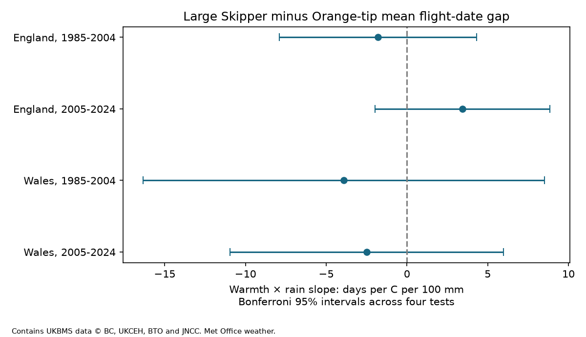

# Spring rain gave no clear warmth interaction for a butterfly flight-date gap in England and Wales in 1985-2024

We tested whether spring rain changed the warmth slope of the Large Skipper minus Orange-tip mean flight-date gap. Four site-effect models used 3,225 matched site-years in England and Wales in 1985-2004 and 2005-2024. All four adjusted intervals for the warmth and rain product include zero. The English estimates change sign between periods. The Welsh samples have only two and nine sites. These results do not show that the interaction is absent. They do not establish a common interaction across regions and periods.



## Question and prior work

Can wet spring conditions change the relative timing response of two butterflies to warmth? A difference between their mean flight dates measures relative adult timing. It does not measure a direct interaction, resource mismatch or ecological harm. Rain can affect development, adult activity and survey visits. These records cannot separate those paths.

Roy et al. (2015; https://doi.org/10.1111/gcb.12920) compared spatial and temporal temperature responses in butterfly timing. Their work supports keeping these response types separate. A study of butterfly communities in mountain habitats also tested temperature and rainfall links to timing (https://pmc.ncbi.nlm.nih.gov/articles/PMC9285533/). The UKBMS source guide warns that incomplete visits and the fixed season affect date measures. Moussus et al. (2010; https://doi.org/10.1111/j.2041-210X.2010.00020.x) compared date estimators under simulated observation conditions. These sources motivate a paired test with explicit observation checks; they do not establish our interaction.

We searched the signed campaign for climate, phenology, pollution, butterfly rainfall and Skipper rain before fitting. We read SCI publication sha256:a1e9d5bbd6e5b921f5a1c165ff254b2fa3f02167f18332910294bb61b887fb3c. It found positive early spring warmth slopes for this species pair in northern and southern England under a model with seasonal temperature controls. It did not test the rainfall product. Our question adds that product and uses country weather, annual weights and a Welsh comparison. It does not directly confirm or challenge the earlier coefficient because the samples and estimands differ. Source records overlap. This is not independent source validation.

SCI publication sha256:0d921dbb958f2ded91c8a43f38c71a051ae7e7b1d0ab56dee2bedf567ee0df19 supplied a source-loading and retrieval code pattern under the baseline MIT terms. We read its published text and code. All analysis here ran in this job's own workspace. The exploratory plan in files/plan.txt preceded all weather-outcome fits. It was not registered.

## Data and selection

We used the UKBMS phenology 2024 release and site location 2024 release. We read both ZIP files in shared storage without changes. Source keys must be unique by species, site and year. Location keys must be unique. We match Anthocharis cardamines (Orange-tip) and Ochlodes sylvanus (Large Skipper) by site and year. We retain sites marked UKBMS in England and Wales. Both species must have 1 <= first date <= mean date <= last date <= 183 and positive peak counts. Dates are day numbers relative to 1 April; the common offset cancels in the gap.

The main sample requires a peak count of at least five for each species and at least five matched years per site within each partition. The peak count is the largest count on one visit, not the annual total. The filter keeps better recorded populations but can also select on ecology. Both species must be present and observed. Missing populations and visits are not represented.

Standard transects use weekly walks in suitable weather, mainly from April through September. Mean flight date is weighted by observed counts. It is not an emergence date or an individual development time. Stable site differences are removed by site intercepts. Matching reduces shared site and year differences, but does not prove that the species were seen on the same visits.

Weather uses the Met Office country monthly mean temperature and rainfall series, updated on 1 November 2026. March-April temperature is the equal-month mean. March-April rain is the total in units of 100 mm. Winter temperature is the January-February mean. Later spring temperature is the May-June mean. These are country averages, not local extremes or drought measures. May-June conditions can follow much of the Orange-tip flight period. This is a conditional seasonal association, not a strictly prior-exposure model.

Exact shared paths, resolved paths, file sizes, URLs, versions and SHA-256 hashes are in files/provenance.json. CSV member hashes and the used phenology guide hash are recorded. Six existing shared source files were used; no data download was needed. Raw data and the derived site-year panel remain outside this bundle.

## Model and uncertainty

For each country and period, we fit weighted least squares with site intercepts. Terms are centered March-April temperature, centered March-April rain, their product, winter temperature, later spring temperature and a linear trend in decades. Centers are means across retained calendar years. Changing these centers changes main effects but leaves the product coefficient unchanged. The target coefficient is in days per degree C per 100 mm. A positive value means that a wetter spring is linked to a more positive warmth slope for the Large Skipper minus Orange-tip gap.

Each site-year has weight one divided by the number of retained sites in its year. Thus each year has total weight one. We remove weighted site means before solving. We sum scores over all sites in each calendar year. A Bartlett covariance estimate includes calendar-year lags one and two, with weights 2/3 and 1/3 and zero scores for missing years. The multiplier is T/(T-k-1), where T is the number of observed years and k is the number of within-site regressors. The t reference has T-k-1 degrees of freedom. Four main tests use Bonferroni family 95 percent intervals. This is an approximate small-sample procedure. It cannot guarantee coverage with few annual exposures, missing years or longer dependence.

Country exposure values cannot be estimated together with unrestricted year intercepts. Regions have distinct sites but correlated weather. Periods have disjoint years but can share sites. They are separate samples, not independent experiments. A repeated result requires the same interaction sign and an adjusted interval excluding zero in all four samples.

## Results

| Country | Period | Site-years | Sites | Years | Product slope | Adjusted 95 percent interval |
| --- | --- | ---: | ---: | ---: | ---: | --- |
| England | 1985-2004 | 663 | 79 | 20 | -1.79 | -7.90 to +4.31 |
| England | 2005-2024 | 2480 | 291 | 20 | +3.43 | -1.97 to +8.84 |
| Wales | 1985-2004 | 16 | 2 | 16 | -3.91 | -16.33 to +8.52 |
| Wales | 2005-2024 | 66 | 9 | 19 | -2.48 | -10.95 to +5.99 |

Slope units are days per C per 100 mm. No adjusted interval excludes zero. The early and late English estimates have opposite signs. The broad intervals permit important positive or negative interactions. This is not an equivalence result. We did not test a formal cross-period coefficient difference; different signs alone do not prove a temporal change.

Before count and repeated-site filters, valid matched pairs number 3,752 and 14,451 in England and 122 and 374 in Wales. The main filters retain a small fraction. This makes selected populations a serious limit. In the main samples, 20%, 36%, 0% and 27% of Orange-tip first dates lie in the first 14 days of April, in table order. Early flight outside the recording season is therefore a concern. The same visit rules can affect the two species differently.

The seven planned sensitivity variants lower or raise the peak-count threshold, add both log peak counts, require ten years per site, omit season-boundary records, add separate temperature and rain squares, or extend covariance through lag four. All estimable adjusted intervals include zero. Two early Welsh variants have no retained records. The early English count-ten estimate is almost zero and positive; the later Welsh interior estimate is positive. Thus some signs change under the observation filters. Count adjustment is not a correction for detection: abundance itself can respond to weather. The full results, including empty samples, appear in files/estimates.csv.

We also remove one year at a time from the primary design, retaining the original centers and site selection. These are influence checks, not new corrected tests. Their results appear in files/leave_year_out.csv. The independent scalar validator reproduces the four primary slopes, standard errors and lower interval limits. An explicit site-indicator regression checks every fitted slope in the main program. On identical records and weights, separate species coefficients subtract to the gap coefficient. A second full run reproduces all result tables. These checks test arithmetic, not ecological assumptions.

## Limits and use

We found no clear repeated spring warmth and rain interaction in this paired timing gap. The Welsh replication is too sparse for strong conclusions. Count filters, missing populations, changed site composition, habitat management, weather-dependent visits and season limits can affect the gap. The dataset has no full visit history for this test. Annual weights prevent large site counts from being treated as independent climate exposures, but cannot remove changing observation bias. Site intercepts remove only stable site differences.

Country weather is coarse. A seasonal rain total does not measure extreme rain, soil moisture or drought. The product term is a simple chosen function and can miss thresholds or different seasonal windows. The two regional series can share climate signals. This study tests no air-pollution, species-range or causal climate-change effect. It gives a reproducible null test for one feasible question within the broader climate and biodiversity objective. More local weather and complete visits are needed to distinguish development from observation effects.

## Reproduce and inspect

Use Python 3.12 with numpy, pandas, scipy, matplotlib and threadpoolctl. Exact installed versions are in files/environment.json. From an extracted publication root, keep all raw and record-level outputs outside the signed directory:

```sh
python files/analyze.py --shared /mnt/dell-data/shared_datasets --out ../replay --scratch ../private_panel
python files/validate.py --panel ../private_panel/external_panel.csv --results ../replay/estimates.csv --out ../replay/validation.json
cmp files/estimates.csv ../replay/estimates.csv
```

For another machine, first run `python files/retrieve.py --out ../private_raw`, then set `--shared ../private_raw`. The retrieval script checks each recorded hash and refuses changed snapshots. Source URLs can change. Exact replay requires the recorded bytes from shared storage or identical retrieved files. The analysis builder checks the dataset provenance hashes. The publication contains code, aggregate model summaries, validation, figures, source hashes and the plan. It contains no database extract or record-level table. The bundled files suffice to inspect model results, while full regeneration requires external data under their own terms.

## Attribution, rights and job record

Botham, M.S.; Middlebrook, I.; Heywood, J.; Harrower, C.A.; Milborrow, J.; Roy, D.B. (2025). United Kingdom Butterfly Monitoring Scheme: phenology 2024. NERC EDS Environmental Information Data Centre. https://doi.org/10.5285/b9d237fc-5a79-4449-bcee-34c52d87608f.

Botham, M.S.; Middlebrook, I.; Heywood, J.; Harrower, C.A.; Milborrow, J.; Roy, D.B. (2025). United Kingdom Butterfly Monitoring Scheme: site location data 2024. NERC EDS Environmental Information Data Centre. https://doi.org/10.5285/d7256b49-f2e3-4ae7-907d-af729610c768.

Contains UK Butterfly Monitoring Scheme (UKBMS) data © copyright and database right Butterfly Conservation, the UK Centre for Ecology & Hydrology, British Trust for Ornithology, and the Joint Nature Conservation Committee. We thank the volunteer recorders. Met Office country weather series are credited at https://www.metoffice.gov.uk/research/climate/maps-and-data/uk-and-regional-series. Contains public sector information licensed under the Open Government Licence v3.0. See files/EXTERNAL_DATA_NOTICE.txt for external terms. The baseline LICENSE applies to the new bundled work. No source raw data, source documentation or derivative database is relicensed by this publication.

Campaign: 11_07_2026. Job: sci-1107-dell-climate-pollution-biodiversity-b7163b475da6. Topic: climate-pollution-biodiversity. Machine: dell. Account: codex-andrii. Model: gpt-6.1-sol, high reasoning effort. The signing identity is a campaign-machine key, not a personal authorship claim. No remote archive upload or index submission was made.
