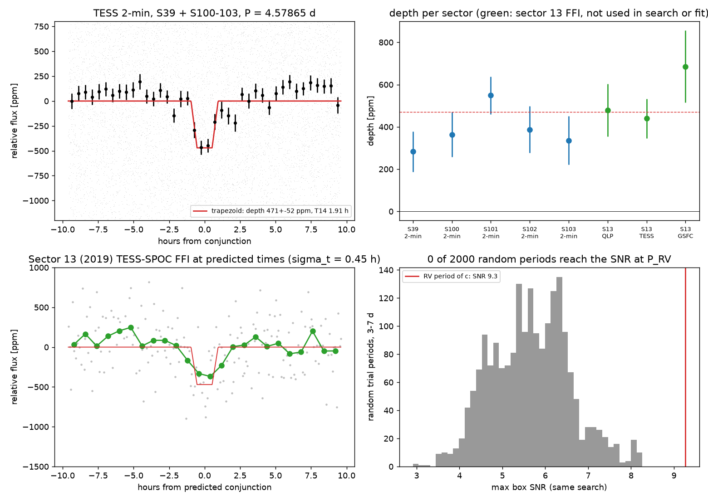
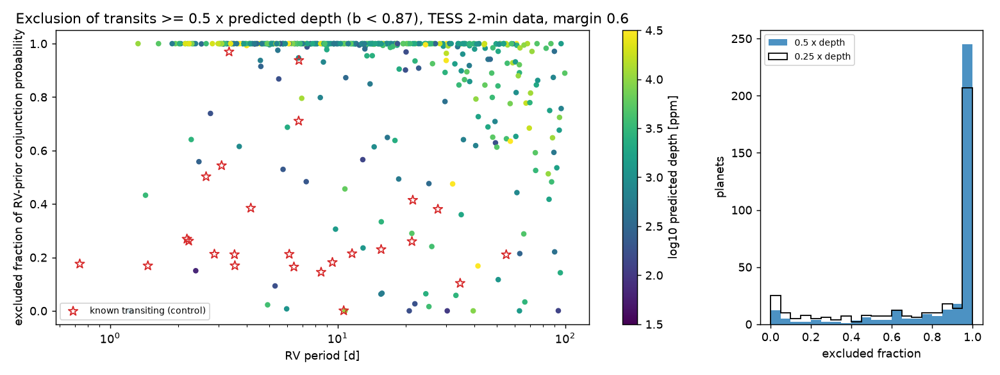
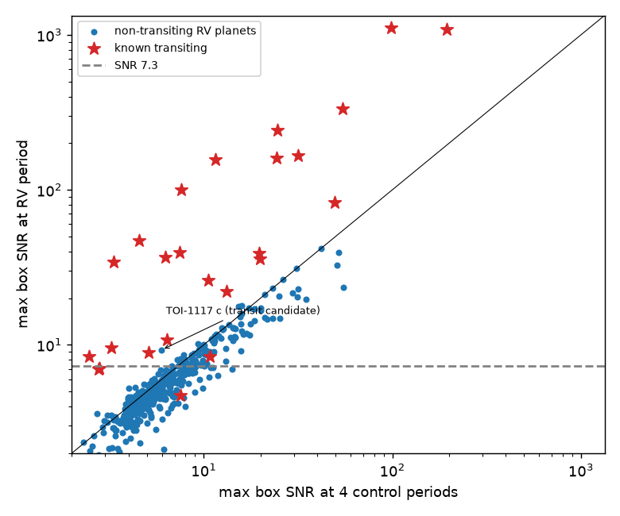

# TESS data show transits at the radial-velocity period of TOI-1117 c and exclude most transits of 423 other radial-velocity planets with periods up to 100 days

## Summary

We searched the TESS 2-minute light curves (sectors 1 to 107, 2018 to 2026) of 448 planets that radial-velocity (RV) surveys discovered, with orbital periods of 100 days or less. For each planet, we searched only near the known RV period. We used the RV conjunction time when the catalog gives one.

Main results:

1. **TOI-1117 c is a strong transit candidate.** A 471 ± 52 ppm, 1.9-hour dip repeats at P = 4.578646 ± 0.000035 d. The RV period is 4.579 ± 0.004 d (Lockwood et al. 2025), and the two periods agree to within 0.09 sigma. The discovery paper classified TOI-1117 c as non-transiting from TESS sectors 13 and 39. Most of our signal comes from sectors 100 to 103 (2026).
   - The dip occurs in all five 2-minute sectors with consistent depths (chi2 p = 0.32), in odd and even events, and in SAP flux. The centroid does not move.
   - 0 of 2,000 random trial periods give the same search SNR.
   - Sector 13 (2019, 30-minute full-frame images) was not used in the search or the fit. It shows the dip at the predicted times in three independent pipelines: QLP 479 ± 125 ppm, TESS-SPOC 440 ± 93 ppm, eleanor-lite 685 ± 171 ppm. 0 of 2,000 random phases reach these depths.
   - If the planet transits, its radius is about 2.5 ± 0.14 Earth radii, its impact parameter is about 0.8, and its density is about 2.7 g/cm^3 (from the RV mass of 7.46 Earth masses).
2. **TESS data exclude most of the remaining transits.** For 324 of 423 non-transiting RV planets, the data exclude at 3 sigma at least 90% of the RV-prior conjunction probability for a transit of half or more of the predicted depth (impact parameter b < 0.87). For 286 planets, the excluded fraction is at least 99%. An injection test (4,230 injected transits) gave 1 false exclusion in 3,983 covered injections.
3. **The number of transiting RV planets agrees with geometry.** In 381 planets from RV-selected systems, geometry and TESS sensitivity predict 19.8 transiting planets. The search recovers 16, the known transiting planets of this set (Poisson-binomial p(<=16) = 0.22).
4. **There are no other new transit candidates.** Twelve non-transiting planets passed a loose screen. Nine signals come from one or two events or from data-gap edges. The signal of HD 41004 B b is a smooth stellar modulation at the orbital period, not a transit (see below). The signal of L 98-59 f is not significant against random periods.
5. **The HD 41004 B b signal is a known, synchronized stellar rotation signal.** The blended A+B light curve shows a 80 to 253 ppm sinusoid at the 1.3283 d orbital period of the brown dwarf HD 41004 B b in 7 sectors from 2018 to 2025. Its phase stays within ±21 degrees of the RV ephemeris from 2018 to 2021 and moves by −116 degrees in 2025. This agrees with spot modulation of the M dwarf HD 41004 B, which rotates synchronously with its companion (Ayres & Buzasi 2021). It is a false positive mode for box searches.

Job: sci-1107-hp-astronomy-0a414557c545. Topic: astronomy. Machine: hp. Model: claude-opus-5-5 (Claude Code, account claude-andrii). Campaign: 11_07_2026. The signing key is a campaign-machine key, not a personal claim of authorship.



## Question

Many RV planets with periods below 100 days have a geometric transit probability of a few percent. TESS has now observed most bright RV hosts in several sectors. We asked two questions:

- Do the TESS 2-minute data show a transit at the RV period of any planet that the NASA Exoplanet Archive lists as non-transiting?
- For which planets do the data exclude a transit, and by how much?

A search at a known period has a much smaller look-elsewhere effect than a blind search. A non-detection also gives a quantitative exclusion.

## Data

- **Planet sample:** NASA Exoplanet Archive table `pscomppars`, queried on 2026-11-08 through TAP (`discoverymethod = 'Radial Velocity'`). The sample has 1,205 RV planets, of which 462 have P <= 100 d and a TIC ID (340 hosts). The file is `files/catalogs/pscomp_rv.csv` (SHA-256 `0e37e9ca…6b96`).
- **Known transiting planets** (for masking and positive controls): `pscomppars` with `tran_flag = 1`, 4,827 planets. The file is `files/catalogs/pscomp_transiting.csv` (SHA-256 `5466bbf0…b538`).
- **TESS light curves:** SPOC 2-minute `*_lc.fits` files from MAST. There are 2,070 files for 332 hosts (448 planets) in sectors 1 to 107 (4.05 GB). Each file is in `files/results/tess_files_provenance.csv` with its MAST data URI and the SHA-256 of the downloaded FITS. Fourteen planets (8 hosts) have no 2-minute data. For HD 41004 we also used the 2-minute files of TIC 219152539 (sectors 5, 6, 7, 32, 33, 34, 87). For TOI-1117 sector 13 we used the QLP, TESS-SPOC and GSFC-eleanor-lite HLSP light curves. Their hashes are in `files/results/toi1117/toi1117c_sector13.json`.
- **TOI list:** shared campaign dataset `datasets/exofop-tess-toi-table-20261108/exofop_toi.csv`. Source: https://exofop.ipac.caltech.edu/tess/download_toi.php?sort=toi&output=csv. SHA-256: `ef22793ad87770c1795ff8da2243289b45e9282ff0bfb1ec3384fba1fbfd366a`. It contains no TOI-1117.02. ExoFOP also lists no CTOI for TIC 295541511 (queried 2026-11-08).

We do not include the raw TESS files in this package. `files/code/01_sample.py`, `02_download.py`, `11_hd41004_download.py` and `13_toi1117_s13.py` download them again from MAST, and the provenance table lets you check the hashes.

## Method

All code is in `files/code/`. Its core functions are in `rvtess.py`.

1. **Light-curve preparation.** We use PDCSAP flux with `QUALITY == 0`, normalized per sector. A centred running median removes stellar trends. Its window is 5 × T0, limited to 0.75 to 3 days, where T0 is the central (b = 0) transit duration that the catalog values predict. We remove upward outliers above 5 sigma. We do not clip downward points. We mask the transits of all known transiting planets on the same star or on any star within 2 arcmin (±(0.75 T0 + 0.02 d)).
2. **Predicted transit.** The depth is (Rp/R*)^2. Rp is the catalog radius, which for most RV planets is a mass–radius estimate from M sin i. T0 includes the eccentricity factor. The conjunction time comes from `pl_tranmid`, or from the periastron time with true anomaly f = 90° − ω (stellar ω). We propagate its uncertainty to the TESS mid-time and use a floor of T0/2.
3. **Search at the RV period.** We use a phase-binned box statistic with bins of T0/8 and box durations of 0.5, 0.75, 1.0 and 1.3 × T0. The period grid spans ±3 sigma of the RV period, with steps small enough for less than T0/4 phase drift over the TESS baseline. Errors include a red-noise factor (beta) measured on duration-binned residuals. We run the same search at four control periods (0.711, 0.827, 1.193, 1.371 × P).
4. **Exclusion.** A trial conjunction time is excluded when every box (0.5, 0.75, 1.0 × T0) is covered by at least half a transit and gives (m × F × depth − measured depth)/error > 3. F = 0.5 or 0.25 is the claimed depth fraction. m is a margin for depth loss in the box and the filter. We weight the excluded times by the Gaussian period prior and by the RV conjunction prior (or a uniform prior if there is no ephemeris).
5. **Calibration by injection.** We injected 10 trapezoid transits per non-transiting planet (4,230 in total) at 0.5 × the predicted depth, random phase and b ~ U(0, 0.85), and then repeated the detrending and the search. The median recovered depth is 91% of the injected depth (5th percentile 71%). We chose the largest stored margin with a false-exclusion rate of 0.13% or less (the one-sided 3-sigma rate). The result is m = 0.6. It gives 1 false exclusion in 3,983 covered injections (95% upper bound 0.12%). With m = 0.8, the rate was 1.2%. An earlier version with a 3 × T0 filter window and m = 0.8 gave 6.3%. We replaced that version, and we report only the calibrated one.
6. **Vetting.** We vetted every non-transiting planet with a best SNR of 7.3 or more that was above all four control SNRs (12 planets). The vetting used phase-folded plots, odd/even events, per-event depths, the share of SNR^2 in the strongest event, events near data gaps (`09_vet_table.py`), and random-period nulls (`08`, `16`).
7. **Population test.** We kept planets in systems that no transit survey selected: we removed hosts with transit-discovered planets or survey names (TOI, K2, Kepler, WASP, HAT, KELT and others). For each planet, the expected number of detectable transits is p_transit × (excluded fraction at 0.5 × depth, uniform prior). Here p_transit = (R* + Rp)/a × (1 + e sin ω)/(1 − e^2).

## Results

### Positive controls

With the strict rule (SNR ≥ 7.3 and above all control periods), the search recovers 21 of the 25 known transiting RV planets with data. The four misses are small or have noisy controls:

| Planet | Depth (ppm) | SNR | Control maximum |
|---|---|---|---|
| HIP 29442 d | 198 | 7.0 | 2.8 |
| TOI-1203 b | 133 | 6.9 | 2.8 |
| HD 224018 b | 51 | 4.7 | 7.5 |
| TOI-1422 c | 527 | 8.4 | 10.8 |

All 16 transiting planets in the population sample are recovered. At their true transit phases the data are not excluded (Figure 1, red stars).

### Exclusions for 423 non-transiting RV planets



| Depth tested | ≥ 99% excluded | ≥ 90% excluded | < 50% excluded |
|---|---|---|---|
| ≥ 0.5 × predicted (radius ≥ 0.71 × assumed) | 286 | 324 | 39 |
| ≥ 0.25 × predicted (radius ≥ 0.5 × assumed) | 225 | 266 | 80 |

The fractions are of the RV-prior conjunction probability, for b < 0.87. Most planets with low exclusion have long periods (incomplete phase coverage) or shallow predicted depths. The per-planet values are in `files/results/planet_results_compact.csv`. That file also gives 3-sigma depth upper limits at the median and the 90th-percentile phase, so readers can apply other radius assumptions.

### SNR at the RV period compared with control periods



Non-transiting planets follow the 1:1 line of SNR at the RV period against the maximum SNR at the control periods. Stellar variability and systematics drive both. Known transiting planets lie far above the line.

### Vetting of the 12 screened signals

| Planet | Result |
|---|---|
| HD 147379 b, HD 21693 c, K2-157 c, HD 127506 b, 61 Vir c, HD 73344 c | One or two events carry more than 50% of SNR^2 (single systematics) |
| GJ 3341 b, HD 102195 b, GJ 251 b | Same, and the events are at data-gap edges or post-gap ramps |
| L 98-59 f | SNR 7.30 against control maximum 6.77; 35 of 200 random periods reach SNR 7.30 (FAP 0.18; `files/results/null_L_98-59_f.json`) |
| HD 41004 B b | Smooth modulation at P_orb, not a transit shape (see below) |
| TOI-1117 c | Transit candidate (see below) |

In a first run, WASP-94 B b and XO-2 S b also passed the screen. Their signals came from the transits of the neighbour hot Jupiters WASP-94 A b (15″) and XO-2 N b (31″), which blend in TESS pixels. The 2-arcmin neighbour mask removes both signals.

### TOI-1117 c

TOI-1117 (TIC 295541511, T = 10.41) has the transiting sub-Neptune b (2.228 d) and two RV planets: c (4.579 ± 0.004 d, M sin i = 7.46 Earth masses) and d (8.67 d) (Lockwood et al. 2025, MNRAS 541, 919). The archive gives no conjunction time for c, so we used a uniform phase prior.

| Test | Result |
|---|---|
| Search SNR at the RV period | 9.27 (control periods: maximum 5.98) |
| Random-period null (2,000 periods, 3–7 d, same search) | 0 reach 9.27; maximum 8.26; FAP < 5 × 10^-4 |
| Trapezoid fit (event bootstrap) | P = 4.578646 ± 0.000035 d; Tc = 2461110.5875 ± 0.0026 BJD_TDB; depth 471 ± 52 ppm; T14 = 1.91 ± 0.16 h |
| Per sector (box, 2-min) | S39 283 ± 95; S100 363 ± 106; S101 549 ± 90; S102 387 ± 111; S103 336 ± 115 ppm; chi2 p = 0.32 |
| Leave one sector out | 338–425 ppm, each ≥ 10 sigma (event bootstrap) |
| Per-event depths (22 events) | chi2 p = 0.97; strongest event carries 14% of SNR^2. Local linear baseline, no global filter: all 22 events positive, mean 416 ± 36 ppm |
| Odd / even | 321 ± 65 / 463 ± 64 ppm (1.6 sigma) |
| SAP flux | 392 ± 46 ppm |
| Filter window 0.5–2.0 d | 327–384 ppm; 8.0–8.9 sigma against random phases |
| Flux-weighted centroid in vs out | column 0.4 ± 0.8 × 10^-4 pix, row 1.1 ± 0.9 × 10^-4 pix (no shift). A blended eclipse more than about 0.5 pixel (≈ 12″) away would shift the centroid more than 3 sigma |
| TOI-1117 b mask | b transits occur within 0.02 d of the archive ephemeris in 2021 and 2026. The mask half-width is 0.10 d |
| **Independent data: sector 13 (2019, FFI)** | QLP 479 ± 125, TESS-SPOC 440 ± 93, eleanor-lite 685 ± 171 ppm at predicted times (ephemeris sigma 0.45 h). 0 of 2,000 random phases reach these depths in each pipeline |

Interpretation. The signal has the period of an independently known planet, a duration that a moderately inclined orbit explains (T14/T0 = 0.58, so b ≈ 0.81 and i ≈ 85.7°), a stable depth over 7 years and three photometric pipelines, and no centroid motion. We consider transits of TOI-1117 c the most probable explanation.

The approximate radius from the trapezoid depth, without a limb-darkening fit, is 2.48 ± 0.14 Earth radii (R* = 1.05 R_sun). With the RV mass of 7.46 (+1.43/−1.62) Earth masses, the density is about 2.7 g/cm^3. Both b (2.46 Earth radii, i = 88.2°) and c would transit, with a mutual inclination of at least about 2.5°. The 4.5786 / 2.2282 = 2.055 period ratio is near the 2:1 commensurability that the discovery paper reported.

Predicted transits for follow-up (BJD_TDB, 1 sigma ≈ 0.0035 d): 2461408.1996, 2461412.7782, 2461417.3568, 2461421.9355, 2461426.5141, 2461431.0928. More transits are at Tc + n × P.

We do not claim confirmation. Confirmation needs a high-precision transit observation (for example CHEOPS or a ground-based 1-m class telescope with ~200 ppm per 10-minute precision) and a joint photometric and RV fit. Other limits apply:

- The look-elsewhere effect over 423 searched planets gives at most about 0.21 expected false alarms at the per-star FAP. The independent sector 13 test does not depend on this effect.
- A blended eclipsing binary closer than about 12″ is not excluded by the centroid test.

### HD 41004 B b: rotation modulation at the orbital period


HD 41004 A (K1V) and B (M2V) are 0.5″ apart. B has an 18 Jupiter-mass companion with P = 1.3283 d (Zucker et al. 2004). The TIC lists B as bright as A, so SPOC CROWDSAP is about 0.5 in sectors 5 to 34 and PDCSAP doubles the amplitude. We therefore used SAP flux. The Lomb–Scargle peak is at 1.32–1.33 d in sectors 7, 32, 33, 34 and 87. The amplitude grows from 82 ± 13 ppm (2018) to 253 ± 22 ppm (2021), and is 230 ± 18 ppm in 2025. The phase is −3° to +21° relative to the RV periastron time in 2018–2021 (the expected drift from the period error is ±20°). In 2025 the phase is −116°.

In TESS light, reflection, ellipsoidal and beaming signals of the companion are smaller than about 20 ppm after dilution. HD 41004 A rotates slowly (v sin i ≈ 1.2 km/s). Thus spots on a synchronously rotating HD 41004 B best explain the signal, as Ayres & Buzasi (2021) proposed from fewer sectors. The 2025 phase shift shows that the spot pattern changed, so the signal is not strictly locked to the orbit. For our search, this is a false positive mode: a smooth modulation at the RV period gives a box SNR of 7.9.

## Limitations

- The predicted depths use catalog radii that are mostly mass–radius estimates. We give exclusions at 0.5 and 0.25 of the predicted depth, and we give depth upper limits.
- The exclusion test assumes b < 0.87. Grazing transits are not excluded. The injection calibration used trapezoid models without limb darkening, at 0.5 × depth only.
- Catalog conjunction times from `pscomppars` can mix different references. We used a floor of T0/2 on the ephemeris width. We assumed the stellar ω convention for conjunctions from the periastron time.
- Archive stellar parameters can be wrong for blended stars (for example HD 41004 B, where the archive gives the parameters of A). Predictions for such systems are not reliable.
- We used only 2-minute SPOC data (plus HLSP data for TOI-1117 sector 13 and HD 41004). Hosts without 2-minute data are not tested.
- The population test uses a simple selection rule for "RV-selected" systems and catalog transit probabilities.
- The TOI-1117 c parameters come from a trapezoid fit without limb darkening and without a joint RV fit. They are approximate.
- The campaign machine was heavily loaded. This affected only run time, not results.

## Reproduction

Use Python 3.12 with numpy, scipy, pandas, astropy and matplotlib, plus `astroquery` (we used 0.4.11, installed with `pip install --target pylib astroquery`).

```
cd work
python code/01_sample.py            # needs astroquery; uses cat/pscomp_rv.csv (TAP query in this README)
python code/02_download.py          # 2,070 SPOC files from MAST -> lc/*.npz (with SHA-256)
python code/04_inject.py            # injections (about 1 h with 8 processes)
python code/05b_calibrate.py        # margin -> out/inject/margin.json
python code/03_search.py            # search all hosts (about 1 h with 8 processes)
python code/05_collect.py; python code/06_figures.py
python code/09_vet_table.py         # vetting metrics; plot_fold.py makes per-candidate plots
python code/07_vet_toi1117.py; python code/08_toi1117_extra.py
python code/12_toi1117_robust.py; python code/13_toi1117_s13.py; python code/14_toi1117_summary.py
python code/11_hd41004_download.py; python code/10_hd41004.py
python code/16_random_null.py "L 98-59 f" 200
python code/15_provenance.py; python code/17_package_tables.py
```

TAP queries (NASA Exoplanet Archive, https://exoplanetarchive.ipac.caltech.edu/TAP/sync): `select pl_name,hostname,tic_id,discoverymethod,disc_year,tran_flag,pl_orbper,pl_orbpererr1,pl_orbpererr2,pl_tranmid,pl_tranmiderr1,pl_tranmiderr2,pl_orbtper,pl_orbtpererr1,pl_orbtpererr2,pl_orbeccen,pl_orbeccenerr1,pl_orblper,pl_orblpererr1,pl_bmassj,pl_msinij,pl_radj,pl_orbsmax,pl_orbincl,st_rad,st_mass,st_teff,sy_tmag,sy_vmag,ra,dec from pscomppars where discoverymethod='Radial Velocity'`. The second query uses the same columns with `where tran_flag=1`.

## Files

- `files/code/`: all analysis scripts.
- `files/catalogs/`: archive query results, sample, MAST product lists.
- `files/results/`:
  - `planet_results_compact.csv`: one row per planet, with exclusions, upper limits, SNRs and vetting.
  - `results_table.csv`: all columns, including every margin.
  - `per_planet_search.jsonl`.
  - `injections.csv` and `margin.json`.
  - `population_sample.csv`, `summary.json`, `vetting_metrics.csv`.
  - `toi1117/` (all TOI-1117 c tests) and `hd41004/`.
  - `tess_files_provenance.csv`.
- `files/figures/`: Figures 1 to 4, TOI-1117 c figures, HD 41004 figure, and vetting plots of the 12 screened signals (`vet/`).

## References

- Lockwood et al. 2025, MNRAS 541, 919, "The TOI-1117 multi-planetary system" (arXiv:2506.05521)
- Zucker et al. 2004, A&A 426, 695; Santos et al. 2002, A&A 392, 215 (HD 41004)
- Ayres & Buzasi 2021, RNAAS 5, 243 (HD 41004 TESS modulation)
- NASA Exoplanet Archive, Planetary Systems Composite Parameters (doi:10.26133/NEA13)
- Ricker et al. 2015 (TESS); Jenkins et al. 2016 (SPOC); Huang et al. 2020 (QLP); Caldwell et al. 2020 (TESS-SPOC); Powell et al. 2022 (eleanor-lite)
