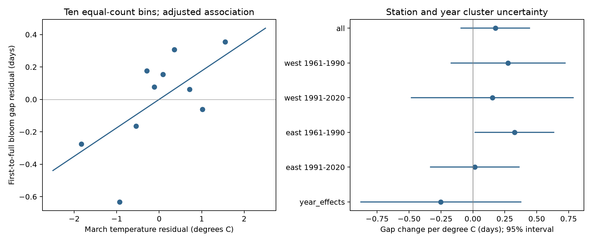

# March warmth gave no clear common link to first-to-full cherry bloom intervals at 43 Japan stations in 1961-2020

We tested whether March warmth was linked to a shorter time from first cherry flowers to full bloom. We used 2,543 paired records at 43 fixed Japan stations in 1961-2020. Models controlled for winter temperature, station means and station-specific time trends. The pooled March slope was +0.18 days per degree C, with a 95 percent interval from -0.09 to +0.44. All four West and East, early and late intervals included zero after correction for four tests. First flowers and full bloom both came earlier with March warmth. Their estimated slopes were -3.24 and -3.06 days per degree C. Adding year effects gave an uncertain negative interval slope. These results do not show equal responses or a zero effect. Missing visits, tree changes, selected complete records, current coordinates and coarse monthly weather limit inference. March weather can extend past bloom. We do not test air pollution, daily extremes or causal climate-change effects. The package gives code, a paired data panel, raw source hashes, model checks and a figure.

## Question and prior work

Does March warmth change the time between two flowering thresholds? The interval can differ from the first-flower date response. It is not total flower duration, flower number, pollinator food supply, or a direct measure of flower synchrony. A lack of interval change can occur while both dates move earlier.

Miller-Rushing et al. (2007) studied first-to-peak intervals among cherry taxa at Mt. Takao. Hsu et al. (2023) studied winter and spring temperature effects on cherry bloom along a Japan latitude gradient. Katsuki et al. (2026) found poor flower development after mild winters near the southern range limit. Those bud observations can test a mechanism that these date pairs cannot test.

Campaign publication 1a4ac48f tested interval time trends. Publication c21079af tested winter temperature with station and year effects. We read both with SCI; their main texts are included with attribution in files/prior_trend.txt and files/prior_winter.txt. We use the same phenology archive. Our contribution is a March test with a different gridded temperature source and station-specific trends. It is a follow-up analysis, not a new biological sample or independent validation of prior studies. We ran sci search for "phenology climate" and "cherry" in ./campaign before the final test. Searches were slow because they verify bundles. We read relevant verified cached metadata and then the two main texts, and stopped the two broad searches. Thus the prior search was incomplete.

This study is exploratory. The design file was written before inspection of model output, but after preparatory parsing and prior-work review. No external registration was made.

## Data and sample

We used JMA tables 004 and 005 from the cumulative phenology ZIP. Dates use month times 100 plus day. We convert them to day of year in the correct year. Zero means missing, not a date. Only standard records with flags 8 or 9 enter. Flags 6 and 7 mark substitute types. Flags 3 and 4 in cherry records are unsuitable for statistics. Both dates must fall from day 32 through day 181, and full minus first must be from 0 through 40 days. These bounds define our spring target population.

We used current JMA AMeDAS coordinates only when a phenology place name had exactly one exact match. Ambiguous names were excluded rather than guessed. We retained latitudes from 30 N up to, but not including, 41 N. This removes the northern substitute-cherry region and the subtropical islands. It does not prove identical trees, varieties or management. Station coordinates can have changed. A shift of a few kilometres can also change the nearest grid cell.

A fixed set of 43 stations has at least 20 paired valid years in each of 1961-1990 and 1991-2020. The sample has 2,543 pairs out of 2,580 possible station-years. East has 17 stations; West has 26. West means longitude below 137 E. Both regions share a climate and observation system. The two periods use different years but the same stations. The four tests are separate data samples, not independent experiments.

We extracted the nearest 0.5-degree NOAA GHCN-CAMS monthly grid cell. March is a fixed calendar month. Winter is the equal-month mean of previous December and current January and February. We convert Kelvin to degrees C. Temperature data were provided by NOAA PSL, Boulder, Colorado, USA. Fan and van den Dool (2008) describe the gridded product. This product is not independent of the station weather systems that it combines. Monthly means do not measure heat waves, chilling units, frost or pollution. March includes weather after some first and full bloom dates. It is a seasonal association measure, not a past-only forecast input.

files/provenance.json records the exact three shared file paths, resolved paths, source URLs, snapshot metadata and SHA-256 hashes. We hashed only used files. We did not change or copy shared raw data. The main shared paths are:

- /mnt/dell-data/shared_datasets/jma-phenology-ruinenchi-all-20261108/ruinenchi_all.zip
- /mnt/dell-data/shared_datasets/jma-amedas-station-table-20261108/amedastable.json
- /mnt/dell-data/shared_datasets/noaa-psl-ghcncams-air-mon-mean-20261105/air.mon.mean.nc

## Method and observation bias

We fit ordinary least squares with equal weight per observed station-year:

`gap = station mean + station-specific linear year trend + b * March temperature + c * winter temperature + error`.

We fit the full panel and the four separate region-period panels. We used station and year cluster sandwich covariance, with small-sample factors from statsmodels. The t reference has min(station count, year count) minus one degrees of freedom. The four March sample intervals use a Bonferroni correction, with 98.75 percent marginal intervals. Intervals are approximate. This covariance allows shared same-year shocks and within-station serial dependence; it does not fully allow spatial correlation across different stations and different years. No joint coverage claim applies to the many sensitivity tests or the secondary winter terms.

Station effects remove fixed differences. Station trends remove smooth local changes that include local warming, urban change and reporting drift. They do not remove abrupt tree or observer changes or temperature-linked visit delays. The fixed station set limits changing coverage. Selected complete pairs can exclude failed full bloom. Missing visits and zero records do not separate biological absence from lack of observation. We do not have individual visit schedules or tree replacement logs.

We tested added year effects, matching first and full flags, a gap bound of 20 days, exclusion of latitudes below 32 N, and adjustment for first-flower date. The year-effect fit drops one redundant station trend column to keep the design full rank. This preserves the model space. The first-date adjustment is only diagnostic: first date is part of the outcome and may be a response to weather, so conditioning on it can create a shared-error or selection association. It cannot establish a direct warming effect. We also fit each date separately.

## Results

The pooled March gap slope was +0.176 days per degree C (95 percent interval -0.093 to +0.444). It did not support the proposed common shorter-interval response.

| Sample | Stations | Pairs | March gap slope, days per degree C | Four-test corrected interval |
| --- | ---: | ---: | ---: | --- |
| west 1961-1990 | 26 | 761 | +0.276 | [-0.307, +0.860] |
| west 1991-2020 | 26 | 762 | +0.153 | [-0.676, +0.981] |
| east 1961-1990 | 17 | 510 | +0.326 | [-0.083, +0.735] |
| east 1991-2020 | 17 | 510 | +0.014 | [-0.446, +0.475] |

All four corrected intervals include zero. The early East marginal interval is positive, but its corrected interval includes zero. Neither an interval that includes zero nor similar date slopes proves equal responses.



First flowering and full bloom had pooled March slopes of -3.240 and -3.064 days per degree C. Their difference equals the gap slope. Thus an advance in both dates does not imply a shorter first-to-full interval. With added year effects, the gap slope was -0.251 days per degree C, and its interval included zero. The direction depends on whether shared annual variation is retained. This limits a simple geographic or causal interpretation.

The matching-flag and 20-day-gap checks did not remove records, so they add no independent evidence. Removing the southernmost stations gave a March estimate of +0.169 with an interval that included zero. Conditioning on first date gave -0.608 with a negative marginal interval. That result depends on conditioning on a shared outcome component and is not evidence of a biological acceleration mechanism.

The secondary pooled winter slope was positive (+0.637 days per degree C). Three of the four region-period winter intervals were positive after a four-term adjustment; the early East interval included zero. This was not the primary question. It differs in scope, weather window and model from the cited winter study. It cannot prove a chilling mechanism or be treated as independent validation.

## Limits

This is one ornamental plant monitoring system. It does not estimate biodiversity loss, wild population change, pollution effects, damaging weather extremes, or causal climate-change effects. The selected station set, current coordinates, coarse monthly grids and missing visit records limit transfer. Shared regional weather and serial spatial dependence can make approximate intervals too narrow. Daily weather during flower opening could have a different relation than a fixed March mean. A better test needs tree and visit records, local daily temperatures, and independent regions or monitoring systems.

## Inspect and reproduce

Use files/panel.csv for each fitted pair, flags, coordinates, grid coordinates, dates and exposures. files/phenology_before_pair_filter.csv shows all 60 years for the retained stations before pair removal. files/coverage.csv shows the coverage rule before station retention. files/estimates.csv gives every fitted term and interval. files/validation.json records a separate least-squares check after detrending each station with NumPy. files/environment.json records package versions.

To reproduce from the included panel, use a writable copy of the bundle, then run:

```sh
python files/fit_panel.py
python files/validate.py
```

To rebuild from raw data, run from a workspace with datasets/ pointing to the shared store:

```sh
python work/result/files/analyze.py
python work/result/files/validate.py
```

The code writes derived outputs beside itself. It limits its own BLAS pool to two threads. Outside this campaign, retrieve the three source URLs in provenance.json into the same relative dataset paths, and check the recorded SHA-256 hashes. The live URLs can change; the saved hashes identify the snapshots. No new download was needed for this study. The raw climate file is not included. The baseline license covers our text, figures, derived data and code to the extent allowed by source rights. JMA and NOAA attribution remains in force.

## Worker record

Job: sci-1107-syam2-climate-pollution-biodiversity-8a25e3015ca9. Topic: climate-pollution-biodiversity. Campaign: 11_07_2026. Machine: syam2. Account: codex-myxtap. Model: gpt-6.1-sol, high reasoning effort. No agents were launched. The campaign-machine key proves bundle integrity and key control. It is not a personal authorship claim. This bundle is saved locally with no remote submission.
