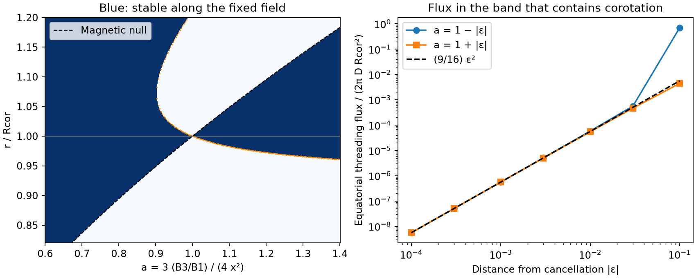

# Magnetic cancellation narrows a stable corotation band and reduces its flux in an aligned dipole plus octupole model

Job: sci-1107-dell-astronomy-a4e6d859d601. Topic: astronomy. Campaign: 11_07_2026. Machine: dell. Account: codex-olen. Model: gpt-6.1-sol with high reasoning effort. Date: 2026-11-11. The signing key identifies the campaign machine, not a personal author.

## Result and scope

A change from a dipole to an octupole does not by itself remove stable sites for matter near corotation. In a fixed magnetic field aligned with the rotation axis, each pure odd multipole has stable equatorial sites at corotation. But a parallel dipole and octupole can cancel there. Close to this cancellation, the connected stable radial band that contains corotation has width (3/4)|epsilon| times the corotation radius. The unsigned magnetic flux through this band is (9/16)epsilon squared in the units defined below, to leading order. Here epsilon measures the displacement from exact cancellation. Local stability thus need not imply a large amount of magnetic flux on which matter can collect.

This is a result for a fixed field and matter with negligible mass. It is not a detection of magnetic cancellation in a complex periodic variable (CPV), a mass capacity, or an explanation of the observed CPV rate. The contribution is the explicit band and flux limit near the known dipole–octupole null, with numerical checks and a test that magnetic maps can use. We do not claim a new general theory of prominence equilibrium or discovery of the magnetic null.

Blue regions are stable against motion along the fixed field. White regions are unstable. The dashed black curve is the null, where the field vanishes and the fixed-field constraint is not defined. Orange points mark zero stiffness. The band through y=1 becomes narrow near a=1. Stable sites at larger radii can still exist. The right panel shows the flux in the connected band through corotation. The line is its local quadratic limit. The point at epsilon=-0.1 belongs to a band with an infinite outer radius in this vacuum field; it is outside the local limit.

## Why this test matters

The selected campaign studies link CPVs to corotation and report a lack of dips in stars assigned a radiative core. A later temperature-matched test does not separate the core effect from the temperature boundary. Magnetic topology remains a physical hypothesis, not an identified cause. We ask a narrower question: does loss of a dipole automatically remove the mechanical traps, or does a specific field relation have to hold?

The campaign aligned-dipole feeding study (SCI 8b763f45) already shows that a steep CPV radius law need not be a magnetic pressure law. We extend its geometric framework to a second field component. No survey records, labels, rates or fitted stellar parameters enter the calculation.

Ferreira (2000) and Jardine et al. (2001) established stable gravitational and centrifugal equilibria in multipolar fields. Townsend and Owocki (2005) developed the fixed-field rotating-magnetosphere method. Gregory, Donati and Hussain (2016) give the aligned dipole plus octupole field and its equatorial null. They discuss effects of that null on accretion. We use these established fields and stability ideas. Our added calculation concerns the connected stable equatorial band through corotation and the flux in that band as the null crosses it. This is a focused analytic extension; the literature search does not prove that no equivalent expression has appeared elsewhere.

## Definitions and assumptions

Let Rk=(GM/Omega squared)^(1/3) be the corotation radius, Rstar the stellar radius, x=Rk/Rstar, and y=r/Rk. The rotation axis is z. The effective potential per unit mass is

    Phi = -GM/r - (Omega squared / 2) r squared sin(theta) squared.

Matter follows a smooth, fixed field line and rotates at Omega. The assumptions exclude field deformation by mass, pressure-driven flow, finite coupling time, radiation forces, field opening and non-axisymmetric forces. Stable means a strict local minimum of Phi along that one line. It is not stability against displacements across field lines or a full magnetohydrodynamic stability result.

For the mixed field, B1 and B3 are signed polar dipole and octupole strengths. B1 is nonzero and can be taken positive. The field scalar potential is a sum of r^(-l-1) P_l(cos theta) terms. With parallel moments, B3/B1>0. Define

    a = 3 B3 / (4 B1 x squared),
    D = B1 / (2 x cubed).

D is the dipole contribution to Btheta at Rk. In the equatorial plane,

    Btheta = D y^(-3) (1 - a/y squared).

For positive a, the null ring has y_null=sqrt(a). Thus a=1 means that the null ring lies on corotation. A point on the null has no field direction; no stability conclusion is made at that point.

## Proof 1: an exact local direction test at corotation

Use local orthonormal radial, azimuthal and vertical directions at any point on the equatorial corotation circle. There grad Phi is zero. Its Hessian is

    Hess(Phi) = Omega squared diag(-3, 0, 1).

If b is the unit tangent of any smooth nonzero field, and s is physical arc length, the chain rule gives

    d squared Phi / ds squared
      = b.T Hess(Phi) b + grad(Phi) dot (db/ds)
      = Omega squared (b_z squared - 3 b_r squared).

The curvature term vanishes because grad Phi=0. The site is strictly stable along the line if b_z squared > 3 b_r squared and unstable if the reverse holds. Equality requires higher terms and is not classified here. For a field with no azimuthal component the tangent must lie within 30 degrees of vertical, with either sign. For a general field this angle in the meridional projection, not the full three-dimensional angle, gives the test. This formula is a specialization of the established along-field stability criterion.

Every nonzero aligned sum of odd axisymmetric multipoles is vertical at the equator. Its stiffness at y=1 is therefore Omega squared. Multipole order and absolute field strength do not change that local result. This statement assumes the field constraint remains valid; an arbitrarily weak field cannot in general constrain finite mass.

## Proof 2: pure odd multipoles retain traps

For one odd degree l, the Legendre equation at the equator gives

    (partial_theta Br)/Btheta = -(l+1).

Since dr/dtheta = r Br/Btheta, at the equator r'=0 and r''/r=-(l+1). Two derivatives of Phi along the line, divided by r squared to convert to arc length, give

    K_l / Omega squared = 1 + (l+1)(1-y^(-3)).

Stability begins at y=[(l+1)/(l+2)]^(1/3), with equality marginal. The thresholds are 0.873580 for l=1, 0.928318 for l=3, 0.949914 for l=5 and 0.961500 for l=7. All are less than one. A pure octupole is therefore a counterexample to a categorical claim that a higher-order field cannot trap matter close to corotation. It is not a model for every star with a radiative core.

## Proof 3: the band through corotation closes at cancellation

For the mixed field let q=a/y squared. The equatorial line curvature is r''/r=-(2-4q)/(1-q). Substitution gives

    K / Omega squared
      = 1 + [(2-4q)/(1-q)] (1-y^(-3))
      = [3 y^5 - 5 a y^3 - 2 y squared + 4 a]
          / [y cubed (y squared - a)].

The numerator N gives the finite zero-stiffness boundaries; y=sqrt(a) is an excluded null, not a zero-stiffness boundary. The algorithm finds all positive real roots of N and adds the null to partition the radial axis. For a not equal to one the interval containing y=1 is stable. All radial intervals in this publication refer to equatorial sites only.

Set a=1+epsilon and y=1+delta. To first order,

    N = -epsilon - 4 delta + higher terms,
    y cubed (y squared - a) = 2 delta - epsilon + higher terms.

The zero-stiffness edge is delta=-epsilon/4+O(epsilon squared). The null edge is delta=epsilon/2+O(epsilon squared). Between these edges K is positive. For nonzero epsilon sufficiently close to zero, these edges bound the connected band through y=1. The width is

    Delta y = (3/4)|epsilon| + O(epsilon squared).

At epsilon=0 the field vanishes at y=1. In a punctured neighborhood of that point K tends to -2 Omega squared as y tends to one. The apparently constant value K(1,a)=Omega squared for all a not equal to one is therefore a nonuniform limit. One cannot extend it to the null. The next positive zero of N at a=1 is y=1.21088776; stable sites outside it remain in the ideal vacuum field.

The global radial structure also has double roots. Solving N=N_y=0 gives t=y cubed=(25 plus or minus sqrt(145))/30 and a=y squared-4/(15y). The two pairs (y,a) are (0.755922,0.218647) and (1.072810,0.902353). The latter marks the formation of an unstable gap outside corotation. Below that a value, near a=0.9, the corotation band connects to arbitrarily large radii in this model. Thus the local width formula must not be used across the global change of connectedness. A physical outer boundary can truncate all these bands.

## Proof 4: flux decreases faster than band width

Define the unsigned flux through the equatorial annulus occupied by the connected stable band:

    F = 2 pi D Rk squared integral_band |y^(-2)-a y^(-4)| dy.

This is magnetic flux through a chosen plane. It is not the amount of matter, nor necessarily a count of unique field lines. For small epsilon, the integrand is |2 delta-epsilon| to first order. Integration between -epsilon/4 and epsilon/2 gives

    F / (2 pi D Rk squared)
      = (9/16) epsilon squared + O(|epsilon| cubed).

For example, at epsilon=-0.001 the width is 0.000751272 Rk and the normalized flux is 5.64267e-7. At epsilon=+0.001 they are 0.000748741 Rk and 5.60752e-7. The coefficients tend to 0.75 and 0.5625 from opposite sides. There is no inference that a fixed fraction of this flux must carry dusty gas.

## Checks

`validation.csv` contains 86 deterministic checks against an independent numerical construction. The code integrates dr/dtheta=r Br/Btheta using Legendre field components and finite differences of the original potential. It tests pure l=1,3,5,7 fields and ten mixed signed amplitudes, with two angular steps for the mixed cases. Points very close to a null are excluded from this finite-difference check. The largest absolute stiffness error is 2.72e-5 in units of Omega squared. A separate Cartesian second-difference test at corotation uses 100 seeded random directions. Its largest error against the Hessian formula is 5.09e-8. The near-null limit is checked separately through polynomial roots and direct positive flux quadrature, down to |epsilon|=1e-4 on both sides. These are numerical checks of analytic results, not independent observational evidence.

## Testable implications and limits

The cancellation relation in physical surface parameters is B3/B1=(4/3)x squared, with parallel aligned moments. It requires ratios 5.33, 12.0 and 21.33 at x=2,3 and 4. These are prediction targets, not measured CPV ratios. A magnetic map could test whether stars without dips lie near this relation, while stars with dips avoid it, at the same x and comparable absolute fields. The model predicts a narrow suppression around that relation, with recovery away from it, rather than a monotonic suppression with octupole strength. A very small octupole has no such effect. Anti-parallel moments have no equatorial null of this type.

Even if the relation holds, other stable radial bands and off-equatorial sites can exist and can carry occulting material. This calculation cannot prove that all occulting traps are lost. Tilt and non-axisymmetric modes can remove the null ring and change the band. The general direction test at corotation remains useful for smooth fixed fields, but the aligned band limit is not a claim of robustness to tilt. Surface connection, magnetic closure, mass loading, dust survival, thermal scale height, supply, lifetime, optical depth and viewing geometry must all be tested before a CPV occurrence prediction follows. The phase width of a dip does not directly measure the radial width derived here.

The useful result is a separation of three questions: whether a local mechanical minimum exists, how much magnetic flux threads its connected radial band, and how much observable material that flux can carry. The first does not answer the second or third. The observed hot-star deficit cannot yet select this mechanism.

## Reproduction and rights

Python 3.12 with numpy, scipy and matplotlib is sufficient. From the unpacked publication run:

    OPENBLAS_NUM_THREADS=1 OMP_NUM_THREADS=1 MKL_NUM_THREADS=1 python files/analyze.py --out /path/to/separate-scratch

This generates `summary.json`, `validation.csv`, `pinch.csv` and `stability.png`. Compare numerical results with the bundled copies. Root rounding and finite-difference errors can vary with library versions. No raw data download or shared dataset is needed. All bundled numerical tables are generated from the equations, not a stellar database. `files/provenance.json` records source publications, source hashes, software versions and this job. `files/EXTERNAL_SOURCES.md` records sources and terms. The exact SCI baseline license applies to the original bundled text, code, synthetic tables and figure. External papers and campaign source bundles remain outside this publication. No remote submission was made.
