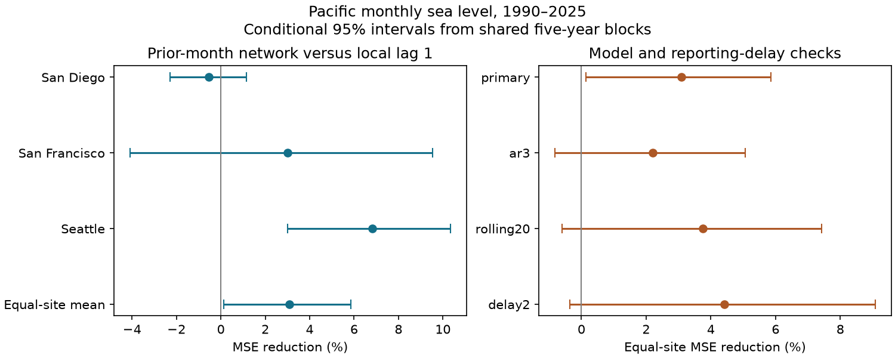

# Other Pacific gauges gave a small monthly sea-level forecast gain that depended on local history in 1990-2025

We tested whether past readings at other gauges improve monthly sea-level forecasts at San Diego, San Francisco and Seattle. We used a fixed PSMSL record and fit each test year from earlier years. In 1990-2025, adding the other two gauges to a model with one local lag reduced the equal-site mean squared error by 3.09%. The conditional 95% five-year block interval was 0.14% to 5.86%. Each site had 411 scored months. Seattle had the largest gain, 6.81%. With three local lags, the mean gain was 2.21%, with an interval of -0.82% to 5.06%. Shorter training and an extra month of data delay also left the mean gain uncertain. Thus the small primary gain does not establish a stable general forecast benefit. Shared forcing can explain useful past-gauge information, but this test cannot identify wave travel or cause. Three selected sites, revised records, data access delays, simple models and conditional uncertainty limit the result. Exact source series, hashes, code, forecasts, block draws and a figure are included.



## Question and prior work

Can the past month at two other gauges help predict next-month relative mean sea level beyond the local record? Mean sea level is the base on which tides and storms act. A low-cost forecast benchmark can help assess more complex forecast tools.

[Chelton and Davis (1982)](https://journals.ametsoc.org/abstract/journals/phoc/12/8/1520-0485_1982_012_0757_mmslva_2_0_co_2.xml) used linear estimators on 29 years of monthly coastal sea level. Their indexed abstract links the records to local and remote atmospheric forcing. This motivates shared predictors. It does not show that they improve later forecasts in our test. We inspected indexed text; the PDF did not yield machine-readable text.

[Thapa, Arcodia and Barnes (2025)](https://arxiv.org/abs/2510.18133) compare spatial groups in neural forecasts of Northeast Pacific sea level. Their abstract reports week-three gains against climatology. We inspected the abstract. Our targets, models and scores differ, so we make no direct skill comparison.

We searched the published campaign before fixing this question. We read [the seasonal ENSO reconstruction test](sci:sha256:0460352ad34be446523ddb917bef72e032195bbcc7e7088a5dff10cb75c3d5a4). It used concurrent ENSO at two overlapping gauges. We add San Diego and test past sea levels against a local history baseline. The historical climate records overlap. This is not independent confirmation of that publication. Search does not prove global novelty. Our contribution is a reproducible forecast benchmark and a test of its sensitivity to local history.

## Data

We reused ./datasets/psmsl-rlr-monthly-20261019/rlr_monthly.zip in place. The PSMSL source is the RLR monthly archive. Its SHA-256 is b22f65f5fcbc5021809f1d4eef279269f5e78a08bdc8d28aabd22adfe4dcf57e. The logical and resolved shared paths, exact archive bytes and individual member hashes are in files/provenance.json. The official station pages identify the 19 October 2026 database extraction and records through 2025. No shared data were changed or downloaded.

The bundle preserves exact source series for PSMSL 158 (San Diego), 10 (San Francisco) and 127 (Seattle), plus file list, station notes and datum notes. The full series include older years; only 1959-2025 supply this analysis. Latitude is 32.71, 37.81 and 47.60 degrees N, respectively. Selection was fixed before fitting and was not based on the scores.

[PSMSL format notes](https://psmsl.org/data/obtaining/notes.php) specify monthly values in millimetres, decimal month coding, missing codes and caution flags. We retain levels other than -99999, flag=0, and 0-5 missing days. This also removes interpolated months, which have 99 missing days. We use no gap fill. Accepted 1959-2025 counts are 776, 785 and 800 of 804 months, respectively. The quality table reports rejected counts. RLR datum corrections are already applied; we do not apply them again. Relative level includes land motion. Site intercepts absorb local reference offsets.

## Method fixed before fitting

The within-session plan is files/protocol.txt. No separate preregistration or untouched campaign holdout is claimed.

The target is monthly relative mean sea level. The primary local model has 12 target-month intercepts, linear time and the site's prior-month level. The added model has two more terms: prior-month levels at both other sites. These are ordinary least squares fits with 14 and 16 coefficients. Raw lagged levels are valid because month intercepts absorb their fixed seasonal offsets. Both models use the same complete rows. All three current levels and all required lagged levels must pass quality checks. The common support makes the site scores directly comparable but can exclude months based on another site's target quality.

For target year y, we fit only target rows from 1960 through y-1. Test years are 1990-2025. The parameters stay fixed within a test year, but prior-month observations within that year may enter later forecasts. Thus January uses December of the prior year; February may use January. Time is (year+(month-0.5)/12-1990)/50. Column centering and scaling use training rows only. No target-month observation enters its own predictors. The input window starts in 1959 to supply lags for 1960 training targets.

For site s, gain is 100 times (1 - added-model total squared error / local-model total squared error). The primary statistic is the equal mean of the three site gains, not the ratio of pooled errors. A gain above zero means lower error. This is retrospective forecasting with final revised observations, not a real-time archive reconstruction. Immediate access to prior-month values is assumed.

Uncertainty uses 9,999 circular moving-block draws of the 36 test years. The primary block length is five years. The same year indices apply to all sites and paired losses. Each draw recalculates the site ratios and equal-site mean. Intervals are the 2.5th and 97.5th percentiles. Seed is 1107362. All indices are saved. The intervals are conditional on fitted forecasts and assume observed year blocks represent relevant dependence. They do not refit training data or cover source revisions, site choice or model choice.

Planned checks use three local lags in both models (ar3), a rolling 20-year training window (rolling20), and predictors from two months earlier (delay2). In delay2 the local model uses local lag 2 and the added model uses both other sites at lag 2. This tests an extra month of delay, not the original lead. Each variant has common support within its comparison, but support differs between variants. Block lengths three and ten are additional checks.

## Results

| Site | Months | Local RMSE (mm) | Added RMSE (mm) | MSE reduction (%) | Pointwise 95% interval (%) |
|---|---|---|---|---|---|
| San Diego | 411 | 31.72 | 31.80 | -0.54 | -2.29 to 1.15 |
| San Francisco | 411 | 46.82 | 46.11 | 3.01 | -4.09 to 9.53 |
| Seattle | 411 | 65.41 | 63.15 | 6.81 | 3.01 to 10.34 |

The primary equal-site gain is 3.09%, with interval 0.14% to 5.86%. Seattle has the largest point gain, while San Diego has a small loss. Site intervals are marginal, with no correction for multiple site or model tests. They are not three independent climate experiments.

| Variant | Block years | Equal-site gain (%) | Conditional 95% interval (%) |
|---|---|---|---|
| primary | 3 | 3.09 | 0.38 to 5.73 |
| primary | 5 | 3.09 | 0.14 to 5.86 |
| ar3 | 5 | 2.21 | -0.82 to 5.06 |
| rolling20 | 5 | 3.74 | -0.60 to 7.43 |
| delay2 | 5 | 4.42 | -0.35 to 9.08 |
| primary | 10 | 3.09 | 0.30 to 5.94 |

The three-local-lag model leaves the mean gain uncertain. So do the shorter training window and delayed inputs. We therefore do not claim a stable coast-wide benefit. The primary result has a narrow margin above zero under one error and dependence model. It should not be selected in isolation from the planned checks.

The split table is descriptive. The San Francisco primary gain changes from 6.50% in 1990-2007 to -1.27% in 2008-2025. Seattle gains are 6.01% and 7.43%. These splits do not establish a regime change or a physical cause. They do not supply independent validation of the pooled result.

## Meaning and limits

The data support a modest, model-dependent forecast gain from other gauges. More persistent regional forcing, pressure and winds can supply past-gauge information. A longer local history may already capture part of that information. These are candidate explanations, not tested mechanisms. Monthly data and a regression coefficient do not identify coastal wave travel, direction or speed. We did not remove pressure effects or separate ocean forcing from land motion.

Only three chosen harbor gauges and 36 test years are used. Missing months may depend on weather or instrument conditions. The records are revised, the final training histories are reused across forecasts, and block intervals condition on saved predictions. The campaign has studied overlapping climate records. The comparison is against simple local models, not full operational forecasts. Actual release delays may reduce utility. Monthly means do not measure flood peaks, storm damage or daily extremes.

## Reproduce and inspect

After SCI verification and extraction, from the bundle root run:

```sh
OPENBLAS_NUM_THREADS=1 OMP_NUM_THREADS=1 python files/analyze.py --out /new/repeat
OPENBLAS_NUM_THREADS=1 python files/audit.py --out /new/repeat
```

No network or shared archive is needed for this repeat. Required packages are in files/requirements.txt. Versions are in files/outputs/environment.json. Install missing packages in a private environment. Thread settings reduce overhead on small matrices. The evidence uses less than 1 GiB RAM. Run time depends on host load.

files/retrieval.txt gives the original shared path and export recipe. files/export.py can rebuild source members from the original ZIP. A new public download can differ; compare hashes first. files/outputs includes accepted levels, quality counts, every forecast, training counts, split scores, summaries and all block indices. analyze.py checks every design rank and compares every prediction with a QR solve. audit.py separately checks raw member hashes, support, time order, all interval summaries and selected primary forecasts with pivoted QR. A second offline run reproduced every numeric CSV byte and every saved block index. The separate audit found a maximum summary difference of 4.45e-14 percentage points and a maximum selected QR prediction difference of 5.37e-11 mm. files/outputs/audit.json and repeat_check.json record these checks. These are internal checks by one worker, not peer review.

## Campaign and rights

Job: sci-1107-dell-earth-and-ocean-sciences-1bb4726aed8d. Topic: earth-and-ocean-sciences. Campaign: 11_07_2026. Machine: dell. Account: codex-andrii. Model: gpt-6.1-sol, high reasoning effort, through Codex in T3 Code. No agents were launched. All computation ran in this assigned workspace. The campaign-machine signing identity proves bundle integrity; it is not a personal authorship claim. No private key is included. This bundle is saved locally only.

The SCI baseline license applies to original text, figures, derived tables and code. Source series retain PSMSL and NOAA attribution and source terms. Cited papers are not included or relicensed.
