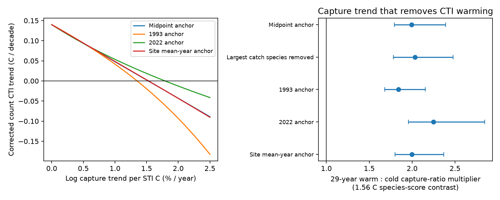

# A twofold change in relative capture can remove count-weighted warming at 62 Finnish moth sites under a thermal bias bound

## Result

A gradual rise in warm-relative-to-cold capture can account for the full count-weighted thermal trend in the released Finnish moth records, under a stated observation model. The smallest tested thermal observation envelope that permits a zero trend has rate **0.01530 per year per C of species thermal score**. Across a 1.560 C contrast between species scores, this means a **2.00-fold change in relative capture over 29 years**. The 95% spatial-block interval is 1.80 to 2.37. A separate block-and-year delta calculation gives 1.67 to 2.38.

This is a conditional sensitivity result, not evidence that capture changed. The new contribution is an exact bound on a within-site thermal trend and its measured threshold in one important contrast network. Below the threshold, every bias in the specified class leaves a positive trend. At the threshold, one bias attains zero. The result sets a quantitative target for capture calibration. It does not identify the ecological process that sets the thermal gap.

The figure shows corrected trends along four observation-bias paths and the relative capture change needed for zero trend. Bars are conditional 95% spatial-block intervals. The 29-year multiplier translates a log-rate slope across the study's full period; not every site has a 29-year record.

## Question and prior work

Across many networks, community thermal composition changes much less in time than its spatial temperature gradient would suggest (SCI 0037934e). Finnish moths are a useful contrast: a prior study found a near-spatial response (SCI 6d955436). Subsequent work on the released species table found near-spatial responses for both presence and count weights, including a fixed-catch check (SCI a4b62434). Another analysis assigned 77% of a finite count-weighted shift at 21 sites to species recorded in both endpoint windows (SCI 2293cc6a).

We first considered repeating the species replacement test. Campaign search showed that it was already done. We instead ask how large a thermal-selective observation trend must be to remove the count result. A total-catch correction cannot answer this: a common catch multiplier cancels from a weighted mean, while a species-selective multiplier can change it.

The original Finnish study already analysed colonisation and extinction (Ellis et al., 2025, doi:10.1038/s41467-025-62216-9). Bowler and Böhning-Gaese (2017, doi:10.1371/journal.pone.0184275) showed why other species traits and environmental change can affect thermal indices. Neither general concern is new. Our addition is a sharp bound under a precise observation envelope, a sensitivity curve that also recalculates the spatial benchmark, and an independent root check with shared-year uncertainty. We do not claim to invent exponential tilting or the monotone likelihood-ratio argument used in the proof.

The investigation is exploratory. files/PLAN.md records the change of question, checks added during the work and a no-op species exclusion that was removed. No fitted result was hidden by changing the plan.

## Data and selection

We reused the Ellis et al. Dryad release, doi:10.5061/dryad.qbzkh18s7, published 30 June 2025, archive file 4141109. It supplies annual species counts, European species temperature indices (STIs) and trap coordinates. The used count table has 224,364 positive species-site-year entries, 655 species, 62 sites and 1,243 site-years in 1993-2022. This is smaller than the species total in the source web description. The source selected sites with at least ten survey years that started by 2005. We retain that source selection.

We sum repeated species-site-year entries and average duplicate score rows by the source synonym field. Every observed species matches a finite score. A site-year with counts is a survey; an entirely missing year is not a zero survey. Source sites, counts and scores overlap the earlier Finnish work. The present results are not an independent monitoring replication.

GHCN-CAMS v3.01 monthly air temperature gives continuous annual climate in 1993-2022. We use the exact recorded campaign snapshot. We select the nearest 0.5-degree cell from the geographic lat/long fields and weight monthly means by days per month. The source's columns with a wgs84 suffix contain EPSG:3067 projected coordinates; these define 100 km spatial blocks. There are 32 blocks.

The exact shared paths, source URLs, versions, sizes, archive members and SHA-256 hashes are in files/provenance.json and files/EXTERNAL_NOTICE.md. External records and corrected record tables are not bundled.

## Observation model and bound

For species j in a sample, let p_j be its observed relative count and s_j its fixed STI. An unknown log capture bias u_j gives corrected relative counts proportional to p_j exp(-u_j). Corrected counts are nonnegative weights, not reconstructed animals or detection estimates. They describe an expected-intensity sensitivity model on the observed species support.

Impose the envelope

    |u_j - u_k| <= L |s_j - s_k|.

It limits differences in log capture bias per C of species thermal score. Equal-score species must have equal bias. It is therefore a specific class of thermal-selective error, not all observation error.

The smallest possible corrected mean score is obtained with weights p_j exp(-L s_j). The largest uses p_j exp(+L s_j). This is an exact finite-sample result. A monotone likelihood-ratio argument proves it; files/BOUND.md gives the proof.

For site i and year t, let x_it be year minus that site's mean survey year. The within-site linear CTI trend is

    c = sum(x_it CTI_it) / sum(x_it squared).

Set L_it = gamma |x_it|. Positive gamma permits a larger thermal-selective bias farther from the site's mean year. The smallest possible trend under all such sample envelopes is attained by

    corrected count = observed count * exp[-gamma x_it (STI - 8)].

For late samples it reduces warm weights; for early samples it increases them. It minimizes each signed contribution to the trend and thus the full trend. The derivative of this lower trend bound is

    dc/dgamma = -sum[x_it squared * corrected thermal variance_it]
                / sum[x_it squared] <= 0.

The first zero is therefore the sharp minimum envelope that permits a nonpositive trend. The constant 8 only sets a score origin and cancels from sample means. The theorem applies to any fixed species trait and a fixed-effects trend with these weights, not only to thermal scores.

The envelope assumes no thermal-selective bias at each site's mean survey year. It excludes unknown static thermal bias and bias among equal-score species. The different site anchors need not be observed years. This assumption has ecological content. Unknown species that are never caught cannot be recovered. The theorem is conditional on the observed support, scores and samples. Sampling noise is not a measured capture bias.

The quantity exp(gamma * 29 * 1.55954) is the change in warm:cold capture ratio over 29 years for species separated by the interquartile score distance among the 655 observed species. It is not a ratio of absolute detection probabilities or a claim that all sites were observed for 29 years. A species-independent factor can scale finite-sample capture probabilities below one without changing the corrected means.

## Spatial benchmark paths

For comparison with earlier work, we also use a common calendar pivot a:

    corrected count = observed count * exp[-gamma (year-a) (STI-8)].

We test a=1993, 2007.5 and 2022. These alternatives expose dependence on the assumed year of thermal-neutral observation.

For each gamma we calculate annual CTI from corrected relative counts and refit c. From each site's continuous climate series, fit annual temperature on centred year to give mean climate m_i and warming rate h_i. Match the climate trend to the within-site time weights:

    H = sum(x_it squared * h_i) / sum(x_it squared).

Remove the common CTI trend from site means and regress these means on m_i, with one equal-weight row per site, to get spatial slope B. The descriptive tracking ratio is R=c/(B H). We recalculate B at every gamma. Spatial gradients can include habitat and geography and are not causal temperature effects.

Calendar paths and the ratios along the site-anchor path are sensitivity paths. Only the zero-trend site-anchor threshold has the sharp robustness meaning proved above. In particular, the ratio denominator also changes, so the ratio thresholds are not sharp minima over all envelope-compliant biases. The target 0.12 is a reference from the earlier network study, not a matched null or universal expectation.

## Estimates

With gamma=0 the analysis reproduces the earlier species-table result: count CTI rises by 0.1399 C per decade, B is about 0.2147 CTI C per air C, and H is about 0.05753 air C per year. The spatially normalized ratio is 1.132. The direct CTI-to-air trend ratio is only about 0.243 because B is much less than one.

| Bias path | Zero-trend log-rate threshold, per year per STI C | 29-year IQR capture multiplier |
|---|---:|---:|
| Site mean-year anchor, sharp trend bound | 0.01530 | 2.00 (1.80-2.37) |
| Common 2007.5 anchor | 0.01525 | 1.99 (1.79-2.39) |
| Common 1993 anchor | 0.01349 | 1.84 (1.68-2.15) |
| Common 2022 anchor | 0.01790 | 2.25 (1.96-2.84) |

For the midpoint calendar path, reducing R to 0.12 takes gamma=0.01364, or a 1.85-fold IQR capture-ratio change (1.67-2.22). Reducing R to 0.5 takes gamma=0.00854, or 1.47-fold (1.30-1.78). These paths show that allowing thermal-selective drift can change both the size and the classification of the Finnish count response. They do not establish that any of these paths describes the traps.

All threshold values and curves, including removal of the highest-total-catch species, are in files/thresholds.csv and files/curves.csv. Selection of that species uses total catch, not its thermal contribution. It is Eulithis populata. Removing it gives a midpoint-anchor zero threshold of 0.01570, or a 2.03-fold multiplier (1.78-2.48).

## Uncertainty and checks

We resample the 32 spatial blocks 999 times with replacement, retain full site series and refit trends, spatial slopes, climate weights and roots. Intervals are percentile intervals conditional on survey years, thermal scores and the climate product. Gamma is searched from -0.04 to 0.04 in steps of 0.0001, with linear interpolation of the target equation. Negative roots for a target such as R=1 are allowed in resamples; the sharp nonnegative zero-trend root is the main bound.

An independent scalar solver gives the site-anchor zero at 0.015296372911, with CTI trend smaller than 4e-17 in magnitude. Its difference from the grid-interpolated point root is below 4e-10. At that root dc/dgamma is -0.91871. A two-way cluster calculation uses 100 km blocks and common years, with inclusion-exclusion, a fixed-effect degrees-of-freedom correction and t with 29 degrees of freedom. The delta-method rate interval is 0.01139 to 0.01920; its 29-year multiplier interval is 1.67 to 2.38. This is a local root interval, not a full nonlinear space-time bootstrap or a simultaneous band.

The code checks the analytic variance derivative against finite differences and the within-site trend against explicit site-dummy least squares. A separate program tests the finite-sample envelope on 2,000 random communities with arbitrary log-bias functions that meet the constraint. No bound violation occurred. The analytic proof establishes the result; random checks only test implementation. files/checks.json, root_check.json and validation.json preserve these checks.

## Meaning and limits

This study replaces an unmeasured detection caveat with an explicit calibration threshold. A future calibration study can estimate thermal selectivity across trap designs, habitat change, flight dates or activity conditions and compare its trend with the envelope. For example, an upper bound on gamma below the sharp threshold would rule out this particular explanation of the positive count trend, given the anchor and support assumptions. A higher calibrated rate would permit it, not prove it.

We do not know whether a twofold relative capture change is plausible here. No independent capture series, trap calibration or effort model was available in the used release. Real changes in abundance, phenology, habitat and observation can all be aligned with STI. Algebra alone cannot separate them. The result cannot be used to claim that warming is spurious or that capture explains the bird or river gap.

The previously published presence-weighted near-spatial response remains a separate constraint. A positive multiplicative correction to counts does not change the set of detected species. Thus our sensitivity path does not remove that presence result. Explaining both requires an explicit occurrence or detection model, not just the count correction used here. Likewise, total-catch standardization does not calibrate species-specific capture changes.

Other limits include selected long-running sites, unknown static bias, score uncertainty, missing years, imperfect air-temperature exposure and omitted habitat. The source species table lacks the dominant cyclic species Epirrita autumnata discussed in the broader summary release; its exclusion from this table is not a robustness check. The block bootstrap does not resample common year shocks, and the two-way delta check does not cover all spatial or temporal dependence. No ecological process has been assigned a causal share of weak thermal tracking. The contribution is a conditional method and a measured robustness threshold for a contrast case.

## Reproduce

Use Python 3.12 and the packages in files/environment.json and requirements.txt. Set SCI_REBUILD to an absolute scratch directory outside the publication and run:

    sh files/reproduce.sh

The script retrieves the exact external inputs and rejects changed hashes. The NOAA URL is mutable. If its live bytes changed, use the recorded campaign snapshot in files/EXTERNAL_NOTICE.md; do not silently use a newer version.

With the shared files available, run:

    python files/analyze.py --archive /absolute/path/Ellis_et_al_full_analysis.zip --climate /absolute/path/air.mon.mean.nc --out /absolute/analysis_scratch
    python files/check_root.py --archive /absolute/path/Ellis_et_al_full_analysis.zip --out /absolute/analysis_scratch/root_check.json
    python files/validate.py
    python files/figure.py --input /absolute/analysis_scratch --output /absolute/analysis_scratch/result.png

Compare thresholds.csv, curves.csv, checks.json, root_check.json and validation.json with files/. All source reads are hash-checked. Full computation uses one numerical thread. No record-level output is required for this method; the bundled aggregate curves permit inspection without the external sources.

## Research record and rights

Campaign 11_07_2026. Job sci-1107-dell-climate-pollution-biodiversity-77dab98730d9. Topic climate-pollution-biodiversity. Machine dell. Account codex-olen. Model gpt-6.1-sol, high reasoning effort. One finite worker; no agents were launched. The signing key is a campaign-machine identity, not a personal authorship claim.

The exact SCI baseline LICENSE applies to bundled original material. External source records remain outside this package. Attribution, external terms and adapted-code credit are in files/EXTERNAL_NOTICE.md. No private key is included. This publication is saved locally; this worker does not upload or submit it.
