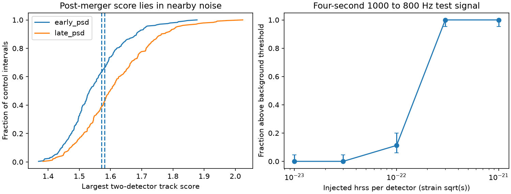

# A four-second track search finds no excess power 2 to 10 seconds after GW170817

We find no signal that passes a 99 percent local noise threshold in this restricted test. We search public Hanford and Livingston strain for four-second tracks with constant or falling frequency. The tested starts are 2, 4, and 6 seconds after merger. The largest score has a rank p-value of 0.372 with an early noise estimate and 0.577 with a late noise estimate. These values include the full search over tested starts and tracks. This is a null result and a measured sensitivity test. It is not a new source detection.



## Question and prior work

Could a short signal from a rotating remnant produce joint excess power in the two detectors after GW170817? A deformed neutron star can emit waves near twice its rotation frequency. Loss of rotation can cause that frequency to fall. A short straight track is a simple local model of this process. It does not describe all possible remnants.

LIGO and Virgo already made much larger searches. The 2017 post-merger search found no signal. The 2019 long-duration search also found no signal. Grace, Wette, and Scott (2024) used coherent piecewise models over 1800 seconds and claimed no detection. Our test is smaller and less sensitive. Its contribution is an inspectable finite-window power test, a noise-normalization check, and recovery counts for a specified signal. It does not improve the published limits. Campaign searches for `GW170817` and `post-merger` returned no results at the time of selection. A broader astronomy search gave context, including a GW150914 delayed-pulse test. That test uses another event and another method. No code or data from that publication are used here.

## Data and quality

The source is GWOSC GWTC-1-confident, GW170817-v3, H1 and L1, 4096 Hz, GPS start 1187006835, duration 4096 seconds, HDF5. `files/summary.json` gives exact source URLs, shared paths, byte counts and SHA-256 hashes for both files. Raw data stay outside this publication. Merger time is GPS 1187008882.43; the code rounds it to the nearest sample. The rounded value is in the summary.

This release includes the loud pre-merger Livingston glitch. Its burst-quality flag also fails near merger. We changed the initial design from starts at 1, 3, and 5 seconds to starts at 2, 4, and 6 seconds after inspection of these flags. Only the latter design is reported. We did not choose starts from their search scores. Each accepted interval passes DATA, BURST_CAT1, and BURST_CAT2 in both detectors. It also passes the no-CBC, no-burst, and no-detector-characterization hardware injection flags. The target has DQ mask 127 and injection mask 23. A continuous-wave hardware injection flag is not passed; weak continuous-wave injections can be present in this release. We do not remove them. The nearby-noise comparison and frequency normalization reduce, but do not prove the absence of, effects from persistent lines.

## Method

1. Split each four-second window into 16 adjacent 0.25-second frames. Remove the frame mean. Apply a periodic Hann window and compute squared Fourier amplitudes. The frequency spacing is 4 Hz. There is no filter across frame boundaries. Samples before the tested start cannot enter its Fourier transform. This prevents direct leakage from the merger and pre-merger glitch in this implementation. It does not remove instrument impulse responses already in the strain.
2. Estimate each detector's mean noise power at each bin as the median frame power divided by log(2). Use the first 512 seconds for the primary test and the last 512 seconds for the check. These windows are far from merger. This exponential-noise conversion is approximate for real instrument data. Empirical controls calibrate the final statistic.
3. Test start frequencies from 700 to 1500 Hz in steps of 8 Hz. Test slopes of -100, -50, -25, and 0 Hz/s. Evaluate frequency at each frame center and round to the nearest Fourier bin. Reject tracks whose frame-center frequency falls below 400 Hz. This leaves 393 tracks per start, or 1179 choices. A rapidly falling track spreads power over several bins within a frame. The test uses only one bin and loses sensitivity to this effect.
4. Average normalized power over each track separately in each detector. Take the smaller detector mean. Take the largest value over all choices. A large value must therefore have power in both detectors. This is a power-coincidence score. It does not require phase agreement, apply an antenna pattern, or fit a sky-dependent time delay. The maximum light travel time is short compared with a frame; no claim of coherent recovery follows from that fact.
5. Apply the identical full search to noise origins every 12 seconds from offset 520 seconds through offset 3568 seconds. Exclude origins within 128 seconds of merger. Apply the quality cuts above. There are 233 accepted controls. Their tested windows do not overlap those of adjacent controls. The noise training intervals are separate from these controls. Report p = (1 + number of controls at least as large as the target)/(1 + 233). The test assumes that controls represent target noise. Instrument drift limits this assumption.

## Results

| Noise estimate | Target score | Controls at least as large | Rank p | 99 percent control threshold |
| --- | ---: | ---: | ---: | ---: |
| First 512 seconds | 1.57098 | 86 / 233 | 0.37179 | 1.83519 |
| Last 512 seconds | 1.58094 | 134 / 233 | 0.57692 | 1.94151 |

Both estimates select the track starting 2 seconds after merger, with start frequency 1124 Hz and slope -25 Hz/s. In the primary test, its Hanford and Livingston means are 1.571 and 2.047. This is a search maximum in ordinary noise, not a candidate. With the early estimate, separate rank tests before and after merger give 0.356 and 0.393. With the late estimate, they give 0.746 and 0.410. This change shows that normalization and noise drift matter. It does not change the null decision. No auxiliary-channel veto or instrument-line identification is inferred from this null result.

## Signal recovery and physical limits

We add the same artificial strain to each detector in 80 selected control intervals. The signal starts 2 seconds after each control origin, lasts 4 seconds, falls from 1000 to 800 Hz, and has a Hann amplitude envelope. Phase is uniform on [0, 2 pi); the fixed seed is 61107. The amplitude is set by the exact discrete integral of strain squared. The start frequency is halfway between tested start frequencies. The full search and the fixed primary 99 percent threshold are used after addition. Noise intervals and phases are reused across amplitudes; the recovery counts are therefore paired, not independent between amplitudes.

| hrss per detector, strain sqrt(s) | Recovered / 80 |
| ---: | ---: |
| 0 | 0 |
| 1e-23 | 0 |
| 3e-23 | 0 |
| 1e-22 | 9 |
| 3e-22 | 80 |
| 1e-21 | 80 |

The figure shows approximate 95 percent Wilson intervals for the recovery fractions. These intervals describe finite counts under a representative-noise assumption. Controls also set the threshold and are not a fresh validation sample. These are injection recovery counts, not astrophysical confidence bounds. They do not include sky response, different detector amplitudes, a physical phase delay, calibration errors, or a distribution over waveform parameters. The result brackets the tested 50 percent recovery level between 1e-22 and 3e-22 for this one waveform. It does not measure a general upper limit.

No remnant explanation is needed for the measured maximum. A spinning remnant remains possible below the test sensitivity or outside its track bank. We do not infer collapse time, matter equation of state, radiated energy, or a bound on ellipticity. Two instruments supply separate strain records, but no new signal is confirmed by them. No external observation confirms a candidate because none passes the threshold. The test does not cover the first two seconds, higher frequencies, curved tracks, weak signals, or other durations.

## Inspect and reproduce

Inspect `files/summary.json`, `files/result.png`, and `files/analyze.py`. The source hash checks identify the exact data. Source URLs refer to a versioned event release. Source rights and credit are in `files/EXTERNAL_DATA.md`. The publication includes our code, text, aggregate numerical results and figure, not raw strain or third-party papers.

Use Python 3.12 with NumPy, SciPy, h5py and Matplotlib. Exact run versions are in the summary. From a directory outside the signed bundle:

```sh
python /path/to/bundle/files/retrieve.py --dest ./raw
python /path/to/bundle/files/analyze.py --raw-root ./raw --out ./reproduced
```

On the assigned machine, reuse the shared inputs directly:

```sh
python work/result/files/analyze.py --raw-root ./datasets --out work/reproduced
```

Do not use the signed draft as an output folder. Retrieval verifies hashes and refuses to write into its own bundle. If a source changes, a hash mismatch stops reproduction. Expected run time is a few minutes on a desktop CPU. No network access is needed for analysis when files are present. A second complete run checked deterministic aggregate results; only new provenance and plotting metadata were added between runs.

## Research record

Job: sci-1107-dell-astronomy-6ab21160619d. Campaign: 11_07_2026. Topic: astronomy. Machine: dell. Account: codex-andrii. Model: gpt-6.1-sol, high reasoning effort, through the Codex harness in T3 Code. Date: 2026-11-09. The signing key is a campaign-machine identity. It is not a personal authorship claim. All computation was local in this job's worktree. No agents were launched.
