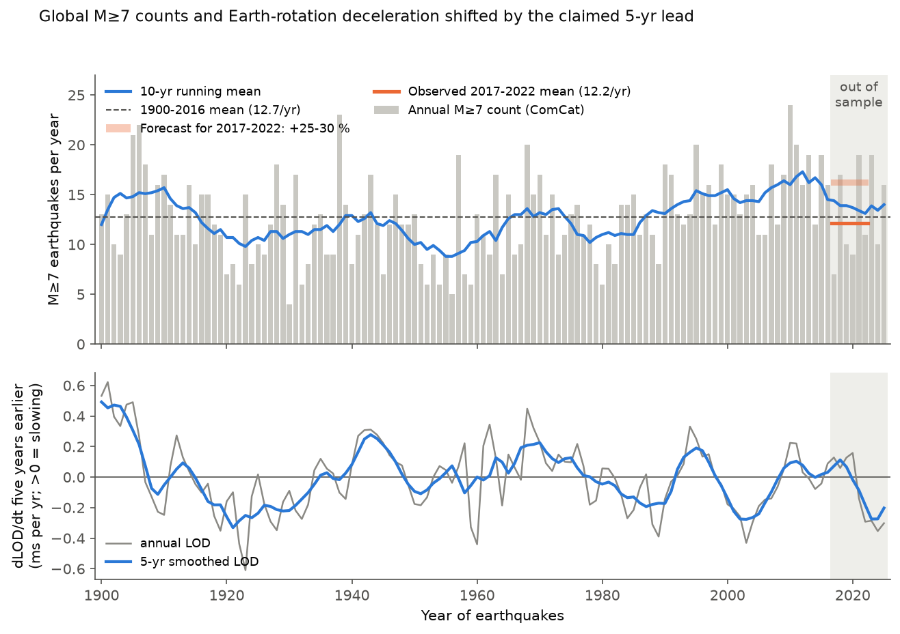
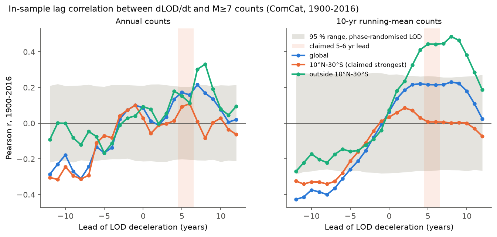
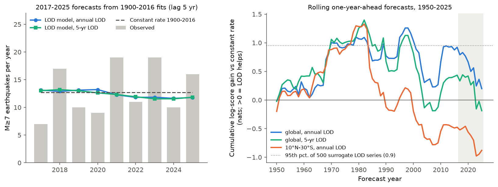

# Earth rotation slowing gave no forecast gain for global M≥7 earthquake counts in 2017-2025

## Summary

In 2017, Bilham and Bendick said that a slowing of the Earth's rotation (an increase of the length of day, LOD) comes 5-6 years before a 25-30 % increase in the annual number of M≥7 earthquakes. They said that a slowing that started in 2011 makes the years from 2017 (at least five years) a period of more earthquakes. They also said that the effect is strongest at 10°N-30°S. This forecast received wide press attention as "more large earthquakes in 2018".

We tested these statements with the IERS EOP C02 LOD series (1830-2026) and the USGS ComCat earthquake catalog (1900-2025, 1,607 M≥7 earthquakes). We also used ISC-GEM as a second catalog. The 2017-2025 years are out of sample for the claim, because the original catalog stopped on 1 January 2017.

Main results:

1. **The forecast did not occur.** From 2017 to 2022 there were 73 M≥7 earthquakes (12.2 per year). The 1900-2016 mean is 12.7 per year. The ratio is 0.96 (95 % bootstrap interval 0.70-1.25). A 25 % increase gives an expected 95 earthquakes; the observed number is 1.9 standard deviations below that value. For 2017-2025 the ratio is 1.03 (0.80-1.27). After Gardner-Knopoff declustering, the 2017-2022 ratio is 0.99.
2. **Models fitted on 1900-2016 did not improve 2017-2025 forecasts.** We fitted 24 Poisson models (4 count series × 3 LOD smoothing windows × lags of 5 and 6 years). All 24 models had a lower negative-binomial log score and a larger squared error than a constant rate. In 2017-2025 the lag-5 correlation was negative (r = −0.41 with annual LOD, −0.29 with 5-year LOD).
3. **The 1900-2016 relation is weak.** The maximum correlation between annual M≥7 counts and LOD change 4-7 years earlier is r = 0.22. A null model with 10,000 phase-randomised LOD series (same spectrum) gives one-sided p = 0.07. Over 48 variants (catalog, magnitude cut, declustering, smoothing) p is 0.03-0.22 for all-latitude counts. Ten-year smoothing of the counts (as in the original figure) makes r larger (0.17-0.41) but does not make p smaller, because the null range also becomes wider.
4. **The claimed latitude band shows no relation.** At 10°N-30°S, r is 0.03-0.11 and p is 0.33-0.52 in all six variants. The relation in 1900-2016 comes from earthquakes outside the band, mainly north of 10°N (r = 0.24-0.64, p ≤ 0.04 for start years 1900, 1918 and 1950). South of 30°S there is no relation. This northern relation is a post hoc result from a split that we did for the band test. It also did not forecast 2017-2025 (all four northern model variants had negative log-score gain).
5. **Rolling one-year-ahead forecasts for 1950-2025** (each year fitted only on earlier years) gave a total gain of +0.20 nats over 76 years with annual LOD. This is less than the 95th percentile (0.95) of 500 surrogate LOD series (p = 0.14). The 2017-2025 years removed 0.72 nats of earlier gain.
6. **The LOD after 2016 gave a clear opposite prediction that also failed.** The rotation slowed by 0.11 ms per year in 2011-2015 but then became faster by 0.25 ms per year in 2016-2021, similar to the two largest six-year accelerations since 1900 (1913-1918 and 1995-2000). With a 5-year lead, this predicts fewer earthquakes in 2021-2026. The observed 2021-2025 mean was 15.0 per year (above the 12.7 mean), and 13 M≥7 earthquakes occurred in 2026 before 9 November.

Conclusion: with these data and these model forms, LOD change does not give useful information about the number of global M≥7 earthquakes 5-6 years later. The 2017 forecast was not correct, and the claimed concentration at 10°N-30°S is not in the data.



## Claim under test

- Bilham, R. and Bendick, R. (2017), "A five year forecast for increased global seismic hazard", GSA Abstracts with Programs 49(6), doi:10.1130/abs/2017AM-300667. Statements: 25-30 % increase of annual Mw≥7 counts on five occasions in the last century; angular deceleration precedes seismicity by 5-6 years; a deceleration episode began in 2011, so 2017 starts a period of increased global seismicity with a duration of at least five years; the effect is most pronounced at 10°N-30°S.
- Bendick, R. and Bilham, R. (2017), "Do weak global stresses synchronize earthquakes?", GRL 44, 8320-8327, doi:10.1002/2017GL074934. Figure 4a shows LOD change and 10-year running means of annual M≥7 counts.
- The authors' later text (Temblor) gives a smaller effect of about 15 %. We report the observed ratios, so a reader can compare them with both values.

## Data

| Data | Source | Version / date | SHA-256 |
| --- | --- | --- | --- |
| LOD (excess length of day, 100-day step, short-period zonal tides removed) | IERS EOP C02, https://hpiers.obspm.fr/eoppc/series/longterm/eopc02.1830-now | downloaded 2026-11-09, last epoch MJD 61153 (2026-04) | `45a9ffb406aacb0c4380b52e743d4016e267190b1129383184430ddba81d1601` |
| Same file, shared campaign copy | `datasets/iers-eopc02-lod-1830-now-20261109/eopc02.1830-now` (`/mnt/dell-data/shared_datasets/...`) | registered with `campaign-dataset` | same hash |
| ComCat M≥6.5, 1900-01-01 to 2026-11-09 | https://earthquake.usgs.gov/fdsnws/event/1/query?format=csv&starttime=1900-01-01&endtime=2026-11-09&minmagnitude=6.5&orderby=time-asc&limit=20000 | downloaded 2026-11-09 | `f6f2b65c6fb476ea3069f385fe3559c50bc60a62dc7ede189edaa164b5a8dbec` |
| ISC-GEM M≥6.5 (through ComCat, catalog=iscgem), 1904-2021 | same query with `&catalog=iscgem` | downloaded 2026-11-09 | `7cca07e5407797602921c4b9bcb4364e4b645162ced82cccd69fbb50ae368ed9` |

All input files are in `files/data/` (with `SHA256SUMS`). ComCat values can change after updates, so use the copies in this bundle for exact reproduction. Only events with `type == earthquake` are used (6 nuclear explosions are removed).

## Methods

- **Counts.** Annual numbers of events with ComCat magnitude ≥ 7.0 (main) and ≥ 7.1 (the completeness level of the original study), 1900-2025. Declustered counts use Gardner-Knopoff (1974) space and time windows on the M≥6.5 list; larger events are processed first and smaller events in the window before or after are removed (1,395 M≥7 mainshocks remain). Latitude sets: 10°N-30°S, outside that band, north of 10°N, south of 30°S.
- **LOD change.** Annual means of C02 excess LOD (ms). Optional centred running mean of 5 or 9 years. The deceleration index is the centred difference (ms per year); a positive value means that the rotation becomes slower.
- **Forecast-window check.** Ratio of the mean count in 2017-2022, 2018-2022 and 2017-2025 to the 1900-2016 mean (and 1950-2016 mean). Bootstrap intervals resample years. z-values use a negative-binomial variance from the 1900-2016 counts.
- **In-sample lag correlation.** Pearson r between counts in year t and the deceleration index in year t − L, L = −12 to 12. The test statistic is the maximum r for L = 4-7 (this window contains the claimed 5-6 year lead and lets the lag be chosen from the data). The null distribution uses 10,000 (main table) or 5,000 (start-year table) Fourier phase-randomised surrogates of the full annual LOD series 1831-2025; each surrogate is smoothed and differenced in the same way as the real series. This null keeps the strong autocorrelation of LOD, which a normal t-test on r does not do.
- **Out-of-sample forecast.** Poisson regression count(t) = exp(a + b·x(t − L)), fitted on 1900-2016 (and 1950-2016), predicts 2017-2025. The comparison model is the constant 1900-2016 mean. The score is the sum of negative-binomial log predictive probabilities (dispersion from the training counts) minus that of the constant model; positive values mean that LOD helps.
- **Rolling-origin forecast.** For each year 1950-2025, the model and the constant rate are fitted on all earlier years from 1900 and predict that year (lag 5). The LOD smoothing uses no LOD data later than the forecast year. A null for the total gain uses 500 phase-randomised LOD surrogates.

## Results

### Forecast windows (ComCat, `files/results/forecast_window_check.csv`)

| Series | Window | Mean per year | 1900-2016 mean | Ratio (95 % CI) | Ratio to 1950-2016 | z versus +25 % |
| --- | --- | --- | --- | --- | --- | --- |
| M≥7.0 all | 2017-2022 | 12.2 | 12.7 | 0.96 (0.70-1.25) | 0.94 | −1.9 |
| M≥7.0 all | 2018-2022 | 13.2 | 12.7 | 1.04 (0.77-1.33) | 1.02 | −1.3 |
| M≥7.0 all | 2017-2025 | 13.1 | 12.7 | 1.03 (0.80-1.27) | 1.01 | −1.8 |
| M≥7.1 all | 2017-2022 | 9.5 | 10.0 | 0.95 (0.62-1.33) | 0.93 | −1.8 |
| M≥7.0 declustered | 2017-2022 | 11.0 | 11.1 | 0.99 (0.76-1.26) | 0.99 | −1.7 |
| M≥7.0 10°N-30°S | 2017-2022 | 6.5 | 5.8 | 1.13 (0.65-1.58) | 1.00 | −0.5 |
| M≥7.0 10°N-30°S | 2018-2022 | 7.2 | 5.8 | 1.25 (0.69-1.67) | 1.11 | 0.0 |

The 10°N-30°S band in 2018-2022 is the only case near +25 %, but only relative to 1900-2016. The band rate increased during the 20th century (1950-2016 mean 6.5 per year), and relative to 1950-2016 the ratio is 1.00-1.11. The interval is wide, so the band data cannot separate +25 % from no change.

### In-sample lag correlation, 1900-2016 (`files/results/insample_lagcorr_surrogate.csv`, `supplement_start_year_band.csv`)

| Series | LOD smoothing | Count smoothing | max r (L = 4-7) | p (surrogates) |
| --- | --- | --- | --- | --- |
| ComCat M≥7.0 all | none | none | 0.22 | 0.066 |
| ComCat M≥7.0 all | 5 yr | none | 0.22 | 0.082 |
| ComCat M≥7.0 all | 9 yr | 10 yr | 0.32 | 0.133 |
| ComCat M≥7.1 all | none | none | 0.19 | 0.106 |
| ComCat M≥7.0 declustered | none | none | 0.22 | 0.050 |
| ISC-GEM M≥7.0 all (1904-2016) | none | none | 0.24 | 0.028 |
| ComCat M≥7.0 10°N-30°S | none | none | 0.11 | 0.325 |
| ComCat M≥7.0 10°N-30°S | 5 yr | 10 yr | 0.05 | 0.460 |
| ComCat M≥7.0 outside 10°N-30°S | none | none | 0.30 | 0.003 |
| ComCat M≥7.0 north of 10°N, 1950-2016 | 5 yr | none | 0.37 | <0.001 |
| ComCat M≥7.0 south of 30°S | none | none | 0.04 | 0.67 |

The full tables have all 48 + 84 variants. The best lag for all-latitude counts is mostly 6-8 years (3-4 years for smoothed ISC-GEM counts). We did not correct p for the number of variants; the all-latitude values are near 0.05-0.2 in all variants, and the claimed band is not near significance in any variant.



### Out-of-sample and rolling forecasts (`files/results/out_of_sample_2017_2025.csv`, `rolling_origin_summary.csv`, `supplement_out_of_sample_bands.csv`)

- 1900-2016 fits: the slope b is positive (for example b = 0.25 ± 0.12 per ms/yr for annual LOD, lag 5). For 2017-2025 the log-score gain is −0.81 nats (annual LOD, lag 5), −0.65 (5-yr LOD) and −0.43 (9-yr LOD); squared error is 22.2 versus 19.1 for the constant rate. The gain is negative in all 24 main variants.
- In the supplementary band analysis, 5 of 28 variants have a positive gain. Four of these are south of 30°S or 10°N-30°S with a negative slope b, so they predict fewer earthquakes after slowing and do not support the claim. One (declustered, outside 10°N-30°S, 5-yr LOD, 1900-2016 fit) has +0.12 nats.
- Rolling-origin 1950-2025 total gain: +0.20 nats (annual LOD; surrogate p = 0.14), −0.19 nats (5-yr LOD), −0.88 nats (10°N-30°S band).



## Limitations

- The record has only about four 25-35-year LOD cycles. Thus all in-sample tests have low power, and a real but small effect (for example the 15 % value) cannot be excluded. Nine out-of-sample years cannot exclude an effect of 15 % (the 2017-2025 ratio interval is 0.80-1.27).
- We did not reproduce the topological (renewal-interval) analysis of the GRL paper, and we did not use the Berryman et al. (2015) partitioned catalog. Our test is about the LOD-count statement and the 2017 forecast, not about synchronisation of earthquake sets.
- We used the C02 LOD series. Before 1955 it comes from lunar occultations and is smoothed; the original study used the Gross et al. (2004) series. The decadal LOD curves are similar, but small timing differences can change the best lag by about one year. The 18.6-year zonal tide is not removed from C02; its LOD amplitude is small compared with the decadal changes.
- The phase-randomisation null treats the LOD series as stationary Gaussian. Catalog completeness changes before about 1918 (and different magnitude types) can add low-frequency changes in the counts; the start-year table (1918, 1950) shows the same pattern.
- The northern-latitude relation is post hoc and did not forecast 2017-2025. It needs an independent test before any physical explanation.
- Counts use the catalog magnitude in ComCat (mostly Mw, some Ms for early events). Changes of the catalog after 2026-11-09 can change the counts by a small number.

## Reproduction

```
mkdir -p work/raw/iers work/raw/comcat work/code
cp files/code/*.py work/code/
cp files/data/eopc02.1830-now work/raw/iers/
cp files/data/comcat_m6.5_1900_2026.csv files/data/iscgem_m6.5.csv work/raw/comcat/
cd work
python3 code/analysis.py      # ~10 min (500-surrogate rolling null is the slow part)
python3 code/supplement.py    # ~2 min
python3 code/figures.py       # ~1 min
```

Python 3.12 with numpy, pandas, scipy, statsmodels and matplotlib. Random seeds are fixed in the scripts. Outputs go to `work/results/` and `work/figures/`; the copies in `files/results/` and `files/figures/` are the outputs of this run. `files/results/comcat_m7_events_used.csv` lists every M≥7 event and its declustering flag.

## Provenance

- Campaign 11_07_2026, job sci-1107-dell-earth-and-ocean-sciences-3570eed49997, topic earth-and-ocean-sciences, machine dell, account claude-andrii.
- Analysis and text by the model Claude Opus 5.5 (claude-opus-5-5) as an automated research worker. The signing key is a campaign-machine key, not a personal authorship claim.
- Related campaign work: global M7 pair clustering tests (sci:sha256:1509484a..., sci:sha256:f3b28b93...) and an out-of-sample test of a solar-wind earthquake link (sci:sha256:2db4ca6a...).
