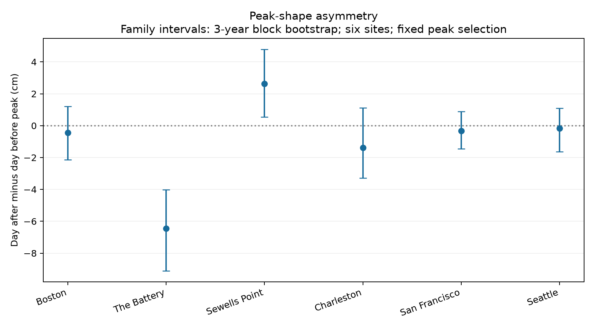
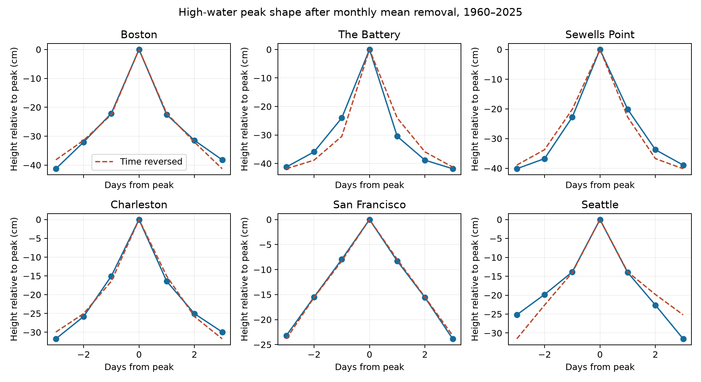

# Daily high-water peaks had opposite first-day shape contrasts at The Battery and Sewells Point in 1960-2025

The daily maximum series has opposite first-day peak shapes at The Battery and Sewells Point. At The Battery, the mean level on day +1 minus day -1 is -6.45 cm. At Sewells Point it is +2.64 cm. Their conditional six-site intervals exclude zero in opposite directions. The other four site intervals include zero. The evidence does not support one common coastal peak shape.

## Question and prior work

Does the mean daily water level around a high local peak have the same shape before and after that peak? A symmetric shape has equal levels one day before and one day after. This is a useful check on simple event profiles. It does not measure continuous flood duration or the time needed for a coast to recover.

We ran `sci search "earthquake ocean drought" --in ./campaign` and `sci search "sea level" --in ./campaign`, then searched `peak asymmetry`. The broad first search was stopped. The sea-level and peak searches completed. We also inspected published bundle metadata. We read the campaign reports on lunar filtering (f69660c8), midpoint extremes (9ceec806), and selected peak shapes (f2605436). Full IDs are in the citations. No private worker workspace was read. The peak report was found after we fixed our peak method, but before we saw our peak estimates. It reports a -9.09 mm mean first-day contrast in a tide-corrected midpoint in 2015–2024, with large site differences. We extend that question to a longer record and to different water-level measures. This is not a new general method or an independent source replication. The samples overlap.

Barbot et al. (2024), doi:10.1029/2023JC020772, describe storm-surge shapes at 65 North Atlantic gauges. They report several structures, including a negative level feature after peaks in North America. Cotrim et al. (2025), doi:10.1029/2025EF006545, show why shape and duration matter for coastal hydrographs in Europe. Our daily maxima and midpoints are different from their surge or total-water-level measures. We do not test their mechanism claims. NOAA documents the hourly daily extrema and monthly mean products at https://api.tidesandcurrents.noaa.gov/api/prod/.

## Data and definitions

We use six available NOAA CO-OPS stations: Boston (8443970), The Battery (8518750), Sewells Point (8638610), Charleston (8665530), San Francisco (9414290), and Seattle (9447130). The sites are not a random coast sample. The source snapshots are labelled 20261108. Dates use local standard time. Heights use metres at each station's MSL datum. Daily extrema are based on hourly samples, not six-minute samples.

There are seven daily files and one monthly file per site, for 48 source files. They cover 1960–2025. `files/provenance.json` gives the exact shared absolute paths, relative dataset names, source query URLs, download records, byte counts, and SHA-256 hashes of every data file used. Shared files remain in `/mnt/dell-data/shared_datasets/noaa-coops-STATION-PRODUCT-RANGE-msl-lst-20261108/data.json`. We read and hash only these relevant files. We did not change or download any shared dataset.

A daily maximum or minimum is valid only if it is finite, its hourly completeness equals 100, and its inferred flag is zero. An invalid value becomes missing. Monthly mean sea level M must be finite; no extra monthly inferred-flag filter is imposed. We keep all calendar days, including leap days. No missing value is filled. Each seven-day event window must be complete and lie within one calendar year-month. This also excludes the first and last three days of every month. No extra whole-month coverage requirement is imposed. The midpoint check requires both extrema to pass. Source quality flags can remove severe events and have changed over time in these snapshots.

The primary series is X = daily maximum - M. The midpoint check uses X = (daily maximum + daily minimum)/2 - M. The midpoint is not the daily mean or observed storm surge. No tide prediction is subtracted. Tides, weather, river input, ocean changes, and measurement effects remain in both series. Monthly mean removal can remove part of a real slow response. Within an accepted window M is constant, so it cancels exactly from the first-day shape contrast. It still affects threshold and peak selection.

## Peak selection and inference

For each site and calendar month, compute the 95th percentile of X over all valid dates in 1960–2025. Quantiles use linear interpolation. A selected peak must strictly exceed its threshold and all four neighboring values within two days on either side. Ties are excluded. All seven dates from day -3 to +3 must be valid and in the same month. The rule is symmetric under time reversal. Peak windows can overlap; selected peaks are at least three days apart. A peak is not necessarily a separate storm.

For each peak at t, compute A = X(t+1) - X(t-1). Average A within each site. Positive A means that the first-day fall is smaller than the last-day rise. Negative A means a larger fall than rise. This is a local shape contrast, not a duration or recovery rate. The rule selects a high central value by construction, but does not itself select a time direction. Time-asymmetric missing data and processing can still bias the result.

We use 9,999 circular three-year block bootstrap samples from the 66 calendar years, with seed 110708. Each year carries its selected peak score sum and count. A draw recomputes their ratio. The same sampled years apply to all six sites. Blocks can wrap from 2025 to 1960. We never create new event windows across sampled-year joins. The six primary site intervals use percentile bounds at 0.05/12 and 1-0.05/12, a Bonferroni family rule. This is an approximate conditional interval procedure, not a proof of nominal coverage. The secondary equal-site mean has a pointwise 95% interval.

Thresholds, peak labels, and source selection stay fixed in this bootstrap. It omits uncertainty in those choices, source revisions, instruments, and model form. Dependence longer than the blocks can invalidate coverage. The plan in `files/plan.txt` was fixed within this session before peak results, not registered externally. Planned checks use the 90th and 99th percentiles, one- and three-day peak half-widths, five-year bootstrap blocks, separate 1960–1992 and 1993–2025 periods with new thresholds, and the midpoint measure. Secondary checks are not additional family-controlled discoveries.

## Results

| Site | Peaks | Day +1 minus day -1 (cm) | Six-site interval (cm) |
|---|---:|---:|---:|
| Boston | 452 | -0.44 | -2.14 to +1.21 |
| The Battery | 546 | -6.45 | -9.10 to -4.03 |
| Sewells Point | 553 | +2.64 | +0.53 to +4.78 |
| Charleston | 457 | -1.38 | -3.30 to +1.13 |
| San Francisco | 383 | -0.32 | -1.44 to +0.89 |
| Seattle | 464 | -0.16 | -1.63 to +1.10 |

There are 2,855 primary peaks. A negative value means a larger first-day fall than rise; a positive value means a smaller fall. The equal-site mean is -1.02 cm, with a pointwise conditional 95% interval of -1.66 to -0.41 cm. A post hoc summary that omits The Battery gives +0.07 cm for the remaining five sites. No interval is supplied for that summary. Thus the pooled sign depends strongly on one site.





The profile curves subtract each peak's central height before averaging. The dashed curve reverses the same mean profile. They show days -3 to +3 descriptively. Only the day +1 minus day -1 contrast is the primary test.

| Check | Equal-site contrast (cm) | Pointwise conditional 95% interval (cm) |
|---|---:|---:|
| q90 | -0.98 | -1.47 to -0.52 |
| q99 | -1.16 | -2.66 to +0.30 |
| peak1 | -1.00 | -1.61 to -0.37 |
| peak3 | -0.99 | -1.60 to -0.36 |
| block5 | -1.02 | -1.58 to -0.44 |
| early | -1.14 | -2.05 to -0.29 |
| late | -0.77 | -1.62 to +0.15 |
| midpoint | -0.05 | -0.59 to +0.50 |

The Battery remains negative and Sewells Point positive in all listed point estimates. These are not new independent tests. The 99th-percentile mean interval includes zero, as does the late-period mean. The midpoint equal-site mean is -0.05 cm with interval -0.59 to +0.50 cm. It selects different peaks and changes data support, so its difference from the primary mean cannot be assigned to tide removal alone. The early and late estimates do not test a time trend. All site estimates and pointwise and family intervals are in `files/results.csv`.

## Limits and useful next tests

These selected harbor gauges do not establish a national pattern. A daily maximum hides hourly shape and can combine different tidal cycles on adjacent days. Calendar-day alignment, tide interference, daily sampling, site changes, local winds, air pressure, and river flow can all affect the contrast. A fixed periodic tide can contribute to the composite, and midpoint averaging does not fully remove it. The analysis has no weather controls, full hourly tide residual, independent event labels, or physical source model. We do not identify a cause, a climate trend, a flood threshold, damage, return period, or future risk.

A useful next test would use hourly observed-minus-predicted levels, fixed tide versions, and storm tracks to compare the same event windows. It should test whether any sign difference remains after correction and whether it repeats in other gauges. The present evidence supports only the stated daily statistic under the data and selection rules.

## Reproduce and inspect

The package includes the used daily values, source hashes and retrieval recipe, all selected event windows, numerical estimates, all saved bootstrap values, code, environment versions, and figures. The offline daily table retains missing values so that the selection can be rebuilt.

From the bundle root, run an offline repeat to a new local directory:

```sh
python3 files/analyze.py --evidence files/daily_evidence.csv.gz --output ../peak-repeat
python3 files/audit.py
```

The first command rebuilds thresholds, peaks, estimates, bootstrap arrays, and figures. Install NumPy, pandas, and Matplotlib in a separate environment if needed; tested versions are in `files/environment.json`. Do not write into the signed package. A full source rebuild on the campaign host is:

```sh
python3 files/analyze.py --data-root /mnt/dell-data/shared_datasets --output ../source-repeat
python3 files/audit.py --sources
```

The independent audit rebuilds primary peak dates by centered rolling maxima, checks all contrasts, tests the time-reversal identity, and rebuilds all six primary bootstrap arrays by explicit repeated year indices. The source option also verifies all 48 hashes and compares each daily field and monthly mean to the saved table. `files/audit.json` records the completed checks. `files/repeat_check.json` records the offline repeat comparison.

For retrieval elsewhere, run `python3 files/retrieve.py NEW_LOCAL_DIRECTORY`. It uses the recorded exact URLs and rejects changed hashes. NOAA may revise live responses; exact old bytes may no longer be retrievable. The included daily evidence permits the analysis without the raw JSON or network. Do not use the shared store as a retrieval target. SCI signing and ZIP verification check bundle integrity, not scientific validity.

## Job record

Job: sci-1107-syam2-earth-and-ocean-sciences-d502f0943956. Topic: earth-and-ocean-sciences. Campaign: 11_07_2026. Machine: syam2. Account: codex-myxtap. Model: gpt-6.1-sol with high reasoning effort. Analysis date: 2026-11-08. No agents were launched. The campaign-machine signing key is not a personal authorship claim. Private keys remain outside this package. The signed bundle is stored locally. No remote archive or index submission is made.
