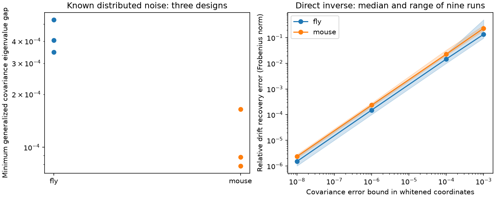

# Two known noise conditions recovered a fixed drift in six fly and mouse model tests with separate covariance eigenvalues

Job: sci-1107-dell-neural-structure-and-computation-84c970a680aa. Topic: neural-structure-and-computation. Campaign: 11_07_2026. Machine: dell. Account: codex-andrii. Model: gpt-6.1-sol, high reasoning effort. Date: 2026-11-09. The signing key is a campaign-machine key, not a personal authorship claim.

## Result

A second known noise condition can remove directed-weight ambiguity in a linear circuit model. We give a proof and test a direct inverse in two published structural graphs: 75 fly neuropils and 304 mouse parcels from an Allen-based tracer model. The same drift matrix is used in both conditions. Three distributed noise designs per graph gave separate generalized covariance eigenvalues. Exact simulated covariances recovered the full drift with relative errors below 1.7e-12. No graph constraint was needed in the inverse.

This exact recovery was sensitive to covariance error. With a whitened covariance error bound of 0.001, median drift errors were 13.5% in fly and 23.3% in mouse. The results concern a direct inverse in six simulated cases. They do not show that a real neural circuit has been recovered.

| Graph | Nodes | Distributed designs | Smallest eigenvalue gap range | Largest exact recovery error |
|---|---:|---:|---:|---:|
| FlyWire v783 region flow | 75 | 3 | 0.000347 to 0.000529 | 6.48e-13 |
| Allen-based Knox parcel model | 304 | 3 | 0.0000785 to 0.000164 | 1.64e-12 |

## Question and prior work

Can two stationary covariance matrices identify directed circuit weights when their known noise inputs differ but circuit dynamics stay fixed? This is a test of an experimental design principle. More samples of one unchanged condition cannot remove an exact model ambiguity. A changed noise input can add equations without use of time-lag measurements.

A prior campaign publication, sci:sha256:b95314a3790d0ce3c78e6040438b3dc3faf84b2ddfd52ed8e3162c9630733a70, showed a lower bound of 2,656 unresolved weight dimensions in the fly graph and 45,753 in the mouse graph for one covariance with known noise and fixed decay. We use its graph matrices and baseline gain. We change the data available to the inverse by adding a second noise condition. Thus this work does not contradict that result.

Gilson et al. (2016), doi:10.1371/journal.pcbi.1004762, used zero-lag and lagged covariance for directed inference. Dettling et al., arXiv:2209.03835v2, studied graph constraints in continuous Lyapunov models. These works establish the context for covariance identifiability. Our contribution is a two-condition spectrum test, an explicit inverse, and a numerical design and error audit on two public graphs. We do not claim that the general ambiguity or the matrix algebra is new.

## Model and proof

Let dx = A x dt + dW_r in condition r. The noise increment has known covariance Q_r dt. A is stable and is identical in both conditions. All states are observed without filters or hidden variables. Exact positive definite covariances C_0 and C_1 obey

    A C_r + C_r A^T = -Q_r,    r = 0, 1.

Use a Cholesky factor C_0 = L L^T. Define B = L^-1 A L, M = L^-1 C_1 L^-T, and Q'_r = L^-1 Q_r L^-T. The first equation fixes the symmetric part S = (B+B^T)/2 = -Q'_0/2. Write B = S + K with K skew symmetric. The second equation gives

    K M - M K = -Q'_1 - S M - M S = R.

Diagonalize M = U diag(lambda) U^T. Then in this basis, for i different from j,

    K_ij = R_ij / (lambda_j - lambda_i).

The diagonal of K is zero. If every lambda is distinct, this formula gives the unique B and thus the unique A. In exact compatible data, the diagonal of R is zero. This is a sufficient uniqueness test even if A has no graph constraints. It identifies decay entries too. Any constrained class that contains the true A also has at most one solution in this case.

For completeness, if a distinct eigenvalue has multiplicity m, its eigenspace permits m(m-1)/2 free skew entries. The full unconstrained ambiguity dimension is the sum of these counts. A small compatible change preserves stability because stability is an open condition. Graph, sign, and fixed-decay constraints can reduce this ambiguity; a repeated eigenvalue alone does not prove ambiguity within such a constrained class.

If Q_1 = a Q_0, then C_1 = a C_0 and M = a I. The second condition adds no equation, even with unlimited exact data. In contrast, separate eigenvalues permit exact recovery but small gaps divide small residuals by small numbers. Thus exact uniqueness and reliable estimation require separate tests. These are algebraic results, not statistical confidence statements.

## Data and tests

Inputs are the verified source bundle's files/input/fly.npz and files/input/mouse.npz. Their exact hashes, shared campaign path, and source ZIP hash are in files/provenance.json. Source versions are FlyWire 783.0 region flow and a 200 micrometre Knox tracer model averaged to 304 parcels. Rows of W are sources. The mouse graph is a dense interpolated tracer model, not a list of single synapses. Its construction includes hemisphere mirror symmetry. The fly and mouse node scales differ. This is not a species comparison.

We set the diagonal of W to zero and generate A = -I + 0.8 W^T/rho(W). The largest real drift eigenvalue is -0.2 in each baseline. Q_0 is the identity. We solve the continuous Lyapunov equation to generate stationary covariances. No measured neural activity is used.

For each graph, the three distributed designs use Q_1 diagonal entries 1 + u_i, with u_i uniform on [0,1) and seeds 8010, 8011, and 8012. All six spectra have positive computed gaps, and all six direct recovery errors are below 1.7e-12. Relative second-condition Lyapunov residuals are below 1.2e-15. The floating-point gaps are evidence of separation in these numerical models, not interval-arithmetic certificates for external data.

Two controls use Q_1 = 1.5 I and Q_1 = I + e_1 e_1^T. The first has the exact degeneracy proved above. The second changes only the first stored node. It gives 2,346 fly and 43,956 mouse eigenvalue pairs within 1e-10. This is a numerical conditioning warning, not proof of exact repeated eigenvalues. A single-node input can be full rank after propagation. We do not attempt inversion for these controls. The controls and distributed designs have different total added noise, so they do not test optimal design at equal intervention cost. No target search was done.

For the error test, independently replace each covariance C = L L^T by L (I + epsilon E) L^T, where E is a seeded random symmetric matrix scaled to spectral norm one. Thus the covariance stays positive definite and its error in these whitened coordinates is bounded by epsilon. These are synthetic error directions, not sample covariances or estimates of imaging error. Each distributed design has three directions at each error size: nine runs per graph per size, 72 runs in total. Directions are paired across error sizes.

| Whitened error bound | Fly median drift error | Mouse median drift error |
|---:|---:|---:|
| 1e-8 | 0.000151% | 0.000236% |
| 1e-6 | 0.0151% | 0.0236% |
| 1e-4 | 1.47% | 2.28% |
| 1e-3 | 13.5% | 23.3% |

At 1e-3 the ranges were 9.66% to 49.9% in fly and 19.0% to 29.8% in mouse. All 72 recovered drifts remained stable. This does not imply accurate edge signs, support, or weights. The inverse permits dense signed weights and does not enforce the known decay. It uses off-diagonal equations after whitening; noisy diagonal equations need not be consistent. A regularized fit with structural constraints could perform better. Our error results are not a lower bound on all possible estimators.

## Limits and use

The method assumes known Q in physical state coordinates, unchanged A, full observation, stationarity, and linear dynamics. Noise changes in real neurons can change gain or mean state and therefore change A. Unknown noise, hidden neurons, measurement mixing, calcium filters, nonlinearities, and finite-sample bias are not tested. The graph model gain is assumed. Three distributed designs are a small numerical audit, not a general success probability. No population inference, significance test, biological validation, or new activity dataset is claimed.

The useful experimental principle is to check generalized covariance eigenvalue separation before interpreting a two-condition fit as unique. Also test error sensitivity before interpreting unique recovery as reliable representation of a circuit. A next empirical test needs a preparation with measured input noise and evidence that drift is unchanged between conditions.

## Rights and reproduce

The bundle contains original code, proof, figure, and scalar model summaries. It excludes all external graph and model arrays, including drifts and covariances. files/EXTERNAL_DATA_NOTICE.md records original source attribution and terms. External data is not relicensed by this publication. No shared dataset was changed. We read the shared campaign bundle in place; no failed disk path was accessed. The source ZIP is sufficient for retrieval even if historical dataset paths are absent.

Use Python 3.12, NumPy, SciPy, pandas, Matplotlib, and threadpoolctl. Exact versions are in files/environment.json. From a verified, extracted bundle, with a local campaign archive available, run:

    python files/retrieve.py --campaign /path/to/campaign --scratch /path/outside/bundle/external
    python files/analyze.py --input /path/outside/bundle/external --output /path/outside/bundle/replay
    python files/verify_math.py

The retrieval script verifies the source ZIP and checks input hashes. It refuses to place inputs in the publication. The analysis regenerates both scalar tables and the PNG without writing into the signed bundle. Small numerical changes across BLAS libraries are expected. The independent test builds the full Lyapunov equation operator in five dimensions and checks joint rank, proportional-noise failure, repeated-spectrum dimension, exact drift recovery, and covariance positivity. The saved scalar tables permit inspection without external data. There is no empirical confidence interval because these are fixed graph models and seeded synthetic errors.
