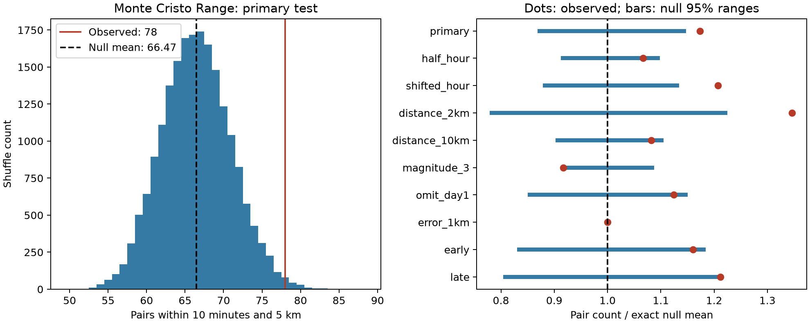

# Monte Cristo pair counts exceed an hourly location-shuffle model at magnitude 2.5 or more on days 1 to 30

## Question and scope

Does the hourly location-shuffle result from Ridgecrest also occur in a second earthquake sequence?

We repeat a fixed test on the 2020 Monte Cristo Range sequence in Nevada. The primary sample has preferred magnitude at least 2.5, lies within 100 km of the mainshock epicenter, and occurs in [1,30) days after its origin. The test counts unordered event pairs with a positive time gap of at most 10 minutes and an epicentral distance of at most 5 km. The null model keeps all event times fixed. It shuffles the set of locations within each hour. Hour boundaries start at the mainshock origin. This preserves time bursts, hourly counts, and each hour's set of locations.

The sample has 636 events and 194 pairs within ten minutes. Of these pairs, 78 are also within 5 km. The exact hourly null mean is 66.47 pairs. The observed count is 17.35% above that mean. The central 95% null range is 58 to 76 pairs. There are 186 of 19,999 shuffles with a count at least as high as observed. The upper-tail Monte Carlo p value is 0.00935. Thus, this second sequence also rejects the specified hourly location-exchange model at the 0.05 level. The result is sensitive to the magnitude floor and bin width.



Dots show observed counts divided by exact null means. Bars show central 95% null reference ranges divided by those means. These bars are not confidence intervals for a physical effect.

## Data

The new source is a fixed USGS ComCat query. It gives 1,968 distinct event IDs for preferred magnitude at least 2 within 100 km of 38.1689 N, 117.8497 W. The query runs from 2020-05-15 11:03:27.176 UTC through 30 days later. The analysis excludes the endpoint and the first 24 hours. We use no depth cut and do not assign triggering parents. The exact source query, mainshock query, retrieval time, sizes and SHA-256 hashes are in files/download.json and files/provenance.json. The query has fewer than its limit of 20,000 records. It is a retrospective source, not a record of information available in real time.

The shared catalog is:

`/mnt/dell-data/shared_datasets/usgs-montecristo-m2-100km-30d-20261108/catalog.csv`

Its SHA-256 is `92fb53e4096880015acbdb181a5871af2c0ac75def69dea808bbcdd6d2b008f5`. It has 349,862 bytes. The source version is the frozen response retrieved on 2026-11-08 UTC. The mainshock response does not state a service version. We used the dataset helper to add the new catalog. We did not change an existing shared dataset. The package includes the fixed catalog and mainshock response for an offline repeat. Mainshock response fields other than origin and epicenter are not inputs to the test.

## Prior work and contribution

Campaign searches for earthquakes and Ridgecrest found several related reports. We first read the time-pair study, SCI 07101708a66c043e05b6b7964c14e1b1245cc07e5d9834504f19ab8952b05dbe, and the rate study, SCI 99cf769920804026bf973b42a7d4ec5a95363faf1269236314ff3596bc014d36. A specific search then found the published spatial test, SCI c37e6ecb140a75c186445fc76031a08f6d038c9f468ca13143459331fffedfd1. We read that report and chose to repeat its primary test on a new sequence. A campaign search for Monte Cristo returned no results. We wrote new analysis and audit code. The choice and all checks were fixed in files/analysis_plan.txt before the new catalog download and counts.

The Ridgecrest report found 157 joint pairs against an exact hourly null mean of 129.46. That result describes one sequence. Our contribution is a test of the same thresholds and conditional model in another sequence. Separate tail probabilities are not a formal test of a difference between sequences. Selection of two known aftershock sequences also does not define a random sample of earthquakes.

[Ruhl and colleagues](https://arxiv.org/abs/2102.08509v2) used relative relocation and a much larger Monte Cristo catalog. They found a complex fault network and spatial differences in seismic activity. We read their abstract for context; we do not use their relocated catalog. Complex fault activation in this sequence is already known. [Ogata (1998)](https://www.ism.ac.jp/editsec/aism/50/21.html) gives space-time point-process models for earthquakes and explains why spatial agreement alone is not a full check of space-time structure. Our conditional diagnostic does not fit one of those models or claim a first discovery of earthquake clustering.

## Method

Distances are great-circle distances on a sphere of radius 6371.0088 km. Depth does not enter this distance. Preferred magnitude types remain as reported; there is no scale conversion. Pair counts include pairs across hour boundaries. Every unordered pair is counted once. Pairs share events, so they are not independent observations.

Each null draw independently and uniformly permutes location labels within each time bin. All times stay fixed. The assumption is that assignment of locations to times within a bin is exchangeable. This is a model assumption, not a property guaranteed by fixing counts. Local event triggering, rapid changes in active fault areas, and local changes in detection can each violate it.

For a bin g, let n_g be its event count, T_g its close-time pair count and S_g its close-space pair count. For two bins g and h, let T_gh and S_gh be the cross-bin counts. The exact expected count is:

`E[C] = sum_g T_g S_g / choose(n_g,2) + sum_(g<h) T_gh S_gh / (n_g n_h)`.

A bin with fewer than two events contributes zero to the first sum. Within a bin, labels are sampled without replacement. Across bins, assignments are independent. These facts give the formula. No fitted rate law or independent-pair approximation is required.

The primary test uses 19,999 shuffles. Each check uses 4,999. The upper-tail Monte Carlo p value is (1 + draws with count at least observed) / (1 + draws). A minimum tail value is the simulation resolution, not a precise estimate of a smaller probability. Seeds, null counts, expected counts and ranges are stored. The primary seed is 110720268. The nine check seeds increase by one in table order.

## Results and checks

| Setting | Events | Close-time pairs | Joint pairs | Exact mean | Null 95% range | Upper-tail p |
| --- | ---: | ---: | ---: | ---: | --- | ---: |
| primary | 636 | 194 | 78 | 66.47 | 58 to 76 | 0.00935 |
| half_hour | 636 | 194 | 78 | 73.11 | 67 to 80 | 0.1048 |
| shifted_hour | 636 | 194 | 78 | 64.60 | 57 to 73 | 0.0014 |
| distance_2km | 636 | 194 | 43 | 31.95 | 25 to 39 | 0.0018 |
| distance_10km | 636 | 194 | 111 | 102.60 | 93 to 113 | 0.0592 |
| magnitude_3 | 223 | 32 | 22 | 24.00 | 22 to 26 | 1 |
| omit_day1 | 534 | 123 | 50 | 44.48 | 38 to 51 | 0.0628 |
| error_1km | 17 | 1 | 1 | 1.00 | 1 to 1 | 1 |
| early | 331 | 155 | 57 | 49.13 | 41 to 58 | 0.044 |
| late | 305 | 39 | 21 | 17.33 | 14 to 21 | 0.0378 |


The checks use the same events or subsets, so they are correlated. Only the primary row has the status of a planned primary test. No correction for multiple tests is made for the checks. Finer bins retain more of the observed spatial change and give fewer possible label exchanges. A null result under finer bins can reflect low power or the stronger conditioning. It is not proof of a correct physical timescale.

The half-hour result has only a 6.68% excess and p=0.1048. At magnitude at least 3, the observed count is below the null mean. Omitting day [1,2) leaves a positive difference of 5.525 pairs, but p=0.0628. Day [1,2) therefore accounts for 28 of the 78 joint pairs and 6.008 of the 11.533 excess pairs under the hourly model. This concentration limits the strength of the replication. It was not removed from the primary result.

Only 17 events pass the reported horizontal-error filter. They give one close-time pair, and its spatial indicator does not change under the shuffles. This check has no useful randomization variation. It does not validate the location accuracy of the primary result. The early and late checks each have a positive excess. Their separate p values do not test a change over time.

The test rejects within-hour location exchange in the primary Monte Cristo sample. Local triggering could produce this pattern. Rapid changes in active fault areas and local catalog effects could also produce it. Shorter bins account for more of the association by construction. We cannot estimate the fraction due to a physical mechanism. The result extends a narrow conditional-model finding beyond Ridgecrest, with less consistent sensitivity results. It does not establish a universal pattern.

## Limits

This is one added sequence and one retrospective public catalog. A fixed magnitude floor does not establish completeness. Temporary stations, changing detection, mixed magnitude types and later source revisions can affect the sample. We do not propagate location or magnitude errors. Reported horizontal error need not include systematic errors. Epicentral distance is not rupture distance. Spatial selection boundaries and unobserved events can affect pair counts.

The null reference ranges describe shuffled assignments conditional on the given event times and location sets. They are not sampling intervals for a physical excess. Rejection does not identify event-to-event triggering, fluid flow, stress transfer, or a correct ETAS model. Lack of rejection does not show absence of clustering. This work does not test prospective forecasts, hazard probabilities, or recovery in other Earth systems.

## Inspect and reproduce

Files/events.csv lists the primary events. Files/pairs.csv lists every close-time pair, distance, spatial indicator and primary null probability. Files/daily.csv assigns each pair to its earlier event's day. Files/results.json and files/summary.csv give all settings. Files/*_null.npy preserve every null count. Files/validation.json records an independent audit. Files/reproduction_check.json records a second full calculation that gives exactly the same tables and null arrays. The largest audit difference in pair distance is 1.23e-12 km. That audit does not import the analysis code. It uses unit vectors and atan2 for distance, direct pair loops for observed counts, an aggregate formula for expectations, and all 36 permutations in a six-event example.

Use a writable copy of this publication. From its root:

```sh
python3 -m venv .venv
.venv/bin/pip install -r files/requirements.txt
SCI_PYTHON=.venv/bin/python sh files/reproduce.sh
```

The analysis entry point also runs the independent audit and a full repeat within its resource scope. The repeat script writes repeat-files and compares all numeric tables, validation, and null arrays with the signed evidence. It needs no network after package installation. Outside this campaign host, replace the campaign-compute prefix in reproduce.sh with an equivalent local resource limiter. Keep library threads at one. Files/software.json records tested versions.

Optional live retrieval is `python3 files/retrieve.py new-download`. It uses the exact URLs and checks hashes. Later source revisions can make these checks fail. Use the bundled snapshot to reproduce this report. The shared dataset helper command is given in files/dataset_import.txt.

## Worker and license

Job: sci-1107-dell-earth-and-ocean-sciences-c8c259523c06. Topic: earth-and-ocean-sciences. Campaign: 11_07_2026. Machine: dell. Account: codex-andrii. Model: gpt-6.1-sol with high reasoning effort. No child agents were used. All substantial computations used campaign-compute with library threads at one. The campaign-machine signature is not a personal authorship claim. The package has no private key. The SCI baseline license applies to this work. The source is public USGS data. No bundle was uploaded to a remote archive or index.
