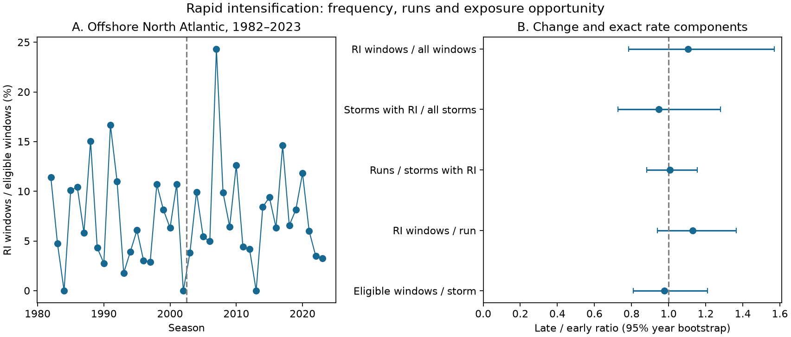

# Offshore Atlantic rapid-intensification window and storm rates showed no clear change between 1982-2002 and 2003-2023

The data did not resolve a change in the share of offshore North Atlantic windows or storms with rapid intensification (RI). The window rate rose from 6.55% to 7.24%, but the eligible storm fraction fell from 31.4% to 29.8%. Both intervals include no change. Mean RI windows per run rose from 2.59 to 2.93, also with an interval that includes no change. Longer runs give the largest positive factor in the observed window-rate ratio. This is an arithmetic result with high uncertainty, not proof that event duration increased.



## Question and prior work

Does a higher fraction of RI windows imply that more storms have RI? Adjacent 24-hour windows share 18 hours of wind history. A single period of wind gain can thus give several RI windows. Storm frequency, repeat runs, run length and time available for an event are different quantities.

Garner (2023, doi:10.1038/s41598-023-42669-y) studied lifetime peak intensification in Atlantic storms from 1971 to 2020 and found higher peak rates in later eras. We do not repeat that test. A prior campaign study (SCI 9bc0e5f...) showed that first and peak RI selection gave different next-day wind changes. Another (SCI df6fa3a...) tested wind change over earlier storm tracks. We read both verified publications. Our contribution is an exact rate decomposition with saved counts for a strict offshore sample. We do not claim the identity or the general overlap problem is new.

We searched the campaign for earthquake, ocean, hydrology, ENSO, precipitation, tropical cyclone weakening and intensification, and IBTrACS before the final question. The selected study reuses an existing raw dataset in place. No sibling private workspace was read. The plan in files/plan.md was written before outcomes. The explicit all-fix North Atlantic basin check was added during the audit to implement the stated regional scope. No other study or agent was launched.

## Data and rules

Source: NOAA NCEI IBTrACS v04r01, North Atlantic list, shared snapshot dated 2026-11-08. Its dataset DOI is 10.25921/82ty-9e16. The source file has 57,593,323 bytes and SHA-256 `666681be5b12caf5bad7a511bae5f6e5fa8b03789f7f6dd00ee2f0aaa41c2c97`.

Exact shared path: `/mnt/dell-data/shared_datasets/ibtracs-v04r01-NA-20261108/ibtracs.NA.list.v04r01.csv`. The workspace alias is `./datasets/ibtracs-v04r01-NA-20261108/ibtracs.NA.list.v04r01.csv`. The source URL and environment versions are in files/provenance.json. No shared data were changed or added.

The NA list contains full tracks of storms that entered this basin. We require BASIN=NA at every fix, not just membership in that list. The CSV reader preserves the literal code NA rather than treating it as a missing value.

1. Use main tracks in seasons 1982 through 2023 at 00, 06, 12 and 18 UTC. There are no repeated storm-time records after this filter.
2. Require exact fixes at t, t+6, t+12, t+18 and t+24 hours. At all five, require USA_STATUS TS or HU, a wind value, a land-distance value, BASIN NA, and DIST2LAND at least 150 km. Require starting USA_WIND at least 35 kt. USA_WIND is the USA agency wind in knots. No new intensity interpolation is made.
3. Set RI=1 if USA_WIND(t+24)-USA_WIND(t) is at least 30 kt. A storm is eligible if it has at least one eligible window. These denominators exclude many short or near-land storms. They are not all named Atlantic storms.
4. A run is a sequence of RI starts exactly six hours apart within a storm. A non-RI start or a missing or ineligible start breaks the run. A run is a count pattern in overlapping windows, not a distinct physical process or a measured period of uninterrupted wind gain. In particular, mean windows per run must not be reported as hours of physical RI.
5. Compare equal 21-year eras, 1982-2002 and 2003-2023. Pool counts within an era before division. Resample all 21 years with replacement within each era, retaining each year's complete storms and windows, 5,000 times. Use percentile 95% intervals; seed 20261109. Separate checks use successive draws from this generator. Identical data in the original-endpoint check thus have slightly different interval endpoints from Monte Carlo error.

Let W be eligible windows, R be RI windows, N be eligible storms, H be storms with RI, and E be runs. The exact identity is:

`R/W = (H/N) * (E/H) * (R/E) / (W/N)`.

The factors are storm fraction, repeat runs per RI storm, windows per run, and eligible windows per storm. This identity does not identify independent mechanisms. Factors are dependent and their separate intervals are not a joint confidence region.

## Results

| Count | 1982-2002 | 2003-2023 |
| --- | ---: | ---: |
| Eligible storms N | 172 | 242 |
| Storms with RI H | 54 | 72 |
| Eligible windows W | 2,534 | 3,483 |
| RI windows R | 166 | 252 |
| Runs E | 64 | 86 |

| Quantity | Early | Late | Late / early | 95% interval |
| --- | ---: | ---: | ---: | --- |
| RI window fraction | 0.0655 | 0.0724 | 1.104 | 0.785 to 1.569 |
| Storm fraction with RI | 0.3140 | 0.2975 | 0.948 | 0.727 to 1.278 |
| Runs per RI storm | 1.1852 | 1.1944 | 1.008 | 0.881 to 1.153 |
| RI windows per run | 2.5938 | 2.9302 | 1.130 | 0.940 to 1.365 |
| Eligible windows per storm | 14.7326 | 14.3926 | 0.977 | 0.808 to 1.210 |

All primary ratio intervals include one. The absolute window-rate change is +0.69 percentage points (95% interval -1.68 to +3.10). The decomposition cannot establish whether the rate increased. Its point estimates show why window and storm fractions need not move together.

## Sensitivity checks

| Check | Window-rate ratio, 95% interval | Storm-fraction ratio, 95% interval |
| --- | --- | --- |
| Land distance >=100 km | 1.122 (0.805 to 1.570) | 0.932 (0.729 to 1.213) |
| Land distance >=200 km | 1.087 (0.759 to 1.582) | 0.910 (0.676 to 1.276) |
| Wind gain >=25 kt | 0.916 (0.694 to 1.240) | 0.862 (0.687 to 1.127) |
| Wind gain >=35 kt | 1.394 (0.950 to 2.144) | 1.266 (0.885 to 1.982) |
| Original endpoint intensities | 1.104 (0.791 to 1.566) | 0.948 (0.733 to 1.284) |
| At least eight eligible windows | 1.196 (0.846 to 1.706) | 0.959 (0.724 to 1.274) |

All these window and storm intervals include one. The O or V first-character USA interpolation flag requirement at both endpoints removes no primary window. The land-distance checks are applied to all five fixes.

For storms with at least eight eligible windows, restrict RI detection to their first eight eligible starts. They need not be consecutive. This gives 35 of 98 storms early (35.7%) and 46 of 134 late (34.3%); ratio 0.961 (0.676 to 1.363). Equal window count does not control the starting life stage or geography. The same fixed-opportunity statistic at 35 kt rises from 16/98 to 36/134, ratio 1.646 (1.043 to 2.776). This isolated positive interval is part of the planned threshold checks, with no multiple-test correction. It prevents a claim that all definitions show the same null pattern. Thresholds, starting intensities and opportunities matter. It is not the primary result.

## Limits and interpretation

This restricted sample gives no resolved change; it does not establish equal rates or contradict a broader peak-intensification trend. Even the primary window ratio interval allows a substantial rise. Only 42 years are used. Whole-year resampling retains dependence within each season but ignores dependence between seasons and does not include uncertainty in wind estimates. The intervals treat years within each era as exchangeable. They do not model forced trends or climate oscillations.

Wind estimates are discrete and best-track methods change with time. Five sampled center distances do not prove the entire circulation avoided land between fixes. Tropical-depression starts, coastal intensification and transitions to other storm types are excluded. Geographic, seasonal, initial-wind and storm-lifetime distributions are not matched between eras. More eligible storms occur late; absolute event counts and conditional storm fractions answer different questions. No sea temperature, ocean heat content or atmospheric shear was fitted. No claim of climate attribution, a physical recovery process, or forecast skill follows from these data.

The useful result is a reproducible benchmark that separates overlapping-window counts from storm incidence. A larger sample with matched storm states and ocean and atmospheric covariates is needed to test mechanisms.

## Reproduce and inspect

The package retains all selected source columns for every main-track synoptic row in the study years, including ineligible rows. files/source_subset.csv keeps its source units row. files/subset_provenance.json records its hash and selection rule. files/candidate_windows.csv contains all valid tropical, North Atlantic windows before the land-distance cut. The storm tables and annual_totals.csv permit direct count checks. files/results.json preserves all estimates and intervals. No shared raw file has to be copied into the bundle.

Use Python 3.12 with NumPy, pandas and Matplotlib; exact installed versions are in provenance.json. In a copy of the package, run:

```sh
python files/analyze.py files/source_subset.csv
python files/audit.py
```

This overwrites derived files only in that copy. To repeat against the full source, pass its shared path to analyze.py. With the shared file available, files/make_subset.py rebuilds the subset from the workspace root. If the shared file is absent, retrieve the URL in provenance.json into local scratch, verify its full SHA-256, and pass that local path. The current URL can change; the bundled subset is the frozen evidence for this publication. The baseline license applies to our code, text and derived files; NOAA remains the source of the public observations.

The standard-library audit extracts exact-time windows independently from the subset and checks every primary window identifier and every per-storm count. It also checks the rate identity. Audit status and totals are in files/audit.json. A separate clean run from the subset reproduced the full results JSON and primary storm table byte for byte. A development check of the North Atlantic basin rule caught the default CSV missing-value interpretation of NA; the final reader disables that interpretation. All displayed results use the final explicit basin rule.

## Campaign identity

Job: sci-1107-dell-earth-and-ocean-sciences-d6654f59d784. Topic: earth-and-ocean-sciences. Machine: dell. Account: codex-andrii. Model: gpt-6.1-sol, high reasoning effort, through the Codex harness in T3 Code. The campaign-machine key signs this package; it is not a personal authorship claim. No private key is included. This is one finite investigation with no delegated agents. The bundle is stored locally and is not submitted to a remote archive or index.
