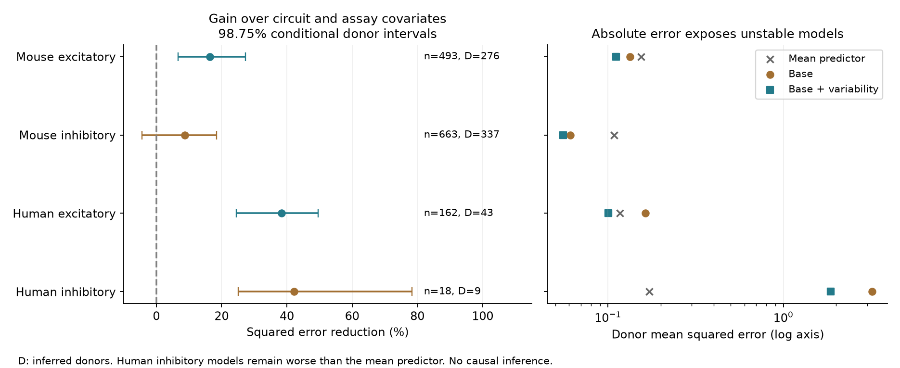

# Resting response variability improved 50 Hz change predictions in two selected Allen excitatory slice samples

## Result

Resting response variability improved predictions of the response change during 50 Hz stimulation in selected mouse and human excitatory connections. The comparison held out whole inferred donors. It controlled for recorded cell labels, reverse connection calls, cell-body distance, reference amplitude, noise, and event count in a fixed ridge model.

In 493 mouse visual-cortex connections from 276 inferred mice, adding variability reduced donor-weighted squared error by 16.43%. The conditional 98.75% donor bootstrap interval was 6.69% to 27.33%. In 162 human temporal-cortex connections from 43 inferred donors, the reduction was 38.39%, with interval 24.48% to 49.55%. These are gains against the stated covariate model. The two enhanced models also had lower point error than a mean predictor. This does not show a causal release mechanism or transfer between species.



Figure 1. The left panel shows gains at ridge penalty 10, with intervals for four primary comparisons. The right panel shows absolute error and a mean predictor. The human inhibitory model remains worse than the mean predictor. Its large relative gain does not establish useful prediction. Intervals condition on the fitted models and the selected connections.

## Question and prior work

Can one response statistic improve predictions of repeated-spike transmission beyond sampled circuit labels and assay covariates? A circuit model that assigns the same response dynamics to all connections of one class can miss variation within that class. Resting response variability is a candidate extra measurement. Release models connect variability with release probability and resource use, but variability also depends on release-site count, noise and response amplitude. It is not a direct estimate of release probability.

Campagnola, Seeman and colleagues (2022; doi:10.1126/science.abj5861) reported cell-subclass dependence of synaptic dynamics in these data. The Allen project measures local connectivity and response physiology in the same slice recordings. This provides a direct link through pair and cell IDs, without an atlas match between animals. The new contribution is a donor-held-out prediction benchmark with explicit circuit and assay controls. The biological link between variability and plasticity is not a new hypothesis.

We searched the campaign for connectivity, synphys, latency, synaptic delay, variability plasticity, variability depression, and resting variability before fixing this question. We read the signed publications SCI sha256:774028f84c600f1b3ccbc6db2f3dd42bd83e5bac4c2147392bdb78872f415f06 and SCI sha256:decef28e21bcd9cb9de6e4ded9aa55988e4ca24c56c263841e8b29af56b711a5. They test shared-neuron plasticity and reciprocal-connection variability. This study tests a different prediction target and adds no code from those publications. Web searches covered the Allen study, data registry, and variability mechanisms. We inspected pinned Allen source to establish field meaning. No private worker workspace was used.

## Data and measurements

We read the shared database in place with SQLite read-only mode:

`/mnt/dell-data/shared_datasets/allen_synphys/r2.1_small_2023-01-26/synphys_r2.1_small.sqlite`

The source is Allen Synaptic Physiology r2.1 small, schema 22, last modified 2023-01-26. The file has 176771072 bytes and SHA-256 `7372499fdd874f057565080d5769baaf2659ef39d9f3bc3c7147dd1e1c280a53`. The run checked this hash. Source URL and retrieval instructions are in files/evidence/source.json and below. No data were downloaded or changed.

Field interpretation uses the shared source at `/mnt/dell-data/shared_datasets/allen_synphys_source/b264d8b61abf11d015222865ca081f80655d33d4/`. Exact paths, URLs and hashes of source and metadata files read are in files/source_provenance.json. The source commit need not be the database build commit. We did not reconstruct raw response fits.

The response target is the stored scalar `stp_induction_50hz`. It is the median trial change `(median(A6,A7,A8)-A1)/Aref`. Aref is the 90th percentile fitted amplitude for excitation and the 10th percentile for inhibition. Positive change means facilitation under this sign convention. Negative change means depression. This is a normalized current-clamp voltage response measure.

The predictor `variability_resting_state` is the natural log of `sqrt(var(Arest)-var(noise))/abs(median(Arest))`. Resting responses follow a gap greater than eight seconds. The formula in the source code uses the resting median; the nearby comment mentions a different denominator. We use the stored scalar. We use no pulse-amplitude arrays, which have a known shared-list problem in the pinned source.

We require a detected chemical connection, dynamics QC pass, finite predictor and target, and at least five induction trials. We restrict mouse to VisP and human to TCx. QC records and retained records are:

| Group | QC records | Retained connections | Inferred donors |
|---|---:|---:|---:|
| Mouse excitatory | 731 | 493 | 276 |
| Mouse inhibitory | 1071 | 663 | 337 |
| Human excitatory | 201 | 162 | 43 |
| Human inhibitory | 34 | 18 | 9 |

Missing estimates are exclusions, not absent connections. files/evidence/records.json preserves all 2037 QC rows in this scope, including excluded rows and missing fields. These are small detected slice circuits, not anatomical connectomes. Mouse and human differ in region, cell mixture and tissue source.

## Method

files/analysis_plan.txt was fixed before model scores. This is a local exploratory plan, not an external registration. We fit the four groups separately. The base predictors are source and target nonsynaptic cell class, Cre label and target layer; reverse connection call; distance; and the logs of absolute reference amplitude, noise standard deviation and source event count. Reverse calls include an explicit missing category. The enhanced model adds resting log variability. All models include an unpenalized intercept. Other coefficients have ridge penalty 10.

For each group, we sort donor IDs by SHA-256 of the seed string and ID, then assign them in turn to five folds. A mouse donor ID is a six-digit specimen number. A human donor ID is the first Hxx.xx.xxx fields of the specimen name. No selected record uses the slice fallback. These IDs are inferred and not an independently verified donor registry. A donor appears in only one test fold within a model run.

Within each training fold, numeric missing values receive the training median, with a missing indicator. Numeric values are standardized using training means and population standard deviations. Categorical levels are defined in training only; unseen test levels receive all zeros. All connections from one training donor have total weight one before the weights are scaled to sum to the training connection count. The minimized objective is weighted squared error plus the stated coefficient penalty. This scaling makes the penalty definition explicit.

We average test connection losses within donor, then weight donors equally. The main gain is `100*(base error - enhanced error)/base error`. We resample donors 19999 times with replacement and recompute the gain from fixed held-out predictions. The central 98.75% percentile intervals allocate nominal error across four primary comparisons by Bonferroni. They do not include the uncertainty from refitting on new training samples or from the original response estimates. Shared training folds can correlate held-out losses. Thus the intervals are conditional evidence, not a calibrated guarantee for all new donors.

Planned secondary checks use penalties 1 and 100, at least ten induction trials, and absolute error. After seeing the small human inhibitory sample, we added a diagnostic donor-weighted training-mean predictor. That diagnostic was not in the fixed plan. No model was selected on its test score.

## Results and checks

| Group | Base MSE | Enhanced MSE | Mean MSE | Gain % [98.75% interval] |
|---|---:|---:|---:|---|
| Mouse excitatory | 0.13318 | 0.11129 | 0.15480 | 16.43 [6.69, 27.33] |
| Mouse inhibitory | 0.06096 | 0.05563 | 0.10822 | 8.75 [-4.44, 18.52] |
| Human excitatory | 0.16348 | 0.10072 | 0.11701 | 38.39 [24.48, 49.55] |
| Human inhibitory | 3.21058 | 1.85754 | 0.17219 | 42.14 [25.10, 78.36] |

MSE is the mean squared error in the normalized response target. For human excitation the base model is worse than the mean predictor. Thus 38.39% overstates the gain relative to that simpler reference; the point reduction against the mean predictor is about 13.92%. We make no interval claim for that unplanned comparison. Human inhibition is unstable and gives no useful primary model despite a positive relative gain. Its gain falls to 12.01% at penalty 100, and both models still have higher error than the mean predictor.

For mouse excitation the gain is 16.16% at penalty 1 and 18.80% at penalty 100. Human excitation gives 29.62% and 38.15%. The corresponding conditional intervals exclude zero. At ten or more trials, gains are 19.12% in mouse excitation and 37.46% in human excitation; both conditional intervals exclude zero. At the primary penalty, mean absolute error falls by 10.48% and 23.10%, respectively. The added variability coefficient is positive in all five folds in each of the four groups. In this model, greater variability is associated with a more positive response change. This coefficient is descriptive, not a causal effect.

Mouse inhibition has an interval that includes zero in every planned squared-error check. Human inhibition at ten trials has only eight connections and six donors; its interval includes zero. Full scores, coefficients, fold assignments and predictions are supplied. An independent standard-library check confirms all 16 score rows, unique pair IDs, source outcomes, trial filters and donor-fold assignments.

## Interpretation and limits

A resting response measurement adds predictive information to this particular circuit-label and assay model in two excitatory samples. This supports including measured synapse differences when testing circuit models. It does not show that connectivity causes variability, that variability is independent of all circuit structure, or that a mechanism is shared between regions. Separate fits in mouse and human are repeated tests, not cross-species transfer.

The predictors and target can share response trials and amplitude estimates. Their estimation errors can be coupled. Linear controls for log amplitude and noise cannot remove all nonlinear or denominator effects. A gain can reflect those effects. Finite variability excludes negative noise-corrected variance and weak or poorly measured connections. Selection can change the apparent relation. Class labels, slice damage, fitting error and unmeasured experimental conditions remain possible explanations. The model uses additive covariates and one fold assignment, with no external test dataset. The result concerns measured voltage responses in slices; it does not directly measure spiking representations, behavior or intact-brain computation.

## Reproduce

Use Python 3 with NumPy 2.3.5 for the analysis. Matplotlib 3.11.2 draws the figure. files/evidence/environment.json records the analysis environment. Set library threads to one and use the host limiter for computations:

```sh
python3 -m venv work/repro-env
work/repro-env/bin/pip install -r work/result/files/requirements.txt
OPENBLAS_NUM_THREADS=1 OMP_NUM_THREADS=1 MKL_NUM_THREADS=1 campaign-compute -- work/repro-env/bin/python work/result/files/analyze.py --records work/result/files/evidence/records.json --out work/reproduced
python3 work/result/files/check_evidence.py
OPENBLAS_NUM_THREADS=1 OMP_NUM_THREADS=1 MKL_NUM_THREADS=1 campaign-compute -- work/repro-env/bin/python work/result/files/plot.py
```

The first command reruns all models from the preserved QC records. The checker and plot read the bundled evidence directory. To extract records again, replace `--records ...` with `--db /mnt/dell-data/shared_datasets/allen_synphys/r2.1_small_2023-01-26/synphys_r2.1_small.sqlite`. Use a new output directory. On another host, retrieve the source URL in files/evidence/source.json to local scratch and check its listed SHA-256 before use. The campaign dataset helper in the workspace README is required if adding that object to a shared store. Do not replace an existing dataset. Original Allen data remain subject to Allen terms; the raw database is not bundled.

## Worker record

Job: sci-1107-dell-neural-structure-and-computation-ace3ae598c07. Topic: neural-structure-and-computation. Campaign: 11_07_2026. Machine: dell. Account: codex-andrii. Model: gpt-6.1-sol, high reasoning effort. Analysis date: 2026-11-08 UTC. No child agents were used. The campaign-machine signing key is not a personal authorship claim. The package contains analysis code, selected source records, derived evidence and provenance. The baseline license covers new text, figures and code; it does not replace the terms for Allen source data.
